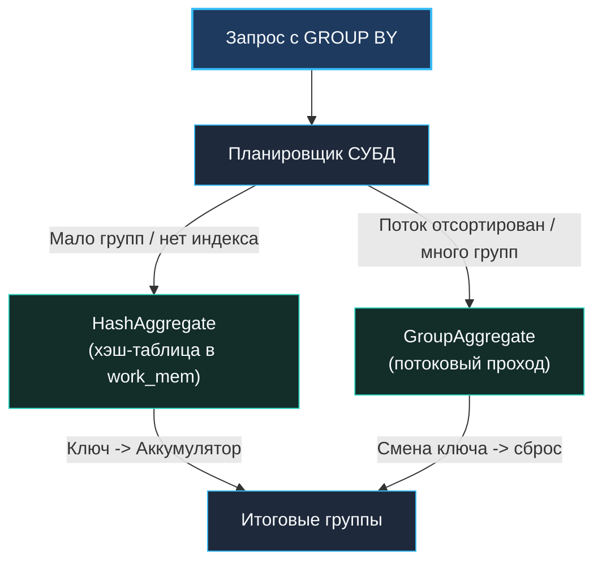

*Как сворачивать миллионы проводок на стороне базы данных, выбирать между HashAgg и SortAgg и не падать при сканировании пустого `SUM()` в Go.*

> «Сборка мусора — огромное подспорье при написании корректных программ, но она не избавляет вас от необходимости думать о памяти. Вам не нужно выделять и освобождать память вручную, однако для написания эффективного кода всё равно приходится понимать время жизни переменных.»  
> — Алан Донован, Брайан Керниган, *The Go Programming Language*

Предыдущие главы учили нас извлекать, фильтровать и соединять отдельные строки. Но финансовому дашборду или сервису лимитов редко нужны миллионы сырых проводок из `ledger_entries`. Бизнес задаёт агрегированные вопросы: каков суммарный оборот по каждой валюте, сколько транзакций прошло за сутки, какой максимальный платёж прошёл по счёту.

Начинающие разработчики часто поддаются соблазну «императивного комфорта»: выгружают массив сырых чисел запросом `SELECT amount FROM ledger_entries WHERE account_id = $1` в слайс `[]int64` в памяти Go и складывают элементы обычным циклом `for`.

С точки зрения устройства машины это тяжёлая ошибка сразу по двум причинам:

1. **Сетевой оверхед.** Вместо одного 8-байтового числа `int64` база сериализует и гонит по TCP десятки мегабайт строк, нагружая буферы сокетов ядра Linux и драйвер.
2. **Память и сборщик мусора Go.** Рантайм вынужден выделять крупные буферы в куче под миллион временных значений. Как только функция подсчёта завершится, эта память станет мусором, провоцируя частые циклы разметки (*Mark Phase*) и рост хвостовых задержек сервиса.

Реляционные СУБД созданы для редукции данных. Операция свёртки должна выполняться там, где лежат 8-килобайтные страницы с данными — внутри процессора сервера базы данных.

---

## Базовые агрегатные функции

Стандарт SQL предоставляет пять основных агрегатных функций:

* `COUNT(...)` — количество строк или непустых значений;
* `SUM(expr)` — сумма значений;
* `AVG(expr)` — среднее арифметическое;
* `MIN(expr)` и `MAX(expr)` — минимальное и максимальное значения.

Все агрегатные функции (кроме `COUNT(*)`) **игнорируют значения `NULL`** при вычислении.

> [!tip] Собеседование [Middle]
> **Вопрос:** В чём разница между `COUNT(*)`, `COUNT(1)` и `COUNT(description)` на уровне выполнения запроса?  
> **Ответ:**
> * **`COUNT(*)` и `COUNT(1)`** в PostgreSQL работают идентично: они считают общее количество строк, прошедших фильтр `WHERE` и видимых текущей транзакции по правилам MVCC. Движок даже не распаковывает значения отдельных столбцов кортежа.
> * **`COUNT(description)`** считает только те строки, где `description IS NOT NULL`. Для каждой строки ядро вынуждено проверять битовую карту пустых значений (*null bitmap*) кортежа и сам столбец.
>
> Если цель — узнать число строк в группе, всегда пишите `COUNT(*)`. Это яснее выражает намерение и не заставляет читателя гадать, может ли столбец внутри `COUNT(col)` содержать `NULL`. (Когда нужно подсчитать лишь уникальные значения, используют `COUNT(DISTINCT col)` — подробнее о `DISTINCT` см. главу 13 этого модуля.)

---

## Механика GROUP BY и железное правило SELECT

Без предложения `GROUP BY` агрегатные функции сворачивают всю выборку в одну итоговую строку. Чтобы получить срез по счетам или валютам, используют `GROUP BY`:

```sql
SELECT
    account_id,
    currency,
    COUNT(*)    AS entries_count,
    SUM(amount) AS net_flow,
    MAX(amount) AS max_credit
FROM ledger_entries
GROUP BY account_id, currency
ORDER BY account_id;
```

СУБД разбивает поток строк, прошедших `WHERE`, на группы эквивалентности по паре `(account_id, currency)` и вычисляет агрегаты независимо для каждой корзины.

### Железное правило столбцов в SELECT

В запросе с `GROUP BY` любой столбец в блоке `SELECT` обязан либо **быть перечислен в `GROUP BY`**, либо **находиться внутри агрегатной функции**.

Попытка добавить непривязанный столбец `created_at` немедленно завершится ошибкой компиляции:

```sql
-- ОШИБКА: column "ledger_entries.created_at" must appear in the GROUP BY clause
-- or be used in an aggregate function
SELECT account_id, created_at, SUM(amount)
FROM ledger_entries
GROUP BY account_id;
```

Причина очевидна: у одного `account_id` в группе могут лежать тысячи проводок с разными метками `created_at`. База не имеет права угадывать, какую именно из этих тысяч дат показать в одной итоговой строке группы.

*(Историческая справка: старые версии MySQL до 5.7 по умолчанию разрешали нарушать это правило, возвращая случайное значение с первой попавшейся страницы данных. В финансовых и аналитических отчётах это порождало трудноуловимые расхождения, поэтому начиная с MySQL 5.7 режим `ONLY_FULL_GROUP_BY` включён по умолчанию.)*

---

## Под капотом: HashAgg против SortAgg

Когда планировщик СУБД видит `GROUP BY`, он выбирает один из двух физических алгоритмов агрегации (в Модуле 4 вы научитесь видеть их в выводе `EXPLAIN ANALYZE`).



### 1. Hash Aggregation (`HashAggregate`)

СУБД читает входные строки за один проход и держит в оперативной памяти (в лимите `work_mem`) хэш-таблицу. Ключом в ней служит ключ группировки (например, `account_id`), а значением — внутреннее состояние аккумулятора (`count`, текущая `sum`). Для каждой строки ядро за `O(1)` находит нужный слот и обновляет аккумулятор.

* **Плюс:** линейная сложность `O(N)` без предварительной сортировки.
* **Риск для памяти:** если уникальных групп слишком много (высокая кардинальность, например миллионы отдельных транзакций), хэш-таблица не вмещается в `work_mem`. СУБД вынуждена сбрасывать промежуточные батчи во временные файлы на диск (**Spill to Disk**), и задержка подскакивает на порядки — от 100 нс доступа к RAM к сотням микросекунд и миллисекундам дискового ввода-вывода.

### 2. Stream / Group Aggregation (`GroupAggregate`)

Если входной поток уже отсортирован по ключу группировки (например, считывается из B-Tree индекса по `account_id` или прошёл узел `Sort`), ядро просто идёт по строкам подряд. Пока `account_id` не меняется, аккумулятор накапливает сумму; как только встретился новый `account_id`, база отдаёт готовую строку наружу и сбрасывает счётчик.

* **Плюс:** требует строго **`O(1)` оперативной памяти** — в RAM в любой момент лежит ровно один текущий аккумулятор, независимо от того, сколько миллионов групп в таблице.
* **Минус:** при отсутствии подходящего индекса придётся сначала отсортировать поток за `O(N log N)`.

---

## Идиомы Go 1.24: ловушка пустого SUM() и типа AVG()

Интеграция агрегатных запросов в Go скрывает два неприятных сюрприза системы типов.

Рассмотрим функцию подсчёта суммы всех поступлений по счёту `account_id`:

```go
func GetTotalCreditsBroken(ctx context.Context, db *sql.DB, accountID int64) (int64, error) {
	const query = `
		SELECT SUM(amount)
		FROM ledger_entries
		WHERE account_id = $1 AND amount > 0`

	var total int64
	err := db.QueryRowContext(ctx, query, accountID).Scan(&total)
	if err != nil {
		return 0, fmt.Errorf("scan total credits: %w", err)
	}
	return total, nil
}
```

> [!warning] Ловушка: SUM(), AVG(), MIN() и MAX() над пустым множеством дают NULL
> Представьте свежесозданный счёт, по которому ещё **нет ни одной приходной проводки**. Фильтр `WHERE` отсечёт 100% строк.
>
> Здравый смысл ждёт `0`, но стандарт SQL предписывает иное: `COUNT(*)` вернёт `0`, а вот `SUM()`, `AVG()`, `MIN()` и `MAX()` без `GROUP BY` на пустом множестве возвращают одну строку со значением **`NULL`**.
>
> Вызов `.Scan(&total)` в обычный `int64` немедленно упадёт с ошибкой драйвера:
> `sql: Scan error on column index 0, name "sum": converting NULL to int64 is unsupported`.

### Два корректных решения в Go

**Способ 1: `COALESCE` на стороне SQL (рекомендуется для большинства случаев).** Мы просим саму СУБД заменить `NULL` на доменный ноль (подробнее о `COALESCE` и `NULLIF` см. главу 12 этого модуля):

```go
func GetTotalCredits(ctx context.Context, db *sql.DB, accountID int64) (int64, error) {
	const query = `
		SELECT COALESCE(SUM(amount), 0)
		FROM ledger_entries
		WHERE account_id = $1 AND amount > 0`

	var total int64
	if err := db.QueryRowContext(ctx, query, accountID).Scan(&total); err != nil {
		return 0, fmt.Errorf("get total credits for account %d: %w", accountID, err)
	}
	return total, nil
}
```

Заметьте также: в PostgreSQL функция `SUM(bigint)` возвращает тип `numeric` (чтобы избежать переполнения 64-битного целого при сложении миллионов больших чисел), но драйверы Go (`pgx`, `lib/pq`) умеют сканировать целое значение без дробной части в `int64`, если сумма помещается в диапазон `int64`. А вот с `AVG(amount)` по столбцу `BIGINT` база вернёт `numeric` с дробной частью (например, `150.500000000`), и прямое сканирование в `int64` не сработает — используйте `COALESCE(ROUND(AVG(amount)), 0)::bigint` или сканируйте в `float64` с приведением `::float8`.

**Способ 2: `sql.NullInt64` на стороне Go.** Нужен тогда, когда приложению важно отличать «проводок не было вообще» от «проводки были, и их сумма равна нулю» (в двойной записи такое бывает постоянно):

```go
func GetNetBalanceByEntries(ctx context.Context, db *sql.DB, accountID int64) (total int64, hasEntries bool, err error) {
	const query = `SELECT SUM(amount) FROM ledger_entries WHERE account_id = $1`

	var sum sql.NullInt64
	if err := db.QueryRowContext(ctx, query, accountID).Scan(&sum); err != nil {
		return 0, false, fmt.Errorf("get net balance: %w", err)
	}
	if !sum.Valid {
		return 0, false, nil
	}
	return sum.Int64, true, nil
}
```

---

## Упражнения

### Базовое
Откройте схему `LedgerPulse` (`001_init_ledger.sql`). Напишите SQL-запрос, который по таблице `accounts` вычисляет для каждой валюты (`currency`):
1. Общее количество счетов (`total_accounts`);
2. Суммарный баланс по всем активным счетам (`status = 'active'`);
3. Минимальный и максимальный баланс среди этих активных счетов.
Отсортируйте вывод по убыванию суммарного баланса.

> [!solution] Показать решение
> ```sql
> SELECT
>     currency,
>     COUNT(*)     AS total_accounts,
>     SUM(balance) AS total_balance,
>     MIN(balance) AS min_balance,
>     MAX(balance) AS max_balance
> FROM accounts
> WHERE status = 'active'
> GROUP BY currency
> ORDER BY total_balance DESC;
> ```
> Условие `status = 'active'` в `WHERE` отсекает замороженные и закрытые счета до группировки. Обратите внимание: если в таблице вообще нет активных счетов в какой-либо валюте, при `GROUP BY currency` строка для этой валюты просто не появится в результате (в отличие от запроса без `GROUP BY`, который вернул бы одну строку с `NULL`).

### Практическое
Постройте ежедневную сводку по проведённым транзакциям в `LedgerPulse`: для каждого дня (`DATE_TRUNC('day', e.created_at)`) и каждой валюты (`e.currency`) подсчитайте количество уникальных транзакций (`COUNT(DISTINCT e.transaction_id)`), общий объём прихода (только `e.amount > 0` — пока без `CASE`, отфильтруйте в `WHERE`) и среднюю сумму такой проводки, округлённую до целых копеек (`BIGINT`). Соедините `ledger_entries` с `transactions`, чтобы учитывать только транзакции со статусом `'posted'`.

> [!solution] Показать решение
> ```sql
> SELECT
>     DATE_TRUNC('day', e.created_at) AS entry_day,
>     e.currency,
>     COUNT(DISTINCT e.transaction_id) AS posted_tx_count,
>     SUM(e.amount)                    AS total_inflow,
>     ROUND(AVG(e.amount))::bigint     AS avg_inflow
> FROM ledger_entries e
> INNER JOIN transactions t ON t.id = e.transaction_id
> WHERE t.status = 'posted'
>   AND e.amount > 0
> GROUP BY DATE_TRUNC('day', e.created_at), e.currency
> ORDER BY entry_day DESC, e.currency;
> ```
> Здесь в `GROUP BY` указано то же выражение `DATE_TRUNC('day', e.created_at)`, что и в `SELECT` — иначе PostgreSQL выдаст ошибку, что не может сгруппировать по выражению с `e.created_at`. Приведение `::bigint` превращает `numeric` от `ROUND(AVG(...))` в целое число, удобное для сканирования в `int64` в Go.

### Со звёздочкой (*)
В двойной записи `LedgerPulse` каждая проведённая транзакция должна иметь нулевую сумму проводок (`SUM(amount) = 0`). Инженер написал функцию на Go для регулярного ночного аудита сверки баланса одной транзакции:
```go
func CheckTransactionBalance(ctx context.Context, db *sql.DB, txID int64) (int64, error) {
	var diff int64
	err := db.QueryRowContext(ctx,
		`SELECT SUM(amount) FROM ledger_entries WHERE transaction_id = $1`,
		txID,
	).Scan(&diff)
	return diff, err
}
```
1. Что произойдёт, если передать сюда `txID` транзакции в статусе `'pending'`, у которой ещё нет ни одной проводки в `ledger_entries`?
2. Почему простая замена на `COALESCE(SUM(amount), 0)` сделает этот аудит **логически опасным**? Как написать корректный запрос и Go-код, чтобы различать: «проводки сошлись в ноль», «проводки разошлись» и «проводок у транзакции вообще нет»?

> [!solution] Показать решение
> 1. Для транзакции без проводок `SUM(amount)` вернёт `NULL`, и `.Scan(&diff)` упадёт с ошибкой конвертации `NULL` в `int64`.
> 2. Если просто обернуть в `COALESCE(SUM(amount), 0)`, транзакция вообще без проводок вернёт `diff = 0`, и аудит ошибочно решит, что баланс сошёлся, хотя денег по транзакции не проводилось вовсе.
>
> **Корректный вариант:** вернуть и счётчик строк, и сумму (либо использовать `sql.NullInt64`):
> ```go
> var ErrNoEntries = errors.New("transaction has no ledger entries")
>
> func CheckTransactionBalance(ctx context.Context, db *sql.DB, txID int64) (int64, error) {
> 	const query = `
> 		SELECT COUNT(*), COALESCE(SUM(amount), 0)
> 		FROM ledger_entries
> 		WHERE transaction_id = $1`
>
> 	var cnt, diff int64
> 	if err := db.QueryRowContext(ctx, query, txID).Scan(&cnt, &diff); err != nil {
> 		return 0, fmt.Errorf("check tx %d balance: %w", txID, err)
> 	}
> 	if cnt == 0 {
> 		return 0, fmt.Errorf("%w: tx_id=%d", ErrNoEntries, txID)
> 	}
> 	return diff, nil
> }
> ```
> Теперь `cnt == 0` чётко отделяется от случая `cnt >= 2 && diff == 0`.

---

## Мостик к следующему уроку

Мы научились сворачивать строки в группы через `GROUP BY` и аккуратно передавать агрегаты в Go.

Но почти сразу возникает следующая задача: как оставить только те группы, где агрегат перешагнул порог? Например, найти транзакции в `LedgerPulse`, у которых нарушен баланс (`SUM(amount) <> 0`), или счета с оборотом выше 1 000 000 копеек. Попытка написать `WHERE SUM(amount) <> 0` упрётся в жёсткую ошибку синтаксиса. Почему так устроен конвейер SQL и как работать с пост-фильтрацией групп — разбираем в следующей главе: [[8. HAVING — фильтрация групп после агрегации]].
