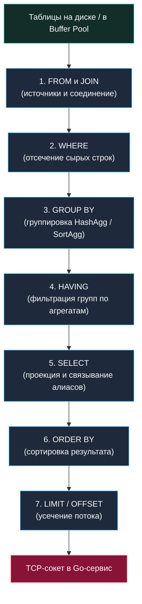

*Почему предикат `WHERE` запрещает агрегатные функции, в каком порядке движок СУБД прогоняет фазы запроса и сколько памяти стоит ошибка выбора между `WHERE` и `HAVING`.*

> «Память часто была самым дорогим компонентом компьютера. Когда на счету был каждый байт, этот дефицит навязывал программистам особую дисциплину: приходилось постоянно отдавать себе отчёт, сколько памяти занимает программа...»  
> — Брайан Керниган, *UNIX: A History and a Memoir*

В [[7. GROUP BY и агрегатные функции]] мы свернули миллионы проводок в аккуратные сводки по счетам. Но финансовому мониторингу `LedgerPulse` редко нужен весь список счетов. Типичная задача звучит иначе: *найти только те счета, чей приходный оборот превысил 10 000 000 копеек, или выявить транзакции, у которых сумма проводок разошлась с нулём*.

Первое интуитивное желание после главы [[3. WHERE и фильтрация строк]] — дописать условие прямо в `WHERE`:

```sql
-- ОШИБКА: агрегат в WHERE невозможен
SELECT account_id, SUM(amount) AS total_inflow
FROM ledger_entries
WHERE amount > 0 AND SUM(amount) > 10000000
GROUP BY account_id;
```

PostgreSQL, MySQL и SQLite немедленно отклонят такой запрос: `ERROR: aggregate functions are not allowed in WHERE`.

Причина лежит в устройстве реляционного конвейера: на шаге `WHERE` движок проверяет **каждую отдельную строку** до того, как строки вообще собрались в группы и просуммировались. Нельзя отфильтровать число, которое ещё не вычислено. Для фильтрации уже готовых групп в SQL существует отдельный оператор **`HAVING`**:

```sql
SELECT account_id, SUM(amount) AS total_inflow
FROM ledger_entries
WHERE amount > 0
GROUP BY account_id
HAVING SUM(amount) > 10000000;
```

---

## Логический порядок выполнения SQL-запроса

Чтобы читать планы запросов без угадывания, инженер обязан различать **лексический порядок** (как запрос написан в `.sql`-файле, начиная с `SELECT`) и **логический порядок** (как СУБД вычисляет результат шаг за шагом).



Пройдём по всем семи ступеням:

1. **`FROM` и `JOIN`** — собирают исходные отношения и соединяют их по предикатам `ON`.
2. **`WHERE`** — отбрасывает отдельные сырые строки до группировки. Именно здесь работают B-Tree индексы.
3. **`GROUP BY`** — раскладывает уцелевшие строки по корзинам и вычисляет агрегатные аккумуляторы.
4. **`HAVING`** — оставляет только те группы, для которых предикат над агрегатом истинен.
5. **`SELECT`** — формирует итоговые столбцы, вычисляет выражения проекции и регистрирует их псевдонимы (алиасы).
6. **`ORDER BY`** — сортирует уже готовые строки (поэтому в `ORDER BY` можно ссылаться на алиасы из `SELECT`).
7. **`LIMIT` / `OFFSET`** — отсекает лишние строки в самом конце.

> [!warning] Ловушка алиасов в HAVING
> Из-за того, что `HAVING` (шаг 4) выполняется **раньше** `SELECT` (шаг 5), попытка использовать алиас из `SELECT` внутри `HAVING` в PostgreSQL и строгом стандарте ANSI SQL проваливается:
> ```sql
> -- ОШИБКА в PostgreSQL: column "total_inflow" does not exist
> SELECT account_id, SUM(amount) AS total_inflow
> FROM ledger_entries
> WHERE amount > 0
> GROUP BY account_id
> HAVING total_inflow > 10000000;
> ```
> На этапе 4 имя `total_inflow` ещё не существует в таблице символов запроса. Некоторые диалекты вроде MySQL делают исключение и переписывают дерево запроса, подставляя формулу за вас, но такой код непереносим. Пишите агрегат в `HAVING` явно: `HAVING SUM(amount) > 10000000`. (По той же логике не стоит ожидать, что алиас из `SELECT` будет виден в `WHERE` или `GROUP BY`.)

---

## Физика ресурсов: WHERE против HAVING

Граница между `WHERE` и `HAVING` напрямую определяет объём дискового I/O, нагрузку на CPU и потребление оперативной памяти `work_mem`.

Допустим, нужно найти валюты в таблице `accounts`, где открыто более 10 **активных** счетов (`status = 'active'`). В строгом SQL нельзя написать `GROUP BY currency HAVING status = 'active'`, так как `status` не входит в `GROUP BY`. Но если разработчик добавил `status` в группировку и перенёс проверку статуса в `HAVING`, запрос скомпилируется — и тихо создаст проблему производительности:

```sql
-- АНТИПАТТЕРН: поздняя фильтрация неагрегированного столбца в HAVING
SELECT currency, COUNT(*) AS active_cnt
FROM accounts
GROUP BY currency, status
HAVING status = 'active' AND COUNT(*) > 10;
```

Что происходит под капотом:
1. СУБД читает с диска в `shared_buffers` **все** строки `accounts`, включая тысячи замороженных и закрытых счетов.
2. Механизм `HashAggregate` аллоцирует память в `work_mem`, строит группы для всех комбинаций `(currency, status)` и честно считает все счётчики.
3. Только на шаге 4 `HAVING` выбрасывает группы со статусами `'frozen'` и `'closed'` — весь труд по их чтению и подсчёту уходит впустую. Если таблица большая, раздутая хэш-таблица может не поместиться в `work_mem` и уйти во временные файлы на диск (**Spill to Disk**).

Теперь перенесём проверку статуса на положенное ей место — в `WHERE`:

```sql
-- СТАНДАРТ: раннее отсечение сырых строк через WHERE
SELECT currency, COUNT(*) AS active_cnt
FROM accounts
WHERE status = 'active'
GROUP BY currency
HAVING COUNT(*) > 10;
```

Планировщик получает шанс отсечь неактивные счета через индекс на этапе `WHERE`, в хэш-таблицу `HashAggregate` попадает минимум строк, память остаётся в пределах быстрого кэша RAM (~100 нс на доступ вместо ~100 мкс на SSD), а `HAVING` проверяет только условие по агрегату `COUNT(*) > 10`.

> [!tip] Собеседование [Middle]
> **Вопрос:** Валиден ли в SQL запрос с `HAVING`, но без `GROUP BY`? Что он вернёт?  
> **Ответ:** Абсолютно валиден. Если `GROUP BY` опущен, а в запросе есть агрегат и `HAVING`, СУБД рассматривает всю выборку после `WHERE` как **одну-единственную глобальную группу**.
> Например, проверка одного перевода в `LedgerPulse`:
> ```sql
> SELECT SUM(amount) AS imbalance
> FROM ledger_entries
> WHERE transaction_id = $1
> HAVING SUM(amount) <> 0;
> ```
> Если сумма проводок равна нулю (или проводок нет и `SUM(amount)` равен `NULL`, а сравнение `NULL <> 0` даёт `UNKNOWN`), запрос вернёт **0 строк**. Если же баланс нарушен, вернётся ровно 1 строка с величиной расхождения.

---

## Антипаттерн в Go: эмуляция HAVING в приложении

Иногда разработчики рассуждают так: «Не буду усложнять SQL, вытащу суммы по всем счетам и отфильтрую нужные в Go обычным `if`».

```go
// АНТИПАТТЕРН: перекачиваем тысячи лишних групп по сети ради фильтрации в Go
func FindHighVolumeAccountsSlow(ctx context.Context, db *sql.DB, minInflow int64) ([]int64, error) {
	rows, err := db.QueryContext(ctx, `
		SELECT account_id, SUM(amount)
		FROM ledger_entries
		WHERE amount > 0
		GROUP BY account_id`)
	if err != nil {
		return nil, err
	}
	defer rows.Close()

	var ids []int64
	for rows.Next() {
		var accID, total int64
		if err := rows.Scan(&accID, &total); err != nil {
			return nil, err
		}
		// Эмуляция HAVING в коде Go
		if total > minInflow {
			ids = append(ids, accID)
		}
	}
	return ids, rows.Err()
}
```

Почему этот код вредит системе:

1. **Network I/O.** База сериализует и отправляет по TCP данные сотен тысяч счетов с оборотом ниже порога, забивая сеть.
2. **CPU на декодировании.** Для каждой отброшенной строки драйвер и `rows.Scan` разбирают протокол, проверяют типы и копируют значения.
3. **Давление на память.** Если в Go-обработчик попадает много данных, промежуточные буферы чтения и растущий слайс провоцируют лишние аллокации и работу сборщика мусора.

Передавая порог параметром `$1` прямо в `HAVING`, мы заставляем СУБД вернуть только подходящие `account_id`:

```go
func FindHighVolumeAccounts(ctx context.Context, db *sql.DB, minInflow int64) ([]int64, error) {
	const query = `
		SELECT account_id
		FROM ledger_entries
		WHERE amount > 0
		GROUP BY account_id
		HAVING SUM(amount) > $1
		ORDER BY SUM(amount) DESC`

	rows, err := db.QueryContext(ctx, query, minInflow)
	if err != nil {
		return nil, fmt.Errorf("find high volume accounts: %w", err)
	}
	defer rows.Close()

	var ids []int64
	for rows.Next() {
		var id int64
		if err := rows.Scan(&id); err != nil {
			return nil, fmt.Errorf("scan account id: %w", err)
		}
		ids = append(ids, id)
	}
	if err := rows.Err(); err != nil {
		return nil, fmt.Errorf("iterate account ids: %w", err)
	}
	return ids, nil
}
```

Если из 500 000 счетов порог перешагнули только 12, по сети уйдут 12 восьмибайтовых чисел вместо полумиллиона строк. Как проверить план выполнения такого запроса через `EXPLAIN ANALYZE`, мы разберём в Модуле 4.

---

## Упражнения

### Базовое
Прочитайте запрос и найдите две ошибки (синтаксическую и производительную), не запуская его в СУБД:
```sql
SELECT
    currency,
    COUNT(*) AS cnt,
    SUM(balance) AS total_bal
FROM accounts
GROUP BY currency, status
HAVING status = 'active'
   AND total_bal > 5000000;
```
Перепишите запрос в корректной и быстрой форме.

> [!solution] Показать решение
> 1. **Синтаксическая ошибка (в PostgreSQL):** алиас `total_bal` объявлен в `SELECT` (шаг 5), а используется в `HAVING` (шаг 4). СУБД выдаст ошибку `column "total_bal" does not exist`. Нужно явно написать `SUM(balance) > 5000000`.
> 2. **Ошибка производительности:** условие `status = 'active'` не зависит от агрегата, но вынесено в `HAVING` (и ради этого `status` добавлен в `GROUP BY`). Из-за этого СУБД считывает и агрегирует замороженные и закрытые счета впустую.
>
> **Исправленный запрос:**
> ```sql
> SELECT
>     currency,
>     COUNT(*)     AS cnt,
>     SUM(balance) AS total_bal
> FROM accounts
> WHERE status = 'active'
> GROUP BY currency
> HAVING SUM(balance) > 5000000;
> ```

### Практическое
Напишите SQL-запрос для ночного сверщика `LedgerPulse`, который находит **все транзакции со статусом `'posted'`**, нарушающие инвариант двойной записи — либо сумма их проводок `SUM(e.amount)` не равна нулю, либо у транзакции меньше двух проводок (`COUNT(*) < 2`). Выведите `t.id`, `t.reference_id`, число проводок и сумму дисбаланса. (Подсказка: подумайте, какой `JOIN` нужен, если у `'posted'` транзакции по ошибке вообще 0 строк в `ledger_entries`.)

> [!solution] Показать решение
> Используем `LEFT JOIN` от `transactions` к `ledger_entries`, чтобы не потерять «пустые» транзакции без проводок:
> ```sql
> SELECT
>     t.id,
>     t.reference_id,
>     COUNT(e.id)              AS entry_count,
>     COALESCE(SUM(e.amount), 0) AS imbalance
> FROM transactions t
> LEFT JOIN ledger_entries e ON e.transaction_id = t.id
> WHERE t.status = 'posted'
> GROUP BY t.id, t.reference_id
> HAVING COUNT(e.id) < 2
>     OR COALESCE(SUM(e.amount), 0) <> 0;
> ```
> Обратите внимание на две тонкости: `COUNT(e.id)` считает реальные строки проводок (для транзакции без проводок вернёт `0`, в отличие от `COUNT(*)`, который вернул бы `1` из-за строки левой таблицы с `NULL` справа), а `COALESCE(SUM(e.amount), 0)` страхует от `NULL` в `imbalance`.

### Со звёздочкой (*)
Антифрод-сервис `LedgerPulse` ищет подозрительную активность: нужно найти пары `(account_id, currency)` в таблице `ledger_entries` за последние 24 часа (`created_at >= now() - interval '24 hours'`), по которым прошло **не менее 5 списаний** (`amount < 0`), а суммарный объём списаний по модулю превысил `1_000_000` (то есть `SUM(amount) < -1000000`), **и при этом** максимальное разовое списание по модулю не превышало `250_000` (дробление крупного вывода — *smurfing*).
Напишите один SQL-запрос с `WHERE`, `GROUP BY` и `HAVING` и объясните, какое условие должно стоять в `WHERE`, а какие — в `HAVING`.

> [!solution] Показать решение
> ```sql
> SELECT
>     account_id,
>     currency,
>     COUNT(*)        AS debit_count,
>     ABS(SUM(amount)) AS total_debit,
>     ABS(MIN(amount)) AS max_single_debit
> FROM ledger_entries
> WHERE created_at >= now() - interval '24 hours'
>   AND amount < 0
> GROUP BY account_id, currency
> HAVING COUNT(*) >= 5
>    AND SUM(amount) < -1000000
>    AND MIN(amount) >= -250000;
> ```
> * В **`WHERE`** вынесены построчные фильтры (`created_at` и `amount < 0`): они отсекают старые периоды и приходные проводки до группировки.
> * В **`HAVING`** стоят три агрегатных критерия по группе: число списаний `COUNT(*) >= 5`, суммарный отток `SUM(amount) < -1000000` и ограничение на самый крупный отрицательный платёж `MIN(amount) >= -250000` (поскольку списания отрицательны, самое крупное по модулю списание — это математический `MIN(amount)`).

---

## Мостик к следующему уроку

Мы разобрались с логическим конвейером SQL и научились фильтровать как сырые строки в `WHERE`, так и готовые агрегаты в `HAVING`.

Но что делать, если порог фильтрации не задан заранее жёсткой константой из Go, а сам зависит от данных в базе — например, найти счета, чей баланс выше среднего по их валюте, или вывести для каждого счёта дату его последней проводки? Для таких задач один запрос встраивается внутрь другого. Как работают скалярные, табличные и коррелированные подзапросы, операторы `ANY`/`ALL` и почему небрежный подзапрос превращается во вложенный цикл `O(N * M)` — разбираем в следующей главе: [[9. Подзапросы — скалярные, табличные и коррелированные]].
