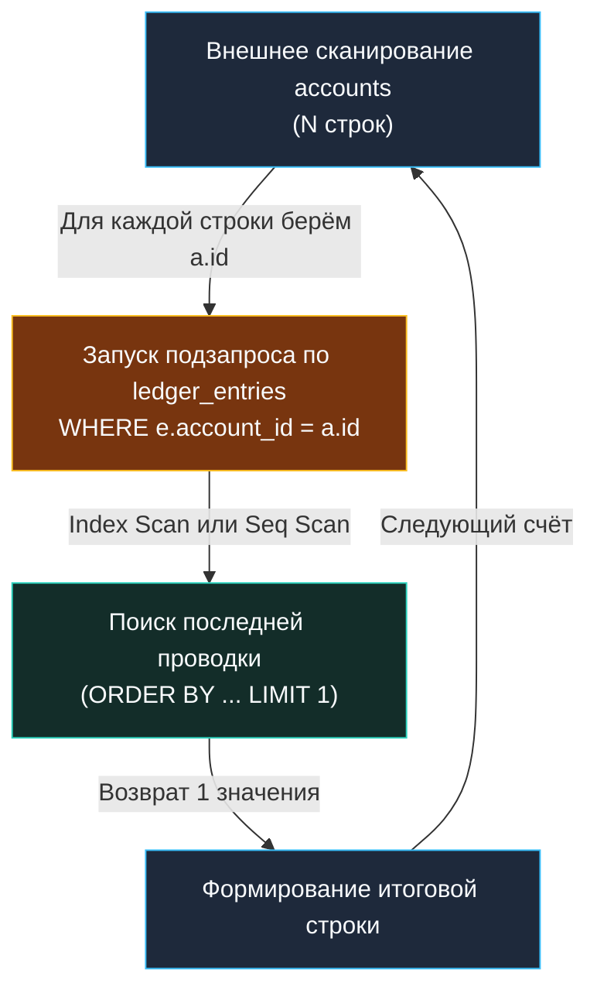

*Как композиция запросов через свойство замкнутости спасает сетевой трафик Go, где прячутся ловушки `ANY`/`ALL` и когда коррелированный подзапрос вырождается в цикл `O(N * M)`.*

> «Гениальность конвейера Unix именно в том, что он собирается из тех самых команд, которыми постоянно пользуются поодиночке. Чтобы разглядеть эту возможность и придумать для неё запись, действительно требовался огромный скачок мысли.»  
> — Деннис Ритчи, *«The Evolution of the Unix Time-sharing System»*

В [[8. HAVING — фильтрация групп после агрегации]] мы отбирали группы по жёсткому числу из Go-параметра `$1`. Но в реальной работе порог часто живёт внутри самой базы: например, *найти счета в `LedgerPulse`, чей баланс выше среднего баланса по их же валюте*, или *получить дату последней проводки для каждого счёта*.

Наивный путь — сделать один запрос за средним балансом, вытащить число в Go, а затем вторым запросом подставить его в `WHERE`. Этот путь порождает лишний сетевой раунд-трип и теряет консистентность снимка данных между двумя запросами.

Реляционная модель Эдгара Кодда (см. [[4. Реляционная модель данных — отношения, кортежи и множества]]) обладает свойством **замкнутости (*closure*)**: результат любого запроса к таблице сам образует новую таблицу. Благодаря этому один `SELECT` можно встроить внутрь другого туда, где синтаксис ждёт таблицу, список или одиночное значение. Такое вложенное выражение называют **подзапросом (*Subquery*)**.

---

## Типология подзапросов

По форме возвращаемого результата подзапросы делятся на три класса.

### 1. Скалярные подзапросы (1 строка × 1 столбец)

Скалярный подзапрос возвращает ровно одно значение, и СУБД обращается с ним как с обычной константой. Его можно поставить в `SELECT`, `WHERE` или `HAVING`:

```sql
-- Счета в RUB с балансом выше среднего среди активных рублёвых счетов
SELECT id, external_id, owner_name, balance
FROM accounts
WHERE currency = 'RUB'
  AND balance > (
      SELECT AVG(balance)
      FROM accounts
      WHERE currency = 'RUB' AND status = 'active'
  );
```

> [!warning] Ловушка: ошибка времени выполнения при нескольких строках
> Если скалярный подзапрос без агрегатной функции вдруг вернёт больше одной строки, СУБД не выберет первую попавшуюся, а немедленно прервёт запрос ошибкой:
> `ERROR: more than one row returned by a subquery used as an expression`.
> Если в вашей бизнес-логике совпадений может быть несколько, обязательно ограничивайте подзапрос детерминированной парой `ORDER BY ... LIMIT 1`. (А если строк не нашлось вовсе, скалярный подзапрос вычислится в `NULL`.)

### 2. Табличные подзапросы во FROM (Derived Tables)

Когда подзапрос возвращает таблицу со строками и столбцами, его можно подставить в секцию `FROM` или в `JOIN` как временное отношение — **производную таблицу (*Derived Table*)**:

```sql
-- Сначала сворачиваем проводки по счетам, потом присоединяем данные владельцев
SELECT
    a.id,
    a.external_id,
    a.owner_name,
    COALESCE(stat.tx_count, 0)   AS tx_count,
    COALESCE(stat.net_flow, 0)   AS net_flow
FROM accounts a
LEFT JOIN (
    SELECT
        account_id,
        COUNT(*)    AS tx_count,
        SUM(amount) AS net_flow
    FROM ledger_entries
    GROUP BY account_id
) AS stat ON stat.account_id = a.id;
```

Предварительная агрегация внутри производной таблицы решает частую проблему `JOIN`: мы не раздуваем строки счетов перед суммированием и избавляемся от необходимости тащить `a.owner_name` в `GROUP BY`.

Обязательное требование SQL: каждой производной таблице во `FROM` должен быть назначен псевдоним (в примере выше — `stat`), иначе парсер вернёт синтаксическую ошибку. Когда таких блоков в запросе два-три, их выносят в именованные выражения `WITH` (CTE) — с них начнётся Модуль 3.

### 3. Списки и квантификаторы IN, ANY и ALL

Если подзапрос возвращает один столбец и множество строк ($N \times 1$), его используют в предикатах `IN`, `ANY` (синоним `SOME`) и `ALL`:

* `x = ANY (subquery)` — истина, если `x` равен **хотя бы одному** значению из подзапроса (по смыслу полностью эквивалентен `x IN (subquery)`).
* `x > ANY (subquery)` — истина, если `x` больше хотя бы одного значения (то есть больше минимума выборки).
* `x > ALL (subquery)` — истина, если `x` строго больше **каждого** значения из подзапроса (то есть больше максимума выборки).

```sql
-- Счета в USD, чей баланс строго больше баланса каждого счёта в EUR
SELECT id, external_id, balance
FROM accounts
WHERE currency = 'USD'
  AND balance > ALL (
      SELECT balance
      FROM accounts
      WHERE currency = 'EUR' AND status = 'active'
  );
```

Квантификаторы `ANY` и `ALL` коварны на двух краевых случаях:
1. **Пустой подзапрос.** Если активных счетов в `EUR` нет, условие `balance > ANY (пусто)` вернёт `FALSE` (ни одного совпадения), а `balance > ALL (пусто)` вернёт **`TRUE`** (пустое множество не дало ни одного контрпримера).
2. **Присутствие `NULL`.** Если в результате подзапроса попался хотя бы один `NULL`, выражение `balance <> ALL (subquery)` (как и `NOT IN`) раскладывается в серию `AND`, где один из членов равен `UNKNOWN`. Весь предикат перестаёт давать `TRUE`, и запрос возвращает 0 строк. Подробно эту ловушку с `NOT IN` и сравнение с `EXISTS` мы разберём в следующей, 10-й главе.

*(На заметку для Go: в PostgreSQL и драйвере `pgx` оператор `= ANY($1)` умеет принимать одномерный слайс Go прямо одним параметром, избавляя от ручной генерации плейсхолдеров `IN ($1, $2, ...)`.)*

---

## Некоррелированные против коррелированных подзапросов

По связи с внешним запросом подзапросы делятся на два лагеря, и разница между ними может означать падение времени ответа с 2 миллисекунд до минут.

### Некоррелированный подзапрос

Внутренний `SELECT` полностью автономен и не упоминает столбцы внешних таблиц — как `SELECT AVG(balance) FROM accounts ...` из первого примера. Оптимизатор выполняет его **ровно один раз** перед основным сканированием, кеширует полученный результат в памяти (узел `InitPlan` в плане PostgreSQL) и подставляет готовую константу при проверке каждой строки. Суммарная сложность остаётся линейной: $O(N + M)$.

### Коррелированный подзапрос

Коррелированный подзапрос прямо ссылается на текущую строку внешнего запроса:

```sql
-- Для каждого счёта найти сумму его последней по времени проводки
SELECT
    a.id,
    a.external_id,
    (
        SELECT e.amount
        FROM ledger_entries e
        WHERE e.account_id = a.id -- Привязка к внешней строке a
        ORDER BY e.created_at DESC, e.id DESC
        LIMIT 1
    ) AS last_entry_amount
FROM accounts a;
```

Без оптимизации такой подзапрос ведёт себя точно так же, как вложенный цикл `for` в коде на Go: для **каждой** строки внешнего сканирования `accounts` ядро СУБД заново запускает внутренний `SELECT ... FROM ledger_entries`.



Если в `accounts` 100 000 строк, внутренний запрос выполнится 100 000 раз. Без подходящего индекса по `(account_id, created_at DESC, id DESC)` сложность улетает в квадрат `O(N * M)`, и даже с B-Tree индексом это `O(N * log M)` с сотнями тысяч спусков по дереву.

---

## Subquery Flattening: когда оптимизатор спасает, а когда нет

В ранних версиях реляционных СУБД коррелированный подзапрос почти всегда означал медленный вложенный цикл. Современные стоимостные оптимизаторы (PostgreSQL 12+, MySQL 8.0+) умеют делать **разворачивание подзапросов (*Subquery Unnesting / Flattening*)**.

Встречая в `WHERE` конструкцию с `IN` или `EXISTS`, планировщик на этапе логической перестройки дерева запроса переписывает вложенный подзапрос в плоское соединение (`Semi-Join`, `Hash Join` или `Merge Join` — подробно см. Модуль 4). Поэтому следующие два запроса для современной СУБД часто дают одинаковый физический план:

```sql
-- Подзапрос с IN
SELECT id, external_id
FROM accounts
WHERE id IN (SELECT account_id FROM ledger_entries WHERE amount > 100000);

-- Эквивалент с JOIN и дедупликацией
SELECT DISTINCT a.id, a.external_id
FROM accounts a
INNER JOIN ledger_entries e ON e.account_id = a.id
WHERE e.amount > 100000;
```

> [!info] Под капотом: когда оптимизатор не может развернуть подзапрос
> Автоматическое разворачивание ломается, и ядро вынуждено оставить тяжёлый узел вложенного выполнения (`SubPlan`), если внутри коррелированного подзапроса есть:
> * `LIMIT` / `OFFSET` (как в примере выше с поиском одной последней проводки);
> * сложная группировка с `GROUP BY` или `HAVING`, которую нельзя безопасно поднять наверх;
> * оконные функции `OVER (...)`;
> * волатильные функции вроде `random()` или `nextval()`.
>
> В таких местах оптимизация ложится на инженера: агрегацию выносят в производную таблицу во `FROM` (или в `JOIN LATERAL`, и оконные функции — их мы изучим в Модуле 3).

---

## Идиомы Go 1.24: один подзапрос вместо цикла N+1

Задача для фонового воркера `LedgerPulse`: перевести в статус `'frozen'` активные счета с нулевым балансом, по которым не было ни одной проводки после заданной отсечки времени `cutoff`.

Начинающий разработчик часто переносит логику фильтрации в Go: вычитывает все подходящие счета, в цикле `for` для каждого счёта спрашивает `SELECT COUNT(*) FROM ledger_entries WHERE account_id = $1 ...` и затем шлёт `UPDATE`. Это антипаттерн `N+1`: при 50 000 счетов воркер отправляет 100 001 сетевой запрос, выжигает пул соединений и создаёт шквал мелких транзакций.

Идиоматичное решение — отдать всю фильтрацию в одном атомарном `UPDATE` с подзапросом:

```go
package repository

import (
	"context"
	"database/sql"
	"fmt"
	"time"
)

// FreezeDormantAccounts замораживает активные нулевые счета без проводок после cutoff.
func FreezeDormantAccounts(ctx context.Context, db *sql.DB, cutoff time.Time) (int64, error) {
	const query = `
		UPDATE accounts AS a
		SET status = 'frozen', updated_at = now()
		WHERE a.status = 'active'
		  AND a.balance = 0
		  AND NOT EXISTS (
		      SELECT 1
		      FROM ledger_entries AS e
		      WHERE e.account_id = a.id
		        AND e.created_at >= $1
		  )`

	res, err := db.ExecContext(ctx, query, cutoff)
	if err != nil {
		return 0, fmt.Errorf("freeze dormant accounts: %w", err)
	}
	affected, err := res.RowsAffected()
	if err != nil {
		return 0, fmt.Errorf("rows affected: %w", err)
	}
	return affected, nil
}
```

Весь отбор и обновление укладываются в один TCP-пакет и одну транзакцию без пересылки тысяч ID по сети. Обратите внимание, что вместо `NOT IN` мы сразу применили коррелированный `NOT EXISTS`: планировщик разворачивает его в быстрый *Anti-Join* и он не боится случайных `NULL`. Почему именно так — станет главной темой следующей главы.

---

## Упражнения

### Базовое
Напишите SQL-запрос к схеме `LedgerPulse`, который выводит все активные счета (`status = 'active'`), чей баланс строго больше максимального баланса среди всех **замороженных** счетов (`status = 'frozen'`). Решите задачу двумя способами:
1. Через скалярный подзапрос с `MAX(balance)`.
2. Через табличный подзапрос с квантификатором `ALL`.
Одинаково ли ведут себя оба запроса, если в таблице нет ни одного замороженного счёта?

> [!solution] Показать решение
> Вариант 1 (скалярный подзапрос):
> ```sql
> SELECT id, external_id, balance
> FROM accounts
> WHERE status = 'active'
>   AND balance > (
>       SELECT MAX(balance)
>       FROM accounts
>       WHERE status = 'frozen'
>   );
> ```
> Вариант 2 (`ALL`):
> ```sql
> SELECT id, external_id, balance
> FROM accounts
> WHERE status = 'active'
>   AND balance > ALL (
>       SELECT balance
>       FROM accounts
>       WHERE status = 'frozen'
>   );
> ```
> **Критическое отличие на пустом множестве:** если замороженных счетов нет вообще, в первом варианте `MAX(balance)` вернёт `NULL`, сравнение `balance > NULL` даст `UNKNOWN`, и внешний запрос вернёт **0 строк**. Во втором варианте `balance > ALL (пустое множество)` вернёт **`TRUE`**, и внешний запрос выведет **все** активные счета. Чтобы защитить первый вариант, используют `COALESCE((SELECT MAX(balance) ...), -1)`.

### Практическое
Перепишите медленный коррелированный подзапрос, который для каждого счёта вычисляет сумму его поступлений и число проводок, в один запрос с производной таблицей во `FROM` (Derived Table):
```sql
-- Медленный вариант с двумя коррелированными подзапросами
SELECT
    a.id,
    a.external_id,
    (SELECT COALESCE(SUM(e.amount), 0) FROM ledger_entries e WHERE e.account_id = a.id AND e.amount > 0) AS inflow,
    (SELECT COUNT(*) FROM ledger_entries e WHERE e.account_id = a.id) AS entry_cnt
FROM accounts a
WHERE a.status = 'active';
```
Убедитесь, что активные счета без единой проводки не исчезнут из результата и получат нули.

> [!solution] Показать решение
> ```sql
> SELECT
>     a.id,
>     a.external_id,
>     COALESCE(stat.inflow, 0)    AS inflow,
>     COALESCE(stat.entry_cnt, 0) AS entry_cnt
> FROM accounts a
> LEFT JOIN (
>     SELECT
>         account_id,
>         SUM(amount) FILTER (WHERE amount > 0) AS inflow,
>         COUNT(*)                              AS entry_cnt
>     FROM ledger_entries
>     GROUP BY account_id
> ) AS stat ON stat.account_id = a.id
> WHERE a.status = 'active';
> ```
> Здесь `ledger_entries` сканируется ровно один раз вместо двух проходов на каждый счёт. Конструкция `FILTER (WHERE ...)` — удобное расширение PostgreSQL для условного агрегата (подробнее о ней и альтернативе через `CASE` вы узнаете в главе 11 этого модуля; в стандартном SQL ту же роль играет `SUM(CASE WHEN amount > 0 THEN amount ELSE 0 END)`).

### Со звёздочкой (*)
В `LedgerPulse` нужно найти для каждой валюты `currency` топ-1 самый крупный активный счёт (вывести `currency`, `id`, `external_id`, `balance`), используя **только изученные инструменты базового SQL** (без оконных функций и `DISTINCT ON`, которые будут позже). Если два счёта в одной валюте имеют одинаковый максимальный баланс, допустимо вывести оба.
1. Реализуйте решение через коррелированный или производный подзапрос с `MAX(balance)`.
2. Оцените, какой вариант легче оптимизируется при миллионе счетов: коррелированный подзапрос в `WHERE` или `JOIN` с производной таблицей `(currency, max_balance)`?

> [!solution] Показать решение
> Вариант через производную таблицу и `INNER JOIN`:
> ```sql
> SELECT a.currency, a.id, a.external_id, a.balance
> FROM accounts a
> INNER JOIN (
>     SELECT currency, MAX(balance) AS max_balance
>     FROM accounts
>     WHERE status = 'active'
>     GROUP BY currency
> ) AS m
>     ON m.currency = a.currency
>    AND m.max_balance = a.balance
> WHERE a.status = 'active';
> ```
> Вариант через коррелированный подзапрос:
> ```sql
> SELECT a.currency, a.id, a.external_id, a.balance
> FROM accounts a
> WHERE a.status = 'active'
>   AND a.balance = (
>       SELECT MAX(a2.balance)
>       FROM accounts a2
>       WHERE a2.status = 'active'
>         AND a2.currency = a.currency
>   );
> ```
> Вариант с производной таблицей во `FROM` предсказуемее: база делает ровно один проход (или один `HashAgg`) по активным счетам, получает маленькую таблицу из нескольких валют (3–20 строк) и затем за один `Hash Join` или поиск по составному индексу `(currency, balance)` находит лидеров. Коррелированный подзапрос с агрегатом, если оптимизатор не сумеет его развернуть, рискует повторять вычисление `MAX` многократно.

---

## Мостик к следующему уроку

Мы научились комбинировать запросы через скалярные, табличные и коррелированные подзапросы, разобрались с `ANY`/`ALL` и увидели, как оптимизатор разворачивает часть подзапросов в соединения.

Но один вопрос остался на самом краю: чем на практике отличаются `IN` и `EXISTS`, почему `EXISTS` умеет останавливаться на первом же совпадении (*Semi-Join*) и какая смертельная ловушка с `NULL` прячется в `NOT IN`? Разберём это в следующей, 10-й главе этого модуля: «EXISTS и IN — семантика, NULL и производительность».
