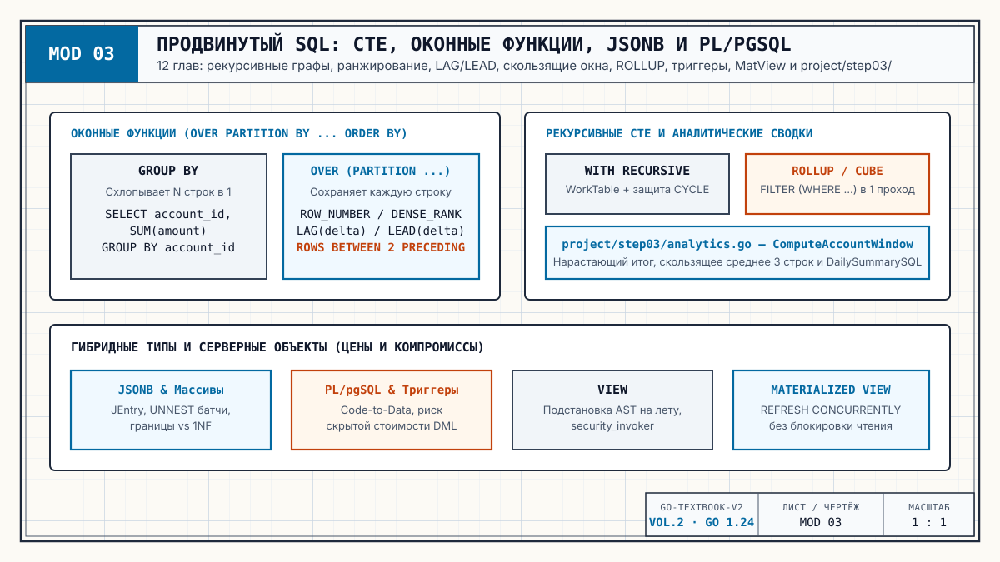

*Двенадцать глав о продвинутом SQL: от CTE и рекурсивного обхода графов до оконных функций, многомерных агрегатов, JSONB, триггеров и материализованных представлений в `project/step03/`.*

> «Цель вычислений — понимание сути, а не числа.»  
> — Ричард Хэмминг

## Что нужно знать до старта

* **Модуль 1 (`1. Фундамент баз данных и моделирование`)** и **Модуль 2 (`2. Базовый SQL с нуля`):** `SELECT`, `JOIN`, `GROUP BY`, `HAVING`, подзапросы, трёхзначная логика `NULL` и keyset-пагинация.

## Что вы соберёте в этом разделе

* **Выразительные и рекурсивные запросы** — освоите `WITH` (CTE), управление материализацией (`MATERIALIZED` / `NOT MATERIALIZED`), обход деревьев и защиту от бесконечных циклов (`CYCLE`).
* **Оконную аналитику и OLAP-сводки** — разберёте `OVER (PARTITION BY ... ORDER BY ... ROWS/RANGE ...)`, функции ранжирования, `LEAD`/`LAG`, скользящие средние, `FILTER (WHERE ...)`, `ROLLUP`, `CUBE` и `GROUPING SETS`, а также сверите их с Go-реализацией в `project/step03/analytics.go`.
* **Гибридные типы и серверную логику** — научитесь работать с `JSON`/`JSONB` и массивами, оценивать цену PL/pgSQL-процедур и триггеров для отладки и миграций, а также ускорять тяжёлые отчёты через `MATERIALIZED VIEW`.

## Карта раздела

1. [[1. CTE и выражения WITH — читаемость и материализация]] — декомпозиция сложных запросов, барьеры оптимизации в старых версиях PostgreSQL и `NOT MATERIALIZED`.
2. [[2. Рекурсивные запросы — деревья, графы и защита от циклов]] — якорь, рекурсивный шаг, `UNION ALL` против `UNION`, `SEARCH` и защита от зацикливания.
3. [[3. Оконные функции — OVER, PARTITION BY и рамки окна]] — вычисления без схлопывания строк, `ROWS` против `RANGE` и порядок выполнения после `GROUP BY`.
4. [[4. Ранжирование — ROW_NUMBER, RANK и DENSE_RANK]] — выбор Top-N в группе, обработка ничьих и сравнение с `DISTINCT ON`.
5. [[5. Сдвиги во времени — LEAD, LAG, FIRST_VALUE и LAST_VALUE]] — сравнение соседних операций без `Self-Join` и классическая ловушка рамки `LAST_VALUE`.
6. [[6. Агрегация с оконными функциями — нарастающий итог и скользящее окно]] — баланс счёта на каждую проводку, скользящее среднее и разбор `project/step03/analytics.go`.
7. [[7. Pivot, FILTER и аналитические запросы (ROLLUP, CUBE, GROUPING SETS)]] — многомерные итоги за один проход и функция `GROUPING()`.
8. [[8. JSON и JSONB в SQL]] — текстовый `JSON` против бинарного `JSONB`, операторы доступа и выбор между колонками и документом.
9. [[9. Массивы в SQL и их ограничения]] — `TEXT[]`/`BIGINT[]`, `UNNEST` для батчей из Go и границы применимости массивов.
10. [[10. Хранимые процедуры и функции (PLpgSQL)]] — `FUNCTION` против `PROCEDURE`, бизнес-логика в СУБД против сервиса на Go и тестируемость.
11. [[11. Триггеры — аудит, инварианты и скрытая стоимость]] — `BEFORE`/`AFTER`, `FOR EACH ROW`/`STATEMENT`, каскадные цепи и влияние на латентность.
12. [[12. Представления (VIEW) и материализованные представления]] — логическая инкапсуляция, обновление `CONCURRENTLY` и связь с `DailySummarySQL` из `project/step03/`.
