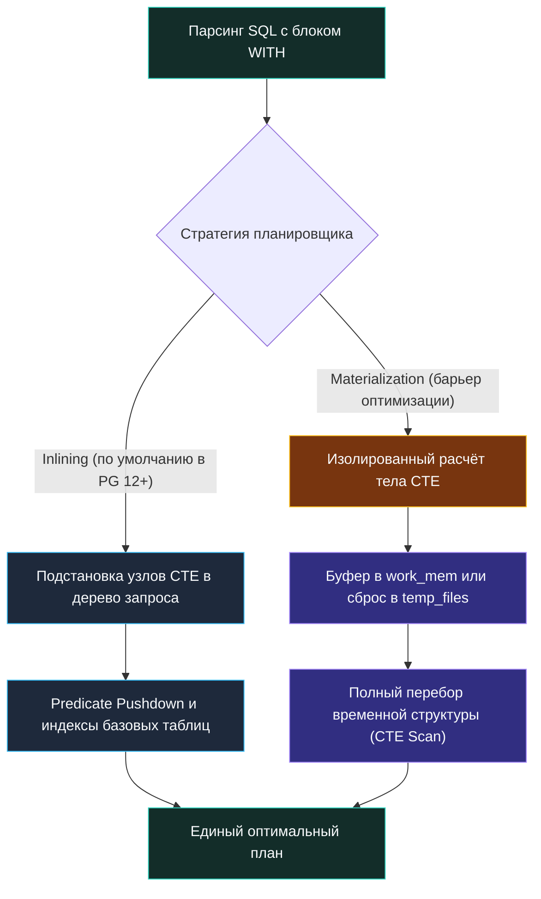

*Линейная декомпозиция сложных запросов через WITH, инлайнинг и оптимизационные барьеры в PostgreSQL, цена материализации в work_mem, Writable CTE и типобезопасный Go-код через sqlc.*

> «Гениальность конвейера Unix именно в том, что он собирается из тех самых команд, которыми постоянно пользуются поодиночке. Чтобы разглядеть эту возможность и придумать для неё запись, действительно требовался огромный скачок мысли.»  
> — Деннис Ритчи, *«The Evolution of the Unix Time-sharing System»*

В [[9. Подзапросы — скалярные, табличные и коррелированные]] мы использовали вложенные `SELECT`, чтобы не смешивать агрегацию с деталями. Пока такой подзапрос один, код читается сносно. Как только в отчёте `LedgerPulse` появляется три уровня расчёта — сначала оборот по счетам, затем среднее по валюте, затем фильтрация и обогащение, — запрос превращается в лабиринт скобок.

---

## Зачем отказываться от вложенных подзапросов

В императивном Go сложную функцию дробят на локальные переменные и небольшие шаги. Поток данных идёт сверху вниз. В классическом SQL до стандарта **SQL:1999** единственными способами структурирования оставались вложенные подзапросы (*ad-hoc subqueries*) или временные таблицы (`CREATE TEMP TABLE`).

**CTE (*Common Table Expression*, обобщённое табличное выражение)** — это именованный временный набор строк, который объявляют перед основным запросом через ключевое слово `WITH`. Его область видимости ограничена одной инструкцией: `SELECT`, `INSERT`, `UPDATE` или `DELETE`. В отличие от `CREATE TEMP TABLE`, CTE не создаёт записей в системном каталоге PostgreSQL и не требует прав на DDL.

Сравним два решения одной задачи для `LedgerPulse`: *найти активные счета, чей суммарный приход (`amount > 0` в `ledger_entries`) строго превышает средний приход по всем активным счетам*.

**Вложенные подзапросы (чтение «изнутри наружу»):**

```sql
SELECT a.id, a.external_id, a.owner_name, inc.total_inflow
FROM accounts a
JOIN (
    SELECT account_id, SUM(amount) AS total_inflow
    FROM ledger_entries
    WHERE amount > 0
    GROUP BY account_id
) inc ON inc.account_id = a.id
WHERE a.status = 'active'
  AND inc.total_inflow > (
      SELECT AVG(sub.total_inflow)
      FROM (
          SELECT le.account_id, SUM(le.amount) AS total_inflow
          FROM ledger_entries le
          JOIN accounts acc ON acc.id = le.account_id
          WHERE le.amount > 0 AND acc.status = 'active'
          GROUP BY le.account_id
      ) sub
  );
```

Такой SQL тяжело читать и опасно менять. Инженеру приходится искать самый глубокий `SELECT`, понимать его смысл, подниматься к `WHERE`, а затем возвращаться к `FROM`. Хуже того: расчёт прихода по `ledger_entries` продублирован дважды. Если завтра бизнес попросит учитывать только проводки со статусом `'posted'` из таблицы `transactions`, правку придётся не забыть внести в оба места.

**Линейный пайплайн через CTE:**

```sql
WITH active_accounts AS (
    SELECT id, external_id, owner_name
    FROM accounts
    WHERE status = 'active'
),
account_inflows AS (
    SELECT
        aa.id AS account_id,
        aa.external_id,
        aa.owner_name,
        SUM(le.amount) AS total_inflow
    FROM active_accounts aa
    JOIN ledger_entries le ON le.account_id = aa.id
    WHERE le.amount > 0
    GROUP BY aa.id, aa.external_id, aa.owner_name
),
avg_inflow AS (
    SELECT AVG(total_inflow) AS avg_amount
    FROM account_inflows
)
SELECT ai.account_id, ai.external_id, ai.owner_name, ai.total_inflow
FROM account_inflows ai
CROSS JOIN avg_inflow avg
WHERE ai.total_inflow > avg.avg_amount;
```

Код читается линейно сверху вниз, как конвейер Unix. Каждый блок решает одну задачу, получил имя и переиспользуется в следующем шаге без копипаста.

---

## Под капотом: Inlining против Materialization

Для бэкенд-инженера `WITH` — не просто способ красиво отформатировать SQL. Это инструкция для стоимостного оптимизатора, которая напрямую влияет на план выполнения, объём памяти `work_mem` и нагрузку на диск.

Движок PostgreSQL обрабатывает нерекурсивное CTE по одной из двух стратегий:



### 1. Инлайнинг (*Inlining*)

Планировщик разворачивает тело CTE и встраивает его узлы в дерево основного запроса — как компилятор Go подставляет короткую функцию в точку вызова. Оптимизатор свободно проталкивает внешние фильтры `WHERE` внутрь (**Predicate Pushdown**), меняет порядок `JOIN` и задействует индексы базовых таблиц.

### 2. Материализация (*Materialization*)

СУБД вычисляет CTE изолированно, сохраняет кортежи в оперативной памяти (`work_mem`) или во временных файлах на диске, а внешний запрос сканирует готовый буфер через узел `CTE Scan`.

> [!info] Исторический контекст: оптимизационный барьер в PostgreSQL
> До PostgreSQL 12 любое `WITH` служило **оптимизационным барьером (*Optimization Fence*)** и всегда материализовалось. Фильтр `WHERE id = 42` не проникал внутрь CTE, что часто замедляло запросы в тысячи раз.
>
> С **PostgreSQL 12** одиночные нерекурсивные CTE без побочных эффектов **инлайнятся** по умолчанию. Автоматическая материализация включается лишь в четырёх случаях:
> * ключевое слово `RECURSIVE` (см. [[2. Рекурсивные запросы — деревья, графы и защита от циклов]]);
> * на CTE ссылаются более одного раза;
> * внутри CTE есть `INSERT`/`UPDATE`/`DELETE` или волатильные функции (`random()`, `clock_timestamp()`);
> * указана явная директива `AS MATERIALIZED`.

В примере `LedgerPulse` блок `account_inflows` читается дважды (`avg_inflow` и внешний `SELECT`), поэтому PostgreSQL материализует его один раз вместо повторного сканирования `ledger_entries`. Если же CTE лёгкое, но к нему обращаются из разных веток с узкими фильтрами, материализацию отменяют директивой **`AS NOT MATERIALIZED`**:

```sql
WITH recent_entries AS NOT MATERIALIZED (
    SELECT id, account_id, amount, created_at FROM ledger_entries
)
SELECT * FROM recent_entries WHERE account_id = 10
UNION ALL
SELECT * FROM recent_entries WHERE account_id = 25;
```

Планировщик подставит `recent_entries` в обе ветки `UNION ALL`, протолкнёт фильтры вниз и в обеих ветках использует индекс `idx_ledger_entries_account_created`.

---

## Физика памяти, work_mem и дисковый I/O

Чтобы оценить цену лишней материализации, посмотрим на неё со стороны ядра Linux и подсистемы хранения:

1. **Аллокация и лимит `work_mem`.** Для хранения материализованного результата процесс бэкенда PostgreSQL выделяет память в пределах параметра `work_mem` (по умолчанию всего **4 МБ** на один узел плана). Пока кортежи помещаются в этот буфер, чтение и запись идут со скоростью оперативной памяти (~100 нс).
2. **Сброс на диск (*spill to disk*).** Как только объём промежуточных строк превышает `work_mem`, движок переходит к сбросу данных во временные файлы каталога `base/pgsql_tmp` (`temp_files`). Это вызывает системные вызовы `write()`, заполняет Page Cache Linux и при нехватке страниц сбрасывается на накопитель. Задержка одного чтения подскакивает в **1 000 раз** на NVMe (~100 мкс) и в **100 000 раз** на HDD (~10 мс).
3. **Повторное чтение и промахи кэша.** Внешний запрос читает временный файл через `read()` и узел `CTE Scan`, вымывая горячие страницы таблиц из памяти и разрушая кэши L1/L2 процессора.
4. **Отсутствие индексов.** На материализованном буфере CTE **нельзя создать B-Tree индекс**. Любой поиск или соединение с материализованным CTE превращается в полный перебор всех его строк (*Sequential Scan*) либо требует построения новой хеш-таблицы в ещё одном `work_mem`.

> [!warning] Ловушка: привычка добавлять `AS MATERIALIZED` «на всякий случай»
> Разработчики, перешедшие со старых версий БД, нередко пишут `WITH cte AS MATERIALIZED (...)`, считая, что «кэшируют» подзапрос. Если внешний запрос содержит узкий фильтр `WHERE account_id = 42`, барьер `AS MATERIALIZED` заставит СУБД сначала прочитать миллионы строк `ledger_entries`, сложить их в `work_mem` или временный файл на диске, а затем линейным перебором искать одну нужную запись.
>
> Посмотрим, как это выглядит в реальном плане выполнения `EXPLAIN (ANALYZE, BUFFERS)`:
>
> ```text
> -- ПЛОХО: с AS MATERIALIZED предикат не протолкнулся
> CTE Scan on entries_cte  (cost=... rows=1 width=32) (actual time=812.40..940.15 rows=12 loops=1)
>   Filter: (account_id = 42)
>   Rows Removed by Filter: 2499988
>   CTE entries_cte
>     -> Seq Scan on ledger_entries  (actual time=0.04..410.12 rows=2500000 loops=1)
>        Buffers: shared hit=1200 read=18400, temp written=14200
>
> -- ХОРОШО: инлайнинг по умолчанию (или NOT MATERIALIZED)
> Index Scan using idx_ledger_entries_account_created on ledger_entries
>   Index Cond: (account_id = 42)
>   Buffers: shared hit=5
> ```
>
> Разница в цене очевидна: **940 мс** и 14 200 временных блоков на диске против **5 страниц** из буферного пула за доли миллисекунды. Ставьте `AS MATERIALIZED` только тогда, когда осознанно изолируете дорогое или волатильное вычисление.

---

## Writable CTE: модификация данных внутри WITH

PostgreSQL поддерживает модифицирующие инструкции (`INSERT`, `UPDATE`, `DELETE`) внутри блока `WITH` — так называемые **Writable CTE**. В связке с клаузой `RETURNING` (см. [[5. INSERT, UPDATE, DELETE и RETURNING]]) это позволяет изменить строки и вернуть обогащённый результат за один сетевой раунд-трип в рамках одного MVCC-снимка.

Допустим, в `LedgerPulse` нужно заморозить проблемный счёт и в том же запросе забрать пять его последних проводок для разбора инцидента:

```sql
WITH frozen_account AS (
    UPDATE accounts
    SET status = 'frozen', updated_at = now()
    WHERE id = 42 AND status = 'active'
    RETURNING id, external_id, balance, currency, updated_at
)
SELECT
    fa.external_id,
    fa.balance,
    fa.currency,
    le.id AS entry_id,
    le.amount,
    le.created_at
FROM frozen_account fa
LEFT JOIN ledger_entries le ON le.account_id = fa.id
ORDER BY le.created_at DESC NULLS LAST, le.id DESC
LIMIT 5;
```

Важная тонкость семантики PostgreSQL: **все модифицирующие CTE запускаются поверх одного и того же снимка данных**, который существовал на момент старта всей инструкции, и **выполняются до конца**, даже если внешний `SELECT` потом отфильтрует часть строк или оборвёт чтение через `LIMIT`. Именно поэтому в примере выше `UPDATE` изменит ровно одну строку `accounts`, а `LIMIT 5` обрежет уже присоединённые проводки, не отменяя саму блокировку счёта. Напротив, если два DML-блока внутри одного `WITH` попытаются обновить одну и ту же строку `accounts`, PostgreSQL не увидит изменений первого `UPDATE` во втором (об этом нюансе MVCC мы подробно поговорим в Модуле 5).

---

## Сравнение подходов к структурированию SQL

| Критерий | Вложенные подзапросы | Временные таблицы (`TEMP TABLE`) | CTE (`WITH`) |
| :--- | :--- | :--- | :--- |
| **Читаемость** | Низкая (изнутри наружу) | Высокая (линейная) | Высокая (линейная сверху вниз) |
| **Оптимизация плана** | Единое дерево плана | Полная изоляция (отдельные запросы) | Гибкая: инлайнинг по умолчанию или `MATERIALIZED` |
| **Переиспользование** | Требует дублирования кода | Живёт всю сессию или транзакцию | В пределах одного SQL-запроса |
| **Индексация** | Использует индексы базовых таблиц | Можно создать B-Tree индекс после вставки | Нет индексов при материализации (`CTE Scan`) |
| **Накладные расходы каталога** | Нет | Запись и очистка системных таблиц (`pg_class`) | Нет |

Когда промежуточный набор строк превышает сотни мегабайт, участвует в нескольких тяжёлых `JOIN` подряд и требует быстрого поиска по ключу, победит временная таблица `CREATE TEMP TABLE` с последующим `CREATE INDEX` и `ANALYZE`. Для всего остального в приложении выбирайте CTE.

---

## Интеграция с Go 1.24: database/sql против sqlc

Когда многошаговый CTE переезжает в код Go-сервиса, главная проблема — позиционные параметры `` `$1` ``, `` `$2` ``, `` `$3` ``. В запросе на 40 строк легко перепутать порядок аргументов при правке верхнего блока `WITH`, и компилятор Go эту ошибку не поймает.

### Вариант 1: стандартный `database/sql`

При работе со стандартной библиотекой группируйте параметры чётко и сразу проверяйте `rows.Err()` после цикла:

```go
package ledger

import (
	"context"
	"database/sql"
	"fmt"
	"time"
)

type HighVolumeAccount struct {
	AccountID   int64
	ExternalID  string
	TotalInflow int64
}

const highVolumeCTE = `
WITH active_accounts AS (
    SELECT id, external_id
    FROM accounts
    WHERE status = $1 AND currency = $2
),
account_inflows AS (
    SELECT aa.id AS account_id, aa.external_id, SUM(le.amount) AS total_inflow
    FROM active_accounts aa
    JOIN ledger_entries le ON le.account_id = aa.id
    WHERE le.amount > 0 AND le.created_at >= $3
    GROUP BY aa.id, aa.external_id
)
SELECT account_id, external_id, total_inflow
FROM account_inflows
WHERE total_inflow >= $4
ORDER BY total_inflow DESC;`

func ListHighVolumeAccounts(
	ctx context.Context, db *sql.DB,
	status, currency string, since time.Time, minInflow int64,
) ([]HighVolumeAccount, error) {
	rows, err := db.QueryContext(ctx, highVolumeCTE, status, currency, since, minInflow)
	if err != nil {
		return nil, fmt.Errorf("query high volume accounts: %w", err)
	}
	defer rows.Close()

	res := make([]HighVolumeAccount, 0, 64)
	for rows.Next() {
		var item HighVolumeAccount
		if err := rows.Scan(&item.AccountID, &item.ExternalID, &item.TotalInflow); err != nil {
			return nil, fmt.Errorf("scan high volume account: %w", err)
		}
		res = append(res, item)
	}
	if err := rows.Err(); err != nil {
		return nil, fmt.Errorf("iterate high volume rows: %w", err)
	}
	return res, nil
}
```

### Вариант 2: кодогенерация через `sqlc`

В продакшен-сервисах на Go для сложных CTE применяют **`sqlc`**. Вы оставляете чистый SQL в `queries.sql`, заменяя позиционные `` `$1` ``..`` `$4` `` на именованные аргументы:

```sql
-- name: ListHighVolumeAccounts :many
WITH active_accounts AS (
    SELECT id, external_id FROM accounts
    WHERE status = sqlc.arg(status) AND currency = sqlc.arg(currency)
),
account_inflows AS (
    SELECT aa.id AS account_id, aa.external_id, SUM(le.amount) AS total_inflow
    FROM active_accounts aa
    JOIN ledger_entries le ON le.account_id = aa.id
    WHERE le.amount > 0 AND le.created_at >= sqlc.arg(since)
    GROUP BY aa.id, aa.external_id
)
SELECT account_id, external_id, total_inflow
FROM account_inflows
WHERE total_inflow >= sqlc.arg(min_inflow)
ORDER BY total_inflow DESC;
```

На этапе сборки `sqlc` сверяет запрос со схемой `001_init_ledger.sql` и генерирует структуру `ListHighVolumeAccountsParams` с полями `Status`, `Currency`, `Since`, `MinInflow` и прямой `rows.Scan` без рефлексии.

---

> [!tip] Собеседование [Middle]
> **Вопрос:** В чём разница между CTE и подзапросом во `FROM` в современных версиях PostgreSQL? Когда стоит писать `AS MATERIALIZED`, а когда `AS NOT MATERIALIZED`?
>
> **Ответ:** Начиная с PostgreSQL 12, нерекурсивное CTE без DML и волатильных функций, упомянутое один раз, планировщик инлайнит по умолчанию — по плану и скорости оно эквивалентно подзапросу во `FROM`, но читается линейно.
>
> Директиву `AS MATERIALIZED` применяют точечно: когда нужно гарантировать однократное вычисление дорогой подпрограммы или зафиксировать результат волатильной функции. Но она возводит оптимизационный барьер: внешние условия `WHERE` не проталкиваются внутрь, а последующий поиск по `CTE Scan` идёт без индексов и при превышении `work_mem` сбрасывается в `temp_files`.
>
> Директиву `AS NOT MATERIALIZED` ставят в обратном случае: когда к лёгкому CTE обращаются два или более раза с разными высокоселективными фильтрами — она отключает автоматическую материализацию и позволяет протолкнуть предикаты в базовые индексы.

---

## Упражнения

### 1. Базовое: декомпозиция отчёта по валютам

Перепишите запрос на схему `LedgerPulse` в линейный пайплайн из двух CTE: `currency_totals` (сумма `ABS(amount)` по каждой валюте среди транзакций `'posted'`) и `max_turnover`, чтобы выбрать валюты с оборотом более 50% от максимума без дублирования подзапросов:

```sql
SELECT currency, total_abs
FROM (
    SELECT le.currency, SUM(ABS(le.amount)) AS total_abs
    FROM ledger_entries le JOIN transactions t ON t.id = le.transaction_id
    WHERE t.status = 'posted' GROUP BY le.currency
) s
WHERE total_abs > 0.5 * (
    SELECT MAX(sub.total_abs) FROM (
        SELECT le.currency, SUM(ABS(le.amount)) AS total_abs
        FROM ledger_entries le JOIN transactions t ON t.id = le.transaction_id
        WHERE t.status = 'posted' GROUP BY le.currency
    ) sub
);
```

> [!solution] Показать решение
> ```sql
> WITH currency_totals AS (
>     SELECT le.currency, SUM(ABS(le.amount)) AS total_abs
>     FROM ledger_entries le
>     JOIN transactions t ON t.id = le.transaction_id
>     WHERE t.status = 'posted'
>     GROUP BY le.currency
> ),
> max_turnover AS (
>     SELECT MAX(total_abs) AS peak FROM currency_totals
> )
> SELECT ct.currency, ct.total_abs
> FROM currency_totals ct
> CROSS JOIN max_turnover mt
> WHERE ct.total_abs > mt.peak / 2.0
> ORDER BY ct.total_abs DESC;
> ```
>
> `currency_totals` используется дважды, поэтому PostgreSQL материализует крошечный список валют один раз и не сканирует `ledger_entries` повторно.

### 2. Практическое: Writable CTE для просроченных транзакций

Напишите один атомарный запрос с Writable CTE для `LedgerPulse`: переведите все транзакции со статусом `'pending'`, созданные более 24 часов назад (`created_at < now() - interval '24 hours'`), в статус `'failed'` и верните агрегированную сводку — сколько транзакций каждого типа (`kind`) было отменено.

> [!solution] Показать решение
> ```sql
> WITH expired_tx AS (
>     UPDATE transactions
>     SET status = 'failed'
>     WHERE status = 'pending'
>       AND created_at < now() - interval '24 hours'
>     RETURNING id, kind
> )
> SELECT
>     kind,
>     COUNT(*) AS failed_count
> FROM expired_tx
> GROUP BY kind
> ORDER BY failed_count DESC;
> ```
>
> Условие в `WHERE` использует частичный индекс `idx_transactions_pending`, а `RETURNING` сразу передаёт обновлённые строки в группировку без второго сетевого обращения из Go.

### 3. Со звёздочкой (\*): расследование `temp written` в CTE

Инженер написал отчёт, но заметил в `EXPLAIN (ANALYZE, BUFFERS)` узел `CTE Scan` и `temp written=45000`:

```sql
WITH all_entries AS MATERIALIZED (
    SELECT id, account_id, amount, created_at
    FROM ledger_entries
)
SELECT id, amount, created_at
FROM all_entries
WHERE account_id = 777
ORDER BY created_at DESC, id DESC
LIMIT 20;
```

Объясните две физические причины тормозов и предложите два исправления (с сохранением CTE и без него).

> [!solution] Показать решение
> **Причины деградации:**
> 1. Явная директива `AS MATERIALIZED` поставила оптимизационный барьер: фильтр `WHERE account_id = 777` и `LIMIT 20` не смогли протолкнуться внутрь `all_entries`.
> 2. Движок выполнил `Seq Scan` по всей таблице `ledger_entries`, переполнил `work_mem`, сбросил 45 000 временных блоков на диск и затем снова прочитал их целиком, потому что на буфере CTE нет индекса.
>
> **Исправление 1 (с сохранением CTE):** убрать `AS MATERIALIZED` (или явно написать `AS NOT MATERIALIZED`, если CTE используется многократно). Планировщик заинлайнит выражение и перейдёт на `Index Scan` по `idx_ledger_entries_account_created`.
>
> **Исправление 2 (если фильтр всегда по одному счёту):** вынести параметр `$1` внутрь самого CTE, чтобы даже при принудительной материализации в `work_mem` попадали только строки конкретного счёта:
> ```sql
> WITH account_entries AS (
>     SELECT id, amount, created_at
>     FROM ledger_entries
>     WHERE account_id = $1
> )
> SELECT id, amount, created_at
> FROM account_entries
> ORDER BY created_at DESC, id DESC
> LIMIT 20;
> ```

---

Обычные CTE отлично строят линейный конвейер с известным заранее числом шагов. Но как быть, если глубина цепочки заранее неизвестна — например, нужно раскрутить дерево корпоративных субсчетов или цепочку возвратных транзакций? В следующей главе мы добавим к `WITH` ключевое слово `RECURSIVE`: [[2. Рекурсивные запросы — деревья, графы и защита от циклов]].
