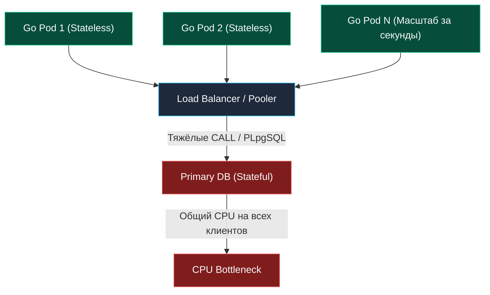

*Парадигма Code-to-Data, функции и процедуры PostgreSQL, категории изменчивости и архитектурный выбор между сервером БД и кодом на Go.*

> «Как сформулировал Роб Пайк, «сложность мультипликативна»: решая задачу за счёт усложнения одной части системы, вы медленно, но верно добавляете сложность во все остальные.»
> — Алан Донован и Брайан Керниган *(цитируя Роба Пайка)*

Обычный бэкенд на Go живёт по модели **Data-to-Code**: сервис вытягивает строки из PostgreSQL через `SELECT`, перегоняет их по TCP-сети в оперативную память своего процесса, считает там бизнес-правила и отправляет обратно команды `INSERT` или `UPDATE`. Эта схема отлично сочетается с горизонтальным масштабированием подов, профилированием через `pprof` и привычными юнит-тестами.

У модели Data-to-Code есть физический предел. Представьте ночной перерасчёт комиссий или сверку биллинга в `LedgerPulse`: чтобы принять решение по 50 счетам, нужно просмотреть 500 000 строк в `ledger_entries`. Если тащить полмиллиона кортежей по локальной сети (сотни микросекунд на каждый round-trip и десятки мегабайт трафика), сетевой стек забьётся, а десериализация создаст сотни тысяч объектов в куче Go, нагружая сборщик мусора.

Тогда возникает идея инвертировать поток — перейти к **Code-to-Data**. Вместо того чтобы гнать данные к приложению, мы переносим вычисления прямо в ядро СУБД. Движок читает страницы из своего горячего Buffer Pool (~100 нс на доступ к RAM), обрабатывает строки локально и отдаёт наружу лишь компактный итог. Поскольку чистый декларативный SQL не обладает тьюринг-полнотой (в нём нет полноценных циклов с произвольной логикой ветвления и автономного управления транзакциями), для серверного кода используют процедурные расширения: **PL/pgSQL** в PostgreSQL, **PL/SQL** в Oracle и **T-SQL** в Microsoft SQL Server.

---

## Хранимые функции (`FUNCTION`): выражения внутри SQL

**Хранимая функция (User-Defined Function, UDF)** — это подпрограмма, которая принимает аргументы, выполняет вычисления и **обязана вернуть значение**: скаляр, массив, составной тип или реляционную таблицу (`RETURNS TABLE (...)` либо `RETURNS SETOF`). Поскольку функция возвращает значение, её разрешено встраивать прямо в `SELECT`, `WHERE`, `JOIN` и `HAVING`.

Создадим в `LedgerPulse` простую функцию расчёта комиссии по тарифу счёта и сумме перевода. Обратите внимание на синтаксис dollar-quoting (`$$`) — в PostgreSQL им оборачивают тело функции, чтобы не экранировать одиночные кавычки внутри SQL-строк:

```sql
CREATE OR REPLACE FUNCTION calculate_transfer_fee(amount BIGINT, tier TEXT)
RETURNS BIGINT
LANGUAGE plpgsql
IMMUTABLE
AS $$
DECLARE
    bps INT := 15; -- базисные пункты (0.15%) по умолчанию
BEGIN
    IF tier = 'vip' THEN
        bps := 5;
    ELSIF tier = 'pro' THEN
        bps := 10;
    END IF;

    -- Целочисленная арифметика в копейках без float
    RETURN (amount * bps) / 10000;
END;
$$;
```

Вызов такой функции в запросе не отличается от встроенных математических функций:

```sql
SELECT id, calculate_transfer_fee(100000, 'vip') AS fee_cents;
```

Для простых однострочных выражений без переменных и ветвлений `IF/LOOP` вместо `LANGUAGE plpgsql` лучше указывать `LANGUAGE sql`. Функции на чистом SQL оптимизатор PostgreSQL часто способен **подставить внутрь плана запроса (inline)** так же, как макрос, избегая накладных расходов на запуск виртуальной машины PL/pgSQL.

### Категории изменчивости: `VOLATILE`, `STABLE` и `IMMUTABLE`

Один из самых важных и часто упускаемых параметров UDF в PostgreSQL — категория изменчивости (**Volatility**). Если её не указать, СУБД молча выставляет самый тяжёлый режим по умолчанию — **`VOLATILE`**.

| Категория | Гарантия для оптимизатора | Примеры | Может использоваться в индексе |
| :--- | :--- | :--- | :--- |
| `VOLATILE` (по умолчанию) | Результат может меняться при каждом вызове, даже внутри одной строки; возможны побочные эффекты (`INSERT`/`UPDATE`) | `random()`, `clock_timestamp()` | Нет |
| `STABLE` | При одинаковых аргументах результат неизменен в пределах **одного снимка транзакции** (или одного оператора) | `now()`, `current_setting('app.tenant_id')` | Нет (кроме частичных/вычислительных трюков, не для B-Tree ключа) |
| `IMMUTABLE` | Чистая математическая функция: результат зависит только от аргументов и никогда не меняется во времени | `calculate_transfer_fee`, `lower()` | **Да** (функциональные индексы и сворачивание констант) |

На уровне исполнения разница колоссальна. Если пометить чистую функцию расчёта комиссии как `VOLATILE`, планировщик не имеет права посчитать `calculate_transfer_fee(100000, 'vip')` один раз и обязан вызывать интерпретатор PL/pgSQL **на каждую строку таблицы**. С модификатором `IMMUTABLE` оптимизатор выполняет *Constant Folding* (сворачивание констант) ещё на этапе построения плана, до чтения первой страницы с диска.

> [!warning] Ловушка функциональных индексов и ложного `IMMUTABLE`
> PostgreSQL позволяет построить индекс по вычисляемому выражению:
> `CREATE INDEX idx_tx_fee ON ledger_entries (calculate_transfer_fee(amount, 'pro'));`
> Движок пропустит эту команду **только если функция объявлена как `IMMUTABLE`**.
>
> Если разработчик слукавит и поставит `IMMUTABLE` на функцию, которая внутри читает таблицу курсов валют или вызывает `now()`, СУБД поверит декларации на слово. Индекс зафиксирует значения на момент `CREATE INDEX` или вставки строки. Когда курс в соседней таблице изменится, индекс останется со старыми ключами и начнёт выдавать неверные строки или пропускать существующие — тихая логическая порча результатов без единой ошибки в логах.

---

## Хранимые процедуры (`PROCEDURE`): батчи и управление транзакциями

Долгое время в PostgreSQL существовали только функции. Полноценные стандартизированные хранимые процедуры (`CREATE PROCEDURE`) появились лишь в **PostgreSQL 11**.

> [!tip] Собеседование [Middle]
> **Вопрос:** В чём принципиальная разница между `FUNCTION` и `PROCEDURE` в PostgreSQL?
>
> **Ответ:** Отличия лежат в трёх плоскостях:
> 1. **Контроль транзакций:** Функция всегда работает строго внутри внешней транзакции вызывающего запроса и не может выполнить `COMMIT` или `ROLLBACK` (только подтранзакции через `EXCEPTION`, которые под капотом используют savepoints). Процедура умеет сама фиксировать и откатывать транзакции прямо посреди циклов.
> 2. **Возврат результата:** Функция обязана вернуть значение (хотя бы `VOID`) и вызывается внутри `SELECT` / `WHERE`. Процедура не возвращает набор строк через `RETURN` — для передачи скаляров наружу служат выходные параметры `INOUT`.
> 3. **Синтаксис вызова:** Процедура вызывается исключительно отдельной командой `CALL proc_name(...)`.

Именно автономное управление транзакциями делает процедуры незаменимыми для фоновой очистки и обслуживания таблиц. В `LedgerPulse` есть таблица `idempotency_keys` (из миграции `003_idempotency_outbox.sql`), куда пишутся ключи каждого запроса. Если удалять 5 миллионов просроченных ключей одним `DELETE FROM idempotency_keys WHERE expires_at < now()`, транзакция удержит блокировки на миллионах строк, раздует WAL-журнал и задержит очистку мёртвых кортежей (`VACUUM`).

Хранимая процедура решает задачу короткими пачками с промежуточным `COMMIT`:

```sql
CREATE OR REPLACE PROCEDURE purge_expired_idempotency_keys(batch_size INT DEFAULT 1000)
LANGUAGE plpgsql
AS $$
DECLARE
    deleted_count INT;
BEGIN
    LOOP
        DELETE FROM idempotency_keys
        WHERE idempotency_key IN (
            SELECT idempotency_key
            FROM idempotency_keys
            WHERE expires_at < now()
            LIMIT batch_size
        );

        GET DIAGNOSTICS deleted_count = ROW_COUNT;

        -- Фиксируем пачку: снимаем строчные блокировки и освобождаем WAL-буферы.
        -- Хранимая функция так делать не умеет.
        COMMIT;

        EXIT WHEN deleted_count = 0;
    END LOOP;
END;
$$;
```

Обратите внимание: при вызове `CALL purge_expired_idempotency_keys(1000)` клиент **не должен** сам открывать внешнюю транзакцию (`BEGIN`), иначе PostgreSQL прервёт выполнение ошибкой `invalid transaction termination` при первом же `COMMIT` внутри процедуры.

---

## Интеграция PL/pgSQL с Go 1.24

В приложении на Go хранимые процедуры вызывают через `ExecContext`, а табличные функции (`RETURNS TABLE`) — через `QueryContext`, подставляя их в секцию `FROM` точно так же, как обычную таблицу.

Допустим, для админ-панели `LedgerPulse` создана табличная функция получения проблемных счетов с высоким оборотом:

```sql
CREATE OR REPLACE FUNCTION get_frozen_accounts(min_balance BIGINT)
RETURNS TABLE (id BIGINT, external_id TEXT, balance BIGINT)
LANGUAGE sql
STABLE
AS $$
    SELECT id, external_id, balance
    FROM accounts
    WHERE status = 'frozen' AND balance >= min_balance
    ORDER BY id;
$$;
```

На стороне Go мы вызываем и эту табличную UDF, и сервисную процедуру очистки стандартными средствами `database/sql` с передачей контекста и позиционным параметром `$1`:

```go
package repository

import (
	"context"
	"database/sql"
	"fmt"
)

type FrozenAccount struct {
	ID         int64
	ExternalID string
	Balance    int64
}

func ListFrozenAccounts(ctx context.Context, db *sql.DB, minBalance int64) ([]FrozenAccount, error) {
	const query = `SELECT id, external_id, balance FROM get_frozen_accounts($1)`

	rows, err := db.QueryContext(ctx, query, minBalance)
	if err != nil {
		return nil, fmt.Errorf("call get_frozen_accounts: %w", err)
	}
	defer rows.Close()

	var result []FrozenAccount
	for rows.Next() {
		var acc FrozenAccount
		if err := rows.Scan(&acc.ID, &acc.ExternalID, &acc.Balance); err != nil {
			return nil, fmt.Errorf("scan frozen account: %w", err)
		}
		result = append(result, acc)
	}
	if err := rows.Err(); err != nil {
		return nil, fmt.Errorf("iterate frozen accounts: %w", err)
	}
	return result, nil
}

func PurgeExpiredKeys(ctx context.Context, db *sql.DB, batchSize int) error {
	// Вызов PROCEDURE через CALL выполняется только вне явной транзакции
	if _, err := db.ExecContext(ctx, `CALL purge_expired_idempotency_keys($1)`, batchSize); err != nil {
		return fmt.Errorf("call purge_expired_idempotency_keys: %w", err)
	}
	return nil
}
```

---

## Где должна жить бизнес-логика: Go против базы данных

Вопрос переноса доменной логики в хранимые процедуры десятилетиями делит инженеров на два лагеря. Взвесим аргументы без идеологии, опираясь на физику кластера и стоимость сопровождения.



### Аргументы за логику в СУБД

1. **Отсутствие сетевого обмена (Zero Network I/O).** Промежуточные выборки не пересекают TCP-стек и не сериализуются в структуры Go. Если задача действительно сводит сотни тысяч строк в пару чисел, она исполняется в памяти сервера БД быстрее всего.
2. **Жёсткая инкапсуляция безопасности.** Сервисному пользователю можно вообще запретить `SELECT`/`UPDATE` на таблицы и выдать права только на `EXECUTE` узкого списка процедур. В таком режиме классическая SQL-инъекция не доберётся до сырых таблиц (подробнее о безопасности БД см. Модуль 10).
3. **Единая точка расчёта для разнородных клиентов.** Если к одной базе подключаются сервис на Go, скрипт выгрузки на Python и устаревшая биллинговая система, формула внутри UDF гарантирует единое округление для всех.

### Аргументы против логики в СУБД

1. **Узкое горлышко по CPU на Primary.** Прикладные поды на Go не хранят состояния: при всплеске трафика оркестратор поднимает ещё 20 подов за секунды. Пишущий узел PostgreSQL (Primary) — это единая точка состояния. Его процессор принципиально не масштабируется горизонтально простым добавлением реплик записи. Если нагрузить CPU Primary тяжёлой доменной логикой на PL/pgSQL, замедлятся абсолютно все транзакции в системе, включая простые чтения.
2. **Слабые инструменты разработки и тестирования (DX).** В Go есть строгая статическая типизация, линтеры, `go test`, таблицы тестов и отладчик `dlv`. В PL/pgSQL ошибки типов в динамических конструкциях всплывают в рантайме, модульные тесты через `pgTAP` громоздки, а пошаговая отладка сложна.
3. **Трудный Zero-Downtime деплой.** Команда `CREATE OR REPLACE FUNCTION` работает без сбоя, только пока не меняется список параметров или тип возвращаемого значения. Стоит добавить новый аргумент или поле в `RETURNS TABLE` — и PostgreSQL потребует сначала выполнить `DROP FUNCTION`, что сломает старые поды Go во время катящегося обновления.
4. **Жёсткий Vendor Lock-in.** Перенести 500 обычных параметризованных запросов из Go с PostgreSQL на другой движок реально за недели; переписать 30 000 строк процедурного кода PL/pgSQL со специфическими исключениями и курсорами — проект на месяцы.

> [!tip] Практический баланс для Go-инженера
> Держите **бизнес-логику** (валидацию правил, переводы, оркестрацию, интеграции) в stateless-сервисах на Go. Оставляйте в PL/pgSQL только две вещи: **сервисные процедуры обслуживания** (батчевое удаление, архивация партиций с `COMMIT`) и **редкие аналитические расчёты**, где перекачка сотен мегабайт по сети физически невозможна.

---

## Упражнения

### Упражнение 1 (Базовое). Классификация Volatility

Разработчик `LedgerPulse` написал три функции на PostgreSQL. Определите правильную категорию (`IMMUTABLE`, `STABLE` или `VOLATILE`) для каждой из них и объясните, какую нельзя использовать в функциональном индексе:

1. `format_external_id(prefix TEXT, raw_id BIGINT)` — склеивает `upper(prefix) || '-' || raw_id::text`.
2. `is_account_created_today(created_at TIMESTAMPTZ)` — проверяет `created_at >= date_trunc('day', now())`.
3. `next_audit_nonce()` — возвращает `gen_random_uuid()::text` и пишет счётчик в служебную таблицу.

> [!solution] Показать решение
> 1. **`IMMUTABLE`**: функция зависит только от своих аргументов и функции `upper` (учтите, что для текстовой сортировки в разных локалях системная `upper()` может зависеть от локали, но при фиксированной базе и без обращения к времени/таблицам сама логика конкатенации детерминирована; точнее, для строгих индексов с `prefix` лучше `C`-локаль или чистая математика, но из трёх вариантов именно первая — кандидат в `IMMUTABLE`).
> 2. **`STABLE`**: функция вызывает `now()`, которая в PostgreSQL возвращает время начала **текущей транзакции** (`transaction_timestamp`). Внутри одной транзакции результат стабилен, но в разных транзакциях (завтра vs сегодня) он изменится. В функциональном индексе использовать нельзя.
> 3. **`VOLATILE`**: функция генерирует случайный UUID и мутирует состояние таблицы. Она обязана выполняться при каждом вызове, в индекс её ставить категорически нельзя.

### Упражнение 2 (Практическое). Батчевая архивация `outbox_events`

Таблица `outbox_events` в `LedgerPulse` разрослась: в ней накопилось 4 миллиона уже опубликованных событий (`published_at IS NOT NULL AND published_at < now() - interval '30 days'`). Напишите хранимую процедуру `purge_published_outbox(batch_limit INT DEFAULT 2000)`, которая удаляет эти строки порциями по `batch_limit` и фиксирует каждую пачку, а также функцию на Go 1.24, которая вызывает эту процедуру с таймаутом контекста.

> [!solution] Показать решение
> ```sql
> CREATE OR REPLACE PROCEDURE purge_published_outbox(batch_limit INT DEFAULT 2000)
> LANGUAGE plpgsql
> AS $$
> DECLARE
>     affected INT;
> BEGIN
>     LOOP
>         DELETE FROM outbox_events
>         WHERE id IN (
>             SELECT id
>             FROM outbox_events
>             WHERE published_at IS NOT NULL
>               AND published_at < now() - interval '30 days'
>             LIMIT batch_limit
>         );
>
>         GET DIAGNOSTICS affected = ROW_COUNT;
>         COMMIT;
>
>         EXIT WHEN affected = 0;
>     END LOOP;
> END;
> $$;
> ```
> Вызов на Go 1.24:
> ```go
> func PurgeOldOutbox(ctx context.Context, db *sql.DB, batchLimit int) error {
> 	if batchLimit <= 0 {
> 		batchLimit = 2000
> 	}
> 	if _, err := db.ExecContext(ctx, `CALL purge_published_outbox($1)`, batchLimit); err != nil {
> 		return fmt.Errorf("purge published outbox: %w", err)
> 	}
> 	return nil
> }
> ```
> При отмене `ctx` драйвер отправит PostgreSQL сигнал отмены запроса; уже закоммиченные батчи останутся удалёнными, а текущий незавершённый батч откатится без потери консистентности.

### Упражнение 3 (\*). Безопасный рефакторинг процедуры с Zero-Downtime

В продакшене Go-сервис вызывает табличную функцию `get_frozen_accounts(min_balance BIGINT)`, которая возвращает `(id, external_id, balance)`. Появилась новая колонка `currency`, и вы хотите добавить её в возвращаемую таблицу. Почему миграция с `CREATE OR REPLACE FUNCTION get_frozen_accounts(...) RETURNS TABLE (id BIGINT, external_id TEXT, balance BIGINT, currency CHAR(3))` упадёт с ошибкой PostgreSQL и как провести такое изменение без простоя (Zero-Downtime)?

> [!solution] Показать решение
> PostgreSQL запрещает через `CREATE OR REPLACE FUNCTION` менять состав и типы возвращаемых столбцов (`cannot change return type of existing function`). Обычный `DROP FUNCTION` перед `CREATE FUNCTION` сломает старые инстансы Go-сервиса, которые в момент раскатки всё ещё вызывают старую сигнатуру `SELECT id, external_id, balance FROM get_frozen_accounts($1)` (или упадут по несоответствию колонок в `rows.Scan`).
>
> **План Zero-Downtime миграции (паттерн Expand-and-Contract):**
> 1. **Expand:** Создаём новую версию функции с другим именем или версионированием: `get_frozen_accounts_v2(min_balance BIGINT)` с новой колонкой `currency`. Старую `get_frozen_accounts` не трогаем.
> 2. **Rollout Go:** Выкатываем новую версию Go-сервиса, которая переходит на `get_frozen_accounts_v2` (или вообще заменяет её прямым SQL-запросом в коде).
> 3. **Contract:** После того как все старые поды остановлены и метрики показывают ноль вызовов старой функции, удаляем `DROP FUNCTION IF EXISTS get_frozen_accounts(BIGINT)` в отдельной миграции.

---

## Мостик к следующему уроку

Функции и процедуры запускаются только тогда, когда приложение явно обращается к ним через `SELECT` или `CALL`. Но в СУБД есть механизм, который срабатывает **без вашего ведома** при любом изменении данных — будто невидимый наблюдатель стоит за каждым `INSERT` и `UPDATE`. Когда автоматический перехват в базе спасает целостность аудита, а когда превращает простую пакетную вставку в кошмар латентности? Разберём в следующей главе: [[11. Триггеры — аудит, инварианты и скрытая стоимость]].
