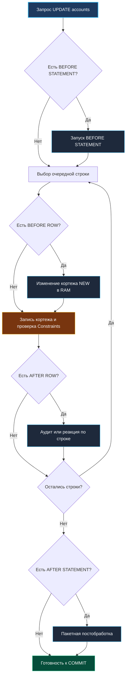

*Событийная модель внутри ядра СУБД: фазы `BEFORE` и `AFTER`, строчные и операторные триггеры, ловушка рекурсии и скрытая цена для латентности.*

> «Пишите ясно — не умничайте.»
> — Брайан Керниган

В [[10. Хранимые процедуры и функции (PLpgSQL)]] код внутри базы запускался предсказуемо: сервис на Go явно вызывал `SELECT func()` или `CALL proc()`. **Триггер (Trigger)** устроен иначе. Это паттерн «Наблюдатель» (*Observer*), вшитый прямо в транзакционное ядро СУБД: функция срабатывает **неявно и автоматически** при `INSERT`, `UPDATE`, `DELETE` или `TRUNCATE`.

Для администратора баз данных триггер выглядит заманчивой страховкой: даже если разработчик забудет обновить поле или другой сервис зайдёт в базу в обход основного API, ядро само поддержит инвариант. Для Go-инженера, привыкшего к явному потоку управления, скрытые триггеры часто оборачиваются «жутким дальнодействием» (*Spooky Action at a Distance*). Приложение выполняет короткий `INSERT` в одну таблицу, а внутри транзакции без единой строчки в Go-коде меняются ещё три таблицы, растут задержки и возникают взаимные блокировки.

---

## Анатомия триггера: три оси выполнения

Поведение триггера в PostgreSQL задаётся тремя координатами: **временем срабатывания**, **событием** и **уровнем детализации**.

### 1. Время срабатывания: `BEFORE` против `AFTER`

* **`BEFORE` (до изменения строки):** функция вызывается *до* записи кортежа в страницу данных и журнал WAL. В строковом триггере доступна изменяемая структура `NEW` — можно нормализовать поля (например, выставить `updated_at = now()`), подставить значения по умолчанию или вернуть `NULL`, чтобы тихо отменить операцию над конкретной строкой без ошибки.
* **`AFTER` (после изменения строки):** функция запускается *после* физической модификации строки в памяти буферного пула и проверки табличных ограничений целостности (`NOT NULL`, `CHECK`, `UNIQUE`, `FOREIGN KEY`, см. [[7. Ограничения целостности данных — NOT NULL, UNIQUE, CHECK]]). Изменять `NEW` здесь поздно и бессмысленно — зато это каноническое место для записи в таблицу аудита и каскадных реакций.
* **`INSTEAD OF` (вместо операции):** специальный режим для представлений (`VIEW`), позволяющий перенаправить запись в базовые таблицы; его разберём в [[12. Представления (VIEW) и материализованные представления]].

### 2. Уровень детализации: `FOR EACH ROW` против `FOR EACH STATEMENT`

Этот параметр напрямую определяет нагрузку на процессор и латентность:

* **`FOR EACH ROW` (строковый уровень):** тело триггера вызывается отдельно для **каждой затронутой строки**. Пакетное обновление 10 000 строк запустит виртуальную машину PL/pgSQL ровно 10 000 раз.
* **`FOR EACH STATEMENT` (уровень оператора):** функция вызывается ровно **один раз на весь SQL-запрос**, даже если условие `WHERE` не затронуло ни одной строки. В PostgreSQL (начиная с версии 10) операторные триггеры поддерживают переходные таблицы `REFERENCING OLD TABLE AS ... NEW TABLE AS ...`, позволяя обработать весь батч изменений одним SQL-запросом вместо цикла по строкам.



---

## Идиоматичный пример: `updated_at` и неизменяемость проводок

В таблице `accounts` схемы `LedgerPulse` есть колонка `updated_at TIMESTAMPTZ`. Если поручить её обновление коду на Go, рано или поздно ручная миграция или соседний сервис выполнит `UPDATE accounts SET status = 'frozen'` и забудет про время обновления. Решить задачу на уровне БД просто и почти бесплатно через `BEFORE UPDATE`:

```sql
CREATE OR REPLACE FUNCTION set_updated_at()
RETURNS TRIGGER
LANGUAGE plpgsql
AS $$
BEGIN
    NEW.updated_at := now();
    RETURN NEW;
END;
$$;

CREATE TRIGGER trg_accounts_updated_at
    BEFORE UPDATE ON accounts
    FOR EACH ROW
    -- Не запускаем PL/pgSQL, если строка фактически не изменилась
    WHEN (OLD IS DISTINCT FROM NEW)
    EXECUTE FUNCTION set_updated_at();
```

Предложение `WHEN (OLD IS DISTINCT FROM NEW)` — полезная оптимизация: если приложение выполнило идемпотентный `UPDATE`, где новые значения совпадают со старыми, движок даже не запустит интерпретатор PL/pgSQL.

Второй оправданный пример в финансовой системе — защита целостности главной книги `ledger_entries`. По принципу двойной записи проведённые проводки нельзя редактировать задним числом или удалять; исправления делают только новой сторнирующей проводкой. Это правило легко зафиксировать триггером:

```sql
CREATE OR REPLACE FUNCTION forbid_ledger_mutation()
RETURNS TRIGGER
LANGUAGE plpgsql
AS $$
BEGIN
    RAISE EXCEPTION 'ledger_entries is append-only: % is forbidden', TG_OP
        USING ERRCODE = 'restrict_violation';
END;
$$;

CREATE TRIGGER trg_ledger_entries_immutable
    BEFORE UPDATE OR DELETE ON ledger_entries
    FOR EACH STATEMENT
    EXECUTE FUNCTION forbid_ledger_mutation();
```

Обратите внимание: здесь применён уровень `FOR EACH STATEMENT`, а не `FOR EACH ROW`. Запрет сработает мгновенно один раз на команду, прежде чем движок начнёт сканировать строки.

### Что под капотом: `NEW` и `OLD` в памяти исполнителя

На уровне подсистемы Executor структуры `NEW` и `OLD` — не отдельные файлы и не повторные чтения с диска, а указатели на кортежи в оперативной памяти (~100 нс на доступ из кэша CPU/RAM):

* При `INSERT` заполнена только `NEW` (`OLD` равна `NULL`).
* При `DELETE` заполнена только `OLD` (`NEW` равна `NULL`).
* При `UPDATE` доступны обе структуры, поэтому легко сравнивать состояние до и после изменения.

Когда триггер `BEFORE ROW` меняет поле `NEW.updated_at`, он правит кортеж в памяти **до** того, как страница пометится грязной (*dirty*) и уйдёт запись в WAL. Повторного обновления строки не происходит.

---

## Скрытая стоимость и три классические ловушки

Удобство триггеров обманчиво: за несколькими строками DDL часто прячется взрывной рост латентности и аварийные откаты.

### Ловушка 1. Каскадная рекурсия

Допустим, разработчик повесил на `accounts` триггер `AFTER UPDATE`, который для синхронизации пересчитывает поле в той же таблице `accounts` командой `UPDATE accounts SET ... WHERE id = NEW.id`. Второе обновление снова запускает тот же триггер `AFTER UPDATE`, порождая третье — до тех пор, пока PostgreSQL не прервёт стек на границе `max_stack_depth` (или не упрётся в таймаут).

**Правило:** никогда не выполняйте `UPDATE` или `INSERT` в ту же таблицу из триггера `AFTER`. Если нужно подправить значения текущей строки, делайте это только присваиванием полям `NEW` в триггере `BEFORE ROW`.

### Ловушка 2. Разрушение конвейера Bulk Insert

Когда сервис на Go загружает пачку из 10 000 строк в `ledger_entries` через `UNNEST` ([[9. Массивы в SQL и их ограничения]]) или протокол `COPY`, подсистема хранения работает в режиме потоковой последовательной записи в страницы памяти и WAL.

Стоит навесить на эту таблицу триггер `FOR EACH ROW` — и потоковый конвейер рвётся: на каждую из 10 000 строк исполнитель ставит обработку на паузу, поднимает контекст виртуальной машины PL/pgSQL и выполняет SQL внутри триггера. Нагрузка на CPU базы резко подскакивает, а суммарная латентность пакетной вставки возрастает на один-два порядка. Если триггер вдобавок делает `INSERT` в соседнюю таблицу аудита, вдвое увеличивается поток WAL и время удержания строчных блокировок.

> [!tip] Собеседование [Middle]
> **Вопрос:** Внутри триггера `AFTER UPDATE` на таблице `accounts` выполняется запись в таблицу аудита `account_audit_log`. Если после этого транзакция в Go-коде упадёт или вызовет `tx.Rollback()`, останется ли запись в `account_audit_log`? А если упадёт сам триггер аудита?
>
> **Ответ:**
> 1. **Запись в аудит не сохранится.** Триггер в реляционной СУБД всегда исполняется строго в контексте той же родительской транзакции. При `ROLLBACK` откатываются и изменение счёта, и все побочные эффекты триггера.
> 2. **Сбой триггера откатит всю бизнес-операцию.** Если в `account_audit_log` сработает нарушение `CHECK` или закончится место, `UPDATE accounts` тоже будет отменён, даже если сам счёт обновлялся абсолютно корректно.

### Ловушка 3. Сетевые вызовы из триггера

Иногда возникает соблазн через расширения вроде `pg_net` или внешние процедуры отправлять HTTP-уведомления и сообщения в брокер прямо из триггера. Это прямой путь к деградации БД: транзакция удерживает строчные блокировки и соединение из пула, пока ждёт ответа удалённого HTTP-сервера (десятки миллисекунд или секунды при таймауте). Более того, если внешний сервис ответит `200 OK`, а затем база откатит транзакцию по конфликту сериализации, внешняя система получит событие о действии, которого никогда не было.

---

## Триггеры против явных транзакций и Domain Events в Go

В проектировании распределённых систем действует жёсткое правило: **бизнес-логика и межсервисные события не должны прятаться в триггерах**.

Рассмотрим типовой антипаттерн: при создании записи в `transactions` триггер `AFTER INSERT` незаметно обновляет балансы в `accounts` и пишет событие в `outbox_events`. В репозитории на Go виден только один вызов `INSERT INTO transactions`, а вся финансовая механика скрыта в миграциях БД. Новый инженер в команде тратит часы на поиск того, откуда списались деньги, а тестирование превращается в обязательный подъём всей базы с накатом всех триггеров.

Идиоматичный подход в Go 1.24 — **явная транзакция в коде сервиса** вместе с таблицей `outbox_events` (паттерн Transactional Outbox из миграции `003_idempotency_outbox.sql`; подробнее о нём см. Модуль 5 и Том 3):

```go
package service

import (
	"context"
	"database/sql"
	"fmt"
)

func PostDeposit(ctx context.Context, db *sql.DB, refID string, accountID, amount int64, currency string) error {
	tx, err := db.BeginTx(ctx, nil)
	if err != nil {
		return fmt.Errorf("begin tx: %w", err)
	}
	defer tx.Rollback()

	var txID int64
	err = tx.QueryRowContext(
		ctx,
		`INSERT INTO transactions (reference_id, kind, status) VALUES ($1, 'deposit', 'posted') RETURNING id`,
		refID,
	).Scan(&txID)
	if err != nil {
		return fmt.Errorf("insert transaction: %w", err)
	}

	if _, err := tx.ExecContext(
		ctx,
		`INSERT INTO ledger_entries (transaction_id, account_id, amount, currency) VALUES ($1, $2, $3, $4)`,
		txID, accountID, amount, currency,
	); err != nil {
		return fmt.Errorf("insert ledger entry: %w", err)
	}

	if _, err := tx.ExecContext(
		ctx,
		`UPDATE accounts SET balance = balance + $1 WHERE id = $2 AND currency = $3`,
		amount, accountID, currency,
	); err != nil {
		return fmt.Errorf("update account balance: %w", err)
	}

	payload := fmt.Sprintf(`{"tx_id":%d,"account_id":%d,"amount":%d}`, txID, accountID, amount)
	if _, err := tx.ExecContext(
		ctx,
		`INSERT INTO outbox_events (aggregate_type, aggregate_id, event_type, payload) VALUES ('account', $1, 'DEPOSIT_POSTED', $2)`,
		fmt.Sprint(accountID), payload,
	); err != nil {
		return fmt.Errorf("write outbox event: %w", err)
	}

	return tx.Commit()
}
```

Весь поток данных читается линейно сверху вниз: транзакция, проводка, баланс, событие в `outbox_events`.

### Когда триггеры всё-таки оправданы

Отказ от бизнес-триггеров не означает полного запрета. Есть три узкие инфраструктурные задачи, где триггеры уместны:

1. **Непреложный аудит и защита журналов (History Tables / Append-Only).** Регуляторный аудит должен фиксировать состояния `OLD` и `NEW`, даже если администратор исправлял запись вручную через `psql` в обход Go-сервиса.
2. **Инварианты, невыразимые через `CHECK`.** Например, запрет на изменение исторических проводок `ledger_entries` или проверка правила, затрагивающего соседние строки, когда табличных ограничений недостаточно.
3. **Технические поля строки.** Автоматическое обновление `updated_at` в `BEFORE UPDATE` или расчёт служебного `tsvector` для полнотекстового поиска.

---

## Упражнения

### Упражнение 1 (Базовое). Защита статуса закрытого счёта

В таблице `accounts` счёт со статусом `'closed'` больше никогда не должен возвращаться в статус `'active'` или `'frozen'`, а также менять `currency`. Напишите триггерную функцию `guard_closed_account()` и триггер `BEFORE UPDATE`, который пропускает обновление только если статус меняется на разрешённый, и отклоняет изменение закрытого счёта с ошибкой `RAISE EXCEPTION`.

> [!solution] Показать решение
> ```sql
> CREATE OR REPLACE FUNCTION guard_closed_account()
> RETURNS TRIGGER
> LANGUAGE plpgsql
> AS $$
> BEGIN
>     IF OLD.status = 'closed' AND (NEW.status <> 'closed' OR NEW.currency <> OLD.currency) THEN
>         RAISE EXCEPTION 'closed account % cannot be reopened or change currency', OLD.id
>             USING ERRCODE = 'check_violation';
>     END IF;
>     RETURN NEW;
> END;
> $$;
>
> CREATE TRIGGER trg_accounts_guard_closed
>     BEFORE UPDATE ON accounts
>     FOR EACH ROW
>     WHEN (OLD.status = 'closed')
>     EXECUTE FUNCTION guard_closed_account();
> ```
> Фильтр `WHEN (OLD.status = 'closed')` гарантирует, что для всех активных счетов триггерная функция вообще не будет вызываться.

### Упражнение 2 (Практическое). Журнал аудита смены статусов счетов

Создайте таблицу `account_status_history (id BIGINT GENERATED ALWAYS AS IDENTITY PRIMARY KEY, account_id BIGINT NOT NULL, old_status TEXT NOT NULL, new_status TEXT NOT NULL, changed_at TIMESTAMPTZ NOT NULL DEFAULT now())`. Напишите `AFTER UPDATE` триггер на `accounts`, который записывает строку в историю **только при фактическом изменении поля `status`**. Почему важно использовать `AFTER` и `UPDATE OF status`?

> [!solution] Показать решение
> ```sql
> CREATE TABLE IF NOT EXISTS account_status_history (
>     id         BIGINT GENERATED ALWAYS AS IDENTITY PRIMARY KEY,
>     account_id BIGINT      NOT NULL REFERENCES accounts(id) ON DELETE CASCADE,
>     old_status TEXT        NOT NULL,
>     new_status TEXT        NOT NULL,
>     changed_at TIMESTAMPTZ NOT NULL DEFAULT now()
> );
>
> CREATE OR REPLACE FUNCTION log_account_status_change()
> RETURNS TRIGGER
> LANGUAGE plpgsql
> AS $$
> BEGIN
>     INSERT INTO account_status_history (account_id, old_status, new_status)
>     VALUES (NEW.id, OLD.status, NEW.status);
>     RETURN NULL; -- для AFTER-триггеров возвращаемое значение игнорируется
> END;
> $$;
>
> CREATE TRIGGER trg_accounts_status_audit
>     AFTER UPDATE OF status ON accounts
>     FOR EACH ROW
>     WHEN (OLD.status IS DISTINCT FROM NEW.status)
>     EXECUTE FUNCTION log_account_status_change();
> ```
> Использование `AFTER` гарантирует, что все ограничения `CHECK` на `accounts` уже пройдены и строка точно зафиксируется (если не откатится внешняя транзакция). Комбинация `UPDATE OF status` и `WHEN (OLD.status IS DISTINCT FROM NEW.status)` избавляет от лишнего запуска функции при изменении баланса или `metadata`.

### Упражнение 3 (\*). Оптимизация аудита при массовом обновлении (`FOR EACH STATEMENT`)

Предположим, регламентная задача `LedgerPulse` раз в час одним запросом `UPDATE accounts SET status = 'frozen' WHERE ...` переводит в заморозку 25 000 счетов. В профиле базы видно, что триггер `FOR EACH ROW` из упражнения 2 делает 25 000 отдельных контекстных переключений PL/pgSQL и 25 000 одиночных `INSERT` в `account_status_history`. Перепишите триггер на уровень `FOR EACH STATEMENT` с переходными таблицами `REFERENCING OLD TABLE AS old_rows NEW TABLE AS new_rows`, чтобы весь аудит записывался **одним** SQL-запросом.

> [!solution] Показать решение
> В PostgreSQL операторные триггеры `AFTER UPDATE` позволяют получить доступ к целым таблицам изменённых строк и соединить их по первичному ключу `id`:
>
> ```sql
> DROP TRIGGER IF EXISTS trg_accounts_status_audit ON accounts;
>
> CREATE OR REPLACE FUNCTION log_account_status_batch()
> RETURNS TRIGGER
> LANGUAGE plpgsql
> AS $$
> BEGIN
>     INSERT INTO account_status_history (account_id, old_status, new_status)
>     SELECT n.id, o.status, n.status
>     FROM new_rows AS n
>     JOIN old_rows AS o ON o.id = n.id
>     WHERE o.status IS DISTINCT FROM n.status;
>
>     RETURN NULL;
> END;
> $$;
>
> CREATE TRIGGER trg_accounts_status_audit_stmt
>     AFTER UPDATE ON accounts
>     REFERENCING OLD TABLE AS old_rows NEW TABLE AS new_rows
>     FOR EACH STATEMENT
>     EXECUTE FUNCTION log_account_status_batch();
> ```
> Теперь вместо 25 000 запусков виртуальной машины PL/pgSQL движок вызывает функцию ровно **один раз** и вставляет строки в таблицу истории одним оптимизированным пакетным планом `INSERT ... SELECT`. Заметьте также ограничение PostgreSQL: для триггера с `REFERENCING` нельзя указать список колонок `UPDATE OF status` и условие `WHEN`, поэтому фильтрация `o.status IS DISTINCT FROM n.status` перенесена в `WHERE` внутри `SELECT`.

---

## Мостик к следующему уроку

Мы разобрали процедуры, функции и триггеры — механизмы, которые добавляют императивную логику внутрь СУБД. Но в ежедневной аналитике и API чаще возникает другая задача: переиспользовать сложные многострочные `SELECT` (вроде дневного отчёта с CTE и оконными функциями) без дублирования SQL по всему проекту и при этом не сканировать десятки миллионов строк при каждом открытии дашборда. Для этого в SQL существуют два инструмента с похожими именами и радикально разной физикой работы: [[12. Представления (VIEW) и материализованные представления]].
