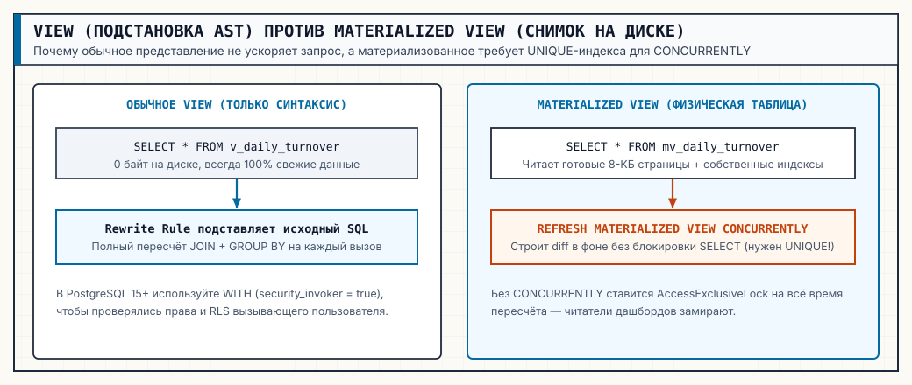
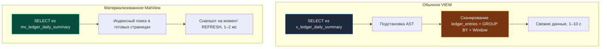

*Логические фасады через `VIEW`, физические снапшоты `MATERIALIZED VIEW`, неблокирующее обновление `CONCURRENTLY` и перенос тяжёлой аналитики `DailySummarySQL` из `project/step03/`.*

> «В идеальном мире прикладному программисту достаточно знать только API — без того, как этот API реализован и к какому железу он обращается. В реальности же чуть более глубокие знания порой оказываются весьма кстати.»
> — Чарльз Петцольд

В `project/step03/analytics.go` мы описали эталонный аналитический запрос `DailySummarySQL` для `LedgerPulse`: сначала CTE `daily` группирует проводки `ledger_entries` по счетам и дням (`SUM(amount)`, `COUNT(*) FILTER (WHERE amount > 0)`), а затем оконные функции считают нарастающий баланс `SUM(net_delta) OVER (...)` и дельту предыдущего дня `LAG(net_delta) OVER (...)` ([[6. Агрегация с оконными функциями — нарастающий итог и скользящее окно]]).

Когда отчётность проекта растёт, копировать такой SQL по пяти Go-сервисам и трём BI-инструментам опасно: любое переименование столбца или добавление фильтра по отменённым транзакциям потребует синхронно править десятки файлов. Ещё хуже, когда тяжёлую многослойную агрегацию над десятками миллионов проводок одновременно запрашивают десять открытых дашбордов — процессор СУБД и диск упираются в потолок.

Реляционные базы данных предлагают два инструмента с похожими именами, но противоположной физикой: **обычные представления (`VIEW`)** решают задачу абстракции и безопасности, а **материализованные представления (`MATERIALIZED VIEW`)** решают задачу производительности за счёт дискового пространства.

---

## Обычное представление (`VIEW`): макрос без хранения

**Обычное представление (`VIEW`)** — это именованный запрос, сохранённый в системном каталоге СУБД. Для клиента на Go или аналитика он выглядит как обычная таблица, но на диске не хранит ни одного байта пользовательских строк.

Превратим `DailySummarySQL` из `project/step03/analytics.go` в переиспользуемое представление:

```sql
CREATE OR REPLACE VIEW v_ledger_daily_summary AS
WITH daily AS (
    SELECT
        account_id,
        date_trunc('day', created_at) AS day,
        SUM(amount) AS net_delta,
        COUNT(*) FILTER (WHERE amount > 0) AS incoming_cnt
    FROM ledger_entries
    GROUP BY account_id, date_trunc('day', created_at)
)
SELECT
    account_id,
    day,
    net_delta,
    SUM(net_delta) OVER (PARTITION BY account_id ORDER BY day) AS running_balance,
    LAG(net_delta) OVER (PARTITION BY account_id ORDER BY day) AS prev_day_delta
FROM daily;
```

Теперь прикладной код в Go запрашивает сводку по конкретному счёту в две строчки, не дублируя логику CTE и оконных функций:

```sql
SELECT day, net_delta, running_balance, prev_day_delta
FROM v_ledger_daily_summary
WHERE account_id = $1
ORDER BY day;
```

### Под капотом: подсистема правил и разворачивание AST

Одно из самых устойчивых заблуждений звучит так: *«Если обернуть медленный запрос в `VIEW`, база запомнит результат и станет отдавать его быстрее»*. Это неверно. Обычное представление не кэширует данные.

Когда клиент отправляет `SELECT ... FROM v_ledger_daily_summary WHERE account_id = 42`, движок PostgreSQL действует как препроцессор макросов:

1. Парсер разбирает входящий запрос в абстрактное синтаксическое дерево (**AST**).
2. Подсистема переписывания запросов (**Query Rewriter / Rule System**) видит, что `v_ledger_daily_summary` — это представление, и достаёт из системного каталога его сохранённое AST.
3. Rewriter вклеивает дерево представления внутрь клиентского запроса и передаёт объединённое дерево планировщику.
4. Планировщик строит физический план для единого развёрнутого запроса (в случае с оконными функциями внутри `PARTITION BY account_id` он обычно сумеет протолкнуть предикат `WHERE account_id = 42` внутрь `daily`, но всё равно просканирует проводки этого счёта и заново посчитает агрегаты).

Запрос к `VIEW` расходует ровно столько же CPU и дискового ввода-вывода, сколько исходный развёрнутый SQL.

> [!warning] Обновляемые представления и триггер `INSTEAD OF`
> Можно ли выполнить `INSERT` или `UPDATE` прямо в `VIEW`? По стандарту SQL простое представление над **одной** таблицей без `JOIN`, `GROUP BY`, оконных функций, `DISTINCT` и `LIMIT` обновляется автоматически (*Updatable View*), и к нему можно добавить опцию `WITH CHECK OPTION`, чтобы запрещать вставку строк, не проходящих `WHERE` самого представления.
>
> Но как только внутри `VIEW` появляются соединения таблиц или агрегаты (как в `v_ledger_daily_summary`), база запретит прямую запись: движок не может угадать, как разложить одно изменение по нескольким таблицам. Если запись через составное `VIEW` всё же нужна для обратной совместимости схемы, на представление вешают триггер **`INSTEAD OF`** ([[11. Триггеры — аудит, инварианты и скрытая стоимость]]), который перехватывает `INSERT`/`UPDATE` и вручную раскладывает поля по физическим таблицам.

---

## Слой безопасности и контекст прав (`Security Layer`)

Вторая сильная сторона обычных `VIEW` — изоляция конфиденциальных данных. Аналитикам или внешним BI-системам нельзя открывать прямой `SELECT` к таблице `accounts`, где лежат персональные атрибуты в `metadata` и закрытые счета. Достаточно создать урезанную проекцию и выдать права только на неё:

```sql
CREATE OR REPLACE VIEW v_public_accounts
WITH (security_invoker = true) AS
SELECT id, external_id, currency, status, created_at
FROM accounts
WHERE status <> 'closed';

GRANT SELECT ON v_public_accounts TO analytics_role;
```

Обратите внимание на флаг **`WITH (security_invoker = true)`**, появившийся в PostgreSQL 15. По умолчанию представление проверяет права доступа к базовым таблицам и политики Row-Level Security (такие как `accounts_tenant_isolation` из миграции `003_idempotency_outbox.sql`) от имени **владельца** представления (обычно это администратор миграций), что способно случайно обойти RLS для обычного пользователя. Флаг `security_invoker = true` заставляет ядро применять права и политики безопасности **вызывающего пользователя** (подробнее о RLS и защите данных см. Модуль 10).

---

## Материализованные представления (`MATERIALIZED VIEW`)



Если таблица `ledger_entries` в `LedgerPulse` выросла до 50 миллионов проводок, агрегация `DailySummarySQL` по всем счетам за год требует сканирования гигабайтов данных и десятков секунд процессорного времени. Открытие финансовой сводки десятью менеджерами одновременно убьёт CPU базы.

Для ускорения таких аналитических выборок используют **материализованные представления (`MATERIALIZED VIEW`, MatView)** — компромисс в духе [[3. Типы баз данных — OLTP против OLAP]] и [[14. Денормализация — когда и как она оправдана]]:

```sql
CREATE MATERIALIZED VIEW mv_ledger_daily_summary AS
WITH daily AS (
    SELECT
        account_id,
        date_trunc('day', created_at) AS day,
        SUM(amount) AS net_delta,
        COUNT(*) FILTER (WHERE amount > 0) AS incoming_cnt
    FROM ledger_entries
    GROUP BY account_id, date_trunc('day', created_at)
)
SELECT
    account_id,
    day,
    net_delta,
    SUM(net_delta) OVER (PARTITION BY account_id ORDER BY day) AS running_balance,
    LAG(net_delta) OVER (PARTITION BY account_id ORDER BY day) AS prev_day_delta
FROM daily
ORDER BY account_id, day
WITH DATA;

-- На материализованное представление можно и нужно вешать индексы
CREATE UNIQUE INDEX idx_mv_ledger_daily_acc_day
    ON mv_ledger_daily_summary (account_id, day);
```

### Физика хранения: почему MatView читается за миллисекунды

В отличие от `VIEW`, команда `CREATE MATERIALIZED VIEW` единожды выполняет тяжёлый запрос, выделяет реальные 8-килобайтные страницы на диске (NVMe/SSD) и сохраняет туда уже посчитанные агрегированные строки. При последующих чтениях из Go:

```sql
SELECT day, net_delta, running_balance, prev_day_delta
FROM mv_ledger_daily_summary
WHERE account_id = $1
ORDER BY day;
```

СУБД **вообще не прикасается** к 50-миллионной таблице `ledger_entries`. Она находит нужные дни по индексу `idx_mv_ledger_daily_acc_day` и читает готовые строки из страниц Buffer Pool (RAM ~100 нс или NVMe ~100 мкс). Запрос, занимавший 10 секунд, укладывается в 1–2 миллисекунды.



*(Если создавать крупный отчёт в миграции, бывает удобно указать `WITH NO DATA` в конце `CREATE MATERIALIZED VIEW`, чтобы миграция прошла мгновенно без блокировки деплоя, а первое наполнение запустить отдельной фоновой задачей).*

---

## Инвалидация и неблокирующее обновление `CONCURRENTLY`

За скорость чтения приходится платить **свежестью данных**. Когда в `ledger_entries` появляется новая проводка, материализованное представление само не пересчитывается — оно хранит снимок на момент создания или последнего обновления.

Базовая команда обновления выглядит так:

```sql
REFRESH MATERIALIZED VIEW mv_ledger_daily_summary;
```

> [!warning] Ловушка: `AccessExclusiveLock` при обычном `REFRESH`
> Обычная команда `REFRESH MATERIALIZED VIEW` берёт на представление самую жёсткую блокировку — **`AccessExclusiveLock`**. Она полностью перестраивает файл данных на диске, а пока идёт тяжёлый пересчёт (те же 10–30 секунд), **любой `SELECT` к этому представлению зависает в ожидании блокировки**. На продакшене это превращается в периодический отказ дашбордов и накопление висящих запросов в пуле соединений Go.

Промышленный стандарт для живых систем — неблокирующее обновление:

```sql
REFRESH MATERIALIZED VIEW CONCURRENTLY mv_ledger_daily_summary;
```

> [!tip] Собеседование [Senior/Staff]
> **Вопрос:** Что нужно для работы `REFRESH MATERIALIZED VIEW CONCURRENTLY`, как оно устроено внутри и какие у него ограничения?
>
> **Ответ:**
> 1. **Обязательный `UNIQUE`-индекс:** на материализованном представлении должен существовать хотя бы один уникальный индекс (без выражений и частичного `WHERE`), однозначно идентифицирующий строку — в нашем случае `(account_id, day)`.
> 2. **Механика под капотом:** PostgreSQL заново выполняет запрос представления во временной служебной структуре, сравнивает новый результат со старыми строками по уникальному ключу и применяет только дельту (`INSERT`/`UPDATE`/`DELETE` изменившихся строк) под слабой блокировкой, **не блокируя читающие `SELECT`**.
> 3. **Компромисс:** `CONCURRENTLY` работает дольше обычного `REFRESH` и требует больше временной памяти/I/O на вычисление диффа (а также копит мёртвые версии строк, которые должен убирать `autovacuum`), зато полностью убирает простои чтения. Кроме того, `CONCURRENTLY` нельзя запускать, если MatView ещё ни разу не наполнялось (после `WITH NO DATA` первый запуск делают без `CONCURRENTLY`).

---

## Архитектурный выбор: кэш в Go (Redis) против MatView

При проектировании бэкенда закономерно возникает вопрос: зачем материализованное представление в PostgreSQL, если можно поднять горутину в Go, раз в 10 минут выполнять `DailySummarySQL` и класть JSON в Redis?

У `MATERIALIZED VIEW` есть три сильных инженерных преимущества:

1. **Реляционная композиция.** MatView остаётся таблицей внутри PostgreSQL: вы можете соединять `mv_ledger_daily_summary` через `JOIN` с живой таблицей `accounts` или фильтровать по правам `status = 'active'` в одном запросе. Выгрузив сводку в Redis, любые `JOIN` и сложную фильтрацию придётся программировать вручную в памяти Go.
2. **Минимум сетевого трафика при пересчёте.** Когда агрегат считается внутри БД, миллионы сырых строк `ledger_entries` перемалываются локально в Buffer Pool и не пересекают TCP-сокет. Если агрегировать на стороне воркера в Go, вы либо всё равно нагружаете базу тем же SQL, либо тащите сырые строки по сети.
3. **Единый контур эксплуатации.** Репликация на read-реплики, резервное копирование и транзакционная консистентность снимка работают из коробки без отдельного кластера кэширования.

Когда же выигрывает Redis/кэш в памяти? Когда запрос примитивен (ключ-значение по `account_id`), нагрузка на чтение исчисляется сотнями тысяч RPS и нужно разгрузить сам пул соединений PostgreSQL от сетевых обращений.

### Оркестрация обновления из Go 1.24

В сервисе `LedgerPulse` фоновый воркер может периодически запускать неблокирующее обновление с жёстким таймаутом контекста, чтобы зависший пересчёт не держал соединение бесконечно:

```go
package worker

import (
	"context"
	"database/sql"
	"log/slog"
	"time"
)

// RefreshDailySummaryWorker периодически актуализирует mv_ledger_daily_summary.
func RefreshDailySummaryWorker(ctx context.Context, db *sql.DB, interval time.Duration, logger *slog.Logger) {
	ticker := time.NewTicker(interval)
	defer ticker.Stop()

	for {
		select {
		case <-ctx.Done():
			return
		case <-ticker.C:
			refreshCtx, cancel := context.WithTimeout(ctx, 2*time.Minute)
			_, err := db.ExecContext(refreshCtx, `REFRESH MATERIALIZED VIEW CONCURRENTLY mv_ledger_daily_summary`)
			cancel()
			if err != nil {
				logger.Error("failed to refresh materialized view", "view", "mv_ledger_daily_summary", "err", err)
			}
		}
	}
}
```

Если запущено несколько реплик Go-сервиса в Kubernetes, одновременный запуск `REFRESH MATERIALIZED VIEW CONCURRENTLY` с двух подов вызовет конфликт блокировок на уровне метаданных. В продакшене запуск такого воркера защищают распределённой блокировкой (например, `pg_try_advisory_lock`) или выносят в единичный CronJob.

---

## Упражнения

### Упражнение 1 (Базовое). Безопасный фасад `VIEW` для службы поддержки

Операторам техподдержки `LedgerPulse` нужен доступ только для чтения к активным и замороженным счетам, причём им нужно видеть валюту, баланс в **целых рублях/долларах** (`balance / 100`) и маскированный `external_id`, но **не** видеть поле `metadata` и закрытые счета. Напишите `CREATE OR REPLACE VIEW v_support_accounts` с `security_invoker = true` и выдайте права на чтение роли `support_readonly`.

> [!solution] Показать решение
> ```sql
> CREATE OR REPLACE VIEW v_support_accounts
> WITH (security_invoker = true) AS
> SELECT
>     id,
>     left(external_id, 4) || '***' AS masked_external_id,
>     owner_name,
>     currency,
>     balance / 100 AS balance_major_units,
>     status,
>     updated_at
> FROM accounts
> WHERE status IN ('active', 'frozen');
>
> GRANT SELECT ON v_support_accounts TO support_readonly;
> ```
> Поскольку в `VIEW` не включена колонка `metadata`, оператор с правами только на `v_support_accounts` физически не сможет извлечь из неё секреты или PII, а условие `WHERE status IN ('active', 'frozen')` скроет закрытые счета.

### Упражнение 2 (Практическое). Материализованная сводка по видам транзакций

Напишите материализованное представление `mv_daily_kind_turnover`, которое считает дневной оборот `LedgerPulse` по дате (`date_trunc('day', le.created_at)`), валюте (`le.currency`) и типу транзакции (`t.kind` из таблицы `transactions`) только для проведённых транзакций (`t.status = 'posted'`). Добавьте необходимые столбцы и уникальный индекс, чтобы представление можно было обновлять командой `REFRESH MATERIALIZED VIEW CONCURRENTLY`.

> [!solution] Показать решение
> ```sql
> CREATE MATERIALIZED VIEW mv_daily_kind_turnover AS
> SELECT
>     date_trunc('day', le.created_at) AS report_day,
>     le.currency,
>     t.kind,
>     COUNT(*) AS entry_count,
>     SUM(ABS(le.amount)) AS gross_volume,
>     SUM(le.amount) AS net_flow
> FROM ledger_entries AS le
> JOIN transactions AS t ON t.id = le.transaction_id
> WHERE t.status = 'posted'
> GROUP BY 1, 2, 3
> WITH DATA;
>
> -- Уникальный индекс по составному ключу группировки обязателен для CONCURRENTLY
> CREATE UNIQUE INDEX idx_mv_daily_kind_turnover_pk
>     ON mv_daily_kind_turnover (report_day, currency, kind);
>
> -- Проверка неблокирующего обновления
> REFRESH MATERIALIZED VIEW CONCURRENTLY mv_daily_kind_turnover;
> ```
> Ключ группировки `(report_day, currency, kind)` гарантированно уникален для каждой строки результата (все три выражения `NOT NULL` из-за `NOT NULL` ограничений в базовых таблицах), поэтому уникальный индекс строится чисто и без конфликтов.

### Упражнение 3 (\*). Почему падает `REFRESH CONCURRENTLY` и как убрать лишние блокировки

Коллега создал материализованное представление для списка активных счетов с последним временем проводки:

```sql
CREATE MATERIALIZED VIEW mv_account_activity AS
SELECT
    a.id AS account_id,
    a.external_id,
    MAX(le.created_at) AS last_entry_at
FROM accounts AS a
LEFT JOIN ledger_entries AS le ON le.account_id = a.id
WHERE a.status = 'active'
GROUP BY a.id, a.external_id
WITH NO DATA;

CREATE INDEX idx_mv_account_activity_id ON mv_account_activity (account_id);
```

При запуске в Go-воркере `REFRESH MATERIALIZED VIEW CONCURRENTLY mv_account_activity` падает с ошибкой. Назовите **две** независимые причины сбоя и исправьте DDL-скрипт.

> [!solution] Показать решение
> Команда падает по двум причинам:
> 1. Представление создано с `WITH NO DATA`, поэтому физически не содержит данных. Первое наполнение **нельзя** выполнять с `CONCURRENTLY` (`cannot refresh materialized view "..." concurrently ... has not been populated`).
> 2. Индекс `idx_mv_account_activity_id` объявлен как обычный (`CREATE INDEX`), а не `CREATE UNIQUE INDEX`. Без уникального индекса PostgreSQL не может сопоставлять старые и новые строки для вычисления диффа.
>
> Исправленная последовательность:
> ```sql
> CREATE MATERIALIZED VIEW mv_account_activity AS
> SELECT
>     a.id AS account_id,
>     a.external_id,
>     MAX(le.created_at) AS last_entry_at
> FROM accounts AS a
> LEFT JOIN ledger_entries AS le ON le.account_id = a.id
> WHERE a.status = 'active'
> GROUP BY a.id, a.external_id
> WITH NO DATA;
>
> CREATE UNIQUE INDEX idx_mv_account_activity_id
>     ON mv_account_activity (account_id);
>
> -- Первичное наполнение (однократно без CONCURRENTLY)
> REFRESH MATERIALIZED VIEW mv_account_activity;
>
> -- Все последующие регулярные обновления из Go-воркера
> REFRESH MATERIALIZED VIEW CONCURRENTLY mv_account_activity;
> ```

---

## Мостик к следующему модулю

Мы завершили путь по продвинутому SQL: от CTE, рекурсии и оконной аналитики `DailySummarySQL` до массивов, процедур PL/pgSQL, триггеров и материализованных представлений. Вы научились выражать сложную логику декларативно и прятать тяжёлые отчёты в предрассчитанные снимки.

Но на практике всё упирается в вопрос цены исполнения: почему два почти одинаковых запроса к `ledger_entries` работают один за 0.4 мс, а другой — за 40 секунд, почему планировщик иногда игнорирует созданный индекс и что на самом деле скрывают цифры `cost`, `buffers` и `actual time` в плане запроса? Ответы лежат на уровне физики структур поиска и алгоритмов оптимизатора — в Модуле 4 «Индексы, планировщик и EXPLAIN».
