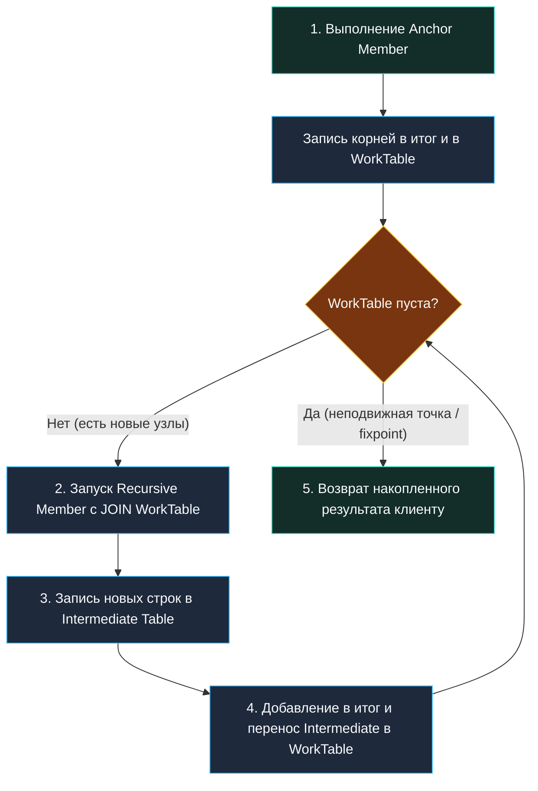

*Итеративный движок WorkTable под капотом WITH RECURSIVE, жёсткий барьер оптимизации и spill to disk, сортировка SEARCH, защита от циклов CYCLE и сборка дерева в Go за O(N).*

> «Контролируемое повторение последовательности команд, или цикл, — это то, что отличает компьютеры от калькуляторов.»  
> — Чарльз Петцольд, *«Код. Тайный язык информатики»*

В [[1. CTE и выражения WITH — читаемость и материализация]] мы превратили запутанные подзапросы в линейный конвейер с известным заранее числом этапов. Но реляционная модель Эдгара Кодда (см. [[4. Реляционная модель данных — отношения, кортежи и множества]]) хранит плоские таблицы, а реальные задачи упрямо выстраиваются в деревья и графы: оргструктуры компаний, ветки комментариев, зависимости пакетов, корпоративные холдинги в `LedgerPulse` с вложенными субсчетами или цепочки корректировочных транзакций.

Когда глубина иерархии заранее неизвестна, обычный `JOIN` бессилен. Приходится либо запускать из Go десятки последовательных запросов в цикле (антипаттерн *N+1* по сети), либо выгружать всю таблицу в память сервиса. Конструкция `WITH RECURSIVE` возвращает обход иерархии туда, где лежат страницы данных — внутрь движка СУБД.

---

## Анатомия рекурсивного CTE

Синтаксически `WITH RECURSIVE` состоит из двух частей, соединённых оператором `UNION ALL`:

1. **Якорь (*Anchor Member*).** Обычный нерекурсивный `SELECT`, который задаёт стартовые вершины — корни дерева или начальную точку поиска. Исполняется ровно один раз.
2. **Рекурсивная часть (*Recursive Member*).** Запрос, который в секции `FROM` или `JOIN` ссылается на имя самого CTE. Он выполняется итеративно шаг за шагом, получая на вход строки предыдущего шага, пока не вернёт пустое множество.

Представим в `LedgerPulse` иерархию корпоративных счетов, где у дочернего счёта заполнена ссылка `parent_account_id` (у головного счёта холдинга она равна `NULL`):

```sql
WITH RECURSIVE account_tree AS (
    -- 1. Anchor Member: находим корневые счета холдингов
    SELECT
        id,
        parent_account_id,
        external_id,
        owner_name,
        1 AS depth
    FROM accounts
    WHERE parent_account_id IS NULL

    UNION ALL

    -- 2. Recursive Member: ищем дочерние субсчета для узлов текущего уровня
    SELECT
        a.id,
        a.parent_account_id,
        a.external_id,
        a.owner_name,
        t.depth + 1
    FROM accounts a
    JOIN account_tree t ON a.parent_account_id = t.id
)
SELECT id, parent_account_id, external_id, owner_name, depth
FROM account_tree
ORDER BY depth, id;
```

На первом шаге база отбирает корни (`depth = 1`). На втором — находит всех прямых потомков (`depth = 2`), на третьем — их потомков (`depth = 3`), и так до самых листьев.

---

## Под капотом: WorkTable вместо стека вызовов

Слово «рекурсивный» здесь — лишь удобная абстракция стандарта SQL. В рантайме Go или C рекурсия выделяет фреймы на стеке вызовов (сдвигая регистр `RSP` и сохраняя адреса возврата). Внутри ядра PostgreSQL никакой стековой рекурсии нет. Исполнение `WITH RECURSIVE` (узел `Recursive Union` в плане запроса) представляет собой **строгий итеративный цикл с перекладыванием кортежей между двумя буферами**:

* **`WorkTable` (рабочая таблица)** — хранит строки, найденные на предыдущей итерации.
* **`Intermediate Table` (промежуточная таблица)** — накапливает строки, порождённые на текущей итерации.



Пошаговый конвейер внутри узла `Recursive Union` устроен так:

1. Исполнитель вычисляет `Anchor Member`. Полученные кортежи сразу кладутся и в накопительный результирующий буфер, и в `WorkTable`.
2. Пока `WorkTable` не пуста, запускается `Recursive Member`. При каждом обращении к имени CTE (`account_tree`) движок читает не всё накопленное дерево, а **только текущее содержимое `WorkTable`**.
3. Новые дочерние строки записываются в `Intermediate Table`.
4. **Проверка останова (*Fixpoint*).** Если `Intermediate Table` оказалась пустой, новых потомков больше нет — цикл завершается.
5. Если строки нашлись, движок дописывает их в итоговый буфер, заменяет содержимое `WorkTable` строками из `Intermediate Table`, очищает `Intermediate Table` и переходит к шагу 2.

---

## Память, диск и барьер оптимизации

Итеративная ротация буферов `WorkTable` сразу ставит перед инженером вопрос о ресурсах. Где живут эти временные таблицы и что происходит, когда дерево разрастается?

* **Быстрый путь (RAM).** Пока строки одного уровня и накопительный буфер укладываются в `work_mem`, `WorkTable` живёт в оперативной памяти процесса PostgreSQL. Чтение и `JOIN` работают с наносекундной задержкой (~100 нс).
* **Аварийный путь (*spill to disk*).** Если дерево широко ветвится и на одном уровне рождаются сотни тысяч строк, буфер переполняет `work_mem`. СУБД сбрасывает кортежи во временные файлы на диск (`temp_files`). Каждая следующая итерация порождает системные вызовы `write()` и `read()`, забивает Page Cache ОС и переводит запрос в режим дискового ожидания (~100 мкс на NVMe, ~10 мс на HDD). Запрос, летавший на 50 тестовых счетах за 2 мс, в продакшене растягивается на минуты.

> [!warning] Ловушка: внешний `WHERE` не проталкивается в рекурсию
> В отличие от обычных CTE, рекурсивное CTE **всегда материализуется** и служит жёстким барьером оптимизации (*Optimization Fence*) даже в PostgreSQL 12–17. Планировщик не способен протолкнуть внешний фильтр в тело цикла.
>
> Если написать:
> ```sql
> WITH RECURSIVE account_tree AS (...)
> SELECT * FROM account_tree WHERE depth <= 3;
> ```
> движок честно развернёт **всё дерево целиком** на 50 уровней глубины, забьёт `WorkTable` и `temp_files`, и только в самом конце отбросит строки с `depth > 3`. Чтобы остановить обход вовремя, ограничение обязано стоять внутри `Recursive Member`: `WHERE t.depth < 3`.

---

## Материализованный путь и порядок обхода (SEARCH)

Для «хлебных крошек» в интерфейсе или аудита часто нужен не просто уровень `depth`, но и полный путь от корня. В рекурсивном шаге путь собирают двумя способами:

```sql
WITH RECURSIVE account_path AS (
    SELECT
        id,
        parent_account_id,
        external_id,
        ARRAY[id] AS id_path,
        external_id::text AS label_path
    FROM accounts
    WHERE parent_account_id IS NULL

    UNION ALL

    SELECT
        a.id,
        a.parent_account_id,
        a.external_id,
        ap.id_path || a.id,
        ap.label_path || ' / ' || a.external_id
    FROM accounts a
    JOIN account_path ap ON a.parent_account_id = ap.id
)
SELECT id, id_path, label_path
FROM account_path;
```

Обратите внимание на цену двух колонок. Строки `TEXT` в PostgreSQL неизменяемы (*immutable*): на каждой итерации конкатенация `||` выделяет в памяти новый строковый объект всё большего размера. Массив идентификаторов `BIGINT[]` (`ap.id_path || a.id`) компактнее в `work_mem`, быстрее сравнивается и сразу служит готовой защитой от циклов.

Начиная с **PostgreSQL 14**, в диалект добавили стандартные клаузы `SEARCH DEPTH FIRST` (обход в глубину, DFS) и `SEARCH BREADTH FIRST` (обход в ширину, BFS) из стандарта SQL:2008. Они автоматически генерируют синтетическую колонку сортировки, чтобы вывести дерево в правильном порядке для иерархического отображения:

```sql
WITH RECURSIVE account_tree AS (
    SELECT id, parent_account_id, external_id
    FROM accounts
    WHERE parent_account_id IS NULL
    UNION ALL
    SELECT a.id, a.parent_account_id, a.external_id
    FROM accounts a
    JOIN account_tree t ON a.parent_account_id = t.id
)
SEARCH DEPTH FIRST BY id SET order_seq
SELECT id, parent_account_id, external_id
FROM account_tree
ORDER BY order_seq;
```

---

## Защита от циклов в графах (CYCLE)

Настоящее дерево ациклично. Но в реальных данных из-за бага в коде импорта или гонки при обновлении `parent_account_id` возникает петля: `A -> B -> C -> A`.

Обычный `WITH RECURSIVE` на циклическом графе уйдёт в бесконечный цикл. `WorkTable` на каждом круге будет получать одни и те же вершины, неподвижная точка никогда не наступит, запрос исчерпает `work_mem`, забьёт диск временными файлами и упадёт по `statement_timeout` или нехватке места.

Начиная с **PostgreSQL 14**, эту проблему решает встроенная директива **`CYCLE`**:

```sql
WITH RECURSIVE account_graph AS (
    SELECT id, parent_account_id, external_id
    FROM accounts
    WHERE id = 100

    UNION ALL

    SELECT a.id, a.parent_account_id, a.external_id
    FROM accounts a
    JOIN account_graph g ON a.parent_account_id = g.id
)
CYCLE id SET is_cycle TO true DEFAULT false USING visited_path
SELECT id, parent_account_id, external_id, is_cycle, visited_path
FROM account_graph
WHERE NOT is_cycle;
```

Под капотом планировщик сам добавляет в `WorkTable` две служебные колонки: булев флаг `is_cycle` и массив пройденных узлов `visited_path`. Перед переходом к очередному шагу движок проверяет, встречался ли текущий `id` в `visited_path`. Если да — выставляется `is_cycle = true`, и эта ветка исключается из следующей итерации, разрывая бесконечный цикл.

Если нужно сохранить совместимость со старыми версиями PostgreSQL или другими СУБД, ту же проверку пишут вручную через массив:

```sql
-- Переносимая ручная защита от циклов через массив пути
SELECT
    a.id,
    a.parent_account_id,
    ap.id_path || a.id
FROM accounts a
JOIN account_path ap ON a.parent_account_id = ap.id
WHERE NOT (a.id = ANY(ap.id_path));
```

---

## Взаимодействие с Go 1.24: сборка дерева в памяти

Сетевой протокол PostgreSQL всегда отдаёт результат запроса в виде плоского потока строк и столбцов. Клиентскому API сервиса на Go обычно нужен вложенный JSON с дочерними узлами. Где именно превращать плоский список в дерево?

### Подход 1: плоский SQL + сборка в Go за O(N) (рекомендуемый)

База данных делает то, в чём она сильнее всего: фильтрует по индексам и обходит связи, возвращая компактные плоские кортежи (`id`, `parent_account_id`, `external_id`, `depth`). Сервис на Go собирает из них дерево в памяти за два линейных прохода через мапу:

```go
package ledger

import (
	"context"
	"database/sql"
	"fmt"
)

type AccountRow struct {
	ID       int64
	ParentID sql.NullInt64
	ExtID    string
	Depth    int
}

type AccountNode struct {
	ID       int64          `json:"id"`
	ExtID    string         `json:"external_id"`
	Depth    int            `json:"depth"`
	Children []*AccountNode `json:"children,omitempty"`
}

const treeQuery = `
WITH RECURSIVE account_tree AS (
    SELECT id, parent_account_id, external_id, 1 AS depth
    FROM accounts
    WHERE parent_account_id IS NULL
    UNION ALL
    SELECT a.id, a.parent_account_id, a.external_id, t.depth + 1
    FROM accounts a
    JOIN account_tree t ON a.parent_account_id = t.id
    WHERE t.depth < $1
)
SELECT id, parent_account_id, external_id, depth
FROM account_tree
ORDER BY depth, id;`

func FetchAccountTree(ctx context.Context, db *sql.DB, maxDepth int) ([]*AccountNode, error) {
	rows, err := db.QueryContext(ctx, treeQuery, maxDepth)
	if err != nil {
		return nil, fmt.Errorf("query account tree: %w", err)
	}
	defer rows.Close()

	flat := make([]AccountRow, 0, 128)
	for rows.Next() {
		var r AccountRow
		if err := rows.Scan(&r.ID, &r.ParentID, &r.ExtID, &r.Depth); err != nil {
			return nil, fmt.Errorf("scan account row: %w", err)
		}
		flat = append(flat, r)
	}
	if err := rows.Err(); err != nil {
		return nil, fmt.Errorf("iterate account tree rows: %w", err)
	}

	nodes := make(map[int64]*AccountNode, len(flat))
	for _, r := range flat {
		nodes[r.ID] = &AccountNode{ID: r.ID, ExtID: r.ExtID, Depth: r.Depth}
	}

	var roots []*AccountNode
	for _, r := range flat {
		node := nodes[r.ID]
		if !r.ParentID.Valid {
			roots = append(roots, node)
			continue
		}
		if parent, ok := nodes[r.ParentID.Int64]; ok {
			parent.Children = append(parent.Children, node)
		}
	}
	return roots, nil
}
```

Разберём устройство этого алгоритма. Предварительная аллокация `make(map[int64]*AccountNode, len(flat))` избавляет рантайм Go от повторного рехеширования бакетов мапы. Второй проход связывает детей с родителями за `O(1)` на узел — итоговая сложность строго `O(N)` по времени и `O(N)` по памяти. Наивный поиск детей вложенным циклом `for` превратился бы в `O(N^2)`: на 10 000 счетах это 100 миллионов сравнений и промахов кэша CPU.

### Подход 2: сборка JSON на стороне СУБД (`jsonb_agg`)

Иногда возникает соблазн собрать готовое дерево прямо в SQL через `jsonb_agg` и `to_jsonb`. Под высокой нагрузкой такой путь опасен по двум причинам:

1. **Асимметрия масштабирования.** Формирование глубоких JSON-документов сжигает CPU и память рабочего процесса PostgreSQL. Безсостоятельные Go-поды горизонтально масштабируются за секунды, а главный узел БД — узкое место системы.
2. **Давление на сеть и GC.** Огромные текстовые или бинарные JSON-полотна нагружают сеть и заставляют `json.Unmarshal` на стороне Go выделять множество временных объектов в куче. Держите сборку дерева в Go, а SQL оставьте обход связей.

---

> [!tip] Собеседование [Middle]
> **Вопрос:** Что произойдёт, если в рекурсивном CTE соединить якорь и рекурсивный шаг через `UNION` вместо `UNION ALL`?
>
> **Ответ:** Оператор `UNION` обязан удалять дубликаты строк. На каждом шаге цикла движок будет строить хеш-таблицу или запускать сортировку `Sort / Unique` поверх накопленных кортежей в `WorkTable` и `Recursive Union`.
>
> При большом графе это резко увеличит расход `work_mem`, спровоцирует сброс в `temp_files` и нагрузит CPU. Кроме того, `UNION` меняет семантику обхода графа: если к одной вершине ведут два разных пути с разной длиной или разным контекстом, `UNION` молча отбросит повторное посещение на этапе дедупликации. В подавляющем большинстве задач используют `UNION ALL`, а от циклов защищаются явно через `CYCLE` или массив `path`.

---

## Упражнения

### 1. Базовое: цепочка возвратных транзакций

Предположим, в таблицу `transactions` добавлена колонка `parent_tx_id BIGINT REFERENCES transactions(id)` для отслеживания каскадных корректировок и возвратов. Напишите запрос с `WITH RECURSIVE`, который стартует от транзакции с `id = $1`, спускается по цепочке дочерних транзакций (не глубже 5 шагов) и возвращает `id`, `reference_id`, `kind`, `status` и глубину цепочки `hop`. Ограничение глубины разместите так, чтобы СУБД не обходила глубже 5 уровня.

> [!solution] Показать решение
> ```sql
> WITH RECURSIVE tx_chain AS (
>     SELECT
>         id,
>         reference_id,
>         kind,
>         status,
>         0 AS hop
>     FROM transactions
>     WHERE id = $1
>
>     UNION ALL
>
>     SELECT
>         t.id,
>         t.reference_id,
>         t.kind,
>         t.status,
>         c.hop + 1
>     FROM transactions t
>     JOIN tx_chain c ON t.parent_tx_id = c.id
>     WHERE c.hop < 5
> )
> SELECT id, reference_id, kind, status, hop
> FROM tx_chain
> ORDER BY hop, id;
> ```
>
> Условие `WHERE c.hop < 5` стоит внутри рекурсивного блока: когда в `WorkTable` попадают строки с `hop = 5`, следующая итерация вернёт пустую `Intermediate Table`, и цикл остановится ровно на пятом уровне.

### 2. Практическое: безопасный обход графа связей счетов

Дана таблица связей `account_links(from_account_id BIGINT, to_account_id BIGINT)`, в которой возможны циклы (например, `1 -> 2 -> 3 -> 1`). Напишите запрос, который находит все достижимые счета от `from_account_id = $1`, выводит путь массивом `BIGINT[]` и гарантированно не зацикливается даже без клаузы `CYCLE` (а затем покажите вариант с `CYCLE` для PostgreSQL 14+).

> [!solution] Показать решение
> **Переносимый вариант с массивом пути:**
> ```sql
> WITH RECURSIVE reachable AS (
>     SELECT
>         to_account_id AS account_id,
>         ARRAY[from_account_id, to_account_id] AS path,
>         1 AS hops
>     FROM account_links
>     WHERE from_account_id = $1
>
>     UNION ALL
>
>     SELECT
>         al.to_account_id,
>         r.path || al.to_account_id,
>         r.hops + 1
>     FROM account_links al
>     JOIN reachable r ON al.from_account_id = r.account_id
>     WHERE NOT (al.to_account_id = ANY(r.path))
> )
> SELECT account_id, path, hops
> FROM reachable
> ORDER BY hops, account_id;
> ```
>
> **Вариант с клаузой `CYCLE` (PostgreSQL 14+):**
> ```sql
> WITH RECURSIVE reachable AS (
>     SELECT to_account_id AS account_id, 1 AS hops
>     FROM account_links
>     WHERE from_account_id = $1
>
>     UNION ALL
>
>     SELECT al.to_account_id, r.hops + 1
>     FROM account_links al
>     JOIN reachable r ON al.from_account_id = r.account_id
> )
> CYCLE account_id SET is_cycle TO true DEFAULT false USING path
> SELECT account_id, path, hops
> FROM reachable
> WHERE NOT is_cycle
> ORDER BY hops, account_id;
> ```
>
> Оба запроса разрывают замкнутый контур в момент попытки повторно войти в уже посещённый `account_id`.

### 3. Со звёздочкой (\*): устойчивая сборка дерева в Go 1.24

Реализуйте чистую функцию `BuildAccountTree(flat []AccountRow) []*AccountNode` на Go 1.24, которая корректно собирает дерево за `O(N)` даже в том случае, если строки в `flat` пришли в произвольном порядке (дочерний узел раньше родительского) или родительский узел был отфильтрован на стороне SQL (такой узел должен стать локальным корнем вместо потери данных или паники).

> [!solution] Показать решение
> ```go
> func BuildAccountTree(flat []AccountRow) []*AccountNode {
> 	nodes := make(map[int64]*AccountNode, len(flat))
> 	for _, r := range flat {
> 		nodes[r.ID] = &AccountNode{
> 			ID:    r.ID,
> 			ExtID: r.ExtID,
> 			Depth: r.Depth,
> 		}
> 	}
>
> 	roots := make([]*AccountNode, 0)
> 	for _, r := range flat {
> 		node := nodes[r.ID]
> 		if !r.ParentID.Valid {
> 			roots = append(roots, node)
> 			continue
> 		}
> 		parent, ok := nodes[r.ParentID.Int64]
> 		if !ok {
> 			// Родитель отфильтрован запросом: поднимаем узел в локальные корни.
> 			roots = append(roots, node)
> 			continue
> 		}
> 		parent.Children = append(parent.Children, node)
> 	}
> 	return roots
> }
> ```
>
> Первый проход аллоцирует все узлы заранее, поэтому порядок следования детей и родителей в `flat` не имеет значения. Проверка `ok` гарантирует отсутствие разыменования `nil` и сохраняет отфильтрованные поддеревья.

---

Рекурсивные CTE незаменимы, когда нужно шагать от строки к строке вдоль графа связей. Но чаще в аналитике мы работаем с плоским журналом проводок `ledger_entries` и хотим видеть рядом с каждой операцией нарастающий баланс счёта или средний оборот — не теряя при этом ни одной отдельной строки. Как считать агрегаты без схлопывания `GROUP BY`, разберём в следующей главе: [[3. Оконные функции — OVER, PARTITION BY и рамки окна]].
