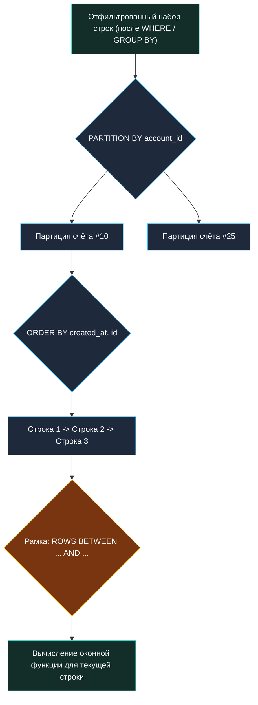
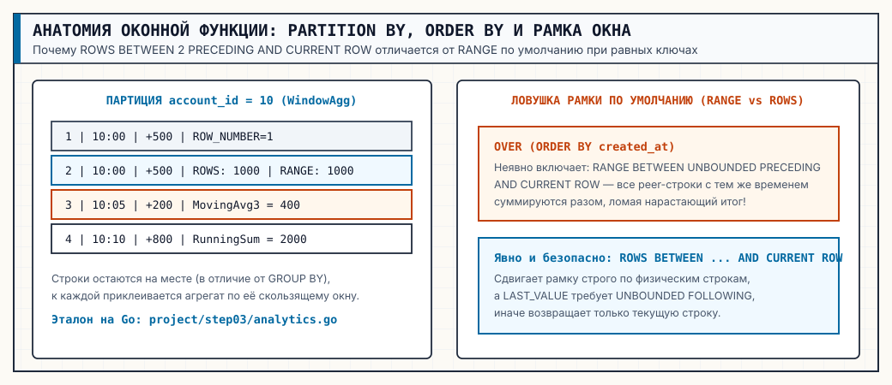

*Вычисления по связанным строкам без схлопывания выборки, анатомия OVER, узел WindowAgg и цена сортировки в work_mem, ловушка RANGE против ROWS и логический порядок выполнения SQL.*

> «В идеальном мире прикладному программисту достаточно знать только API — без того, как этот API реализован и к какому железу он обращается. В реальности же чуть более глубокие знания порой оказываются весьма кстати.»  
> — Чарльз Петцольд, *Code: The Hidden Language of Computer Hardware and Software*

В [[7. GROUP BY и агрегатные функции]] мы сворачивали тысячи записей `ledger_entries` в одну итоговую строку на счёт. Для месячного отчёта это удобно. Но у `GROUP BY` есть жёсткое свойство: он безвозвратно **схлопывает** исходные строки. Вы теряете идентификатор каждой проводки, её точное время и отдельную сумму.

В `LedgerPulse` часто нужно обратное: вывести ленту **каждой** проводки по счёту и тут же в соседних столбцах показать текущий нарастающий баланс после этой операции, общий оборот счёта и долю данной проводки в дневном объёме. До появления стандарта **SQL:2003** инженеры решали это коррелированными подзапросами в `SELECT` (вырождавшимися в $O(N^2)$ повторных чтений страниц) либо рассчитывали агрегаты в подзапросе и клеили их обратно через `JOIN`.

**Оконные функции (*Window Functions*)** вычисляют агрегаты и ранги по группе связанных с текущей строкой записей, **не схлопывая сами строки**. На вход подаётся $N$ строк — на выходе остаётся ровно $N$ строк, обогащённых вычисленным контекстом.

---

## Анатомия клаузы OVER()

Признак оконной функции в SQL — синтаксическая конструкция `OVER (...)` сразу после вызова функции. Именно `OVER` сообщает парсеру и планировщику, что перед ними не обычная групповая агрегация, а расчёт по виртуальному «окну» вокруг текущей строки:

```sql
SELECT
    id,
    account_id,
    amount,
    -- Обычный SUM(amount) без GROUP BY вызвал бы ошибку смешивания уровней,
    -- а с OVER () он добавляет общую сумму по всей выборке к каждой строке.
    SUM(amount) OVER () AS global_net_flow
FROM ledger_entries
WHERE created_at >= '2026-05-01';
```

Пустые скобки `OVER ()` задают единое окно размером во всю результирующую таблицу. Чтобы управлять геометрией окна, внутри `OVER (...)` комбинируют три секции:

1. **`PARTITION BY`** — делит набор данных на независимые секции (партиции) по значению ключа, например `account_id`. Это смысловой аналог `GROUP BY` без физического сжатия строк: в начале каждой новой партиции расчёт начинается с нуля.
2. **`ORDER BY`** — задаёт строгий порядок строк внутри каждой партиции. Он обязателен для нарастающих итогов, сдвигов и функций ранжирования.
3. **Рамка окна (`ROWS` / `RANGE` / `GROUPS`)** — определяет точные границы скользящего подмножества строк внутри партиции относительно текущей строки.



---

## Под капотом: узел WindowAgg и цена сортировки

Обычный `SELECT id, amount FROM ledger_entries` исполнитель PostgreSQL умеет отдавать клиенту поточно — по мере чтения 8-килобайтных страниц из буферного пула. С оконными функциями потоковая выдача с первой же прочитанной страницы невозможна: чтобы посчитать сумму или ранг по партиции, движок обязан собрать и упорядочить строки этой партиции.

В плане `EXPLAIN` за оконные вычисления отвечает специализированный узел **`WindowAgg`**:

```text
WindowAgg  (cost=1420.15..1645.15 rows=10000 width=32)
  ->  Sort  (cost=1420.15..1445.15 rows=10000 width=24)
        Sort Key: account_id, created_at, id
        Sort Method: quicksort  Memory: 1024kB
        ->  Seq Scan on ledger_entries  (cost=0.00..750.00 rows=10000 width=24)
```

Физический конвейер обработки проходит три этапа:

1. **Реляционная подготовка.** Исполнитель выполняет сканирование таблиц (`Seq Scan` / `Index Scan`), фильтрацию `WHERE`, соединения `JOIN`, классическую группировку `GROUP BY` и фильтрацию групп `HAVING`.
2. **Сортировка потока (`Sort`).** Промежуточные кортежи сортируются по ключам `PARTITION BY`, а внутри каждой партиции — по ключам `ORDER BY`. Если в одном `SELECT` стоят три оконные функции с разными `OVER (...)`, планировщик вставит в план несколько узлов `Sort` подряд. Если же индекс уже даёт нужный порядок (например, покрывающий индекс `(account_id, created_at, id)` из `002_indexes.sql` при обходе с нужным направлением), узел `Sort` может исчезнуть из плана.
3. **Проход `WindowAgg`.** Узел читает отсортированный поток, удерживая в памяти состояние только **одной активной партиции** за раз. Как только меняется значение `account_id`, текущая партиция закрывается, буфер очищается, и расчёт стартует заново.

### Физика памяти и риск spill to disk

Сортировка в `WindowAgg` — вычислительно тяжёлая операция со сложностью $O(N \log N)$:

* **Кэши CPU.** Алгоритмы сортировки (quicksort / external merge sort) постоянно переставляют указатели и сравнивают кортежи в памяти, порождая промахи кэшей L1/L2 процессора.
* **Переполнение `work_mem`.** Пока активная партиция и буфер сортировки укладываются в `work_mem` (по умолчанию 4 МБ), всё происходит в оперативной памяти (~100 нс). Но стоит написать `PARTITION BY date_trunc('day', created_at)` на таблице с миллионом проводок в сутки — и `work_mem` переполняется. PostgreSQL переключается во внешнюю сортировку (*external merge*) и сбрасывает временные файлы на диск (`temp_files`), где задержка чтения возрастает в тысячи раз (~100 мкс на NVMe, ~10 мс на HDD).

> [!tip] Оптимизация: переименование одинаковых окон через `WINDOW`
> Если несколько выражений в `SELECT` используют одну и ту же геометрию окна, опишите его один раз в секции `WINDOW` после `HAVING`:
> ```sql
> SELECT
>     id,
>     account_id,
>     amount,
>     SUM(amount) OVER w AS running_balance,
>     COUNT(*)    OVER w AS entries_so_far
> FROM ledger_entries
> WINDOW w AS (
>     PARTITION BY account_id
>     ORDER BY created_at, id
>     ROWS BETWEEN UNBOUNDED PRECEDING AND CURRENT ROW
> );
> ```
> Это избавляет от дублирования кода и гарантирует, что планировщик обойдётся одним узлом `Sort` и одним `WindowAgg`.

---

## Рамки окна: коварство RANGE против ROWS



Когда вы указываете в `OVER (...)` сортировку `ORDER BY`, но не пишете рамку окна явно, поведение функции меняется. По стандарту SQL неявной рамкой по умолчанию при наличии `ORDER BY` становится:

```sql
RANGE BETWEEN UNBOUNDED PRECEDING AND CURRENT ROW
```

Именно это правило позволяет лаконично считать нарастающий итог (*running total*) от начала партиции до текущей строки. Но у неявного `RANGE` прячется опасная ловушка.

* **`ROWS`** отсчитывает **физические строки** в отсортированном потоке. Конструкция `ROWS BETWEEN UNBOUNDED PRECEDING AND CURRENT ROW` суммирует строго от первой строки партиции до текущей записи, даже если у соседей совпадает ключ сортировки.
* **`RANGE`** отсчитывает **логические значения** выражения `ORDER BY`. Все строки с одинаковым значением ключа сортировки считаются равными (*peers*), и `RANGE` включает в текущую рамку **их все сразу**.

Посмотрим, как это ломает расчёт текущего баланса в `LedgerPulse`, если две проводки по счёту `#10` записаны с одинаковым `created_at` (например, основное списание и комиссия в рамках одной транзакции):

| `id` | `created_at` | `amount` | Нарастающий итог (`RANGE`, по умолчанию) | Нарастающий итог (`ROWS`) |
| :--- | :--- | ---: | ---: | ---: |
| 101 | `2026-05-01 10:00:00` | +1000 | 1000 | 1000 |
| 102 | `2026-05-01 10:00:05` | -200 | **750** | **800** |
| 103 | `2026-05-01 10:00:05` | -50 | **750** | **750** |

> [!warning] Ловушка: скачки нарастающего итога при совпадающих таймстемпах
> При `ORDER BY created_at` без явного `ROWS` строки `102` и `103` попали в один логический `RANGE`, и у обеих отобразился итог `750`. В финансовой выписке такой отчёт выглядит как ошибка баланса.
>
> Чтобы гарантировать детерминированный построчный итог, всегда:
> 1. Явно указывайте **`ROWS BETWEEN UNBOUNDED PRECEDING AND CURRENT ROW`**.
> 2. Добавляйте уникальный tie-breaker (первичный ключ `id`) в сортировку: `ORDER BY created_at, id`.

Если же внутри упорядоченного окна нужно получить сумму **по всей партиции целиком** (например, чтобы посчитать долю каждой проводки в полном обороте счёта), расширьте правую границу до конца секции:

```sql
SUM(ABS(amount)) OVER (
    PARTITION BY account_id
    ORDER BY created_at, id
    ROWS BETWEEN UNBOUNDED PRECEDING AND UNBOUNDED FOLLOWING
)
```

*(Или просто опустите `ORDER BY` в этом конкретном `OVER (PARTITION BY account_id)`, если порядок для суммы не важен — тогда рамка по умолчанию охватывает всю партицию.)*

---

## Логический порядок выполнения SQL

Новички часто удивляются, почему нельзя отфильтровать строки по результату оконной функции прямо в `WHERE`. Причина кроется в строгом порядке логических фаз обработки запроса движком СУБД:

1. `FROM` и `JOIN` — сборка базовых отношений и соединений.
2. `WHERE` — фильтрация отдельных кортежей.
3. `GROUP BY` — схлопывание строк в группы.
4. `HAVING` — фильтрация агрегированных групп.
5. **Оконные функции (`WindowAgg`)** — вычисления поверх групп и отфильтрованных строк.
6. `SELECT` — проекция итоговых столбцов и псевдонимов.
7. `DISTINCT` — удаление дубликатов.
8. `ORDER BY` — финальная сортировка результата клиенту.
9. `LIMIT` и `OFFSET` — усечение выборки.

В момент работы `WHERE` оконные функции ещё физически не вычислялись, а псевдонимы из `SELECT` не существуют. Попытка написать фильтр напрямую завершится ошибкой:

```sql
SELECT id, account_id, amount,
       SUM(amount) OVER (PARTITION BY account_id ORDER BY created_at, id
                         ROWS BETWEEN UNBOUNDED PRECEDING AND CURRENT ROW) AS running_balance
FROM ledger_entries
WHERE running_balance < 0;
```

Вывод PostgreSQL:

```text
ERROR:  column "running_balance" does not exist
LINE 5: WHERE running_balance < 0;
```

Чтобы отфильтровать строки по значению оконной функции, оберните расчёт в CTE (см. [[1. CTE и выражения WITH — читаемость и материализация]]) и фильтруйте уже во внешнем `SELECT`:

```sql
WITH ledger_with_balance AS (
    SELECT
        id,
        account_id,
        amount,
        created_at,
        SUM(amount) OVER (
            PARTITION BY account_id
            ORDER BY created_at, id
            ROWS BETWEEN UNBOUNDED PRECEDING AND CURRENT ROW
        ) AS running_balance
    FROM ledger_entries
)
SELECT id, account_id, amount, running_balance
FROM ledger_with_balance
WHERE running_balance < 0;
```

Заметьте ещё одно следствие порядка фаз: поскольку оконные функции исполняются **после `GROUP BY`**, их можно комбинировать с групповыми агрегатами в одном запросе — либо явно разносить на два шага в CTE, как это сделано в `DailySummarySQL` из `project/step03/analytics.go`, где сначала `GROUP BY` вычисляет дневную дельту `net_delta`, а затем `SUM(net_delta) OVER (PARTITION BY account_id ORDER BY day)` накапливает дневной баланс.

---

## Интеграция с Go 1.24: память при потоковом чтении

В отличие от `GROUP BY`, оконная выборка сохраняет все исходные строки. Если запрос возвращает 100 000 проводок по счетам с нарастающим балансом, наивный цикл `var out []EntryBalance` с `append` в пустой слайс вызовет каскад реаллокаций базового массива (рост в 1.5–2 раза) и нагрузит сборщик мусора Go копированием мегабайтов данных в куче.

Выделяйте начальную ёмкость слайса заранее и используйте прямое сканирование полей через `rows.Scan` без рефлексии:

```go
package ledger

import (
	"context"
	"database/sql"
	"fmt"
	"time"
)

type EntryBalance struct {
	ID             int64
	AccountID      int64
	Amount         int64
	RunningBalance int64
	CreatedAt      time.Time
}

const runningBalanceSQL = `
SELECT
    id,
    account_id,
    amount,
    SUM(amount) OVER (
        PARTITION BY account_id
        ORDER BY created_at, id
        ROWS BETWEEN UNBOUNDED PRECEDING AND CURRENT ROW
    ) AS running_balance,
    created_at
FROM ledger_entries
WHERE account_id = $1 AND created_at >= $2
ORDER BY created_at, id;`

func GetAccountRunningBalances(
	ctx context.Context, db *sql.DB, accountID int64, since time.Time, expectedCap int,
) ([]EntryBalance, error) {
	rows, err := db.QueryContext(ctx, runningBalanceSQL, accountID, since)
	if err != nil {
		return nil, fmt.Errorf("query running balances: %w", err)
	}
	defer rows.Close()

	// Предварительная аллокация ёмкости снижает число реаллокаций слайса в куче.
	res := make([]EntryBalance, 0, max(expectedCap, 64))
	for rows.Next() {
		var item EntryBalance
		if err := rows.Scan(
			&item.ID, &item.AccountID, &item.Amount, &item.RunningBalance, &item.CreatedAt,
		); err != nil {
			return nil, fmt.Errorf("scan entry balance: %w", err)
		}
		res = append(res, item)
	}
	if err := rows.Err(); err != nil {
		return nil, fmt.Errorf("iterate running balance rows: %w", err)
	}
	return res, nil
}
```

---

> [!tip] Собеседование [Middle]
> **Вопрос:** В чём принципиальная разница между `GROUP BY` и `OVER (PARTITION BY ...)` с точки зрения плана выполнения и потребления ресурсов БД?
>
> **Ответ:** `GROUP BY` схлопывает строки в одну запись на группу, а `PARTITION BY` оставляет каждую исходную строку на месте, добавляя вычисленную колонку.
>
> Физически `GROUP BY` почти всегда дешевле: планировщик может выбрать однопроходный алгоритм `HashAggregate`, который держит в хеш-таблице только по одному аккумулятору на группу и не требует сортировки всего набора строк. Оконная функция с `ORDER BY` опирается на узел `WindowAgg`, которому нужна предварительная сортировка `Sort` стоимостью $O(N \log N)$ и достаточный буфер `work_mem` для удержания всей активной партиции без сброса на диск.

---

## Упражнения

### 1. Базовое: доля проводки в обороте счёта

Напишите SQL-запрос к таблице `ledger_entries`, который для каждой проводки возвращает `id`, `account_id`, `amount`, общее число проводок по этому счёту и долю абсолютной суммы этой проводки в суммарном абсолютном обороте счёта в процентах (округлённую до 2 знаков). Исходные строки схлопывать нельзя.

> [!solution] Показать решение
> ```sql
> SELECT
>     id,
>     account_id,
>     amount,
>     COUNT(*) OVER (PARTITION BY account_id) AS account_tx_count,
>     ROUND(
>         100.0 * ABS(amount) / SUM(ABS(amount)) OVER (PARTITION BY account_id),
>         2
>     ) AS pct_of_turnover
> FROM ledger_entries
> ORDER BY account_id, id;
> ```
>
> Поле `amount` в схеме `LedgerPulse` имеет ограничение `CHECK (amount <> 0)`, поэтому делитель `SUM(ABS(amount))` гарантированно строго больше нуля и деление на ноль исключено. Одинаковые окна `OVER (PARTITION BY account_id)` оптимизатор объединит в один проход `Sort` + `WindowAgg`.

### 2. Практическое: исправление прыгающего нарастающего итога

В отчёте о балансе счёта аналитик заметил, что две проводки с одинаковым временем `created_at` показывают одинаковую сумму `running_balance`:

```sql
SELECT
    id,
    created_at,
    amount,
    SUM(amount) OVER (PARTITION BY account_id ORDER BY created_at) AS running_balance
FROM ledger_entries
WHERE account_id = $1;
```

Исправьте запрос так, чтобы баланс менялся строго последовательно от проводки к проводке и не зависел от физического порядка чтения страниц после `VACUUM`.

> [!solution] Показать решение
> ```sql
> SELECT
>     id,
>     created_at,
>     amount,
>     SUM(amount) OVER (
>         PARTITION BY account_id
>         ORDER BY created_at, id
>         ROWS BETWEEN UNBOUNDED PRECEDING AND CURRENT ROW
>     ) AS running_balance
> FROM ledger_entries
> WHERE account_id = $1
> ORDER BY created_at, id;
> ```
>
> Добавление уникального первичного ключа `id` в `ORDER BY` делает порядок внутри партиции детерминированным, а явная рамка `ROWS` привязывает суммирование к физическим строкам вместо логического `RANGE`.

### 3. Со звёздочкой (\*): цена двух разных `OVER` в `EXPLAIN`

Рассмотрите запрос:

```sql
SELECT
    id,
    account_id,
    currency,
    amount,
    SUM(amount) OVER (PARTITION BY account_id ORDER BY created_at, id) AS acc_running,
    SUM(amount) OVER (PARTITION BY currency ORDER BY amount DESC)     AS cur_running
FROM ledger_entries;
```

Сколько узлов `Sort` и `WindowAgg` появится в плане выполнения и почему? Как вы измените запрос, если окажется, что для `cur_running` порядок внутри валюты не нужен (требуется просто суммарный поток по валюте)?

> [!solution] Показать решение
> В исходном запросе в плане появятся **два узла `Sort`** и **два узла `WindowAgg`** последовательно: ключи партиционирования и сортировки (`account_id, created_at, id` против `currency, amount DESC`) несовместимы, поэтому движок вынужден отсортировать все строки дважды.
>
> Если для `cur_running` нужен только общий итог по валюте без нарастания (`OVER (PARTITION BY currency)`), вторая сортировка по `amount DESC` всё равно потребуется из-за смены ключа партиции с `account_id` на `currency`, но сама сортировка по `(currency)` дешевле, чем по `(currency, amount DESC)`, а рамка не требует пошагового отслеживания порядка. Кроме того, если таких общих агрегатов по валюте много, их иногда выгоднее вынести в лёгкий CTE с `GROUP BY currency` (однопроходный `HashAggregate`) и присоединить через `JOIN`, избегая повторной сортировки большой таблицы `ledger_entries`.

---

Мы разобрали механику `OVER`, `WindowAgg` и рамок окна. Но помимо агрегатных функций вроде `SUM` и `COUNT`, окна раскрывают мощнейший класс задач упорядочивания: выбор последних N операций на каждый счёт, построение рейтингов и удаление дубликатов. Как работают `ROW_NUMBER`, `RANK` и `DENSE_RANK` при равенстве значений и как они отражаются в Go-коде `project/step03/analytics.go`, разберём в следующей главе: [[4. Ранжирование — ROW_NUMBER, RANK и DENSE_RANK]].
