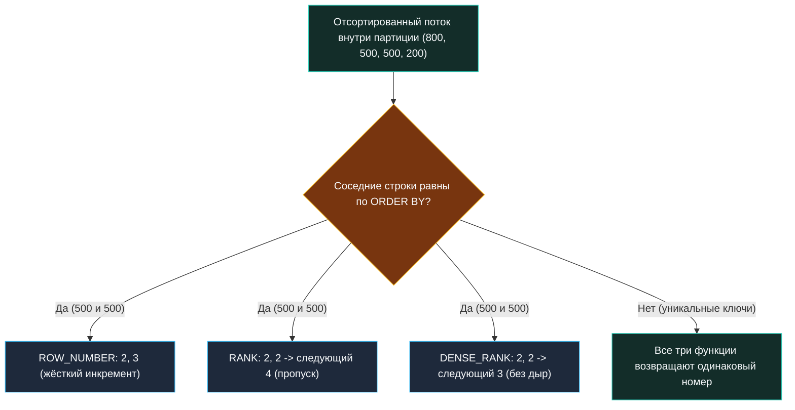

*Как ROW_NUMBER, RANK и DENSE_RANK обрабатывают ничьи через группы равных, почему недетерминированный порядок ломает Gather Merge, сравнение с DISTINCT ON, очистка дубликатов через CTAS и сверка с project/step03/analytics.go.*

> «Go поощряет понимание устройства современных компьютеров — и прежде всего важности локальности данных в памяти. Его встроенные типы и большинство структур стандартной библиотеки спроектированы так, чтобы естественно работать без явной инициализации и скрытых конструкторов, поэтому в коде спрятано сравнительно мало лишних аллокаций и записей в память.»  
> — Алан Донован, Брайан Керниган, *The Go Programming Language*

В [[3. Оконные функции — OVER, PARTITION BY и рамки окна]] мы научились считать суммы и счётчики поверх связанных строк через `WindowAgg`. Теперь перейдём к задаче, с которой ежедневно сталкивается любой бэкенд-разработчик: упорядочивание и отбор лучших строк **внутри каждой группы**.

Обычный `ORDER BY ... LIMIT 3` (см. [[4. ORDER BY, LIMIT и пагинация (OFFSET против keyset)]]) отбирает три записи по всей таблице целиком. Но в `LedgerPulse` нужна иная выборка: *вернуть три самые свежие проводки для каждого активного счёта* или *удалить дубликаты повторно пришедших событий, оставив по одному оригиналу на ключ идемпотентности*. Для этого стандарт SQL предоставляет тройку оконных функций ранжирования: `ROW_NUMBER()`, `RANK()` и `DENSE_RANK()`.

---

## Тройка функций ранжирования на данных LedgerPulse

Все три функции вычисляют целое число для каждой строки внутри её партиции согласно порядку `ORDER BY`. Разница между ними проявляется ровно в одном месте: **как алгоритм поступает при «ничьей»**, когда у двух или более строк совпадают значения ключей сортировки.

Возьмём четыре тестовые проводки счёта `#10` прямо из `project/step03/analytics_test.go`:

| `id` | `account_id` | `amount` |
| ---: | ---: | ---: |
| 1 | 10 | 500 |
| 2 | 10 | 500 |
| 3 | 10 | 200 |
| 4 | 10 | 800 |

Отранжируем их по убыванию суммы `ORDER BY amount DESC`:

```sql
SELECT
    id,
    amount,
    ROW_NUMBER() OVER (PARTITION BY account_id ORDER BY amount DESC, id ASC) AS rn,
    RANK()       OVER (PARTITION BY account_id ORDER BY amount DESC)         AS rnk,
    DENSE_RANK() OVER (PARTITION BY account_id ORDER BY amount DESC)         AS drnk
FROM ledger_entries
WHERE account_id = 10;
```

Результат для всех четырёх строк:

| `id` | `amount` | `ROW_NUMBER` (`rn`) | `RANK` (`rnk`) | `DENSE_RANK` (`drnk`) |
| ---: | ---: | ---: | ---: | ---: |
| 4 | 800 | 1 | 1 | 1 |
| 1 | 500 | 2 | 2 | 2 |
| 2 | 500 | 3 | 2 | 2 |
| 3 | 200 | 4 | 4 | 3 |

Разберём механику каждой функции:

1. **`ROW_NUMBER()`** — строгий счётчик кортежей: `1, 2, 3, 4...`. Даже если две проводки имеют одинаковую сумму `500`, функция присвоит им разные номера (`2` и `3`). Без дополнительного уникального поля `id` в `ORDER BY` распределение номеров между строками `1` и `2` будет **недетерминированным**.
2. **`RANK()`** — модель спортивного пьедестала. Обе проводки по `500` делят 2-е место (`rnk = 2`), но 3-я позиция исчезает: следующая проводка на `200` получает ранг `4` (равный её реальной порядковой позиции в потоке).
3. **`DENSE_RANK()`** («плотный ранг») — присваивает равным строкам одинаковый ранг (`2` и `2`), но **не оставляет дыр** в нумерации: проводка на `200` получает ранг `3`.



---

## Под капотом: Peer Groups, детерминизм и Gather Merge

Чтобы понимать поведение этих функций в продакшене, заглянем в алгоритм узла `WindowAgg`. Когда предварительно отсортированный поток строк поступает в `WindowAgg`, движок сравнивает соседние кортежи по ключам `ORDER BY` из клаузы `OVER`:

* Все идущие подряд строки с одинаковыми значениями ключей сортировки образуют временную **группу равных (*Peer Group*)**.
* **`RANK()` и `DENSE_RANK()`** работают на границах peer groups. Пока движок не перешёл к новой группе, ранг не меняется. При смене группы `DENSE_RANK()` прибавляет `1` к прошлому рангу, а `RANK()` прибавляет размер завершившейся группы (или просто записывает текущий счётчик строки).
* **`ROW_NUMBER()`** игнорирует границы peer groups: она держит счётчик в локальном регистре и прибавляет `1` на каждой обработанной строке.

Как и другие оконные вычисления, ранжирование требует отсортированного потока по ключам `(PARTITION BY, ORDER BY)`: при нехватке `work_mem` сортировка уходит во временные файлы на диске.

> [!warning] Ловушка: недетерминированный `ROW_NUMBER` и параллельный `Gather Merge`
> Запрос вида `ROW_NUMBER() OVER (PARTITION BY account_id ORDER BY created_at DESC)` таит «плавающий баг». Если в рамках одной пакетной транзакции на счёт упали две проводки с одинаковым `created_at`, их относительный порядок зависит от физического расположения кортежей на 8-килобайтных страницах таблицы. Сегодня первой придёт запись A, а завтра после фоновой очистки `VACUUM` или перестроения индекса — запись B.
>
> На многоядерных серверах PostgreSQL распараллеливает сортировку и сборку потоков через фоновых воркеров (`Parallel Worker`) и узел **`Gather Merge`**. Разница в микросекундах между ядрами CPU, задержками кэша L3 и планировщиком ОС перетасует порядок равных строк на каждом запуске. Если на такой `ROW_NUMBER` завязана пагинация API, пользователь увидит дубликаты на соседних страницах и пропустит часть записей.
>
> **Золотое правило:** всегда добавляйте в конец `ORDER BY` уникальный tie-breaker (первичный ключ): `ORDER BY created_at DESC, id DESC`.

---

## Паттерн «Top-N per Group» против DISTINCT ON

Задача из реального `LedgerPulse`: *для каждого активного счёта получить 3 его последние проводки*.

Поскольку оконные функции выполняются после `WHERE`, отфильтровать `rn <= 3` прямо внутри того же блока `SELECT` нельзя — выносим ранжирование в CTE:

```sql
WITH ranked_entries AS (
    SELECT
        le.account_id,
        le.id AS entry_id,
        le.amount,
        le.currency,
        le.created_at,
        ROW_NUMBER() OVER (
            PARTITION BY le.account_id
            ORDER BY le.created_at DESC, le.id DESC
        ) AS rn
    FROM ledger_entries le
    JOIN accounts a ON a.id = le.account_id
    WHERE a.status = 'active'
)
SELECT account_id, entry_id, amount, currency, created_at
FROM ranked_entries
WHERE rn <= 3
ORDER BY account_id, rn;
```

### Когда `DISTINCT ON` быстрее, чем `ROW_NUMBER()`

Если задача сужается до **Top-1 на группу** (например, *найти только самую последнюю проводку каждого счёта*), в PostgreSQL есть специализированный нестандартный оператор `DISTINCT ON` (подробнее об уникальности см. [[13. DISTINCT, дубликаты и операции над множествами]]):

```sql
SELECT DISTINCT ON (le.account_id)
    le.account_id,
    le.id AS entry_id,
    le.amount,
    le.created_at
FROM ledger_entries le
ORDER BY le.account_id, le.created_at DESC, le.id DESC;
```

Сравним оба подхода с точки зрения планировщика и железа:

* **`DISTINCT ON`** для Top-1 не нуждается в узле `WindowAgg` и не выделяет состояние оконных аккумуляторов. Если на таблице есть составной индекс `(account_id, created_at DESC, id DESC)` (а в `002_indexes.sql` у нас создан именно такой покрывающий индекс `idx_ledger_entries_account_created` с `INCLUDE (amount, currency, transaction_id)`), PostgreSQL может прочитать индекс за один упорядоченный проход (*Index Only Scan*) и сразу отдавать по первой строке на каждый `account_id`.
* **`ROW_NUMBER()`** выигрывает в двух случаях: когда нужен произвольный **Top-N при $N > 1$** (`rn <= 3`, `rn <= 10`) и когда SQL должен оставаться переносимым по стандарту ANSI SQL на другие СУБД (MySQL 8+, SQLite, ClickHouse). А если счетов немного (скажем, тысяча), а проводок десятки миллионов, для маленького $N$ полезно также знать альтернативу через `CROSS JOIN LATERAL (... ORDER BY created_at DESC, id DESC LIMIT 3)` — она точечно делает $N$ быстрых спусков по B-Tree без сканирования всей таблицы `ledger_entries`.

---

## Удаление дубликатов через ROW_NUMBER

Вторая частая боевая задача — вычистить дубликаты, попавшие в таблицу до установки уникального ограничения (например, повторные входящие события в буферной таблице `raw_webhooks`). Оставляем самую раннюю запись на каждый `event_key`, остальные удаляем через `DELETE ... USING` с CTE:

```sql
WITH duplicates AS (
    SELECT
        id,
        ROW_NUMBER() OVER (
            PARTITION BY event_key
            ORDER BY received_at ASC, id ASC
        ) AS rn
    FROM raw_webhooks
)
DELETE FROM raw_webhooks w
USING duplicates d
WHERE w.id = d.id
  AND d.rn > 1;
```

> [!warning] Масштаб: почему массовый `DELETE` опасен на десятках миллионов строк
> Если таблица насчитывает 50 миллионов строк и 30% из них — дубликаты, единичный массовый `DELETE` захватит строковые блокировки на миллионы кортежей, раздует журнал предзаписи WAL гигабайтами изменений, вызовет всплеск дискового I/O и оставит миллионы «мёртвых» версий строк (*dead tuples*), с которыми потом часами будет бороться `autovacuum`.
>
> В высоконагруженных системах вместо массового `DELETE` применяют паттерн **CTAS (*Create Table As Select*)**: выбирают только уникальные строки (`WHERE rn = 1`) в новую чистую таблицу `raw_webhooks_clean`, строят на ней индексы без фрагментации и в короткой транзакции меняют таблицы именами через `ALTER TABLE ... RENAME`.

---

## Сверка с Go 1.24: `project/step03/analytics.go` и Top-N в сервисе

Заглянем в файл `project/step03/analytics.go` нашего сквозного проекта `LedgerPulse`. Функция `ComputeAccountWindow` моделирует в чистом Go ровно те же правила партиционирования и ранжирования, которые исполняет узел `WindowAgg` в PostgreSQL. Посмотрим на ключевой фрагмент расчёта `RANK()` и `DENSE_RANK()` по `amount DESC` внутри счёта:

```go
// Фрагмент логики из project/step03/analytics.go:
// предвычисление RANK и DENSE_RANK по amount DESC внутри партиции account_id.
byAmount := slices.Clone(list)
slices.SortFunc(byAmount, func(a, b Entry) int {
	if a.Amount > b.Amount {
		return -1
	}
	if a.Amount < b.Amount {
		return 1
	}
	return int(a.ID - b.ID) // детерминированный tie-breaker
})

rankByID := make(map[int64]int)
denseByID := make(map[int64]int)
curDense := 0
for i, e := range byAmount {
	if i == 0 || e.Amount != byAmount[i-1].Amount {
		rankByID[e.ID] = i + 1
		curDense++
	} else {
		rankByID[e.ID] = rankByID[byAmount[i-1].ID]
	}
	denseByID[e.ID] = curDense
}
```

Обратите внимание на две детали этого кода Go 1.24:

1. **Граница Peer Group.** Условие `e.Amount != byAmount[i-1].Amount` — точная программная реализация перехода к новой группе равных: при совпадении суммы `RANK` копирует ранг предыдущего элемента (`rankByID[byAmount[i-1].ID]`), а при смене группы ставит текущую физическую позицию `i + 1`. `DENSE_RANK` просто делает `curDense++`.
2. **Детерминированный tie-breaker.** Когда суммы равны, `slices.SortFunc` сравнивает `a.ID - b.ID`, гарантируя воспроизводимый порядок, а в `RowNumber` внутри `ComputeAccountWindow` используется сортировка по `(CreatedAt, ID)`.

Теперь посмотрим, как правильно принимать плоский результат SQL-запроса «Top-3 проводки на каждый счёт» в Go-репозитории без лишнего давления на сборщик мусора:

```go
package ledger

import (
	"context"
	"database/sql"
	"fmt"
	"time"
)

type AccountEntry struct {
	ID        int64
	Amount    int64
	Currency  string
	CreatedAt time.Time
}

type AccountTopEntries struct {
	AccountID int64
	Entries   []AccountEntry
}

const top3EntriesSQL = `
WITH ranked AS (
    SELECT
        account_id, id, amount, currency, created_at,
        ROW_NUMBER() OVER (
            PARTITION BY account_id
            ORDER BY created_at DESC, id DESC
        ) AS rn
    FROM ledger_entries
)
SELECT account_id, id, amount, currency, created_at
FROM ranked
WHERE rn <= 3
ORDER BY account_id, rn;`

func FetchTop3EntriesPerAccount(ctx context.Context, db *sql.DB) (map[int64]*AccountTopEntries, error) {
	rows, err := db.QueryContext(ctx, top3EntriesSQL)
	if err != nil {
		return nil, fmt.Errorf("query top3 entries: %w", err)
	}
	defer rows.Close()

	// Храним указатель *AccountTopEntries, чтобы модифицировать слайс Entries на месте.
	result := make(map[int64]*AccountTopEntries)
	for rows.Next() {
		var (
			accountID int64
			entry     AccountEntry
		)
		if err := rows.Scan(
			&accountID, &entry.ID, &entry.Amount, &entry.Currency, &entry.CreatedAt,
		); err != nil {
			return nil, fmt.Errorf("scan top3 entry: %w", err)
		}

		acc, exists := result[accountID]
		if !exists {
			acc = &AccountTopEntries{
				AccountID: accountID,
				// Верхняя граница известна заранее (<= 3): исключаем реаллокации слайса.
				Entries: make([]AccountEntry, 0, 3),
			}
			result[accountID] = acc
		}
		acc.Entries = append(acc.Entries, entry)
	}
	if err := rows.Err(); err != nil {
		return nil, fmt.Errorf("iterate top3 rows: %w", err)
	}
	return result, nil
}
```

Хранение указателей `map[int64]*AccountTopEntries` вместо значений `map[int64]AccountTopEntries` решает сразу две проблемы: элементы мапы в Go неадресуемы (поэтому `result[id].Entries = append(...)` просто не скомпилируется), а извлечение копии структуры с последующей обратной записью породило бы лишние копирования памяти. Заданная ёмкость `cap = 3` позволяет слайсу не расширяться ни разу.

---

> [!tip] Собеседование [Middle]
> **Вопрос:** В чём разница между `RANK()` и `DENSE_RANK()`? Приведите сценарий, где выбор `ROW_NUMBER()` вместо них создаст скрытый баг в бизнес-логике.
>
> **Ответ:** При совпадении значений сортировки обе функции присваивают равным строкам одинаковый ранг, но `RANK()` оставляет пропуск в нумерации на размер группы равных (`1, 1, 3`), а `DENSE_RANK()` продолжает последовательность без разрывов (`1, 1, 2`).
>
> Баг с `ROW_NUMBER()` возникает, когда нужно отобрать **всех** победителей или все операции с максимальной суммой («показать все счета, разделившие первое место по дневному обороту»). Если три счёта набрали одинаковый максимум, условие `ROW_NUMBER() <= 1` вернёт только один случайный счёт из трёх, а остальные два несправедливо отбросит. Для таких задач необходимо использовать `RANK() = 1` или `DENSE_RANK() = 1` (а для топ-3 уникальных уровней результата — `DENSE_RANK() <= 3`).

---

## Упражнения

### 1. Базовое: три ранга по величине проводки

Для каждого счёта из таблицы `ledger_entries` отранжируйте его проводки по модулю суммы `ABS(amount) DESC` (от самых крупных к самым мелким). Выведите `account_id`, `id`, `amount` и три колонки рангов: `rn` (`ROW_NUMBER` с детерминированным tie-breaker `id ASC`), `rnk` (`RANK`) и `drnk` (`DENSE_RANK`).

> [!solution] Показать решение
> ```sql
> SELECT
>     account_id,
>     id,
>     amount,
>     ROW_NUMBER() OVER (PARTITION BY account_id ORDER BY ABS(amount) DESC, id ASC) AS rn,
>     RANK()       OVER (PARTITION BY account_id ORDER BY ABS(amount) DESC)         AS rnk,
>     DENSE_RANK() OVER (PARTITION BY account_id ORDER BY ABS(amount) DESC)         AS drnk
> FROM ledger_entries
> ORDER BY account_id, rn;
> ```
>
> Обратите внимание: `ROW_NUMBER` сортирует по `(ABS(amount) DESC, id ASC)`, а `RANK` и `DENSE_RANK` — только по `ABS(amount) DESC`. Если бы вы добавили `id ASC` внутрь `RANK()`, то каждая строка образовала бы отдельную peer group из-за уникальности `id`, и `RANK()` выродился бы в `ROW_NUMBER()`.

### 2. Практическое: последняя проводка счёта — `ROW_NUMBER()` против `DISTINCT ON`

Напишите два SQL-запроса, возвращающих по **одной** самой свежей проводке (по `created_at DESC, id DESC`) для каждого счёта из `ledger_entries`: первый — через CTE и `ROW_NUMBER()`, второй — через `DISTINCT ON`. Укажите, какой индекс из `project/sql/migrations/002_indexes.sql` позволяет обоим вариантам избежать тяжёлой сортировки всей таблицы.

> [!solution] Показать решение
> **Вариант 1 (`ROW_NUMBER`):**
> ```sql
> WITH latest AS (
>     SELECT
>         account_id, id, transaction_id, amount, currency, created_at,
>         ROW_NUMBER() OVER (
>             PARTITION BY account_id
>             ORDER BY created_at DESC, id DESC
>         ) AS rn
>     FROM ledger_entries
> )
> SELECT account_id, id, transaction_id, amount, currency, created_at
> FROM latest
> WHERE rn = 1;
> ```
>
> **Вариант 2 (`DISTINCT ON`):**
> ```sql
> SELECT DISTINCT ON (account_id)
>     account_id, id, transaction_id, amount, currency, created_at
> FROM ledger_entries
> ORDER BY account_id, created_at DESC, id DESC;
> ```
>
> Оба запроса опираются на покрывающий составной индекс `idx_ledger_entries_account_created ON ledger_entries (account_id, created_at DESC, id DESC) INCLUDE (amount, currency, transaction_id)`. Поскольку все выбранные поля присутствуют в индексе (включая секцию `INCLUDE`), планировщик способен обойти индекс по порядку без обращения к страницам основной таблицы (*Index Only Scan*).

### 3. Со звёздочкой (\*): дедупликация с сохранением первого события

В таблице `tx_audit_log(id BIGINT, reference_id TEXT, payload JSONB, created_at TIMESTAMPTZ)` из-за сбоя продюсера появились дубликаты с одинаковым `reference_id`. Напишите запрос `DELETE ... USING` с CTE, который удаляет дубликаты, оставляя для каждого `reference_id` ровно **самую первую** запись (`created_at ASC`, при совпадении — наименьший `id`). Затем опишите план миграции на CTAS, если в таблице 40 миллионов строк и половина из них дубликаты.

> [!solution] Показать решение
> ```sql
> WITH ranked_logs AS (
>     SELECT
>         id,
>         ROW_NUMBER() OVER (
>             PARTITION BY reference_id
>             ORDER BY created_at ASC, id ASC
>         ) AS rn
>     FROM tx_audit_log
> )
> DELETE FROM tx_audit_log t
> USING ranked_logs r
> WHERE t.id = r.id
>   AND r.rn > 1;
> ```
>
> **Почему при 40 млн строк и 50% дубликатов нужен CTAS:** массовый `DELETE` создаст 20 млн мёртвых кортежей, сгенерирует гигантский объём WAL и заблокирует таблицу на долгое время. Вместо него в сервисном окне (или с догонкой изменений через триггер/очередь) выполняют:
> 1. `CREATE TABLE tx_audit_log_new AS SELECT id, reference_id, payload, created_at FROM (SELECT *, ROW_NUMBER() OVER (PARTITION BY reference_id ORDER BY created_at ASC, id ASC) AS rn FROM tx_audit_log) s WHERE rn = 1;`
> 2. Создают уникальный индекс на `tx_audit_log_new (reference_id)` и первичный ключ.
> 3. В короткой транзакции переименовывают таблицы (`ALTER TABLE tx_audit_log RENAME TO tx_audit_log_old; ALTER TABLE tx_audit_log_new RENAME TO tx_audit_log;`), проверяют статистику `ANALYZE` и позже удаляют старую таблицу.

---

Функции ранжирования присваивают позиционный номер строке в группе, но ничего не говорят о соседнем значении: на сколько сумма текущей проводки больше или меньше предыдущей операции по счёту? Как заглядывать в предыдущие и следующие строки без медленных самосоединений и почему функция `LAST_VALUE` почти всегда работает не так, как ожидают новички, разберём в следующей главе о сдвигах во времени (`LEAD`, `LAG`, `FIRST_VALUE`, `LAST_VALUE`).
