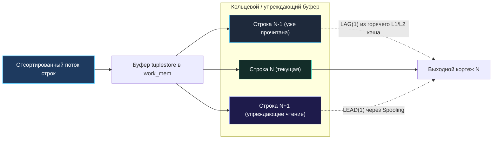

*Как сравнивать соседние проводки за один линейный проход без квадратичных самосоединений, как устроены кольцевой буфер `LAG` и упреждающее чтение `LEAD` в памяти СУБД и почему `LAST_VALUE` без явной рамки почти всегда ошибается.*

> «В идеальном мире прикладному программисту достаточно знать только API — без того, как этот API реализован и к какому железу он обращается. В реальности же чуть более глубокие знания порой оказываются весьма кстати.»  
> — Чарльз Петцольд

В `LedgerPulse` аудиторам и системе антифрода постоянно нужно сравнивать соседние операции одного счёта: сколько секунд прошло между двумя списаниями подряд, как изменилась сумма по сравнению с предыдущей проводкой и с какой операции счёт стартовал.

До появления оконных функций эту задачу решали соединением таблицы с самой собой (`Self-Join`) или коррелированными подзапросами:

```sql
-- Антипаттерн: поиск предыдущей проводки через Self-Join
SELECT curr.account_id, curr.id, curr.amount, prev.amount AS prev_amount
FROM ledger_entries curr
LEFT JOIN ledger_entries prev
    ON prev.account_id = curr.account_id
   AND prev.id = curr.id - 1;
```

Такой запрос ломается по трём причинам:
1. **Пропуски в `id`.** После любого `ROLLBACK` последовательность `IDENTITY` уходит вперёд, а между записями одного счёта вклиниваются проводки тысяч других счетов.
2. **Расхождение `id` и времени.** В конкурентных транзакциях строка с меньшим `id` может зафиксироваться позже или иметь более ранний `created_at`.
3. **Алгоритмическая цена.** Подзапрос `WHERE prev.created_at < curr.created_at ORDER BY ... LIMIT 1` или неравенство в `JOIN` превращают линейный проход в $O(N \log N)$ или $O(N^2)$ со множеством поисков по B-tree.

Оконные функции смещения `LAG`, `LEAD`, `FIRST_VALUE` и `LAST_VALUE` решают задачу за один последовательный проход без единого `JOIN`.

---

## Синтаксис и механика `LAG` и `LEAD`

Обе функции читают значение выражения из строки, смещённой относительно текущей внутри партиции:
* **`LAG`** смотрит **назад** (к строкам до текущей в порядке `ORDER BY`).
* **`LEAD`** смотрит **вперёд** (к строкам после текущей).

```sql
LAG  (expression [, offset [, default]]) OVER (PARTITION BY ... ORDER BY ...)
LEAD (expression [, offset [, default]]) OVER (PARTITION BY ... ORDER BY ...)
```

Аргументы:
* `expression` — столбец или выражение, значение которого нужно извлечь;
* `offset` — неотрицательное целое смещение в строках (по умолчанию `1`; при `0` берётся текущая строка);
* `default` — значение при выходе за границы партиции (по умолчанию `NULL`; тип обязан быть совместим с `expression`).

```sql
SELECT
    account_id,
    id,
    created_at,
    amount,
    LAG(amount, 1) OVER w                      AS prev_amount,
    LEAD(amount, 1, 0) OVER w                  AS next_amount,
    created_at - LAG(created_at) OVER w        AS time_since_prev
FROM ledger_entries
WHERE account_id = 42
WINDOW w AS (PARTITION BY account_id ORDER BY created_at, id);
```

Указание `id` после `created_at` в `ORDER BY` обязательно: если две проводки получили одинаковый timestamp, первичный ключ служит детерминированным разделителем ничьих (*tie-breaker*). Именованное окно `WINDOW w AS (...)` избавляет от дублирования кода и гарантирует планировщику единую сортировку потока.

---

## Границы партиции: `FIRST_VALUE`, `LAST_VALUE` и ловушка рамки

Чтобы сравнить каждую операцию с самой первой или самой свежей проводкой счёта, используют `FIRST_VALUE(expr)`, `LAST_VALUE(expr)` и `NTH_VALUE(expr, n)`.

Именно с `LAST_VALUE` связана классическая ошибка. Попробуйте предсказать, что выведет столбец `last_amount` для счёта с проводками `500`, `-200`, `800`:

```sql
SELECT
    id,
    amount,
    FIRST_VALUE(amount) OVER (PARTITION BY account_id ORDER BY created_at, id) AS first_amount,
    LAST_VALUE(amount)  OVER (PARTITION BY account_id ORDER BY created_at, id) AS last_amount
FROM ledger_entries
WHERE account_id = 42;
```

Результат удивит неподготовленного разработчика:

```text
 id | amount | first_amount | last_amount
----+--------+--------------+-------------
  1 |    500 |          500 |         500
  2 |   -200 |          500 |        -200
  3 |    800 |          500 |         800
```

> [!warning] Ловушка рамки по умолчанию для `LAST_VALUE`
> В отличие от `LAG` и `LEAD`, которые всегда работают по всей партиции, функции `FIRST_VALUE`, `LAST_VALUE` и `NTH_VALUE` ограничены **текущей рамкой окна** (*frame*). При наличии `ORDER BY` стандарт SQL неявно задаёт рамку `RANGE BETWEEN UNBOUNDED PRECEDING AND CURRENT ROW` (см. [[3. Оконные функции — OVER, PARTITION BY и рамки окна]]). Правая граница заканчивается на текущей строке, поэтому `LAST_VALUE` возвращает значение самой текущей строки.

Исправить это можно двумя способами:
1. **Явно расширить рамку до конца партиции (рекомендуемый вариант):**
   ```sql
   LAST_VALUE(amount) OVER (
       PARTITION BY account_id
       ORDER BY created_at, id
       ROWS BETWEEN UNBOUNDED PRECEDING AND UNBOUNDED FOLLOWING
   ) AS last_amount
   ```
   Порядок сортировки совпадает с окном `LAG` и `FIRST_VALUE`, поэтому планировщику не потребуется второй узел `Sort`.
2. **Развернуть сортировку и взять `FIRST_VALUE`:** `FIRST_VALUE(amount) OVER (PARTITION BY account_id ORDER BY created_at DESC, id DESC)`. Этот приём работает, но при сочетании с прямым `LAG` заставит СУБД сортировать партицию дважды в разных направлениях.

---

## Под капотом: `WindowAgg`, кольцевой буфер и Spooling

Преимущество `LAG` над `Self-Join` объясняется физикой работы процессора с памятью. `Self-Join` строит хэш-таблицу или многократно обращается к B-tree, порождая **случайный доступ к памяти** (*Random Access*): кэш-линии L1/L2 постоянно сбрасываются, а ядро CPU простаивает в ожидании данных из RAM (~100 нс против ~1 нс в кэше L1).

Оконный узел `WindowAgg` работает последовательно:



1. **Единый проход.** При наличии индекса `(account_id, created_at, id)` движок подаёт строки в `WindowAgg` сразу в нужном порядке через `Index Scan` без внешней сортировки.
2. **Кольцевой буфер для `LAG`.** Для `LAG(col, k)` узлу не нужна вся партиция целиком: в `work_mem` удерживается хвост длиной `k + 1` строк. Строка `N - 1` обрабатывалась наносекунды назад и всё ещё горяча в L1/L2 кэше процессора.
3. **Механизм Spooling для `LEAD`.** Поскольку дочерний узел выдаёт кортежи строго по одному вперёд, для вычисления `LEAD(col, 1)` на строке $N$ узел `WindowAgg` задерживает отдачу строки $N$ и подкачивает в `tuplestore` строку $N + 1$ (*spooling*).
4. **Память при `UNBOUNDED FOLLOWING`.** Для `LEAD(col, 1)` буфер держит одну будущую строку, а вот `LAST_VALUE` с рамкой `UNBOUNDED FOLLOWING` заставляет `WindowAgg` вычитать в `tuplestore` **всю партицию целиком** до отдачи первой строки. Если партиция огромна и превышает `work_mem`, буфер сбрасывается на диск (NVMe ~100 мкс, HDD ~10 мс вместо ~100 нс в RAM).

---

## Практический паттерн: сессионизация потока операций

Классическая задача антифрода и аналитики (класс *Gaps and Islands*) — разбить поток операций каждого счёта на **сессии активности**: если между двумя проводками прошло более 30 минут, начинается новая сессия.

Связка `LAG` и накопительной суммы решает её за один потоковый проход без курсоров и рекурсии:

```sql
WITH entry_gaps AS (
    SELECT
        account_id,
        id,
        created_at,
        amount,
        created_at - LAG(created_at) OVER (
            PARTITION BY account_id
            ORDER BY created_at, id
        ) AS gap
    FROM ledger_entries
),
session_markers AS (
    SELECT
        account_id,
        id,
        created_at,
        amount,
        CASE
            WHEN gap IS NULL OR gap > INTERVAL '30 minutes' THEN 1
            ELSE 0
        END AS is_new_session
    FROM entry_gaps
)
SELECT
    account_id,
    id,
    created_at,
    amount,
    SUM(is_new_session) OVER (
        PARTITION BY account_id
        ORDER BY created_at, id
        ROWS BETWEEN UNBOUNDED PRECEDING AND CURRENT ROW
    ) AS session_seq
FROM session_markers
ORDER BY account_id, created_at, id;
```

На первой проводке счёта `gap` равен `NULL`, маркер `is_new_session` получает `1` и открывает сессию `1`. Пока паузы не превышают 30 минут, прибавляется `0`. Каждый разрыв длиннее 30 минут инкрементирует `session_seq`.

---

## Взаимодействие с Go 1.24: `NULL` на границах и аллокации

На первой строке партиции `LAG` без третьего аргумента возвращает `NULL` (как и `LEAD` на последней). Попытка отсканировать `NULL` в обычный `int64` или `time.Time` завершится ошибкой `converting NULL to int64 is unsupported`.

У разработчика есть два варианта:
1. **Убрать `NULL` в SQL** через третий параметр `LAG(amount, 1, 0)` или `COALESCE` (см. [[12. Работа с NULL в SQL — COALESCE, NULLIF и ловушки агрегатов]]). Тогда структура в Go остаётся плоской, без указателей и лишних аллокаций.
2. **Различать `NULL` в Go 1.24** с помощью дженерика `sql.Null[T]` (доступен со стандартной библиотеки Go 1.22) или указателя `*int64` (как в `project/step03/analytics.go`):

```go
package ledger

import (
	"context"
	"database/sql"
	"fmt"
	"time"
)

type EntryShift struct {
	ID          int64
	AccountID   int64
	Amount      int64
	CreatedAt   time.Time
	PrevAmount  sql.Null[int64] // Valid == false для самой первой проводки счёта
	FirstAmount int64
}

const queryEntryShiftsSQL = `
SELECT
    id, account_id, amount, created_at,
    LAG(amount) OVER w         AS prev_amount,
    FIRST_VALUE(amount) OVER w AS first_amount
FROM ledger_entries
WHERE account_id = $1
WINDOW w AS (PARTITION BY account_id ORDER BY created_at, id)
ORDER BY created_at, id
LIMIT $2;`

func ListAccountEntryShifts(ctx context.Context, db *sql.DB, accountID int64, limit int) ([]EntryShift, error) {
	rows, err := db.QueryContext(ctx, queryEntryShiftsSQL, accountID, limit)
	if err != nil {
		return nil, fmt.Errorf("query entry shifts: %w", err)
	}
	defer rows.Close()

	var shifts []EntryShift
	for rows.Next() {
		var s EntryShift
		if err := rows.Scan(&s.ID, &s.AccountID, &s.Amount, &s.CreatedAt, &s.PrevAmount, &s.FirstAmount); err != nil {
			return nil, fmt.Errorf("scan entry shift: %w", err)
		}
		shifts = append(shifts, s)
	}
	if err := rows.Err(); err != nil {
		return nil, fmt.Errorf("iterate entry shifts: %w", err)
	}
	return shifts, nil
}
```

> [!warning] Ловушка: указатели `*T` против `sql.Null[T]` под нагрузкой
> Тип `sql.Null[int64]` — плоская структура из двух полей (`V int64`, `Valid bool`), лежащая прямо в массиве слайса без косвенного указателя. А вот поле `*int64` на каждой не-NULL строке заставляет драйвер выделить отдельный `int64` в куче. При выборке 50 000 строк это создаст 50 000 мелких объектов для сборщика мусора Go. На горячем пути предпочитайте нормализацию через `default` в SQL или плоский `sql.Null[T]`.

---

> [!tip] Собеседование [Middle]
> **Вопрос 1:** Почему `LAG` быстрее `Self-Join` на уровне железа?  
> **Ответ:** `Self-Join` строит хэш-таблицу или скачет по B-tree, создавая случайный доступ к памяти (Random Access) и промахи кэша CPU. Узел `WindowAgg` читает отсортированный поток последовательно, удерживая в `work_mem` кольцевой буфер длиной `offset + 1` строк, которые остаются горячими в кэше L1/L2.
>
> **Вопрос 2:** Почему `LAST_VALUE(amount) OVER (PARTITION BY account_id ORDER BY created_at)` возвращает текущее значение, а не последнее?  
> **Ответ:** При наличии `ORDER BY` стандарт SQL ставит рамку по умолчанию `RANGE BETWEEN UNBOUNDED PRECEDING AND CURRENT ROW`. Правая граница окна заканчивается на текущей строке. Чтобы увидеть конец партиции, нужно явно указать `ROWS BETWEEN UNBOUNDED PRECEDING AND UNBOUNDED FOLLOWING`.

---

## Упражнения

### Упражнение 1 (Базовое)
В таблице `ledger_entries` для счёта `7` есть три проводки в хронологическом порядке: `(id=10, amount=1000)`, `(id=15, amount=-300)`, `(id=22, amount=400)`.
Что вернут для второй строки (`id=15`) следующие выражения:
1. `LAG(amount, 2, -1) OVER (ORDER BY created_at, id)`
2. `LEAD(amount) OVER (ORDER BY created_at, id)`
3. `LAST_VALUE(amount) OVER (ORDER BY created_at, id)`
4. `LAST_VALUE(amount) OVER (ORDER BY created_at, id ROWS BETWEEN UNBOUNDED PRECEDING AND UNBOUNDED FOLLOWING)`

> [!solution] Показать решение
> 1. **`-1`.** Смещение на 2 строки назад выходит за левую границу партиции, срабатывает `default = -1`.
> 2. **`400`.** `LEAD` со смещением `1` берёт значение третьей строки.
> 3. **`-300`.** Неявная рамка обрывается на текущей строке, поэтому `LAST_VALUE` возвращает значение самой второй строки.
> 4. **`400`.** Явная рамка `UNBOUNDED PRECEDING AND UNBOUNDED FOLLOWING` открывает всю партицию до конца.

### Упражнение 2 (Практическое)
Напишите запрос к `ledger_entries` и `transactions`, который для каждого счёта среди проведённых транзакций (`t.status = 'posted'`) вернёт `account_id`, `entry_id`, `created_at`, `amount`, интервал времени `interval_from_prev` от предыдущей операции (`INTERVAL '0'` для первой), сумму первой проводки `initial_amount` и сумму последней проводки `latest_amount`.

> [!solution] Показать решение
> ```sql
> SELECT
>     le.account_id,
>     le.id AS entry_id,
>     le.created_at,
>     le.amount,
>     COALESCE(le.created_at - LAG(le.created_at) OVER w, INTERVAL '0') AS interval_from_prev,
>     FIRST_VALUE(le.amount) OVER w AS initial_amount,
>     LAST_VALUE(le.amount) OVER (
>         PARTITION BY le.account_id
>         ORDER BY le.created_at, le.id
>         ROWS BETWEEN UNBOUNDED PRECEDING AND UNBOUNDED FOLLOWING
>     ) AS latest_amount
> FROM ledger_entries le
> JOIN transactions t ON t.id = le.transaction_id
> WHERE t.status = 'posted'
> WINDOW w AS (PARTITION BY le.account_id ORDER BY le.created_at, le.id)
> ORDER BY le.account_id, le.created_at, le.id;
> ```

### Упражнение 3 (Со звёздочкой `*`)
В антифроде `LedgerPulse` нужно находить подряд идущие дубли списаний: два списания подряд (`amount < 0`) по одному счёту на одинаковую сумму в интервале до 60 секунд. Напишите запрос без `Self-Join`, выводящий подозрительную проводку вместе с `id` и `created_at` предыдущей. Какой частичный покрывающий индекс устранит этап `Sort`?

> [!solution] Показать решение
> ```sql
> WITH flagged AS (
>     SELECT
>         account_id, id, amount, created_at,
>         LAG(id) OVER w         AS prev_id,
>         LAG(amount) OVER w     AS prev_amount,
>         LAG(created_at) OVER w AS prev_created_at
>     FROM ledger_entries
>     WHERE amount < 0
>     WINDOW w AS (PARTITION BY account_id ORDER BY created_at, id)
> )
> SELECT account_id, id, amount, created_at, prev_id, prev_created_at
> FROM flagged
> WHERE prev_amount = amount
>   AND created_at - prev_created_at <= INTERVAL '60 seconds'
> ORDER BY account_id, created_at, id;
> ```
> **Разбор:** Частичный покрывающий индекс `CREATE INDEX idx_le_debit_acc_time ON ledger_entries (account_id, created_at, id) INCLUDE (amount) WHERE amount < 0;` подаёт данные в `WindowAgg` через `Index Only Scan` сразу в нужном порядке, минуя `Sort` и чтение страниц таблицы.

---

## Мостик к следующему уроку

Функции смещения сравнивают отдельные соседние или граничные строки. Но на странице выписки счёта в `LedgerPulse` напротив каждой проводки нужен **нарастающий баланс** и **скользящее среднее** по нескольким последним операциям.

В следующей главе — [[6. Агрегация с оконными функциями — нарастающий итог и скользящее окно]] — мы разберём режим вычислений *Moving-Aggregate* в PostgreSQL, ловушку группировки дат в `RANGE` и построчно сверим SQL-окна с их Go-эталоном в `project/step03/analytics.go`.
