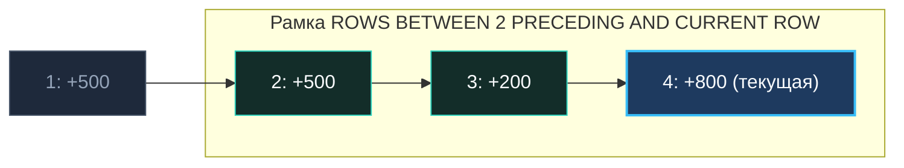

*Как считать нарастающий баланс и скользящее среднее без схлопывания строк, почему обратная функция перехода ускоряет окно с квадратичного времени до линейного, где прячется ловушка `RANGE` и как SQL-окна устроены в эталонном Go-коде `project/step03/analytics.go`.*

> «Go поощряет понимание устройства современных компьютеров — и прежде всего важности локальности данных в памяти.»  
> — Алан Донован и Брайан Керниган

В выписке счёта `LedgerPulse` напротив каждой проводки нужно показывать **текущий остаток счёта** после этой операции (*нарастающий итог*, или *running balance*), а для детектора аномалий — **скользящее среднее** по трём последним проводкам.

Обычный `GROUP BY account_id` схлопнет все операции в одну строку и уничтожит детализацию, а коррелированный подзапрос на каждой строке даст $O(N^2)$ обращений к буферному пулу. Оконные агрегаты (`SUM`, `AVG`, `COUNT`, `MIN`, `MAX` с клаузой `OVER`) вычисляются поверх виртуальной **рамки окна**, сохраняя каждую исходную строку.

---

## Спецификация рамки окна: `ROWS`, `RANGE` и `GROUPS`

В [[3. Оконные функции — OVER, PARTITION BY и рамки окна]] мы зафиксировали два правила поведения по умолчанию для `OVER(...)`:
* Без `ORDER BY` рамкой становится **вся партиция целиком**: `RANGE BETWEEN UNBOUNDED PRECEDING AND UNBOUNDED FOLLOWING`.
* При наличии `ORDER BY` без явных границ активируется рамка `RANGE BETWEEN UNBOUNDED PRECEDING AND CURRENT ROW`.

Чтобы явно управлять шириной и шагом скользящего окна, используют конструкцию:

```sql
{ ROWS | RANGE | GROUPS } BETWEEN <левая_граница> AND <правая_граница>
```

Границами выступают пять ориентиров: `UNBOUNDED PRECEDING` (начало партиции), `N PRECEDING` ($N$ единиц назад), `CURRENT ROW` (текущая позиция), `N FOLLOWING` ($N$ единиц вперёд) и `UNBOUNDED FOLLOWING` (конец партиции).

| Режим | Единица отсчёта | Поведение `2 PRECEDING AND CURRENT ROW` | Когда применять |
|---|---|---|---|
| **`ROWS`** | Физическая строка | Текущая строка и ровно 2 предыдущие строки в буфере | Нарастающий баланс, скользящее среднее по $N$ проводкам |
| **`RANGE`** | Значение ключа `ORDER BY` | Строки, чей ключ попал в `[val - 2, val]` (включая `INTERVAL '7 days'`) | Временные окна «оборот за 7 календарных дней» |
| **`GROUPS`** | Группа равных ключей | Текущая группа равных ключей и 2 предыдущие группы (PG 11+) | Рейтинги и бакеты с несколькими строками на одну дату |

Сдвиг рамки `ROWS BETWEEN 2 PRECEDING AND CURRENT ROW` для четырёх проводок:



На 4-й строке в рамке остаются строки 2, 3 и 4: сумма равна `1500`, среднее — `500.0`, а первая строка уже вышла за левую границу.

---

## Ловушка `ROWS` против `RANGE` в финансовых расчётах

> [!warning] Ловушка: одинаковые `created_at` в `ORDER BY`
> Пусть на счёте `10` две проводки по `500` копеек записались в одну микросекунду (`created_at = '2026-05-01 09:00:00Z'`). В запросе `SUM(amount) OVER (PARTITION BY account_id ORDER BY created_at)` по умолчанию действует `RANGE`. Поскольку ключ сортировки одинаков, обе строки образуют *peer group*, и обе получат сумму `1000`, перескочив через промежуточный остаток `500`.
>
> Чтобы нарастающий итог считался строго от проводки к проводке:
> 1. Добавляйте уникальный `id` в конец сортировки: `ORDER BY created_at, id`.
> 2. Явно указывайте физическую рамку `ROWS BETWEEN UNBOUNDED PRECEDING AND CURRENT ROW`.

---

## Под капотом: *Moving-Aggregate* (`sfunc` и `invfunc`) и память

На миллионе строк и окне шириной $W = 1000$ наивный пересчёт рамки на каждом шаге потребовал бы $10^6 \times 10^3 = 10^9$ операций — сложность $O(N \cdot W)$.

Чтобы избежать квадратичной деградации, PostgreSQL использует **режим скользящего агрегата (*Moving-Aggregate Mode*)**. В каталоге `pg_aggregate` агрегат разделён на две функции перехода:
1. **`sfunc` (*State Transition Function*)** — прибавляет к аккумулятору значение строки, вошедшей в окно справа.
2. **`invfunc` (*Inverse Transition Function*)** — вычитает из аккумулятора значение строки, покинувшей окно слева.

При сдвиге рамки на одну строку вперёд узел `WindowAgg` вызывает `invfunc` для выбывшей строки и `sfunc` для вошедшей. Для `SUM`, `AVG` и `COUNT` сложность падает с $O(N \cdot W)$ до строго линейной **$O(N)$** независимо от ширины окна.

Ограничения механизма:
* **Необратимые агрегаты (`MIN`, `MAX`).** Для минимума и максимума обратной функции не существует: если минимум вышел за границу рамки, по старому состоянию нельзя восстановить новый минимум среди оставшихся $W - 1$ элементов. Движок отключает инверсивный режим и пересчитывает рамку, из-за чего скорость падает пропорционально $W$.
* **Лимит `work_mem` и `spill to disk`.** Чтобы передавать выбывшие значения в `invfunc`, `WindowAgg` держит все строки текущей рамки в буфере `tuplestore` внутри `work_mem`. Гигантские окна (`ROWS BETWEEN 200000 PRECEDING AND CURRENT ROW`) переполняют `work_mem` и вызывают сброс во временные файлы на диск — RAM (~100 нс) сменяется дисковым I/O (~100 мкс на NVMe).

---

## Разбор эталона: `project/step03/analytics.go` и `analytics_test.go`

В репозитории проекта есть чистая Go-модель оконных функций — `project/step03/analytics.go`. Разберём её ключевые части и сверим с SQL.

### Функция `ComputeAccountWindow`

Входные проводки `Entry` преобразуются в срез `WindowedEntry`:

```go
type Entry struct {
	ID        int64
	AccountID int64
	Amount    int64
	CreatedAt time.Time
}

type WindowedEntry struct {
	Entry
	RowNumber  int
	Rank       int
	DenseRank  int
	PrevAmount *int64
	RunningSum int64
	MovingAvg3 float64
}
```

Алгоритм `ComputeAccountWindow` по шагам повторяет конвейер `WindowAgg`:
1. **Партиционирование (`PARTITION BY account_id`).** Записи раскладываются в мапу `byAcc := make(map[int64][]Entry)`, а ключи сортируются через `slices.Sort(accIDs)` для детерминизма.
2. **Сортировка окна (`ORDER BY created_at, id`).** Внутри каждой партиции `slices.SortFunc` сравнивает `CreatedAt`, а при равенстве времени — `int(a.ID - b.ID)`.
3. **Предвычисление рангов (`RANK`, `DENSE_RANK`).** Клон партиции `byAmount` сортируется по `Amount DESC` (разбор — в [[4. Ранжирование — ROW_NUMBER, RANK и DENSE_RANK]]).
4. **Линейный цикл окна:**

```go
var running int64
for i, e := range list {
	running += e.Amount
	var prev *int64
	if i > 0 {
		v := list[i-1].Amount
		prev = &v
	}
	start := max(0, i-2)
	var winSum int64
	for j := start; j <= i; j++ {
		winSum += list[j].Amount
	}
	out = append(out, WindowedEntry{
		Entry:      e,
		RowNumber:  i + 1,
		Rank:       rankByID[e.ID],
		DenseRank:  denseByID[e.ID],
		PrevAmount: prev,
		RunningSum: running,
		MovingAvg3: float64(winSum) / float64(i-start+1),
	})
}
```

Каждое поле `WindowedEntry` напрямую соответствует выражению SQL:
* `RowNumber` → `ROW_NUMBER() OVER (PARTITION BY account_id ORDER BY created_at, id)`
* `PrevAmount` → `LAG(amount) OVER (PARTITION BY account_id ORDER BY created_at, id)`
* `RunningSum` → `SUM(amount) OVER (... ROWS BETWEEN UNBOUNDED PRECEDING AND CURRENT ROW)`
* `MovingAvg3` (`start := max(0, i-2)`) → `AVG(amount) OVER (... ROWS BETWEEN 2 PRECEDING AND CURRENT ROW)` — на первых двух строках окно имеет ширину `1` и `2`, начиная с третьей — ровно `3`.

В `project/step03/analytics_test.go` тест `TestComputeAccountWindow` проверяет эти инварианты на четырёх проводках счёта `10` (`500`, `500`, `200`, `800`): на четвёртой строке `RowNumber == 4`, `RunningSum == 2000`, `MovingAvg3 == 500` (`(500+200+800)/3`), `PrevAmount` равен `nil` на первой строке и `500` на второй, а сумма `200` получает `Rank == 4` и `DenseRank == 3`.

### Эталонный SQL: `DailySummarySQL`

Вторая часть `project/step03/analytics.go` задаёт константу `DailySummarySQL` — готовый запрос для PostgreSQL:

```sql
WITH daily AS (
    SELECT
        account_id,
        date_trunc('day', created_at) AS day,
        SUM(amount) AS net_delta,
        COUNT(*) FILTER (WHERE amount > 0) AS incoming_cnt
    FROM ledger_entries
    GROUP BY account_id, date_trunc('day', created_at)
)
SELECT
    account_id,
    day,
    net_delta,
    SUM(net_delta) OVER (PARTITION BY account_id ORDER BY day) AS running_balance,
    LAG(net_delta) OVER (PARTITION BY account_id ORDER BY day) AS prev_day_delta
FROM daily
ORDER BY account_id, day;
```

Здесь CTE `daily` из [[1. CTE и выражения WITH — читаемость и материализация]] сначала сворачивает отдельные проводки в дневные сводки (используя `FILTER` для подсчёта входящих операций), а внешний `SELECT` строит по дням накопительный баланс и дельту предыдущего дня. Неявный `RANGE` в `ORDER BY day` здесь безопасен только потому, что `GROUP BY account_id, date_trunc('day', created_at)` уже сделал пару `(account_id, day)` уникальной.

---

## Точность в Go и выбор: БД против приложения

В PostgreSQL `SUM(bigint)` возвращает тип `NUMERIC`, чтобы избежать 64-битного переполнения. При переносе итогов в Go 1.24 учитывайте три правила:
1. Если сумма гарантированно помещается в 64-битное знаковое целое, приводите её в SQL к `bigint` (`SUM(amount) OVER w::bigint`) — драйвер отсканирует результат напрямую в `int64` без аллокаций.
2. Для точных дробных сумм и процентов из `NUMERIC` нельзя использовать `float64` (арифметика IEEE-754 даёт погрешности вроде `0.1 + 0.2 = 0.30000000000000004`). Применяйте `github.com/shopspring/decimal`, но помните про цену: внутри структуры лежит `*big.Int`, создающий аллокации в куче для сборщика мусора.
3. Для статистических метрик вроде `MovingAvg3` тип `float64` оптимален: он обрабатывается регистрами FPU без единой аллокации.

```go
package analytics

import (
	"context"
	"database/sql"
	"fmt"
	"time"
)

type AccountEntryWindow struct {
	ID         int64
	Amount     int64
	RunningSum int64
	MovingAvg3 float64
	CreatedAt  time.Time
}

const accountWindowSQL = `
SELECT
    id, amount,
    SUM(amount) OVER w::bigint AS running_sum,
    AVG(amount) OVER (
        PARTITION BY account_id ORDER BY created_at, id
        ROWS BETWEEN 2 PRECEDING AND CURRENT ROW
    )::double precision AS moving_avg_3,
    created_at
FROM ledger_entries
WHERE account_id = $1
WINDOW w AS (
    PARTITION BY account_id ORDER BY created_at, id
    ROWS BETWEEN UNBOUNDED PRECEDING AND CURRENT ROW
)
ORDER BY created_at, id
LIMIT $2;`

func FetchAccountWindow(ctx context.Context, db *sql.DB, accountID int64, limit int) ([]AccountEntryWindow, error) {
	rows, err := db.QueryContext(ctx, accountWindowSQL, accountID, limit)
	if err != nil {
		return nil, fmt.Errorf("query account window: %w", err)
	}
	defer rows.Close()

	out := make([]AccountEntryWindow, 0, min(limit, 256))
	for rows.Next() {
		var w AccountEntryWindow
		if err := rows.Scan(&w.ID, &w.Amount, &w.RunningSum, &w.MovingAvg3, &w.CreatedAt); err != nil {
			return nil, fmt.Errorf("scan account window: %w", err)
		}
		out = append(out, w)
	}
	if err := rows.Err(); err != nil {
		return nil, fmt.Errorf("iterate account window: %w", err)
	}
	return out, nil
}
```

**Где считать скользящие окна?** Для выписок, отчётов и дашбордов вроде `DailySummarySQL` вычисления в БД выгодны: они агрегируют данные рядом со страницами буферного пула. Но для потоковой телеметрии и антифрод-счётчиков на сотнях тысяч RPS разумнее считать скользящие окна в горизонтально масштабируемых Go-сервисах с помощью кольцевого буфера $O(1)$ памяти, разгружая дефицитный CPU базы данных.

---

> [!tip] Собеседование [Middle]
> **Вопрос:** Почему `AVG(amount) OVER (ORDER BY created_at ROWS BETWEEN 999 PRECEDING AND CURRENT ROW)` работает за $O(N)$, а `MIN(amount)` на таком же окне — заметно медленнее?  
> **Ответ:** Для `AVG`, `SUM` и `COUNT` в PostgreSQL реализован режим *Moving-Aggregate* с обратной функцией `invfunc`: при сдвиге рамки выбывающая строка вычитается из аккумулятора, а новая прибавляется через `sfunc`, сохраняя сложность $O(N)$. Для `MIN` и `MAX` обратной функции нет, поэтому при уходе минимума из рамки СУБД вынуждена искать новый минимум среди оставшихся $W-1$ строк.

---

## Упражнения

### Упражнение 1 (Базовое)
По счёту `account_id = 5` зафиксированы три проводки в одну миллисекунду `2026-05-01T12:00:00Z`: `(id=1, amount=100)`, `(id=2, amount=200)`, `(id=3, amount=300)`. Что вернёт столбец `bal` для каждой строки в двух запросах?
1. `SUM(amount) OVER (ORDER BY created_at) AS bal`
2. `SUM(amount) OVER (ORDER BY created_at, id ROWS BETWEEN UNBOUNDED PRECEDING AND CURRENT ROW) AS bal`

> [!solution] Показать решение
> 1. **`600, 600, 600`.** Неявная рамка `RANGE` объединяет строки с одинаковым `created_at` в единую *peer group*, возвращая сразу всю сумму группы.
> 2. **`100, 300, 600`.** Явный спецификатор `ROWS` идёт по физическим строкам, а `id` фиксирует детерминированный порядок.

### Упражнение 2 (Практическое)
Расширьте `DailySummarySQL` из `project/step03/analytics.go`: добавьте колонку `rolling_7d_delta` — сумму оборота за **7 календарных дней** (текущий день и 6 предыдущих календарных дней), учитывая, что в некоторые дни проводок по счёту могло не быть. Какой режим рамки выбрать?

> [!solution] Показать решение
> При пропусках дат `ROWS BETWEEN 6 PRECEDING AND CURRENT ROW` захватил бы 6 предыдущих строк (возможно, за несколько месяцев). Нужен **`RANGE` со смещением `INTERVAL`** по `day`:
> ```sql
> WITH daily AS (
>     SELECT
>         account_id,
>         date_trunc('day', created_at) AS day,
>         SUM(amount) AS net_delta,
>         COUNT(*) FILTER (WHERE amount > 0) AS incoming_cnt
>     FROM ledger_entries
>     GROUP BY account_id, date_trunc('day', created_at)
> )
> SELECT
>     account_id, day, net_delta,
>     SUM(net_delta) OVER (
>         PARTITION BY account_id ORDER BY day
>         ROWS BETWEEN UNBOUNDED PRECEDING AND CURRENT ROW
>     ) AS running_balance,
>     SUM(net_delta) OVER (
>         PARTITION BY account_id ORDER BY day
>         RANGE BETWEEN INTERVAL '6 days' PRECEDING AND CURRENT ROW
>     ) AS rolling_7d_delta
> FROM daily
> ORDER BY account_id, day;
> ```

### Упражнение 3 (Со звёздочкой `*`)
В `ComputeAccountWindow` из `project/step03/analytics.go` цикл расчёта `MovingAvg3` перебирает от 1 до 3 элементов на каждой итерации. Если ширину окна увеличить до `W = 10000` на миллионе записей, вложенный цикл деградирует до $O(N \cdot W)$. Перепишите расчёт скользящего среднего для окна `W` в Go 1.24 за линейное время $O(N)$ без дополнительных буферов (по принципу `sfunc` + `invfunc`).

> [!solution] Показать решение
> ```go
> const windowWidth = 10000
> var running, winSum int64
>
> for i, e := range list {
>     running += e.Amount
>     winSum += e.Amount // sfunc
>     if i >= windowWidth {
>         winSum -= list[i-windowWidth].Amount // invfunc
>     }
>     winCount := min(i+1, windowWidth)
>     avg := float64(winSum) / float64(winCount)
>     _ = avg
> }
> ```
> **Разбор:** Вычитание `list[i-windowWidth].Amount` заменяет внутренний цикл, снижая сложность до $O(N)$ при $O(1)$ памяти.

---

## Мостик к следующему уроку

Оконные функции анализируют строки вдоль временной оси, сохраняя исходную детализацию. Но бухгалтерские сводки в `LedgerPulse` часто требуют обратного: развернуть категории операций в колонки и посчитать многоуровневые итоги по валютам и видам транзакций за одно чтение таблицы.

В следующей главе — [[7. Pivot, FILTER и аналитические запросы (ROLLUP, CUBE, GROUPING SETS)]] — мы разберём преимущества `FILTER (WHERE ...)` перед `CASE WHEN`, многомерные группировки `ROLLUP` и `CUBE`, а также функцию `GROUPING()` для распознавания итоговых `NULL`.
