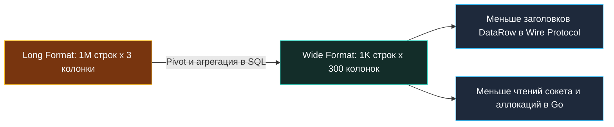

*Как разворачивать длинные таблицы в сводные отчёты через `FILTER (WHERE ...)`, чем опасен `crosstab`, как считать многомерные подитоги за один проход через `ROLLUP`, `CUBE`, `GROUPING SETS` и `GROUPING()` и почему динамический Pivot в `map[string]any` нагружает сборщик мусора Go.*

> «Блеск Unix заключался в выборе абстракции, достаточно общей, чтобы быть поразительно полезной, и при этом не слишком дорогой по производительности.»  
> — Брайан Керниган

В OLTP-схеме `LedgerPulse` (см. [[3. Типы баз данных — OLTP против OLAP]]) данные лежат в «длинном» нормализованном формате (*Long Format*): каждая проводка занимает отдельную строку со столбцами `currency`, `kind`, `amount`. Это оптимально для быстрых вставок и ограничений целостности.

Но аналитикам и финансовым дашбордам нужен «широкий» формат (*Wide / Pivot Format*), где виды операций (`deposit`, `withdrawal`, `transfer`, `fee`) развёрнуты в столбцы, а рядом показаны подитоги по валютам и общий итог по системе. Выгружать миллионы строк в Go или запускать серию отдельных `GROUP BY` — расточительно. SQL позволяет построить сводку и все уровни подитогов за один проход по таблице.

---

## Pivot через клаузу `FILTER (WHERE ...)`

В [[11. Выражения CASE и условная агрегация]] мы строили условные агрегаты через `SUM(CASE WHEN ... THEN amount ELSE 0 END)`. Современный стандарт SQL (нативно поддерживаемый в PostgreSQL) даёт более быструю и чистую конструкцию — **`FILTER (WHERE ...)`**:

```sql
SELECT
    le.currency,
    COUNT(*) AS total_entries,
    COALESCE(SUM(le.amount) FILTER (WHERE t.kind = 'deposit'), 0)    AS deposit_sum,
    COALESCE(SUM(le.amount) FILTER (WHERE t.kind = 'withdrawal'), 0) AS withdrawal_sum,
    COALESCE(SUM(le.amount) FILTER (WHERE t.kind = 'transfer'), 0)   AS transfer_sum,
    COALESCE(SUM(le.amount) FILTER (WHERE t.kind = 'fee'), 0)        AS fee_sum
FROM ledger_entries le
JOIN transactions t ON t.id = le.transaction_id
WHERE t.status = 'posted'
GROUP BY le.currency
ORDER BY le.currency;
```

### Под капотом: почему `FILTER` быстрее `CASE WHEN`

Разница проявляется внутри узла исполнения `Aggregate`:
* Для `SUM(CASE WHEN ...)` исполнитель обязан вычислить ветку `CASE` на **каждой строке** и передать `0` в функцию перехода состояния агрегата `sfunc`.
* Для `FILTER (WHERE ...)` движок проверяет булев предикат **до** вызова `sfunc`. Если условие ложно, строка отбрасывается мгновенно, не вызывая функцию агрегации.

На простых суммах это экономит такты CPU, а для тяжёлых агрегатов вроде `array_agg`, `string_agg` или `jsonb_agg` (где каждый вызов `sfunc` выделяет память и копирует буферы) выигрыш становится многократным. Учитывайте семантику: если ни одна строка не прошла фильтр, `SUM(...) FILTER (...)` вернёт `NULL` (поэтому нужен `COALESCE`), а `COUNT(*) FILTER (...)` вернёт `0`.

---

## Нативный Pivot в PostgreSQL: `crosstab` и его ловушки

Когда категорий десятки, штатное расширение `tablefunc` в PostgreSQL предоставляет функцию `crosstab`:

```sql
CREATE EXTENSION IF NOT EXISTS tablefunc;

SELECT *
FROM crosstab(
    $$
    SELECT le.currency::text, t.kind, SUM(le.amount)::bigint
    FROM ledger_entries le
    JOIN transactions t ON t.id = le.transaction_id
    WHERE t.status = 'posted'
    GROUP BY le.currency, t.kind
    ORDER BY 1, 2
    $$,
    $$ VALUES ('deposit'), ('fee'), ('transfer'), ('withdrawal') $$
) AS ct(currency TEXT, deposit BIGINT, fee BIGINT, transfer BIGINT, withdrawal BIGINT);
```

> [!warning] Ловушки `crosstab`
> 1. **Сдвиг колонок в однопараметрической форме.** Вызов `crosstab(source_sql)` без второго запроса со списком категорий раскладывает значения слева направо по мере их появления. Если по валюте `EUR` не было ни одного `fee`, сумма `transfer` тихо встанет в колонку `fee`, исказив отчёт. Всегда используйте **двухпараметрическую форму** `crosstab(source_sql, category_sql)`.
> 2. **Жёсткая выходная схема.** Секция `AS ct(...)` фиксирует колонки в тексте запроса: при появлении новой категории её придётся дописывать вручную.

---

## Многомерные итоги за один проход: `GROUPING SETS`, `ROLLUP`, `CUBE`

Если отчёт должен одновременно вывести детали по `(currency, kind)`, подитоги по `(currency)` и общий итог `()`, склейка трёх `GROUP BY` через `UNION ALL` (см. [[13. DISTINCT, дубликаты и операции над множествами]]) заставит СУБД прочитать таблицы трижды.

Расширения клаузы `GROUP BY` вычисляют все срезы **за один проход** (в плане появляются узлы `GroupAggregate` или `MixedAggregate`):

1. **`GROUPING SETS`** — явный список нужных срезов (пустые скобки `()` означают общий итог):
   ```sql
   GROUP BY GROUPING SETS ((le.currency, t.kind), (le.currency), ())
   ```
2. **`ROLLUP`** — иерархические подитоги слева направо (для $N$ столбцов строит $N + 1$ срезов; идеально для `(year, month, day)` или `(currency, kind, status)`):
   ```sql
   GROUP BY ROLLUP (le.currency, t.kind, t.status)
   -- Даёт: (currency, kind, status), (currency, kind), (currency), ()
   ```
3. **`CUBE`** — все $2^N$ комбинаций подмножеств:
   ```sql
   GROUP BY CUBE (le.currency, t.kind)
   -- Даёт: (currency, kind), (currency), (kind), ()
   ```
   Осторожно с размерностью: для 6 столбцов `CUBE` сгенерирует $2^6 = 64$ группировки, резко увеличив расход `work_mem` и объём вывода.

### Ловушка итоговых `NULL` и функция `GROUPING()`

При свёртке измерения подитог подставляет `NULL` в свёрнутый столбец. Если столбец допускает настоящие `NULL` в данных (например, необязательный `region`), отличить пустое значение от строки-итога помогает функция **`GROUPING(col1 [, col2, ...])`**:
* возвращает `0`, если столбец участвует в группировке (реальное значение или `NULL` из таблицы);
* возвращает `1`, если столбец свёрнут и обозначает подитог;
* при нескольких аргументах формирует десятичное число из битовой маски (`GROUPING(currency, kind)` даёт `0` для `(currency, kind)`, `1` для `(currency)`, `2` для `(kind)`, `3` для `()`).

```sql
SELECT
    CASE WHEN GROUPING(le.currency) = 1 THEN 'ALL' ELSE le.currency::text END AS currency,
    CASE WHEN GROUPING(t.kind) = 1      THEN 'ALL' ELSE t.kind           END AS kind,
    GROUPING(le.currency, t.kind) AS grp_mask,
    SUM(le.amount)::bigint        AS total_amount
FROM ledger_entries le
JOIN transactions t ON t.id = le.transaction_id
WHERE t.status = 'posted'
GROUP BY CUBE (le.currency, t.kind)
ORDER BY GROUPING(le.currency), le.currency, GROUPING(t.kind), t.kind;
```

Вывод отчёта:

```text
 currency |    kind    | grp_mask | total_amount
----------+------------+----------+--------------
 EUR      | deposit    |        0 |       500000
 EUR      | withdrawal |        0 |      -120000
 EUR      | ALL        |        1 |       380000
 RUB      | deposit    |        0 |      2500000
 RUB      | ALL        |        1 |      2500000
 ALL      | deposit    |        2 |      3000000
 ALL      | withdrawal |        2 |      -120000
 ALL      | ALL        |        3 |      2880000
```

---

## Физика сети и динамический Pivot в Go 1.24

Сравним передачу 3 млн ячеек из PostgreSQL в Go: длинная таблица (1 млн строк $\times$ 3 колонки) против широкой сводки (1 000 строк $\times$ 300 колонок).



Протокол PostgreSQL (*Wire Protocol*) строчно-ориентирован: каждое сообщение `DataRow` несёт заголовок длины и метаданные полей. Передача миллиона мелких строк перегружает сеть заголовками, множит системные вызовы чтения из сокета и циклы сканирования в Go. Поэтому агрегацию и Pivot лучше делать в СУБД, но избегать сверхшироких строк на тысячи столбцов, которые плохо укладываются в 64-байтные кэш-линии CPU.

### Проблема динамического списка колонок

Чистый SQL требует фиксировать имена и типы столбцов на этапе планирования — список колонок в `SELECT` не может зависеть от значений данных. Для динамического Pivot в Go сначала получают белый список категорий (строго валидируя их против SQL-инъекций), генерируют SQL с `FILTER` и сканируют неизвестное число столбцов через `rows.Columns()`:

```go
package analytics

import (
	"context"
	"database/sql"
	"fmt"
	"regexp"
	"strings"
)

var validCurrencyRe = regexp.MustCompile(`^[A-Z]{3}$`)

func BuildCurrencyPivot(ctx context.Context, db *sql.DB, currencies []string) ([]map[string]any, error) {
	if len(currencies) == 0 {
		return nil, nil
	}
	cols := make([]string, 0, len(currencies))
	for _, cur := range currencies {
		if !validCurrencyRe.MatchString(cur) {
			return nil, fmt.Errorf("invalid currency code %q", cur)
		}
		cols = append(cols, fmt.Sprintf(
			`COALESCE(SUM(le.amount) FILTER (WHERE le.currency = '%s'), 0)::bigint AS "%s"`,
			cur, strings.ToLower(cur),
		))
	}

	query := fmt.Sprintf(`
		SELECT t.kind, %s
		FROM ledger_entries le
		JOIN transactions t ON t.id = le.transaction_id
		WHERE t.status = 'posted'
		GROUP BY t.kind ORDER BY t.kind`, strings.Join(cols, ", "))

	rows, err := db.QueryContext(ctx, query)
	if err != nil {
		return nil, fmt.Errorf("execute pivot: %w", err)
	}
	defer rows.Close()

	colNames, err := rows.Columns()
	if err != nil {
		return nil, fmt.Errorf("columns: %w", err)
	}
	values := make([]any, len(colNames))
	ptrs := make([]any, len(colNames))
	for i := range values {
		ptrs[i] = &values[i]
	}

	var result []map[string]any
	for rows.Next() {
		if err := rows.Scan(ptrs...); err != nil {
			return nil, fmt.Errorf("scan pivot row: %w", err)
		}
		rowMap := make(map[string]any, len(colNames))
		for i, name := range colNames {
			if b, ok := values[i].([]byte); ok {
				rowMap[name] = string(b)
			} else {
				rowMap[name] = values[i]
			}
		}
		result = append(result, rowMap)
	}
	return result, rows.Err()
}
```

> [!warning] Ловушка: `[]any` и `map[string]any` под нагрузкой
> Динамическое сканирование годится для редких админских выгрузок, но губительно на горячем пути: упаковка примитивов в `any` (*boxing*) и создание отдельной хэш-таблицы на каждую строку генерируют сотни тысяч аллокаций в куче, разгоняя сборщик мусора и p99-задержку. В высоконагруженном API возвращайте плоскую типизированную структуру `(Currency, Kind, Total)` или упаковывайте сводку в `JSONB` на стороне БД (см. [[8. JSON и JSONB в SQL]]).

---

## Unpivot: обратная операция за один проход

Обратная задача — развернуть широкую таблицу `(deposit_sum, withdrawal_sum, fee_sum)` в узкие строки `(kind, amount)`. В PostgreSQL нет ключевого слова `UNPIVOT`, а цепочка `UNION ALL` заставит СУБД прочитать таблицу трижды.

Идиоматичное решение за **одно чтение** страниц — **`CROSS JOIN LATERAL`** и **`unnest`** над параллельными массивами:

```sql
SELECT w.currency, v.kind, v.amount
FROM wide_summary w
CROSS JOIN LATERAL unnest(
    ARRAY['deposit', 'withdrawal', 'fee'],
    ARRAY[w.deposit_sum, w.withdrawal_sum, w.fee_sum]
) AS v(kind, amount)
WHERE v.amount IS NOT NULL;
```

---

> [!tip] Собеседование [Middle]
> **Вопрос 1:** Можно ли в стандартном SQL сделать динамический Pivot, не зная значений категорий заранее?  
> **Ответ:** Нет. Парсер и планировщик SQL обязаны знать точные имена и типы колонок до начала выполнения. Решение: два шага через динамический SQL в PL/pgSQL (`EXECUTE`) либо генерация запроса с `FILTER` в Go (или возврат `JSONB`).
>
> **Вопрос 2:** Чем отличаются `ROLLUP(a, b)` и `CUBE(a, b)`, и зачем нужна функция `GROUPING()`?  
> **Ответ:** `ROLLUP(a, b)` даёт иерархию `(a, b)`, `(a)`, `()`. `CUBE(a, b)` строит все $2^N$ комбинаций, добавляя `(b)`. `GROUPING(col)` возвращает `1`, если `NULL` вызван свёрткой подитога, и `0` для настоящего значения из данных.

---

## Упражнения

### Упражнение 1 (Базовое)
Сколько группировок сгенерирует PostgreSQL и какие именно?
1. `GROUP BY ROLLUP (currency, kind, status)`
2. `GROUP BY CUBE (currency, kind, status)`
3. `GROUP BY GROUPING SETS ((currency, kind), (status), ())`

> [!solution] Показать решение
> 1. **4 группировки** ($N + 1$): `(currency, kind, status)`, `(currency, kind)`, `(currency)`, `()`.
> 2. **8 группировок** ($2^3$): все комбинации, включая одиночные `(currency)`, `(kind)`, `(status)`, пары и `()`.
> 3. **3 группировки**: ровно перечисленные наборы `(currency, kind)`, `(status)`, `()`.

### Упражнение 2 (Практическое)
Напишите один SQL-запрос к `transactions` и `ledger_entries`, который за один проход посчитает сводку по `(currency, kind)` для `status = 'posted'`, подитоги по `currency` и общий итог. Итоговые `NULL` замените на `'ALL'` через `GROUPING()`, а число входящих (`amount > 0`) и исходящих (`amount < 0`) операций посчитайте через `FILTER (WHERE ...)`.

> [!solution] Показать решение
> ```sql
> SELECT
>     CASE WHEN GROUPING(le.currency) = 1 THEN 'ALL' ELSE le.currency::text END AS currency,
>     CASE WHEN GROUPING(t.kind) = 1      THEN 'ALL' ELSE t.kind           END AS kind,
>     COUNT(*) FILTER (WHERE le.amount > 0) AS incoming_cnt,
>     COUNT(*) FILTER (WHERE le.amount < 0) AS outgoing_cnt,
>     COALESCE(SUM(le.amount), 0)::bigint   AS net_amount
> FROM ledger_entries le
> JOIN transactions t ON t.id = le.transaction_id
> WHERE t.status = 'posted'
> GROUP BY ROLLUP (le.currency, t.kind)
> ORDER BY GROUPING(le.currency), le.currency, GROUPING(t.kind), t.kind;
> ```

### Упражнение 3 (Со звёздочкой `*`)
Витрина `account_monthly_pivot (account_id, month, deposit_sum, withdrawal_sum, fee_sum)` хранит широкие сводки. Разверните её обратно в `(account_id, month, kind, amount)` за одно сканирование (без `UNION ALL`), отбросив `0` и `NULL`. Как упаковать этот результат по счёту прямо в БД, чтобы избежать `map[string]any` в Go?

> [!solution] Показать решение
> ```sql
> SELECT p.account_id, p.month, u.kind, u.amount
> FROM account_monthly_pivot p
> CROSS JOIN LATERAL unnest(
>     ARRAY['deposit', 'withdrawal', 'fee'],
>     ARRAY[p.deposit_sum, p.withdrawal_sum, p.fee_sum]
> ) AS u(kind, amount)
> WHERE u.amount IS NOT NULL AND u.amount <> 0;
> ```
> **Упаковка для Go:** Собрав категории функцией `jsonb_object_agg(u.kind, u.amount)`, сервис на Go сможет отсканировать готовый документ в `json.RawMessage` (срез байтов) без промежуточной `map[string]any`. Подробности работы с `JSONB` — в следующем уроке.

---

## Мостик к следующему уроку

В схеме `LedgerPulse` рядом со строгими реляционными столбцами таблицы `accounts` живёт столбец `metadata JSONB NOT NULL DEFAULT '{}'::jsonb`.

Как PostgreSQL хранит бинарный `JSONB` на 8-килобайтных страницах, почему GIN-индекс игнорирует оператор `->>` и как пробрасывать JSON-документы в Go без двойного парсинга? Разберём это в главе [[8. JSON и JSONB в SQL]].
