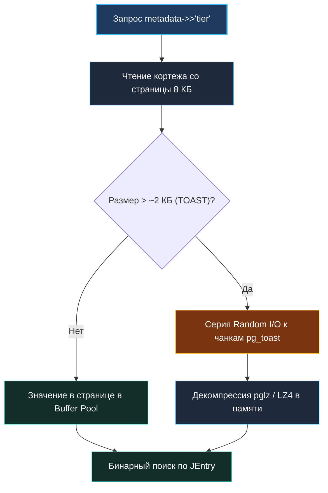

*Как устроены текстовый `JSON` и бинарный `JSONB` на страницах PostgreSQL, когда большие документы вытесняются в `TOAST`, почему GIN-индекс игнорирует оператор `->>`, как выбирать между строгими колонками и документом и как избегать двойного парсинга в Go 1.24.*

В схеме `LedgerPulse` рядом со строгими столбцами (`balance BIGINT`, `currency CHAR(3)`, `status TEXT`) в таблице `accounts` есть полуструктурированное поле:

```sql
metadata JSONB NOT NULL DEFAULT '{}'::jsonb
```

Такой гибрид снимает вечный конфликт между строгой схемой и гибкостью. Когда бизнесу нужно добавить у счёта код партнёрской программы, персональный лимит или флаги комплаенса, вы добавляете ключи в `metadata` без `ALTER TABLE` и без десятков пустых `NULL`-колонок. Но неаккуратная работа с `JSONB` быстро бьёт по диску, CPU и планам запросов.

---

## `JSON` против `JSONB` в PostgreSQL

PostgreSQL поддерживает два разных типа: текстовый `json` и бинарный `jsonb`. Выбор между ними — компромисс между скоростью записи и скоростью чтения:

| Характеристика | `json` (текстовый) | `jsonb` (бинарный) |
|---|---|---|
| **Хранение на диске** | Точная посимвольная копия текста | Декомпилированное бинарное представление |
| **Пробелы и порядок ключей** | Сохраняются полностью | Пробелы удаляются, ключи сортируются |
| **Дубликаты ключей** | Сохраняются все | Остаётся только последнее значение ключа |
| **Скорость `INSERT`** | Чуть быстрее (только проверка синтаксиса) | Чуть медленнее (разбор в бинарное дерево) |
| **Чтение поля (`->>`)** | Медленно: заново парсит всю строку на каждом запросе | Быстро: читает по смещениям без парсинга |
| **Индексы GIN** | Не поддерживаются | Поддерживаются (`jsonb_ops`, `jsonb_path_ops`) |

### Под капотом: заголовки `JEntry` и бинарный поиск

Внутренний формат `jsonb` опирается на таблицу служебных заголовков `JEntry` (типы значений и байтовые смещения). При записи в `jsonb` движок однократно разбирает текст, отбрасывает пробелы и дубликаты, а ключи объектов сортирует лексикографически. Благодаря этому поиск ключа внутри объекта работает бинарным поиском за $O(\log K)$ без линейного сканирования текста.

В 99% задач выбирайте `jsonb`. Текстовый `json` нужен лишь тогда, когда требуется побайтово сохранить исходное форматирование и порядок ключей (например, для проверки цифровой подписи сырого документа).

---

## Физика страниц (8 КБ) и ловушка `TOAST`

PostgreSQL хранит таблицы страницами по **8 КБ**. Если строка целиком превышает порог около **2 КБ**, включается механизм **TOAST (*The Oversized-Attribute Storage Technique*)**.

Когда в `JSONB` попадает тяжёлый документ (скажем, сырой ответ платёжного шлюза на 200 КБ):
1. СУБД сжимает значение алгоритмом `pglz` или `LZ4` (доступен с PostgreSQL 14).
2. Если сжатый блок всё ещё велик, он режется на чанки по ~2 КБ и сохраняется в скрытую таблицу `pg_toast_<OID>`.
3. В основной строке остаётся лишь 18-байтный указатель (*TOAST pointer*).



Из-за TOAST чтение одного короткого поля `metadata->>'tier'` из 100-килобайтного документа заставляет движок делать серию случайных чтений из `pg_toast` (~100 мкс на NVMe вместо ~100 нс в RAM) и распаковывать весь буфер.

> [!warning] Архитектурное правило для `JSONB`
> В операционных таблицах держите в `JSONB` только компактные метаданные (< 1–2 КБ). Многосот-килобайтные логи и сырые вебхуки выносите в отдельную архивную таблицу или объектное хранилище (S3/MinIO), оставляя в строке лишь URL или ключ.

---

## Операторы доступа и индексация: почему GIN игнорирует `->>`

| Оператор | Назначение | Тип результата | Пример |
|---|---|---|---|
| **`->`** | Поле объекта или элемент массива | `jsonb` | `metadata->'limits'->'daily'` |
| **`->>`** | Значение поля как скалярный текст | `text` | `metadata->>'tier'` |
| **`#>`** / **`#>>`** | Доступ по пути из массива ключей | `jsonb` / `text` | `metadata #>> '{limits,daily}'` |
| **`@>`** | Проверка включения документа (*contains*) | `boolean` | `metadata @> '{"tier": "pro"}'` |
| **`?`** / **`?\|`** / **`?&`** | Проверка существования ключей | `boolean` | `metadata ? 'partner_id'` |

Операторы `->` и `->>` — функции, поэтому фильтр `WHERE metadata->>'tier' = 'pro'` без специального индекса вызовет полное чтение таблицы (`Seq Scan`).

Для `JSONB` применяют инвертированный индекс **GIN** в одном из двух классов операторов:
* **`jsonb_ops`** (по умолчанию) — индексирует каждый ключ и каждое значение отдельно; поддерживает `@>`, `?`, `?|`, `?&`, но занимает больше места.
* **`jsonb_path_ops`** — хэширует полные пути до значений; индекс в 2–3 раза компактнее и быстрее, но поддерживает **только** оператор включения `@>` (и `jsonpath`).

```sql
CREATE INDEX idx_accounts_metadata_path
    ON accounts USING GIN (metadata jsonb_path_ops);

-- ИСПОЛЬЗУЕТ GIN-индекс:
SELECT id, external_id FROM accounts WHERE metadata @> '{"tier": "pro"}';

-- ИГНОРИРУЕТ GIN-индекс (Seq Scan):
SELECT id, external_id FROM accounts WHERE metadata->>'tier' = 'pro';
```

> [!warning] Ловушка: `->>` и диапазонные сравнения
> Переписывайте точный поиск с `->>` на оператор `@>`. А если нужен диапазонный поиск (`>`, `<`, `BETWEEN`) по числовому полю внутри `JSONB`, GIN не поможет — создавайте **функциональный B-tree индекс**:
> ```sql
> CREATE INDEX idx_accounts_daily_limit
>     ON accounts (((metadata->>'daily_limit')::bigint))
>     WHERE metadata ? 'daily_limit';
> ```
> В запросе выражение в `WHERE` должно точно повторять формулу индекса.

---

## Выбор: реляционные колонки против `JSONB`-документа

Четыре инженерных критерия определяют границу между колонками таблицы и `JSONB`:
1. **Инварианты и типы.** В обычных колонках работают `NOT NULL`, `CHECK`, `UNIQUE` и `FOREIGN KEY`. Внутри `JSONB` нет внешних ключей, а числа не разделяют `BIGINT` и `FLOAT` на уровне JSON. Поэтому `balance`, `currency`, `status` в `LedgerPulse` — строгие колонки.
2. **Статистика планировщика (`pg_statistic`).** Команда `ANALYZE` строит точные гистограммы для обычных столбцов. Для ключей внутри `JSONB` гистограмм нет — планировщик оценивает селективность грубыми константами и в сложных `JOIN` чаще ошибается с выбором алгоритма соединения.
3. **Обновления под MVCC.** Любой `UPDATE` в PostgreSQL создаёт **новую копию всей строки**. Часто меняемое поле внутри 1 КБ `JSONB` заставляет каждый раз копировать весь документ в новую версию кортежа и писать его в WAL, а также мешает HOT-обновлениям при наличии GIN-индекса.
4. **Где `JSONB` оправдан.** Разреженные атрибуты разных тарифов, настройки интерфейса, метаданные внешних провайдеров без жёстких связей.

---

## Взаимодействие с Go 1.24: проблема двойного парсинга

Наивная работа с `JSONB` в Go страдает от **двойного парсинга (*Double Unmarshal / Marshal*)**: БД отдаёт текст JSON → сервис разбирает его через `json.Unmarshal` в структуру или `map[string]any` (аллокации в куче) → HTTP-хэндлер тут же кодирует всё обратно через `json.Marshal`.

### Паттерн 1: `json.RawMessage` для транзитного проброса

Если сервис не меняет поля JSON, сканируйте столбец в `json.RawMessage` (под капотом это `[]byte`): пакет `encoding/json` отдаст сырые байты в HTTP-ответ без повторного парсинга и маршалинга.

```go
package accounts

import (
	"context"
	"database/sql"
	"encoding/json"
	"fmt"
)

type AccountAPIView struct {
	ID         int64           `json:"id"`
	ExternalID string          `json:"external_id"`
	Balance    int64           `json:"balance"`
	Currency   string          `json:"currency"`
	Metadata   json.RawMessage `json:"metadata"`
}

func GetAccountView(ctx context.Context, db *sql.DB, id int64) (*AccountAPIView, error) {
	const q = `SELECT id, external_id, balance, currency, metadata FROM accounts WHERE id = $1;`
	var v AccountAPIView
	if err := db.QueryRowContext(ctx, q, id).Scan(
		&v.ID, &v.ExternalID, &v.Balance, &v.Currency, &v.Metadata,
	); err != nil {
		return nil, fmt.Errorf("get account view %d: %w", id, err)
	}
	return &v, nil
}
```

### Паттерн 2: строгая типизация для бизнес-логики

Если поля `metadata` участвуют в расчётах внутри Go, декодируйте `json.RawMessage` в строгую структуру с JSON-тегами вместо нетипизированной `map[string]any` — это защитит от паник при приведении типов и сократит аллокации.

### Паттерн 3: точечное обновление через `jsonb_set`

Не выгружайте весь документ в Go ради изменения одного ключа: при конкурентных запросах это приводит к потере обновлений соседних полей (*Lost Update*). Меняйте нужный путь прямо в БД (четвёртый параметр `true` создаёт отсутствующий ключ):

```sql
UPDATE accounts
SET metadata   = jsonb_set(metadata, '{tier}', '"vip"'::jsonb, true),
    updated_at = now()
WHERE id = $1;
```

> [!info] Под капотом: `jsonb_set` и MVCC
> `jsonb_set` не меняет буфер «на месте» (*in-place*): под моделью MVCC PostgreSQL копирует дерево `jsonb`, подменяет нужный узел и записывает новую версию всей строки таблицы. Это всё равно надёжнее и быстрее сетевой перезаписи из приложения.

---

> [!tip] Собеседование [Middle]
> **Вопрос 1:** В чём разница между `json` и `jsonb`, и почему при GIN-индексе с `jsonb_path_ops` фильтр `metadata->>'status' = 'active'` делает `Seq Scan`?  
> **Ответ:** `json` хранит сырой текст и заново парсит его при каждом чтении. `jsonb` парсится однократно при записи, сортирует ключи с заголовками `JEntry` и индексируется через GIN. Класс `jsonb_path_ops` хэширует пути и поддерживает только оператор включения `@>` (и `jsonpath`), но не `->> ... = ...`. Запрос нужно переписать на `metadata @> '{"status": "active"}'`.
>
> **Вопрос 2:** Почему `balance` в `LedgerPulse` не хранят внутри `metadata JSONB`?  
> **Ответ:** Для `balance` обязательны строгие ограничения `NOT NULL` и `CHECK (balance >= 0)`, целочисленная арифметика `BIGINT`, точная статистика планировщика и частые обновления без перезаписи целого JSON-документа под MVCC.

---

## Упражнения

### Упражнение 1 (Базовое)
В `accounts.metadata` (`jsonb`) хранится `{"tier": "pro", "limits": {"daily": 500000}}`. Какой тип данных и значение вернут выражения:
1. `metadata->'limits'->'daily'`
2. `metadata->'limits'->>'daily'`
3. `metadata #>> '{limits,daily}'`
4. `metadata @> '{"limits": {"daily": 500000}}'`

> [!solution] Показать решение
> 1. **`jsonb`, `500000`** — узел JSONB (для арифметики нужно приведение типа).
> 2. **`text`, `'500000'`** — скалярная строка SQL.
> 3. **`text`, `'500000'`** — извлечение текста по вложенному пути за один шаг.
> 4. **`boolean`, `true`** — правый фрагмент полностью содержится в `metadata`.

### Упражнение 2 (Практическое)
В `accounts.metadata` хранятся данные вида `{"partner": {"code": "acme"}, "vip": true}`.
1. Создайте компактный GIN-индекс на `accounts(metadata)`.
2. Найдите `id` и `external_id` активных счетов партнёра `"acme"` так, чтобы сработал этот индекс.
3. Точечно обновите `"vip": false` для счёта `$1` на стороне PostgreSQL, не затирая ключ `"partner"`.

> [!solution] Показать решение
> ```sql
> -- 1. Компактный GIN-индекс
> CREATE INDEX IF NOT EXISTS idx_accounts_metadata_gin
>     ON accounts USING GIN (metadata jsonb_path_ops);
>
> -- 2. Поиск через оператор включения @>
> SELECT id, external_id
> FROM accounts
> WHERE status = 'active'
>   AND metadata @> '{"partner": {"code": "acme"}}'::jsonb;
>
> -- 3. Точечное обновление через jsonb_set
> UPDATE accounts
> SET metadata   = jsonb_set(metadata, '{vip}', 'false'::jsonb, true),
>     updated_at = now()
> WHERE id = $1;
> ```

### Упражнение 3 (Со звёздочкой `*`)
API `LedgerPulse` отдаёт по счёту `$1` JSON-ответ с полями `id`, `external_id`, `balance` и массивом `recent_entries` из пяти последних проводок (`id`, `amount`, `created_at`). Соберите этот объект прямо в PostgreSQL (`jsonb_build_object` и `jsonb_agg`) и верните его в Go через `json.RawMessage` без вызова `json.Marshal`.

> [!solution] Показать решение
> ```sql
> WITH recent AS (
>     SELECT id, amount, created_at
>     FROM ledger_entries
>     WHERE account_id = $1
>     ORDER BY created_at DESC, id DESC
>     LIMIT 5
> )
> SELECT jsonb_build_object(
>     'id', a.id,
>     'external_id', a.external_id,
>     'balance', a.balance,
>     'recent_entries', COALESCE(
>         (
>             SELECT jsonb_agg(
>                 jsonb_build_object('id', r.id, 'amount', r.amount, 'created_at', r.created_at)
>                 ORDER BY r.created_at DESC, r.id DESC
>             )
>             FROM recent r
>         ),
>         '[]'::jsonb
>     )
> )
> FROM accounts a
> WHERE a.id = $1;
> ```
> ```go
> func GetAccountSummaryJSON(ctx context.Context, db *sql.DB, accountID int64) (json.RawMessage, error) {
>     var raw json.RawMessage
>     if err := db.QueryRowContext(ctx, accountSummaryJSONSQL, accountID).Scan(&raw); err != nil {
>         return nil, fmt.Errorf("query account summary json: %w", err)
>     }
>     return raw, nil
> }
> ```
> **Разбор:** `COALESCE(..., '[]'::jsonb)` гарантирует пустой массив вместо `NULL` для счёта без проводок, а `ORDER BY` внутри `jsonb_agg` сохраняет хронологию. В Go байты напрямую попадают в `json.RawMessage`.

---

## Мостик к следующему уроку

`JSONB` отлично справляется с вложенными документами. Но когда из Go в запрос нужно передать плоский список однотипных элементов — например, 500 идентификаторов счетов для массовой проверки или вставки за один сетевой поход — на сцену выходят нативные массивы SQL.

В следующей главе — «9. Массивы в SQL и их ограничения» — мы разберём типы `BIGINT[]` и `TEXT[]`, пакетную распаковку через `UNNEST` и границы применимости массивов по сравнению с классическими таблицами связей.
