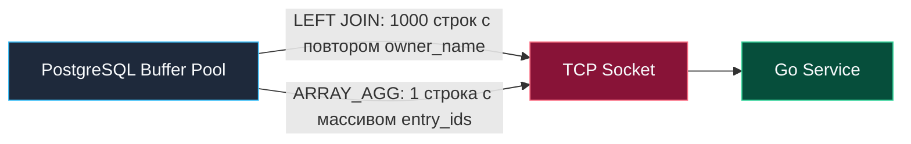

*Типизированные списки в колонке, инвертированные индексы GIN, распаковка батчей через `UNNEST` и скрытая цена TOAST.*

> «Блеск Unix заключался в выборе абстракции, достаточно общей, чтобы быть поразительно полезной, и при этом не слишком дорогой по производительности.»
> — Брайан Керниган

В [[10. Первая нормальная форма (1NF)]] каждая ячейка хранит одно атомарное значение: если у транзакции в `LedgerPulse` есть метки вроде `'cross_border'` и `'high_risk'`, канон требует отдельную таблицу `transaction_tags` и сборку через `JOIN` ([[6. JOIN — INNER, LEFT, RIGHT, FULL и CROSS]]).

На практике жёсткая нормализация создаёт две проблемы. Во-первых, при связи 1:M `JOIN` дублирует поля родительской строки на каждую дочернюю метку: `external_id`, `owner_name` и `metadata` улетают в TCP-сокет сотни раз подряд, раздувая Network I/O и нагрузку на GC. Во-вторых, загрузка по Go-слайсу из 300 идентификаторов через динамический `IN ($1, ..., $300)` сбивает кэш планов СУБД под каждую длину слайса.

Для таких задач в PostgreSQL (и ClickHouse с типом `Array(T)`) есть **нативные массивы** — осознанное отступление от 1NF, экономящее трафик и память.

---

## Массивы против нормализации и JSONB

Сравним три способа хранения множеств: дочернюю таблицу (1NF), документ `JSONB` ([[8. JSON и JSONB в SQL]]) и типизированный массив.

| Критерий | Дочерняя таблица (1NF) | `JSONB` | Массив (`TEXT[]`, `BIGINT[]`) |
| :--- | :--- | :--- | :--- |
| Типизация элементов | Строгая | Динамическая | Строгая (единый тип) |
| Внешние ключи (`FK`) | Да | Нет | Нет (главное ограничение) |
| Место на диске | Кортежи + заголовки 24 Б | Ключи, кавычки, смещения | Плотный буфер элементов |
| Отображение в Go | Слайс после агрегации | `json.Unmarshal` | Напрямую в `[]string`/`[]int64` (`pgx`) |
| Правка 1 элемента | Мелкий `INSERT`/`DELETE` | Перезапись кортежа | Перезапись кортежа (MVCC) |

Массивы выигрывают у `JSONB`, когда список **однороден** и **компактен**: флаги риска, роли или батч идентификаторов из Go. По бинарному протоколу PostgreSQL массив уходит плотным буфером без ключей, кавычек и разбора AST.

---

## Базовый синтаксис, операторы и индексация с единицы

Объявим в `LedgerPulse` вспомогательную колонку тегов на таблице транзакций или создадим отдельную таблицу правил маршрутизации:

```sql
ALTER TABLE transactions
    ADD COLUMN IF NOT EXISTS tags TEXT[] NOT NULL DEFAULT '{}';
```

Записывать массивы в SQL можно двумя способами: через конструктор `ARRAY[...]` (предпочтительный, типобезопасный вариант) или через строковый литерал в фигурных скобках:

```sql
-- Конструктор ARRAY: типы проверяются явно, удобно читать
INSERT INTO transactions (reference_id, kind, status, tags)
VALUES ('tx-9001', 'transfer', 'posted', ARRAY['cross_border', 'high_risk']);

-- Строковый литерал: исторический синтаксис PostgreSQL
INSERT INTO transactions (reference_id, kind, status, tags)
VALUES ('tx-9002', 'deposit', 'posted', '{"sepa", "instant"}');
```

Здесь кроется первая ловушка для Go-разработчика: **индексация массивов в SQL начинается с 1**, а не с 0. Выражение `tags[1]` вернёт `'cross_border'`, а `tags[0]` — не ошибку, а `NULL`. Срез `tags[1:2]` в PostgreSQL включает оба конца диапазона (`[1..2]`), в отличие от полуоткрытого слайса `tags[0:2]` в Go.

Ещё тоньше ведёт себя пустой массив `'{}'`:

```sql
SELECT
    array_length('{}'::text[], 1) AS len_trap,     -- вернёт NULL!
    cardinality('{}'::text[])     AS card_safe;    -- вернёт 0
```

Функция `array_length(arr, 1)` для пустого одномерного массива возвращает `NULL`, потому что у пустого массива в модели PostgreSQL нет размерностей. Для проверки числа элементов всегда используйте `cardinality(arr)` — она гарантированно возвращает `0` на `'{}'` и `NULL` только на настоящем `NULL` ([[8. NULL и трёхзначная логика]]).

### Поиск элементов: `ANY`, `@>`, `<@` и `&&`

Обычные операторы `=` и `LIKE` сравнивают массив целиком или вообще к нему не применимы. Для фильтрации по содержимому используют специализированные операторы множеств:

```sql
-- 1. Содержит ли массив конкретный элемент
SELECT id, reference_id
FROM transactions
WHERE 'high_risk' = ANY(tags);

-- 2. Содержит ли массив ВСЕ перечисленные элементы (contains)
SELECT id, reference_id
FROM transactions
WHERE tags @> ARRAY['cross_border', 'high_risk'];

-- 3. Является ли массив подмножеством указанного набора (contained by)
SELECT id, reference_id
FROM transactions
WHERE tags <@ ARRAY['sepa', 'instant', 'retail'];

-- 4. Есть ли хотя бы один общий элемент (overlap)
SELECT id, reference_id
FROM transactions
WHERE tags && ARRAY['high_risk', 'sanctions_check'];
```

> [!warning] Ловушка `!= ALL(tags)` и `NULL`
> Выражение `'high_risk' <> ALL(tags)` возвращает `NULL`, если среди элементов `tags` встречается хотя бы один `NULL`. Как и в случае с `NOT IN` ([[10. EXISTS и IN — семантика, NULL и производительность]]), строка тихо выпадет из выборки. Безопаснее инвертировать условие через `NOT ('high_risk' = ANY(tags))` или запрещать `NULL`-элементы на уровне `CHECK (array_position(tags, NULL) IS NULL)`.

---

## Инвертированный индекс GIN и цена записи

Если на таблице `transactions` накопилось 20 миллионов строк, запрос `WHERE tags @> ARRAY['high_risk']` без индекса запустит последовательное сканирование всей таблицы (`Seq Scan`). Обычный B-Tree индекс здесь бесполезен: он упорядочивает значение массива целиком (сначала по первому элементу, затем по второму), поэтому не умеет искать вхождение произвольного тега в середину списка.

Для индексации содержимого массивов в PostgreSQL служит **GIN (Generalized Inverted Index)** — обобщённый инвертированный индекс (подробнее об устройстве индексов см. Модуль 4):

```sql
CREATE INDEX IF NOT EXISTS idx_transactions_tags_gin
    ON transactions USING GIN (tags);
```

Движок GIN **разворачивает** массив на атомарные элементы: B-дерево хранит уникальные теги (`'cross_border'`, `'high_risk'`), а в листьях лежат сжатые списки адресов строк — **Posting List** (наборы TID). При запросе `@>` или `&&` движок пересекает отсортированные списки в памяти без чтения всей таблицы.

Цена чтения — стоимость записи: вставка строки с 12 тегами обновляет 12 Posting List в индексе. Для сглаживания нагрузки в GIN включён буфер отложенного сброса **`fastupdate`** (*pending list* до `gin_pending_list_limit` = 4 МБ, сбрасывается пачкой или при `VACUUM`), который ценой редких скачков латентности ускоряет массовые вставки.

---

## Конвейер трансформаций: `UNNEST` и `ARRAY_AGG`

### `UNNEST`: распаковка в строки и батчевая вставка

Функция `unnest(anyarray)` разворачивает элементы массива в виртуальную таблицу (с `WITH ORDINALITY` добавляет 1-индексную позицию элемента):

```sql
SELECT t.id, u.tag, u.pos
FROM transactions AS t
CROSS JOIN LATERAL unnest(t.tags) WITH ORDINALITY AS u(tag, pos)
WHERE t.id = 42;
```

Для батчевой вставки из Go `unnest` даёт единый фиксированный SQL-шаблон и ровно четыре параметра для любого размера пачки (один сетевой round-trip вместо 500):

```sql
INSERT INTO ledger_entries (transaction_id, account_id, amount, currency)
SELECT tx_id, acc_id, amt, cur
FROM unnest($1::bigint[], $2::bigint[], $3::bigint[], $4::char(3)[])
    AS batch(tx_id, acc_id, amt, cur);
```

### `ARRAY_AGG`: свёртка и экономия Network I/O

Функция `array_agg()` собирает дочерние строки в массив, отгружая связь 1:M одной строкой на родителя:



При использовании `array_agg` вместе с `LEFT JOIN` есть классическая ловушка: если у счёта ещё нет ни одной проводки, `array_agg(e.id)` вернёт не пустой массив `'{}'`, а массив из одного элемента `{NULL}`. Чтобы гарантированно получать пустой массив без ручной фильтрации в Go, комбинируйте `FILTER` и `COALESCE` ([[7. Pivot, FILTER и аналитические запросы (ROLLUP, CUBE, GROUPING SETS)]]):

```sql
SELECT
    a.id,
    a.external_id,
    COALESCE(
        array_agg(e.id ORDER BY e.created_at DESC) FILTER (WHERE e.id IS NOT NULL),
        '{}'
    ) AS entry_ids
FROM accounts AS a
LEFT JOIN ledger_entries AS e ON e.account_id = a.id
GROUP BY a.id, a.external_id;
```

---

## Работа с массивами в Go 1.24

Стандартная библиотека `database/sql` сама по себе не знает о PostgreSQL-массивах: попытка передать `[]int64` или просканировать колонку `BIGINT[]` напрямую через стандартный интерфейс приведёт к ошибке `sql: converting argument $1 type: unsupported type []int64, a slice of int64`.

Исторически эту границу закрывали обёрткой `pq.Array` из драйвера `github.com/lib/pq`:

```go
// Устаревший подход с github.com/lib/pq (драйвер в режиме maintenance)
var tags []string
err := db.QueryRowContext(ctx, `SELECT tags FROM transactions WHERE id = $1`, txID).
    Scan(pq.Array(&tags))
```

> [!tip] Собеседование [Middle]
> **Вопрос:** Как эффективно передать слайс из 500 `account_id` в PostgreSQL из Go и чем `pgx` отличается от `lib/pq` при работе с массивами?
>
> **Ответ:** Для передачи слайса используют один позиционный параметр с `WHERE id = ANY($1)` (или `JOIN unnest($1::bigint[])`), чтобы не плодить тысячи уникальных SQL-строк с `IN ($1, ..., $N)` и не выбивать кэш планов. Драйвер `github.com/lib/pq` переведён в режим поддержки и кодирует массивы через текстовое представление с обёрткой `pq.Array`. Современный стандарт `github.com/jackc/pgx/v5` поддерживает нативный бинарный протокол PostgreSQL: слайсы `[]int64` и `[]string` передаются и сканируются напрямую без адаптеров, промежуточной текстовой сериализации и лишних аллокаций в куче (подробнее о драйверах Go см. Модуль 6).

Если ваш сервис пока использует стандартный `database/sql` с совместимым драйвером вроде `pgx/v5/stdlib` (или абстракцию с интерфейсом `sql.Scanner`), передача батча на выборку выглядит так:

```go
package repository

import (
	"context"
	"database/sql"
	"fmt"
)

type AccountBalance struct {
	ID      int64
	Balance int64
}

// FetchBalancesByIDs загружает балансы по произвольному слайсу ID одним запросом.
func FetchBalancesByIDs(ctx context.Context, db *sql.DB, ids []int64) ([]AccountBalance, error) {
	if len(ids) == 0 {
		return nil, nil
	}

	// pgx/v5 (напрямую или через stdlib) кодирует []int64 в бинарный BIGINT[].
	const query = `
		SELECT id, balance
		FROM accounts
		WHERE id = ANY($1)
		ORDER BY id`

	rows, err := db.QueryContext(ctx, query, ids)
	if err != nil {
		return nil, fmt.Errorf("query balances by ids: %w", err)
	}
	defer rows.Close()

	out := make([]AccountBalance, 0, len(ids))
	for rows.Next() {
		var b AccountBalance
		if err := rows.Scan(&b.ID, &b.Balance); err != nil {
			return nil, fmt.Errorf("scan balance: %w", err)
		}
		out = append(out, b)
	}
	if err := rows.Err(); err != nil {
		return nil, fmt.Errorf("iterate balances: %w", err)
	}
	return out, nil
}
```

---

## Физика TOAST и фундаментальные ограничения массивов

Даже идеально проиндексированный массив перестаёт быть бесплатным, как только начинает расти в длину или часто обновляться.

### TOAST: скрытый Random I/O

Физическая страница (*Page*) в PostgreSQL имеет фиксированный размер **8 КБ** (8 192 байта). Обычный кортеж строки не может пересекать границу страницы. Когда общий размер строки (включая массив `TEXT[]` или поле `JSONB`) превышает порог примерно **2 КБ**, движок автоматически включает механизм **TOAST (*The Oversized-Attribute Storage Technique*)**:

1. Сначала PostgreSQL пытается сжать длинный атрибут алгоритмом PGLZ или более быстрым LZ4 (`default_toast_compression`).
2. Если сжатый буфер всё равно не помещается в целевой порог, данные режутся на куски примерно по 2 КБ и уезжают в скрытую вспомогательную таблицу `pg_toast.pg_toast_<oid>`.
3. В основной строке таблицы остаётся компактный 18-байтовый указатель (`Oid` чанка и таблицы TOAST).

Последствия для производительности ощутимы на уровне железа. Чтение указателя из основной страницы буферного пула занимает ~100 нс, если страница в RAM, но при запросе `SELECT * FROM transactions` движок вынужден для каждой «толстой» строки разыменовывать TOAST-указатель — делать **дополнительные случайные чтения** (~100 мкс на NVMe SSD или ~10 мс на HDD) и тратить CPU на декомпрессию LZ4/PGLZ, даже если приложению требовались только `id` и `status`. Правило дисциплины простое: перечисляйте в `SELECT` только нужные колонки.

### Четыре жёсткие границы применимости

1. **Отсутствие ссылочной целостности.** В PostgreSQL нельзя объявить `FOREIGN KEY` для элементов массива (хотя соответствующие патчи периодически обсуждались сообществом, в основном ядре этого нет). Если строка в справочнике тегов переименована или удалена, массивы сохранят битые идентификаторы.
2. **Усиление записи (Write Amplification) в MVCC.** В модели MVCC любое изменение строки создаёт её **полную новую физическую копию** на диске. Добавление одного тега командой `SET tags = array_append(tags, 'verified')` переписывает всю строку, порождает новый TOAST-объект (если массив велик) и требует обновления всех индексов таблицы — вместо вставки одной 40-байтной строки в связующую таблицу 1NF.
3. **Неограниченный рост.** Массив подходит для малых и стабильных наборов (5–50 элементов на строку), которые почти всегда читаются целиком. Хранить в массиве историю проводок, ленту событий или тысячи комментариев нельзя: вы получите деградацию TOAST, медленные апдейты и неспособность делать keyset-пагинацию ([[4. ORDER BY, LIMIT и пагинация (OFFSET против keyset)]]).
4. **Сложность частичных изменений и уникальности.** Движок не гарантирует уникальность элементов внутри массива без пользовательского `CHECK` или триггера, а удаление дубликатов требует распаковки через `unnest` и обратной сборки.

> [!tip] Главный ориентир выбора
> Если элементам списка нужна внешняя ссылка (`FOREIGN KEY`), индивидуальные метаданные (дата добавления тега, автор), независимая пагинация или частые точечные добавления — оставайтесь в 1NF с отдельной таблицей. Используйте нативные массивы для компактных однородных наборов вроде флагов и тегов, а `UNNEST` — как транспорт для батчевых параметров из Go.

---

## Упражнения

### Упражнение 1 (Базовое). Фильтрация транзакций по тегам

В таблице `transactions` добавлена колонка `tags TEXT[] NOT NULL DEFAULT '{}'` с GIN-индексом. Напишите два SQL-запроса:
1. Выберите `id` и `reference_id` всех проведённых (`status = 'posted'`) транзакций, у которых одновременно присутствуют оба тега `'cross_border'` и `'high_risk'`, а общее число тегов не превышает 5.
2. Выберите `id` и первый тег (`first_tag`) транзакций, у которых есть хотя бы один тег из набора `'sanctions_check'` или `'manual_review'`.

> [!solution] Показать решение
> ```sql
> -- 1. Оператор @> проверяет вхождение всех элементов и использует GIN-индекс.
> -- Для подсчёта элементов используем cardinality(), чтобы корректно обрабатывать '{}'.
> SELECT id, reference_id
> FROM transactions
> WHERE status = 'posted'
>   AND tags @> ARRAY['cross_border', 'high_risk']
>   AND cardinality(tags) <= 5;
>
> -- 2. Оператор && проверяет непустое пересечение множеств.
> -- В PostgreSQL первый элемент массива имеет индекс 1.
> SELECT id, tags[1] AS first_tag
> FROM transactions
> WHERE tags && ARRAY['sanctions_check', 'manual_review'];
> ```

### Упражнение 2 (Практическое). Батчевый пересчёт через `UNNEST` из Go

Приложению `LedgerPulse` нужно одним запросом обновить статусы пачки транзакций и привязать к каждой итоговый тег: на входе у вас три слайса одинаковой длины `txIDs []int64`, `newStatuses []string`, `addedTags []string`. Напишите SQL-запрос с `UPDATE ... FROM unnest(...)` и функцию на Go 1.24 с проверкой равенства длин слайсов до обращения к БД.

> [!solution] Показать решение
> Передача трёх параллельных массивов фиксирует текст SQL-запроса (всегда ровно 3 параметра `$1`, `$2`, `$3`), сохраняя кэш планов и делая обновление за один сетевой проход:
>
> ```go
> package repository
>
> import (
> 	"context"
> 	"database/sql"
> 	"errors"
> 	"fmt"
> )
>
> func BatchUpdateTxStatusAndTag(
> 	ctx context.Context,
> 	db *sql.DB,
> 	txIDs []int64,
> 	newStatuses []string,
> 	addedTags []string,
> ) (int64, error) {
> 	if len(txIDs) != len(newStatuses) || len(txIDs) != len(addedTags) {
> 		return 0, errors.New("input slices must have equal length")
> 	}
> 	if len(txIDs) == 0 {
> 		return 0, nil
> 	}
>
> 	const query = `
> 		UPDATE transactions AS t
> 		SET status = b.new_status,
> 		    tags = CASE
> 		        WHEN b.tag = ANY(t.tags) THEN t.tags
> 		        ELSE array_append(t.tags, b.tag)
> 		    END
> 		FROM unnest($1::bigint[], $2::text[], $3::text[]) AS b(id, new_status, tag)
> 		WHERE t.id = b.id`
>
> 	res, err := db.ExecContext(ctx, query, txIDs, newStatuses, addedTags)
> 	if err != nil {
> 		return 0, fmt.Errorf("batch update transactions: %w", err)
> 	}
> 	return res.RowsAffected()
> }
> ```
> Обратите внимание на проверку `b.tag = ANY(t.tags)`: без неё повторный вызов добавит дубликат тега в массив.

### Упражнение 3 (\*). Исправление отчёта с `{NULL}` и TOAST

Аналитик написал отчёт по счетам, который возвращает список номеров проводок каждого счёта:

```sql
SELECT a.*, array_agg(e.id) AS entry_ids
FROM accounts AS a
LEFT JOIN ledger_entries AS e ON e.account_id = a.id
GROUP BY a.id;
```

На продакшене проявились две проблемы: для новых счетов без проводок в Go приходит срез `[0]` (или ошибка сканирования `NULL` в `[]int64`), а сам запрос читает с диска в 5 раз больше данных, чем ожидалось, из-за большого поля `metadata` в `accounts`, ушедшего в TOAST. Исправьте запрос и объясните оба эффекта.

> [!solution] Показать решение
> 1. **Ловушка `{NULL}`:** При `LEFT JOIN` для счёта без проводок формируется одна строка со значением `e.id IS NULL`. Функция `array_agg(NULL)` собирает массив из одного элемента `{NULL}`, который Go-код не может положить в `[]int64`. Лечится фильтром `FILTER (WHERE e.id IS NOT NULL)` и `COALESCE(..., '{}')`.
> 2. **Лишний TOAST I/O:** Выражение `a.*` тянет колонку `metadata` (`JSONB`), крупные значения которой хранятся во вспомогательной таблице TOAST. Движок делает лишние случайные чтения и декомпрессию, хотя отчёту нужны только `id`, `external_id` и `currency`.
>
> ```sql
> SELECT
>     a.id,
>     a.external_id,
>     a.currency,
>     COALESCE(
>         array_agg(e.id ORDER BY e.created_at DESC) FILTER (WHERE e.id IS NOT NULL),
>         '{}'
>     ) AS entry_ids
> FROM accounts AS a
> LEFT JOIN ledger_entries AS e ON e.account_id = a.id
> GROUP BY a.id, a.external_id, a.currency;
> ```

---

## Мостик к следующему уроку

Массивы и `UNNEST` радикально сокращают сетевой обмен, упаковывая наборы данных в компактные бинарные буферы. Но представьте задачу посложнее: закрытие операционного дня требует просмотреть 500 000 проводок, проверить инварианты и начислить комиссии на 50 счетов, или удалить 10 миллионов устаревших логов мелкими порциями без долгого удержания блокировок. Перекачивать полмиллиона строк в Go и обратно дорого даже по локальной сети. Что изменится, если отправить не данные к коду, а сам код — прямо внутрь транзакционного ядра СУБД? Разберёмся в следующей главе: [[10. Хранимые процедуры и функции (PLpgSQL)]].
