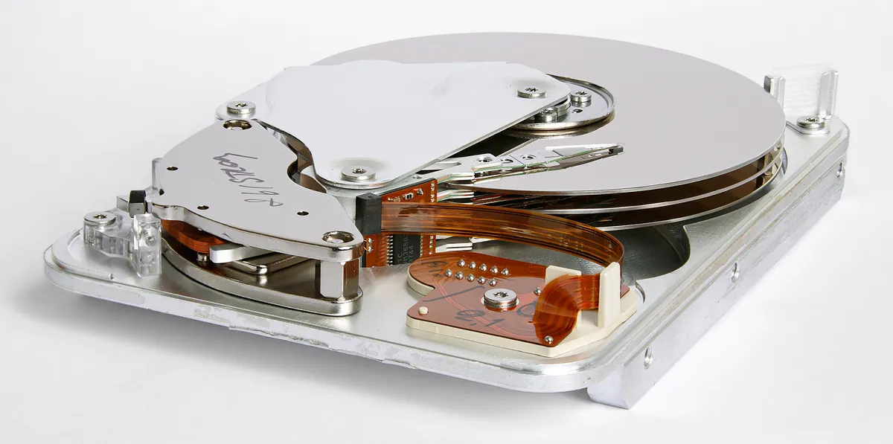
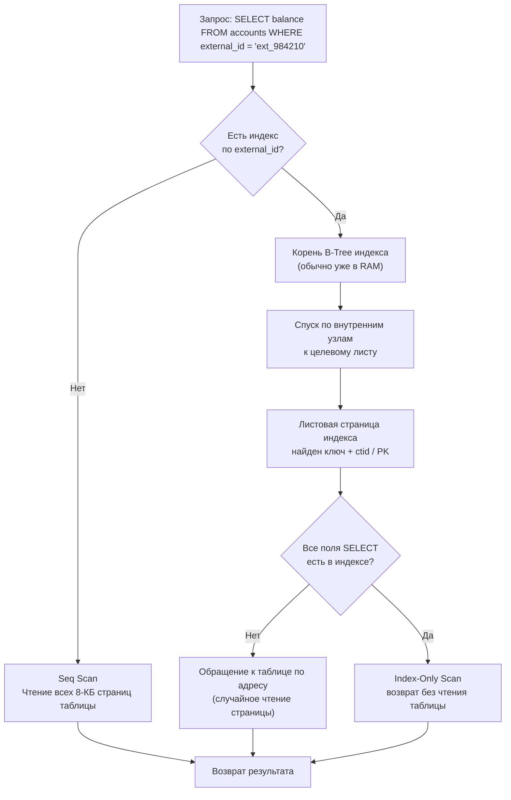

*Зачем реляционной базе нужна отдельная структура поиска, как `Seq Scan` упирается в физику накопителя и какую цену мы платим за каждый `CREATE INDEX`.*

Когда в `LedgerPulse` всего тысяча тестовых счетов, запрос по внешнему идентификатору клиента выполняется меньше чем за миллисекунду:

```sql
SELECT id, owner_name, balance, currency
FROM accounts
WHERE external_id = 'ext_984210';
```

На локальном ноутбуке создаётся иллюзия, что база данных умеет мгновенно находить любую строку сама по себе. Но когда таблица `accounts` в продакшене вырастает до десятков миллионов строк, а таблица проводок `ledger_entries` — до сотен миллионов, тот же запрос начинает отвечать по 15–20 секунд. Процессор упирается в 100%, очередь диска растёт, а таймауты API срывают SLA.

Причина проста: без вспомогательного ориентира движок вынужден прочитать с накопителя в память **каждую страницу и каждую строку таблицы**, проверяя условие `external_id = 'ext_984210'` байт за байтом. Этот режим называется **последовательным сканированием (`Seq Scan`, Sequential Scan)**, и его сложность строго линейна — $O(N)$ от физического размера таблицы.

---

## Интуиция: предметный указатель и физика памяти



Представьте бумажную энциклопедию на 1 500 страниц. Чтобы найти статью о виртуальной памяти без оглавления и указателя, придётся листать том от первой страницы до последней. Алфавитный предметный указатель в конце книги позволяет за пару секунд найти нужный термин и сразу открыть страницу 412.

У этой аналогии есть жёсткая граница, за которой она ломается. Типографский указатель печатают один раз и больше не меняют. Индекс в базе данных обязан синхронно перестраиваться при каждом `INSERT`, `UPDATE` и `DELETE` — причём сразу из десятков параллельных транзакций — и при этом подчиняться блочной физике диска.

Посмотрим, как ту же задачу поиска мы решили бы в оперативной памяти на Go:

1. **Хеш-мапа (`map[string]Account`):** даёт амортизированный доступ за $O(1)$, но совершенно не хранит порядок ключей. Она бесполезна, если нужно выбрать счета в диапазоне дат (`BETWEEN`) или отсортировать выдачу (`ORDER BY`).
2. **Отсортированный слайс + бинарный поиск (`slices.BinarySearch`):** элементы лежат по порядку ключей, поиск занимает $O(\log N)$, а диапазонная выборка превращается в линейный проход по соседним ячейкам.

На этом принципе построен стандартный индекс реляционных СУБД — сбалансированное $B^+$-дерево (подробно его анатомию мы разберём в главе [[2. B-Tree индекс под капотом — страницы, ветвление и page split]]). Разница лишь в среде хранения. В оперативной памяти обращение к произвольному адресу занимает **~100 нс**, тогда как чтение блока с NVMe SSD длится **~100 мкс** (в 1 000 раз дольше), а случайный поиск на магнитном HDD — **~10 мс** (ещё в 100 раз медленнее). Контроллер накопителя не умеет читать отдельные байты: он поднимает данные фиксированными блоками — **страницами (pages)** по **8 КБ** в PostgreSQL и по **16 КБ** в MySQL/InnoDB. Поэтому индекс организует отсортированные ключи прямо внутри 8-килобайтных страниц.

---

## Что такое индекс и что он ускоряет

**Индекс** — это физически обособленная вспомогательная структура данных, которая хранится в отдельных файлах на диске и кэшируется в буферном пуле (`shared_buffers` в PostgreSQL или `Buffer Pool` в InnoDB). Он содержит упорядоченные значения одного или нескольких столбцов вместе с физическими указателями на соответствующие строки основной таблицы.

Замена сплошного перебора $O(N)$ на спуск по сбалансированному дереву $O(\log N)$ радикально сокращает число дисковых операций ввода-вывода (IOPS). На схеме ниже показана разница между тремя маршрутами исполнения одного и того же `SELECT`:



Масштаб работы оборудования различается на порядки: при `Seq Scan` СУБД прокачивает через буферный пул всю таблицу (например, 100 ГБ страниц), а при `Index Scan` поднимает 3–4 индексные страницы дерева и точечно забирает одну целевую страницу таблицы.

Индексы закрывают четыре ключевые задачи в движке БД:

- **Быстрая фильтрация (`WHERE`):** точечный поиск (`=`), диапазоны (`>`, `<`, `BETWEEN`) и списки (`IN`).
- **Ускорение соединений (`JOIN`):** превращение дорогого вложенного перебора по внешнему ключу в серию точечных поисков по индексу (алгоритмы соединений мы разберём позже в этом модуле).
- **Устранение лишней сортировки и группировки:** если индекс уже упорядочен по нужному столбцу, движок выполняет `ORDER BY` и `GROUP BY` потоково по листьям, не создавая временных файлов внешней сортировки на диске.
- **Отказ от чтения таблицы (`Covering Index` / `Index-Only Scan`):** когда все запрошенные в `SELECT` столбцы уже лежат внутри индекса, СУБД возвращает ответ, вообще не заглядывая в страницы самой таблицы.

---

## Первичный и вторичные индексы: PostgreSQL против InnoDB

То, на что именно указывает листовая запись индекса, зависит от архитектуры движка хранения. Это различие напрямую влияет на задержку запросов и разметку памяти.

- **В PostgreSQL** сама таблица устроена как неупорядоченная **куча страниц (Heap Table)**. Первичный ключ `PRIMARY KEY` автоматически создаёт уникальный B-Tree индекс, в листьях которого лежит физический адрес кортежа в куче — **`ctid`** (пара `(номер_страницы, смещение_элемента)`). Все вторичные индексы, созданные через `CREATE INDEX`, устроены точно так же: хранят ключ и `ctid`.
- **В MySQL/InnoDB** таблица физически организована как **кластерный индекс (Clustered Index)**: сами строки целиком лежат прямо в листовых страницах B-Tree первичного ключа. Отдельной кучи нет. Поэтому каждый вторичный индекс в InnoDB хранит не физический адрес байта, а пару `(ключ_индекса, значение_PK)`.

> [!warning] Ловушка: двойной спуск в InnoDB и случайный доступ в PostgreSQL
> Когда запрос в MySQL/InnoDB идёт через вторичный индекс и просит столбцы, которых в этом индексе нет, движок вынужден выполнить **bookmark lookup** (поиск по закладке): сначала спуститься по вторичному B-Tree, получить `id` первичного ключа, а затем заново спуститься по кластерному B-Tree, чтобы достать саму строку.
>
> В PostgreSQL второго спуска по дереву нет — `ctid` сразу даёт номер страницы кучи. Но если подходящих строк тысячи, переходы по разрозненным `ctid` превращаются в серию случайных чтений диска (Random I/O), которые быстро проигрывают обычному `Seq Scan`.

---

## Индекс на практике: SQL и модель поиска в Go

Посмотрим, как это выглядит в домене `LedgerPulse`. В базовой миграции `001_init_ledger.sql` таблица `accounts` уже имеет уникальный индекс на `external_id` (благодаря ограничению `UNIQUE`), но у таблицы `ledger_entries` изначально есть индекс только на первичный ключ `id`. Посмотрим, как реагирует планировщик PostgreSQL на запрос истории проводок счёта до и после создания индекса:

```sql
-- Запрос ленты проводок по счёту без индекса на (account_id, created_at DESC)
EXPLAIN ANALYZE
SELECT id, amount, currency, created_at
FROM ledger_entries
WHERE account_id = 42
ORDER BY created_at DESC
LIMIT 20;
```

Пока индекса по `account_id` нет, планировщик строит `Seq Scan`:

```text
Limit  (cost=24510.12..24512.45 rows=20 width=32) (actual time=184.310..186.102 rows=20 loops=1)
  ->  Sort  (cost=24510.12..24535.80 rows=10272 width=32) (actual time=184.308..186.098 rows=20 loops=1)
        Sort Key: created_at DESC
        Sort Method: top-N heapsort  Memory: 27kB
        ->  Seq Scan on ledger_entries  (cost=0.00..24236.00 rows=10272 width=32) (actual time=0.041..181.440 rows=10415 loops=1)
              Filter: (account_id = 42)
              Rows Removed by Filter: 989585
Planning Time: 0.145 ms
Execution Time: 186.165 ms
```

Движок прочитал все 1 000 000 строк таблицы, отбросил 989 585 лишних и потратил 186 мс на одном миллионе записей. На ста миллионах строк время вырастет в сто раз. Стоит добавить индекс — и из плана исчезают и `Seq Scan`, и этап сортировки `Sort`, потому что строки уже лежат в нужном порядке.

На стороне Go интуитивную разницу между неупорядоченным поиском в `map` и упорядоченным поиском по отсортированному массиву легко показать через стандартный пакет `slices`:

```go
package main

import (
	"cmp"
	"fmt"
	"slices"
)

type indexEntry struct {
	accountID int64
	ctidPage  uint32
}

func main() {
	// Имитация отсортированных ключей на странице индекса (как в B-Tree).
	entries := []indexEntry{
		{accountID: 12, ctidPage: 4},
		{accountID: 42, ctidPage: 19},
		{accountID: 42, ctidPage: 87},
		{accountID: 105, ctidPage: 3},
	}

	// Поиск первого вхождения accountID = 42 за O(log N) без скана всего слайса.
	pos, found := slices.BinarySearchFunc(entries, int64(42), func(e indexEntry, target int64) int {
		return cmp.Compare(e.accountID, target)
	})
	fmt.Printf("found=%v first_pos=%d page=%d\n", found, pos, entries[pos].ctidPage)
	// Вывод: found=true first_pos=1 page=19
}
```

Ключевое свойство здесь — упорядоченность. Если в реальной базе мы ищем счета через `database/sql` с параметром `` `$1` ``, то запрос вида `WHERE external_id = $1` (в коде — переданный как параметр драйвера) сразу попадает в бинарный поиск по страницам дерева.

---

## Цена индекса: за что мы платим при записи

Индексы никогда не достаются бесплатно. Каждый `CREATE INDEX` — это явный компромисс между скоростью чтения и стоимостью записи.

Когда сервис на Go вставляет новую проводку (`INSERT`), обновляет баланс или статус (`UPDATE`) или удаляет запись (`DELETE`), СУБД обязана синхронно обновить **все существующие индексы этой таблицы**. На уровне железа это порождает четыре вида накладных расходов:

1. **Усиление записи (Write Amplification):** одна вставка в таблицу с пятью индексами превращается в запись одной строки в кучу и модификацию пяти независимых деревьев.
2. **Случайный ввод-вывод (Random I/O) и расщепление страниц (`page split`):** если 8-килобайтная страница индекса переполнена, движок выделяет новую страницу, переносит половину ключей, правит родительский узел и ставит внутренние блокировки.
3. **Раздувание журнала WAL:** каждая правка индексной страницы обязана записаться в журнал предзаписи (подробнее в Модуле 5, главе о WAL), увеличивая дисковый и репликационный трафик.
4. **Вымывание буферного пула:** неиспользуемый индекс размером в десятки гигабайт вытесняет из RAM горячие страницы рабочих таблиц, провоцируя промахи кэша и чтение с физического диска.

> [!tip] Собеседование [Middle]
> **Вопрос:** Почему на таблицах с интенсивным потоком вставок (например, журнал событий или таблица проводок `ledger_entries`) опасно бездумно заводить десятки вторичных индексов?
>
> **Ответ:** Каждый дополнительный индекс линейно или сверхлинейно увеличивает Write Amplification. На одну вставку строки движок обновляет кучу и все $K$ индексных деревьев, провоцирует частые расщепления страниц (`page split`), удерживает защелки узлов и генерирует кратно больше записей в WAL. Кроме того, лишние индексы отнимают память у `shared_buffers` и удлиняют работу `VACUUM`. На write-heavy таблицах держат только те индексы, которые реально закрывают критические запросы чтения.

---

## Когда планировщик игнорирует индекс и как мы сами его ломаем

Наличие индекса не гарантирует, что СУБД его применит. Стоимостной планировщик (подробно мы изучим его в середине этого модуля) сознательно выбирает `Seq Scan` в четырёх ситуациях:

1. **Крошечная таблица:** если вся таблица помещается на 2–3 страницах по 8 КБ, проще прочитать их подряд, чем спускаться по уровням дерева и прыгать по `ctid`.
2. **Низкая селективность условия:** если у столбца мало уникальных значений (например, `status = 'active'` в `accounts` покрывает 85% строк), 850 000 случайных переходов по указателям обойдутся на порядки дороже одного линейного прохода по файлу таблицы.
3. **Запрос без фильтрации и подходящей сортировки:** `SELECT * FROM accounts` без `WHERE` и `ORDER BY` всегда пойдёт через `Seq Scan`.
4. **Нарушение порядка колонок в составном индексе:** индекс на `(account_id, created_at)` отсортирован сначала по `account_id`, а потом по дате, поэтому бесполезен для фильтрации только по `WHERE created_at >= ...` (подробнее о правиле левого префикса см. главу 5 этого модуля).

Ещё чаще индекс ломает сам код приложения. Популярные ORM и динамические конструкторы запросов нередко оборачивают столбец в функцию прямо внутри `WHERE`:

> [!warning] Ловушка: выражения, отключающие индекс
> Если написать в запросе:
> ```sql
> SELECT id, balance FROM accounts WHERE LOWER(external_id) = LOWER($1);
> ```
> стандартный B-Tree индекс по `external_id` **не сработает**. Для планировщика `LOWER(external_id)` — непрозрачная функция, результат которой заранее не упорядочен в дереве. Чтобы такой поиск использовал индекс, нужен либо канонизированный формат хранения данных при записи, либо специальный индекс по выражению: `CREATE INDEX idx_accounts_lower_ext ON accounts (LOWER(external_id));` (об индексах по выражениям и SARGable-условиях поговорим дальше в этом модуле).

---

## Упражнения

**Упражнение 1 (Базовое). Оценка маршрута выполнения.**
В таблице `accounts` лежит 2 000 000 строк, и на столбце `status` (`'active'`, `'frozen'`, `'closed'`) создан B-Tree индекс. Доля счетов со статусом `'active'` равна 92%, со статусом `'frozen'` — 0.4%. Какой метод сканирования вероятнее всего выберет планировщик для запроса `WHERE status = 'active'`, а какой — для `WHERE status = 'frozen'`? Объясните почему.

> [!solution] Показать решение
> Для `WHERE status = 'active'` планировщик выберет **`Seq Scan`**: читать 92% строк через индекс — это сотни тысяч случайных обращений к страницам кучи по `ctid`, причём почти каждая 8-КБ страница таблицы всё равно будет прочитана не по одному разу.
>
> Для `WHERE status = 'frozen'` (0.4% строк) выборка селективна, поэтому планировщик использует индекс (`Index Scan` или `Bitmap Index Scan` — о последнем пойдёт речь в главе [[4. Bitmap-индекс и Bitmap Index Scan]]), избегая чтения 99.6% ненужных строк.

**Упражнение 2 (Практическое). Ускорение ленты проводок.**
Перед вами Go-функция, которая выбирает последние 50 операций клиента по внешнему ID, но при профилировании запрос в `LedgerPulse` упирается в `Seq Scan` и сортировку:
```sql
SELECT t.id, t.reference_id, t.created_at
FROM transactions t
WHERE LOWER(t.reference_id) = LOWER($1)
ORDER BY t.created_at DESC
LIMIT 50;
```
Перепишите запрос так, чтобы он использовал стандартный уникальный индекс по `reference_id` (предполагаем, что `reference_id` хранится в нижнем регистре), либо предложите DDL-решение на случай, если регистр в старых записях смешан.

> [!solution] Показать решение
> Если система нормализует `reference_id` в нижний регистр на этапе записи в Go (`strings.ToLower`), достаточно убрать `LOWER(...)` со столбца, чтобы условие стало индексным:
> ```sql
> SELECT t.id, t.reference_id, t.created_at
> FROM transactions t
> WHERE t.reference_id = LOWER($1)
> ORDER BY t.created_at DESC
> LIMIT 50;
> ```
> Если в таблице исторически хранятся ключи в разном регистре и менять данные нельзя, создайте функциональный индекс (expression index):
> ```sql
> CREATE INDEX idx_transactions_ref_lower ON transactions (LOWER(reference_id));
> ```
> Тогда `WHERE LOWER(t.reference_id) = LOWER($1)` сможет выполнить индексный поиск.

**Упражнение 3 (Со звёздочкой \*). Сравнение стоимости чтения в PostgreSQL и InnoDB.**
В таблице `ledger_entries` 50 миллионов строк. Мы выполняем точечный запрос `SELECT amount, currency FROM ledger_entries WHERE transaction_id = 771024;`, используя вторичный индекс на `transaction_id` без дополнительных включённых столбцов (`INCLUDE`). Объясните, сколько обходов B-Tree потребуется в PostgreSQL (с кучей и `ctid`) и сколько — в MySQL/InnoDB (с кластерным индексом), и в чём разница для дискового I/O.

> [!solution] Показать решение
> - **В PostgreSQL:** один спуск по вторичному B-Tree на `transaction_id` даёт список физических адресов `ctid`. По каждому `ctid` движок делает прямое обращение к 8-КБ странице кучи (`Heap`), чтобы прочитать `amount` и `currency` (а заодно проверить видимость MVCC). Второго спуска по дереву нет, но при множестве строк на один `transaction_id` возникают случайные чтения страниц кучи.
> - **В MySQL/InnoDB:** вторичный индекс на `transaction_id` хранит в листьях не физический адрес, а значение первичного ключа `id`. Поэтому после спуска по вторичному индексу движок для каждого найденного `id` выполняет **повторный спуск по кластерному B-Tree** первичного ключа (`bookmark lookup`), чтобы добраться до полей `amount` и `currency` в листовой странице таблицы.

---

Мы увидели, зачем базе данных индекс и почему упорядоченный поиск на страницах побеждает сплошной перебор `Seq Scan`. Но почему стандартный индекс в PostgreSQL, MySQL и SQLite — это не привычное по алгоритмам бинарное дерево поиска, а именно $B^+$-Tree? В следующей главе [[2. B-Tree индекс под капотом — страницы, ветвление и page split]] мы спустимся внутрь 8-килобайтной страницы, посчитаем высоту дерева для миллиарда строк и разберём реальный код `BPlusTree` из `project/step04/btree.go`.
