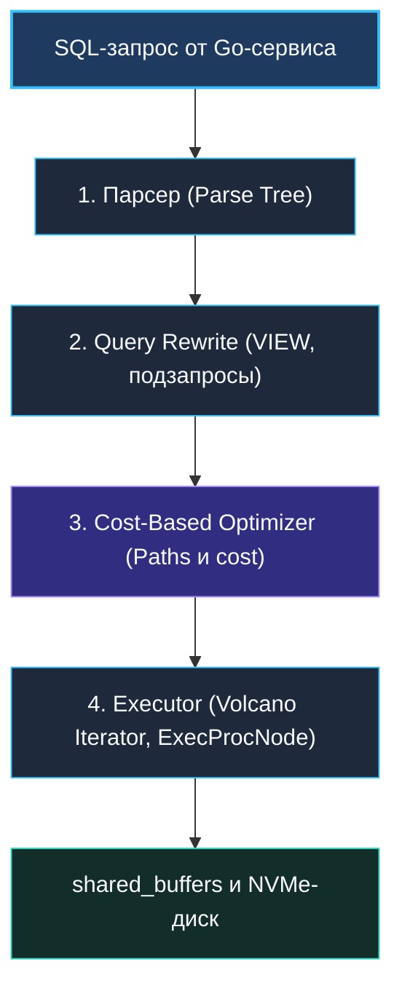
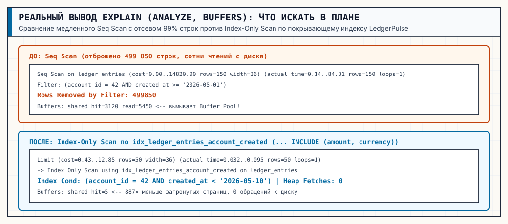
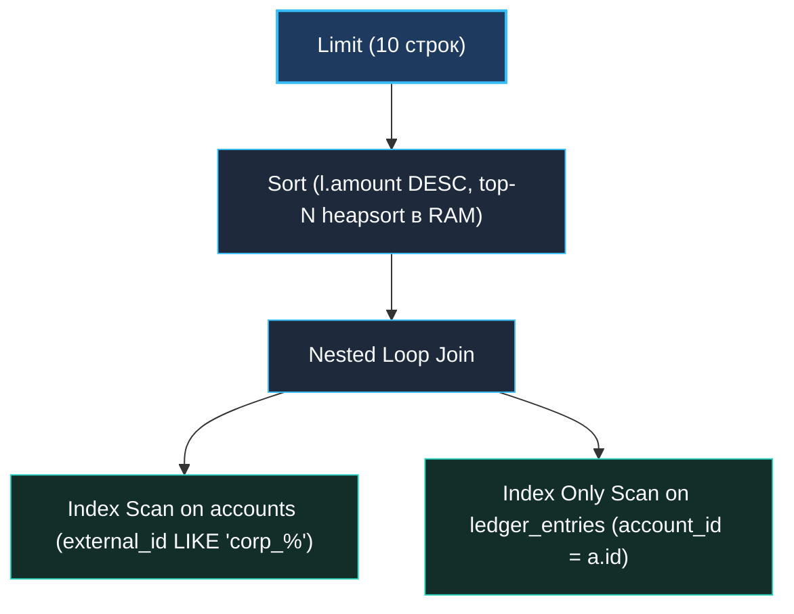

*Как читать дерево плана выполнения снизу вверх, отличать `cost` от реального времени, считать `loops` и находить промахи мимо кэша по `shared hit/read` и `temp read/written`.*

> «Цель вычислений — понимание сути, а не числа.»  
> — Ричард Хэмминг

В Go ни один зрелый разработчик не оптимизирует сервис на глаз: сначала снимают профиль `pprof`, ищут блокировки в `go tool trace`, находят узкое место и только потом правят код. В реляционных базах попытка ускорить SQL без плана выполнения — такое же гадание.

SQL декларативен: вы пишете, *что* нужно получить, но не указываете, *как* читать страницы с диска. Алгоритм доступа, порядок `JOIN` и способ сортировки выбирает планировщик. Команда `EXPLAIN` — рентген базы данных: она показывает дерево **плана выполнения (Execution Plan)**, по которому видно, работает ли индекс, сколько блоков поднято с NVMe и где потеряны миллисекунды.

---

## Четыре фазы построения и исполнения плана

До чтения первого байта данных запрос от Go-сервиса проходит четыре этапа:

1. **Парсинг (Parsing):** превращение текста SQL в синтаксическое дерево **Parse Tree** и проверка имён в каталоге.
2. **Переписывание (Query Rewrite):** подстановка представлений (`VIEW`), выпрямление подзапросов и упрощение тривиальных условий.
3. **Оптимизация (Query Optimization):** генерация альтернативных путей (**Paths**), расчёт стоимости на базе модели затрат и статистики `ANALYZE`, выбор самого дешёвого пути и компиляция в дерево **Plan**.
4. **Выполнение (Execution):** исполнитель (**Executor**) работает по **итераторной модели Волкано (Volcano Iterator Model)** — это *pull-based* конвейер, где родительский узел по требованию забирает строки у дочернего через вызов `ExecProcNode()`.



> [!info] Под капотом: архитектура планировщика PostgreSQL
> Код планировщика лежит в `src/backend/optimizer`. Точка входа `planner()` последовательно вызывает `subquery_planner()` (подзапросы), `grouping_planner()` (`GROUP BY`, окна, `ORDER BY`) и `query_planner()` (базовые таблицы и соединения). Пути к отдельным таблицам строятся в `make_one_rel()`, а варианты `JOIN` — в `add_paths_to_joinrel()`. Лучший `Path` превращается в исполняемое дерево `Plan`.

---

## Режимы `EXPLAIN` и анатомия узла



Обычный `EXPLAIN` **не запускает запрос** и показывает лишь теоретический прогноз по статистике. Правду показывает **`EXPLAIN ANALYZE`**: база реально выполняет запрос и печатает фактические замеры рядом с оценками.

Основные опции:
* `ANALYZE` — реальное выполнение и замеры `actual time`, `rows`, `loops`;
* `BUFFERS` — попадания в буферный кэш (`shared hit`), чтения с диска или из Page Cache ОС (`shared read`), изменённые блоки (`dirtied`, `written`) и дисковый спилл временных файлов (`temp read`, `temp written`);
* `VERBOSE` — список выводимых столбцов (`Output`) и полные имена;
* `FORMAT` — `TEXT` (по умолчанию), `JSON` (удобен для парсинга в Go), `XML`, `YAML`.

Золотой стандарт ручной диагностики: `EXPLAIN (ANALYZE, BUFFERS, VERBOSE) SELECT ...;`.

### Правило чтения: снизу вверх, изнутри наружу

Самые глубоко вложенные узлы исполняются первыми и отдают строки наверх родителям. Разберём типичную строку узла:

```text
->  Index Scan using accounts_external_id_key on accounts  (cost=0.42..8.44 rows=1 width=64) (actual time=0.045..0.048 rows=1 loops=1)
```

* **`cost=0.42..8.44`:** стартовая стоимость до первой строки (`0.42`, спуск по B-Tree) и полная расчётная стоимость узла (`8.44`).
* **`rows=1` / `width=64`:** ожидаемое число строк и средний размер кортежа в байтах.
* **`actual time=0.045..0.048`:** реальное время в миллисекундах **на один цикл** (первая строка и завершение).
* **`rows=1` / `loops=1`:** среднее число реально отданных строк за цикл и количество запусков этого узла родителем.

---

## Основные узлы плана

### Сканирование таблиц и индексов

1. **`Seq Scan`** — последовательное чтение всех 8-КБ страниц таблицы. Выгодно для малых таблиц или широких выборок, разрушительно для точечного поиска на миллионах строк.
2. **`Index Scan`** — поиск адресов `ctid` в B-Tree и последующий переход в кучу (Heap) за столбцами и проверкой видимости MVCC.
3. **`Index-Only Scan`** — чтение всех нужных столбцов прямо из листьев покрывающего индекса ([[6. Покрывающие (Covering) индексы, INCLUDE и Index-Only Scan]]). При актуальной карте видимости обращений к таблице нет (`Heap Fetches: 0`).
4. **`Bitmap Index Scan` + `Bitmap Heap Scan`** — сбор адресов из индекса в битовую карту `TIDBitmap` с последующим упорядоченным чтением страниц кучи ([[4. Bitmap-индекс и Bitmap Index Scan]]).

### Соединения и сортировка

5. **`Nested Loop`** — для каждой строки внешнего набора опрашивается внутренний. Эффективен при малом внешнем наборе и индексе на внутреннем.
6. **`Hash Join`** — построение хеш-таблицы в памяти `work_mem` по меньшему набору и один проход по большему.
7. **`Merge Join`** — слияние двух потоков, уже отсортированных по ключу соединения.
8. **`Sort`** — явная сортировка. Поле `Sort Method` показывает режим: `quicksort` в памяти, `top-N heapsort` в памяти для `ORDER BY ... LIMIT N` или медленный `external merge` на диске при нехватке `work_mem` (в `BUFFERS` появляются `temp read/written`).

---

## Живые примеры планов в `LedgerPulse`

Проверим keyset-пагинацию ленты проводок ([[4. ORDER BY, LIMIT и пагинация (OFFSET против keyset)]]) с покрывающим индексом `idx_ledger_entries_account_created` из `002_indexes.sql`:

```sql
EXPLAIN (ANALYZE, BUFFERS)
SELECT id, transaction_id, amount, currency, created_at
FROM ledger_entries
WHERE account_id = 42
ORDER BY created_at DESC, id DESC
LIMIT 20;
```

```text
Limit  (cost=0.43..14.20 rows=20 width=40) (actual time=0.031..0.044 rows=20 loops=1)
  Buffers: shared hit=4
  ->  Index Only Scan using idx_ledger_entries_account_created on ledger_entries  (cost=0.43..2415.80 rows=3500 width=40) (actual time=0.029..0.039 rows=20 loops=1)
        Index Cond: (account_id = 42)
        Heap Fetches: 0
        Buffers: shared hit=4
Planning Time: 0.145 ms
Execution Time: 0.068 ms
```

Узел `Sort` отсутствует — индекс уже отсортирован. `Limit` остановил скан на 20-й строке за `0.039` мс, `Heap Fetches: 0` и `shared hit=4` подтверждают чтение целиком из RAM.

Второй пример — соединение `accounts` и `ledger_entries` с отбором корпоративных клиентов и топ-10 сумм:

```sql
EXPLAIN (ANALYZE, BUFFERS)
SELECT a.owner_name, l.amount, l.currency
FROM accounts AS a
JOIN ledger_entries AS l ON l.account_id = a.id
WHERE a.external_id LIKE 'corp_%'
ORDER BY l.amount DESC
LIMIT 10;
```



---

## Оборудование и параметры стоимости в `EXPLAIN`

Модель затрат опирается на физические характеристики подсистемы памяти и диска:
* `seq_page_cost = 1.0` — эталон последовательного чтения одной 8-КБ страницы;
* `random_page_cost = 4.0` — случайное чтение (исторически для HDD с seek time ~10 мс; на NVMe SSD с ~100 мкс его снижают до `1.1–1.5`);
* `cpu_tuple_cost = 0.01` и `cpu_index_tuple_cost = 0.005` — процессорные затраты на кортеж таблицы и индексную запись.

`Buffers: shared hit=4` означает мгновенное чтение из `shared_buffers` в RAM (~100 нс на обращение), `shared read=4800` — чтение блоков из Page Cache ОС или с SSD, а `temp read/written` — нехватку `work_mem` при сортировке или хешировании.

---

## Автоматический разбор `EXPLAIN` в Go (`pgx/v5`)

Запрашивая план в формате `JSON`, можно проверять запросы прямо в тестах CI или отладочном middleware для dev/staging:

```go
package main

import (
	"context"
	"encoding/json"
	"fmt"
	"log"

	"github.com/jackc/pgx/v5"
)

type ExplainNode struct {
	NodeType          string        `json:"Node Type"`
	RelationName      string        `json:"Relation Name,omitempty"`
	PlanRows          float64       `json:"Plan Rows"`
	TotalCost         float64       `json:"Total Cost"`
	ActualRows        float64       `json:"Actual Rows"`
	ActualLoops       float64       `json:"Actual Loops"`
	ActualTotalTime   float64       `json:"Actual Total Time"`
	SharedHitBlocks   int           `json:"Shared Hit Blocks"`
	SharedReadBlocks  int           `json:"Shared Read Blocks"`
	TempReadBlocks    int           `json:"Temp Read Blocks"`
	TempWrittenBlocks int           `json:"Temp Written Blocks"`
	Plans             []ExplainNode `json:"Plans,omitempty"`
}

type ExplainResult struct {
	Plan          ExplainNode `json:"Plan"`
	PlanningTime  float64     `json:"Planning Time"`
	ExecutionTime float64     `json:"Execution Time"`
}

func AnalyzeQuery(ctx context.Context, conn *pgx.Conn, query string, args ...any) (ExplainResult, error) {
	explainSQL := "EXPLAIN (ANALYZE, BUFFERS, FORMAT JSON) " + query
	var rawJSON []byte
	if err := conn.QueryRow(ctx, explainSQL, args...).Scan(&rawJSON); err != nil {
		return ExplainResult{}, fmt.Errorf("run explain: %w", err)
	}

	var results []ExplainResult
	if err := json.Unmarshal(rawJSON, &results); err != nil || len(results) == 0 {
		return ExplainResult{}, fmt.Errorf("decode explain json: %w", err)
	}

	res := results[0]
	r := res.Plan
	log.Printf("node=%s exec=%.3fms cost=%.2f hit=%d read=%d temp_written=%d",
		r.NodeType, res.ExecutionTime, r.TotalCost, r.SharedHitBlocks, r.SharedReadBlocks, r.TempWrittenBlocks)
	return res, nil
}
```

---

## Ловушки, собеседование и сравнение с MySQL

> [!warning] Ловушка: мутации, множитель `loops` и статистика
> 1. **`EXPLAIN ANALYZE` реально изменяет данные.** Запрос `INSERT`/`UPDATE`/`DELETE` всегда оборачивайте в откат:
>    ```sql
>    BEGIN; EXPLAIN (ANALYZE, BUFFERS) DELETE FROM transactions WHERE status = 'failed'; ROLLBACK;
>    ```
> 2. **Множитель `loops`.** `actual time` и `rows` даны **на один цикл**. При `actual time=0.8..2.5` и `loops=10000` узел суммарно работал $2.5 \times 10\,000 = 25\,000$ мс (25 с).
> 3. **Расхождение `rows` и `actual rows`.** Ошибка прогноза на порядки сигнализирует об устаревшей статистике — нужен `ANALYZE`.
> 4. **Холодный vs прогретый кэш.** Сравнивайте планы, сопоставляя `Execution Time` с `shared read`.

> [!tip] Собеседование [Middle]: физический смысл `cost`
> **Вопрос:** У запроса А `cost=150`, у запроса Б `cost=900`. Значит ли это, что запрос А быстрее в 6 раз?
>
> **Ответ:** Нет. `cost` — безразмерная условная единица модели затрат, служащая **только для сравнения альтернативных планов одного и того же запроса**. Сравнивать `cost` разных запросов нельзя: скан компактной таблицы из RAM с `cost=900` может занять 1 мс, а холодный индексный доступ с диска с `cost=150` — сотни миллисекунд. Реальную скорость показывает только `actual time`.

### Сравнение с MySQL (InnoDB)

В MySQL базовый `EXPLAIN` выводит плоскую таблицу: `type` (`const` $\to$ `eq_ref` $\to$ `ref` $\to$ `range` $\to$ `index` $\to$ `ALL`), `key` (выбранный индекс), `rows` и `Extra` (`Using index`, `Using temporary`, `Using filesort`). Начиная с MySQL 8.0, команды `EXPLAIN FORMAT=JSON` и `EXPLAIN ANALYZE` дают древовидный план с реальным временем и `loops`, как в PostgreSQL.

В повседневной работе связывайте `EXPLAIN (ANALYZE, BUFFERS)` с агрегатами `pg_stat_statements` (`total_exec_time`, `mean_exec_time`), модулем `auto_explain` (логирование планов медленных запросов через `log_min_duration_statement`) и регрессионными проверками JSON-плана в CI.

---

## Упражнения

### Упражнение 1 (Базовое). Расчёт времени по `loops` и буферов

По фрагменту плана определите суммарное время узла `Index Scan on ledger_entries`, число блоков, поднятых с диска (или из OS Page Cache), и место выполнения сортировки:

```text
Limit  (cost=1840.20..1840.23 rows=10 width=32) (actual time=124.510..124.515 rows=10 loops=1)
  Buffers: shared hit=8420 read=1200
  ->  Sort  (cost=1840.20..1865.20 rows=10000 width=32) (actual time=124.508..124.510 rows=10 loops=1)
        Sort Method: top-N heapsort  Memory: 25kB
        ->  Nested Loop  (cost=0.85..1624.10 rows=10000 width=32) (actual time=0.410..118.200 rows=10000 loops=1)
              ->  Index Scan using accounts_status_idx on accounts a  (cost=0.42..42.10 rows=200 width=16) (actual time=0.350..2.100 rows=200 loops=1)
                    Buffers: shared hit=120 read=40
              ->  Index Scan using idx_ledger_entries_account on ledger_entries l  (cost=0.43..7.40 rows=50 width=24) (actual time=0.050..0.550 rows=50 loops=200)
                    Buffers: shared hit=8300 read=1160
```

> [!solution] Показать решение
> 1. `Index Scan on ledger_entries`: `0.550` мс × `200` циклов = **110.0 мс** суммарного времени.
> 2. Промахи мимо `shared_buffers`: `read=1200` блоков (40 по `accounts` и 1160 по `ledger_entries`).
> 3. Сортировка шла в оперативной памяти методом `top-N heapsort` (`Memory: 25kB`), временные файлы на диск не писались.

### Упражнение 2 (Практическое). Безопасный `EXPLAIN ANALYZE` для `UPDATE`

Напишите безопасный SQL-сценарий замера плана для массового перевода старых `pending`-операций в `'failed'` (`created_at < now() - interval '30 days'`), который не оставит изменений в `transactions`.

> [!solution] Показать решение
> ```sql
> BEGIN;
> EXPLAIN (ANALYZE, BUFFERS)
> UPDATE transactions
> SET status = 'failed'
> WHERE status = 'pending'
>   AND created_at < now() - interval '30 days';
> ROLLBACK;
> ```
> `ROLLBACK` отменяет изменения после замера времени и грязных буферов.

### Упражнение 3 (\*). Рекурсивный детектор аномалий плана в Go

Напишите функцию `InspectPlanAnomalies(node ExplainNode) []string`, которая рекурсивно обходит `node.Plans` и сообщает о `Seq Scan` с `ActualRows > 1000` и любом узле с `TempWrittenBlocks > 0`.

> [!solution] Показать решение
> ```go
> func InspectPlanAnomalies(node ExplainNode) []string {
> 	var alerts []string
> 	if node.NodeType == "Seq Scan" && node.ActualRows > 1000 {
> 		alerts = append(alerts, fmt.Sprintf("Seq Scan on %q returned %.0f rows", node.RelationName, node.ActualRows))
> 	}
> 	if node.TempWrittenBlocks > 0 {
> 		alerts = append(alerts, fmt.Sprintf("%q spilled %d temp blocks", node.NodeType, node.TempWrittenBlocks))
> 	}
> 	for _, child := range node.Plans {
> 		alerts = append(alerts, InspectPlanAnomalies(child)...)
> 	}
> 	return alerts
> }
> ```

---

## Мостик к следующему уроку

Вы научились читать планы `EXPLAIN (ANALYZE, BUFFERS)` и видеть числа `cost=0.43..2415.80`. Но откуда планировщик берёт эти оценки и почему меняет алгоритм доступа при росте таблицы? В следующей главе разберём математическое ядро планировщика: [[11. Стоимостной оптимизатор (Cost-Based Optimizer)]].
