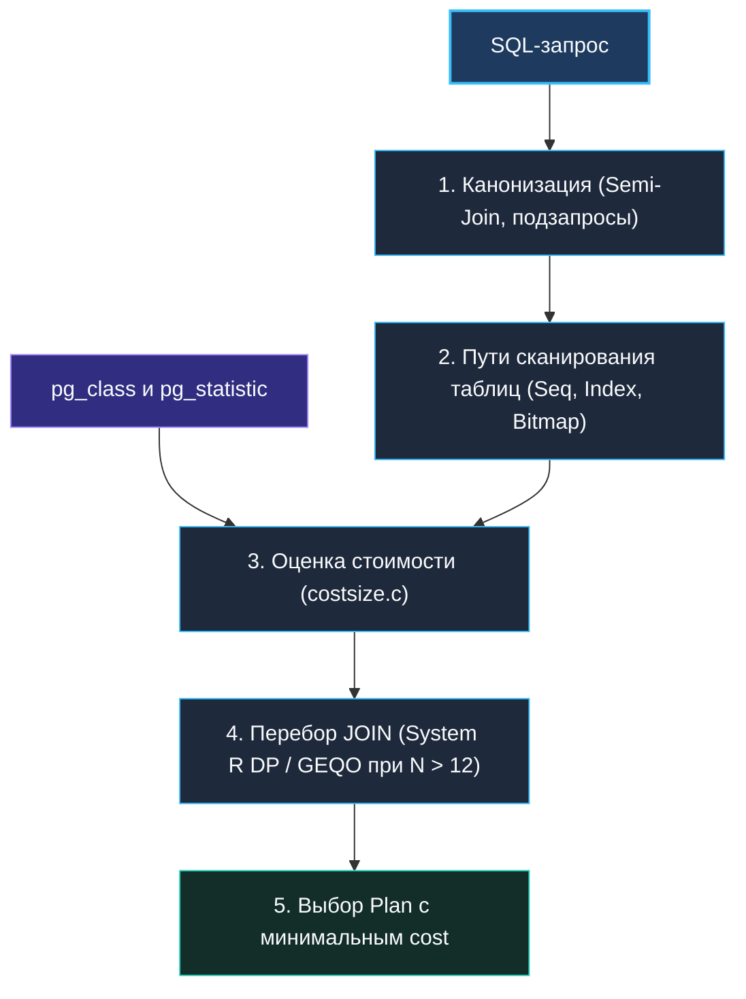

*От жёстких эвристик RBO к математической экономике CBO: константы `seq_page_cost` и `random_page_cost`, алгоритм перебора `JOIN`, настройка под NVMe и разбор симулятора `EstimatePlan` из `project/step04/`.*

> «Решения, определившие развитие этой технологии и путь, по которому мы пошли, принимали живые люди — под давлением и в жёстких ограничениях своего времени.»  
> — Брайан Керниган

В ранних реляционных СУБД 1970–1980-х годов планировщики работали как жёсткие бюрократы. Такую архитектуру называли **Rule-Based Optimizer (RBO)**: «Есть индекс — всегда используй индекс», «Соединяй таблицы в порядке перечисления в `FROM`».

Практика быстро доказала слабость догм. Прочитать 5 страниц таблицы подряд быстрее, чем спускаться по B-Tree, а при соединении 50 миллионов строк вложенный цикл `Nested Loop` проигрывает хеш-соединению в памяти (`Hash Join`) на порядки.

На смену правилам пришёл **Cost-Based Optimizer (CBO)** — оптимизатор на основе модели стоимости. Для каждого SQL-запроса от `LedgerPulse` он строит десятки вариантов плана, оценивает каждый в единой «валюте» и отправляет на исполнение самый дешёвый.

---

## RBO против CBO: два столпа модели стоимости

Главное свойство CBO — адаптивность к реальному объёму и распределению данных. Его расчёты опираются на две опоры:
1. **Статистика данных (`pg_statistic`):** размер таблиц в страницах, число строк, гистограммы, списки частых значений и доля `NULL`.
2. **Модель аппаратных затрат (Cost Model):** веса операций дискового ввода-вывода (I/O) и процессора (CPU).

Благодаря этому на маленькой таблице оптимизатор выберет `Seq Scan`, при росте данных переключится на `Index Scan`, а при выборке половины таблицы вернётся к последовательному сканированию.

---

## Валюта планировщика: коэффициенты модели затрат

PostgreSQL задаёт стоимость операций через параметры конфигурации (их можно переопределить в `postgresql.conf` или в сессии):

* **`seq_page_cost`** (`1.0`) — эталон: цена последовательного чтения одной 8-КБ страницы с диска.
* **`random_page_cost`** (`4.0`) — цена случайного чтения одной страницы (Random I/O); исторически откалибрована под HDD с механическим позиционированием головки (~10 мс).
* **`cpu_tuple_cost`** (`0.01`) — затраты CPU на обработку одной строки таблицы.
* **`cpu_index_tuple_cost`** (`0.005`) — затраты CPU на обработку одной записи в B-Tree.
* **`cpu_operator_cost`** (`0.0025`) — цена элементарной операции сравнения (`=`, `<`, `AND`).
* **`effective_cache_size`** — оценка памяти под кэш (`shared_buffers` + OS Page Cache). Параметр **не выделяет RAM**, но подсказывает CBO, какая часть индекса и таблицы уже лежит в памяти (~100 нс на доступ вместо ~100 мкс на NVMe), удешевляя повторные чтения B-Tree.

В MySQL (InnoDB) аналогичные веса лежат в `mysql.server_cost` и `mysql.engine_cost` (`SET GLOBAL`).

Полная стоимость любого узла складывается из дисковой и процессорной компонент:

$$\text{Total Cost} = (\text{Pages}_{\text{seq}} \times \text{seq\_page\_cost}) + (\text{Pages}_{\text{rnd}} \times \text{random\_page\_cost}) + (\text{Rows} \times \text{cpu\_tuple\_cost}) + (\text{IndexRows} \times \text{cpu\_index\_tuple\_cost}) + (\text{Ops} \times \text{cpu\_operator\_cost})$$

Эта сумма отображается в поле `cost=start..total` вывода `EXPLAIN` ([[10. План выполнения запроса — читаем EXPLAIN ANALYZE BUFFERS]]).

> [!info] Под капотом: `costsize.c` и `clausesel.c` в ядре PostgreSQL
> Формулы расчёта стоимости реализованы в `src/backend/optimizer/path/costsize.c` функциями `cost_seqscan()`, `cost_index()`, `cost_nestloop()`, `cost_hashjoin()` и `cost_mergejoin()`. Селективность фильтров `WHERE` вычисляет модуль `clausesel.c`, читая гистограммы и списки частых значений из `pg_statistic`.

---

## Статистика и перебор деревьев соединений

Переменные в формулу стоимости поставляют `ANALYZE` и `autovacuum`:
* `pg_class.reltuples` — оценочное число строк таблицы;
* `pg_class.relpages` — число 8-КБ страниц таблицы на диске;
* `pg_statistic` — доля `NULL`, средняя ширина кортежа, `n_distinct`, списки наиболее частых значений (**MCV**) и гистограммы (детально в [[12. Кардинальность, селективность и статистика]]).



Для поиска порядка соединения $N$ таблиц применяется алгоритм динамического программирования **System R**. Поскольку число перестановок растёт факториально, при числе таблиц выше `geqo_threshold = 12` PostgreSQL переходит на генетический алгоритм **GEQO (Genetic Query Optimizer)**, чтобы планирование не длилось дольше выполнения.

---

## Почему на 5 страницах побеждает `Seq Scan`

Пусть тестовая таблица `accounts` занимает 5 страниц (`relpages = 5`, ~150 строк), и на `external_id` есть индекс:
1. **`Seq Scan`:** прочитать 5 страниц подряд: $5 \times 1.0 + 150 \times 0.01 = 6.5$.
2. **`Index Scan`:** спуститься по B-Tree (допустим, 3 страницы) и прочитать 1 страницу Heap по `ctid`: $4 \times 4.0 + \text{CPU} \approx 16.0$.

Последовательное чтение втрое дешевле (`6.5` против `16.0`). При росте таблицы до 100 000 страниц цена `Seq Scan` взлетает выше 100 000, а спуск по B-Tree остаётся ~16–20 — и CBO переключается на индекс.

---

## Разбор симулятора `EstimatePlan` в `project/step04/`

В `project/step04/btree.go` рядом с `BPlusTree` реализован симулятор CBO `EstimatePlan`, наглядно показывающий математику выбора между `Seq Scan`, `Index Scan` и `Index-Only Scan`:

```go
type PlanChoice string

const (
	PlanSeqScan       PlanChoice = "Seq Scan"
	PlanIndexScan     PlanChoice = "Index Scan"
	PlanIndexOnlyScan PlanChoice = "Index-Only Scan"
)

func EstimatePlan(tablePages, rows int, selectivity float64, coveredByIndex bool) (PlanChoice, float64) {
	const (
		seqPageCost   = 1.0
		randPageCost  = 4.0
		cpuTupleCost  = 0.01
		cpuIndexTuple = 0.005
	)
	seqCost := float64(tablePages)*seqPageCost + float64(rows)*cpuTupleCost

	matchedRows := max(1.0, float64(rows)*selectivity)
	indexPages := max(1.0, float64(tablePages)*0.15*selectivity)
	if coveredByIndex {
		cost := indexPages*randPageCost + matchedRows*cpuIndexTuple
		if cost < seqCost {
			return PlanIndexOnlyScan, cost
		}
		return PlanSeqScan, seqCost
	}

	heapPages := min(float64(tablePages), matchedRows)
	idxCost := indexPages*randPageCost + heapPages*randPageCost + matchedRows*(cpuTupleCost+cpuIndexTuple)
	if idxCost < seqCost {
		return PlanIndexScan, idxCost
	}
	return PlanSeqScan, seqCost
}
```

Разберём три контрольных сценария из `project/step04/btree_test.go` для таблицы на `tablePages = 10 000` и `rows = 1 000 000`:

1. **`seqCost` не зависит от селективности:** $\text{seqCost} = 10\,000 \times 1.0 + 1\,000\,000 \times 0.01 = 20\,000.0$.
2. **Селективность `0.0001` (100 строк):**
   * При `coveredByIndex = true` (`idx_ledger_entries_account_created`) обращения в кучу не нужны (`heapPages = 0`): читается `indexPages = 1.0` и 100 индексных ключей. Итог: $1 \times 4.0 + 100 \times 0.005 = 4.5 \ll 20\,000$ — побеждает **`Index-Only Scan`**.
   * При `coveredByIndex = false` добавляется до `100` случайных страниц Heap: $1 \times 4.0 + 100 \times 4.0 + 100 \times 0.015 = 405.5 \ll 20\,000$ — побеждает **`Index Scan`**.
3. **Низкая селективность `0.45` (450 000 строк, `coveredByIndex = false`):**
   * `heapPages` ограничено размером таблицы (`10 000`), но $10\,000 \times 4.0 = 40\,000$ само по себе вдвое дороже `seqCost`, а с учётом `675` страниц индекса и CPU цена достигает `49 450.0`. Тест проверяет возврат **`Seq Scan`**.

Уже при выборке ~0.5% разбросанных строк (~5 000 из миллиона) непокрывающий `Index Scan` при `randPageCost = 4.0` уступает `Seq Scan`, тогда как покрывающий индекс выигрывает даже на десятках процентов выборки.

---

## Железо, параллельные планы и ошибки CBO

### Калибровка `random_page_cost` под NVMe

Константа `random_page_cost = 4.0` устарела для NVMe SSD, где случайное чтение (~100 мкс) почти не уступает последовательному.

> [!warning] Ловушка: дефолтный `random_page_cost = 4.0` на SSD
> На серверах с NVMe значение `4.0` заставляет планировщик бояться индексов и срываться в `Seq Scan`. Рекомендуемый диапазон для NVMe — **`1.1–1.5`** (для облачных сетевых дисков — `1.5–2.0`). Никогда не опускайте `random_page_cost` ниже `seq_page_cost` (`< 1.0`), иначе случайные прыжки станут на бумаге дешевле линейного чтения.

### Параллельное выполнение

Начиная с PostgreSQL 9.6, таблицы крупнее `min_parallel_table_scan_size` (по умолчанию `8MB`) могут сканироваться параллельно (`Parallel Seq Scan`). Дисковая стоимость делится на число воркеров (`max_parallel_workers_per_gather`), добавляются затраты на передачу кортежей в узел `Gather` через разделяемую память.

### Ошибки CBO и калибровка пула в Go

Оптимизатор ошибается при устаревшей статистике (после массового `INSERT`) и при корреляции столбцов (перемножает вероятности как независимые — лечится через `CREATE STATISTICS`).

> [!tip] Собеседование [Senior/Staff]: регрессия планов (Plan Regression)
> **Вопрос:** Почему после `ANALYZE` или `VACUUM FULL` запрос в продакшене стал выполняться в 10 раз медленнее?
>
> **Ответ:** Произошла **регрессия плана**. Свежая статистика слегка сместила оценки `cost`, и CBO переключил запрос на альтернативный план (например, с `Index Scan` на `Hash Join`), который на бумаге дешевле, но из-за перекоса данных или корреляции фактически работает хуже. Лечат уточнением статистики (`SET STATISTICS`, `CREATE STATISTICS`), корректировкой запроса или фиксацией плана через `pg_hint_plan`.

В Go настройки CBO для аналитического пула можно задавать в `AfterConnect` пула `pgxpool`, а отслеживать решения — через `EXPLAIN (ANALYZE, BUFFERS, VERBOSE)`, `pg_stat_statements` и `auto_explain`:

```go
package main

import (
	"context"
	"fmt"

	"github.com/jackc/pgx/v5"
	"github.com/jackc/pgx/v5/pgxpool"
)

func NewTunedPool(ctx context.Context, connString string) (*pgxpool.Pool, error) {
	cfg, err := pgxpool.ParseConfig(connString)
	if err != nil {
		return nil, fmt.Errorf("parse pool config: %w", err)
	}
	cfg.AfterConnect = func(ctx context.Context, conn *pgx.Conn) error {
		_, err := conn.Exec(ctx, `
			SET random_page_cost = 1.1;
			SET effective_cache_size = '16GB';
			SET work_mem = '32MB';`)
		return err
	}
	return pgxpool.NewWithConfig(ctx, cfg)
}
```

---

## Упражнения

### Упражнение 1 (Базовое). Точка перелома в `EstimatePlan`

Для `tablePages = 10000`, `rows = 1_000_000` и `selectivity = 0.05` (50 000 строк) посчитайте стоимость и выбор `EstimatePlan` при `coveredByIndex = false` и `coveredByIndex = true`.

> [!solution] Показать решение
> `seqCost = 10000*1 + 1000000*0.01 = 20000.0`. `matchedRows = 50000`, `indexPages = 75`.
> * При `coveredByIndex = false`: `heapPages = 10000`, `idxCost = 75*4 + 10000*4 + 50000*0.015 = 41050.0 > 20000` -> **`Seq Scan`**.
> * При `coveredByIndex = true`: `cost = 75*4 + 50000*0.005 = 550.0 < 20000` -> **`Index-Only Scan`**.

### Упражнение 2 (Практическое). Влияние `random_page_cost` на границу индекса

Добавьте параметр `randPageCost float64` в копию функции `EstimatePlanWithDisk` и сравните выбор при `tablePages = 10000`, `rows = 1_000_000`, `selectivity = 0.006`, `coveredByIndex = false` для HDD (`4.0`) и NVMe (`1.1`).

> [!solution] Показать решение
> При `selectivity = 0.006`: `matchedRows = 6000`, `indexPages = 9`, `heapPages = 6000`, `seqCost = 20000`:
> * HDD (`4.0`): `idxCost = 9*4 + 6000*4 + 6000*0.015 = 24126 > 20000` -> **`Seq Scan`**.
> * NVMe (`1.1`): `idxCost = 9*1.1 + 6000*1.1 + 90 = 6699.9 < 20000` -> **`Index Scan`**.

### Упражнение 3 (\*). Безопасный тест смены стоимости через `SET LOCAL`

В изолированной транзакции сравните планы `EXPLAIN` для диапазона по `transactions (created_at)` до и после `SET LOCAL random_page_cost = 1.1;`. Почему через `pgxpool` или `PgBouncer` нельзя бездумно звать обычный `SET`?

> [!solution] Показать решение
> ```sql
> BEGIN;
> EXPLAIN SELECT id, status FROM transactions WHERE created_at >= now() - interval '7 days';
> SET LOCAL random_page_cost = 1.1;
> EXPLAIN SELECT id, status FROM transactions WHERE created_at >= now() - interval '7 days';
> ROLLBACK;
> ```
> `SET LOCAL` сбрасывается при `COMMIT`/`ROLLBACK`, тогда как обычный `SET` «загрязняет» физическое соединение пула для всех последующих запросов.

---

## Мостик к следующему уроку

Все формулы CBO — от `costsize.c` до учебного `EstimatePlan` — опираются на одно входное число: **ожидаемую кардинальность (`rows`)**. Ошибка в ней разрушит любой план. Как PostgreSQL вычисляет селективность и хранит гистограммы, разберём в главе [[12. Кардинальность, селективность и статистика]].
