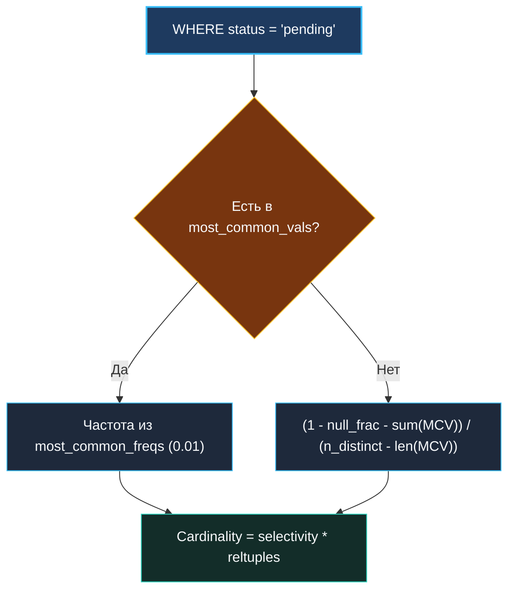

*Как PostgreSQL оценивает число строк до запуска запроса: выборка Виттера, `pg_stats`, списки MCV, эквиглубинные гистограммы, корреляция столбцов и `CREATE STATISTICS`.*

> «Не у каждого значения есть адрес, но у каждой переменной он есть.»  
> — Алан Донован и Брайан Керниган

В [[11. Стоимостной оптимизатор (Cost-Based Optimizer)]] мы разобрали экономику планировщика. На вход каждой формуле стоимости подаётся решающее число — **кардинальность (Cardinality)**, ожидаемое число строк на выходе узла.

Ошибку стоимости в 10% план переживает спокойно. Ошибка кардинальности на порядок рушит выбор алгоритма:
* Ожидая `1` строку вместо реального `1 000 000`, планировщик выбирает `Nested Loop` и делает миллион обходов B-Tree.
* Ожидая `500 000` строк вместо `5`, движок строит массивную хеш-таблицу для `Hash Join`, хотя точечный спуск по индексу отработал бы за 50 микросекунд.

Кардинальность вычисляется из статистики, которую собирает ядро СУБД.

---

## Что такое кардинальность и где её смотреть

**Cardinality** — математическое ожидание числа кортежей, производимых операцией (`WHERE`, сканированием, соединением). В отчёте `EXPLAIN (ANALYZE, BUFFERS)` ([[10. План выполнения запроса — читаем EXPLAIN ANALYZE BUFFERS]]) рядом стоят:
* **`rows`** (в первых скобках) — теоретический прогноз оптимизатора;
* **`actual rows`** (во вторых скобках) — реальное среднее число строк за один цикл (`loops`).

---

## Сбор статистики: выборка Виттера и `ANALYZE`

Сканировать терабайтную таблицу целиком ради статистики непозволительно дорого. Поэтому `ANALYZE` использует **резервуарную выборку (Reservoir Sampling)**:
* **Вручную:** `ANALYZE transactions;`.
* **Автоматически:** фоновый демон `autovacuum` запускает `ANALYZE`, когда число изменённых строк превышает порог `autovacuum_analyze_threshold + autovacuum_analyze_scale_factor * reltuples` (по умолчанию $50 + 0.1 \times \text{reltuples}$).

Размер выборки равен `default_statistics_target` (по умолчанию `100`) × `300`, то есть ровно **30 000 случайных строк** независимо от размера таблицы. Для перекошенных колонок точность поднимают индивидуально:

```sql
ALTER TABLE transactions ALTER COLUMN status SET STATISTICS 1000;
ANALYZE transactions;
```

При `1000` выборка увеличивается до **300 000 строк**.

> [!info] Под капотом: `analyze.c` в исходном коде PostgreSQL
> В модуле `src/backend/commands/analyze.c` функция `do_analyze_rel()` запускает `acquire_sample_rows()`, которая по алгоритму Виттера в два этапа выбирает случайные 8-КБ страницы, а затем случайные строки с этих страниц. Обычные индексы наследуют статистику таблицы, обновляя лишь свои `reltuples` и `relpages` (отдельная статистика собирается только для индексов по выражениям).

---

## Каталог `pg_statistic` и представление `pg_stats`

Собранные данные пишутся в `pg_statistic` (в полиморфных массивах `anyarray`), а для чтения человеком открыто представление **`pg_stats`**:

```sql
SELECT attname, null_frac, avg_width, n_distinct,
       most_common_vals, most_common_freqs, correlation
FROM pg_stats
WHERE tablename = 'transactions';
```

Ключевые поля `pg_stats`:
1. **`null_frac`** — доля `NULL` (от `0.0` до `1.0`). При `reltuples = 1_000_000` и `null_frac = 0.2` фильтр `IS NULL` ожидает `200 000` строк.
2. **`avg_width`** — средняя ширина значения в байтах (оценка `width` и памяти под `Sort`/`Hash Join`).
3. **`n_distinct`** — число уникальных не-`NULL` значений (базовая оценка `1 / n_distinct`).
4. **`most_common_vals` (MCV)** и **`most_common_freqs`** — массив самых частых значений и их точные доли.
5. **`histogram_bounds`** — границы корзин гистограммы для значений вне MCV.
6. **`correlation`** — корреляция между физическим порядком строк на диске и логическим порядком значений (от `-1.0` до `+1.0`). При значении около `+1.0` (как у `id` или `created_at` в `ledger_entries`) индексный скан идёт почти последовательно без Random I/O.

> [!tip] Собеседование [Middle]: что означает `n_distinct = -1`?
> **Вопрос:** В `pg_stats` для `accounts.id` стоит `n_distinct = -1`, а для `owner_name` — `-0.35`. Что значат отрицательные числа?
>
> **Ответ:** Положительное число фиксирует абсолютное количество уникальных значений (например, `4` статуса). Отрицательное задаёт **долю уникальности относительно `reltuples`**: `-1` означает 100% уникальность (`n_distinct = reltuples`), а `-0.35` — что уникальных значений около 35% от числа строк таблицы. Это позволяет оценке автоматически масштабироваться при росте таблицы.

---

## MCV, эквиглубинные гистограммы и расчёт селективности

В таблице `transactions` статусы распределены неравномерно:

```text
most_common_vals  : {posted, failed, reversed, pending}
most_common_freqs : {0.88, 0.08, 0.03, 0.01}
```

Для `WHERE status = 'pending'` планировщик берёт из MCV точную частоту `0.01` (1%) и выбирает частичный индекс `idx_transactions_pending`.

Для непрерывных данных (`amount`, `created_at`) строится **эквиглубинная гистограмма (Equi-depth Histogram)** в `histogram_bounds`: отсортированная выборка делится на корзины с **одинаковым числом строк** (при цели `100` — `101` граница для `100` корзин). Это позволяет точно интерполировать диапазоны `>`, `<` и `BETWEEN`.

**Селективность (`selectivity`)** — расчётная вероятность от `0.0` до `1.0`, что строка пройдёт фильтр (`Cardinality = selectivity × reltuples`):
1. **Равенство (`=`):** ищется в `most_common_vals`; если нет — остаток вероятности делится поровну:
   $$\text{selectivity} = \frac{1 - \text{null\_frac} - \sum \text{most\_common\_freqs}}{n\_distinct - \text{len}(\text{MCV})}$$
2. **Диапазоны (`>`, `<`, `BETWEEN`):** сумма попавших MCV + полные корзины гистограммы + линейная интерполяция граничной корзины.
3. **Префикс `LIKE 'corp_%'`:** преобразуется в диапазон `(col >= 'corp_' AND col < 'corp`')` и оценивается по гистограмме.
4. **Неравенство (`<>` или `!=`):** $1.0 - \text{null\_frac} - \text{selectivity}(=)$.



---

## Искажения статистики, `CREATE STATISTICS` и цена для железа

> [!warning] Ловушка: гипотеза независимости атрибутов
> Для условия `WHERE a = 1 AND b = 2` планировщик по умолчанию считает столбцы независимыми и перемножает вероятности: $\text{selectivity}(A \land B) = \text{selectivity}(A) \times \text{selectivity}(B)$. На скоррелированных полях вроде `country = 'RU' AND city = 'Moscow'` оценка занижается в десятки раз, провоцируя выбор губительного `Nested Loop`.

### Три главные проблемы и их решение

1. **Протухшая статистика (Stale Statistics):** после массовой пакетной заливки `reltuples` отстаёт от факта. Вызывайте `ANALYZE table_name;` сразу после ETL.
2. **Грубая выборка на редких значениях:** поднимите `SET STATISTICS 500` или `1000` на перекошенный столбец.
3. **Корреляция колонок:** с PostgreSQL 10 доступна расширенная статистика:
   ```sql
   CREATE STATISTICS stat_tx_kind_status (dependencies, ndistinct, mcv)
   ON kind, status FROM transactions;
   ANALYZE transactions;
   ```

> [!info] Под капотом: `pg_statistic_ext` и виды расширенной статистики
> Расширенные модели хранятся в `pg_statistic_ext` и `pg_statistic_ext_data`. Поддерживаются три типа: `dependencies` (функциональная зависимость для `WHERE`), `ndistinct` (уникальные комбинации для `GROUP BY`) и `mcv` (многоколоночные списки частых пар и троек).

### Нагрузка `ANALYZE` на оборудование

Выборка 30 000 случайных страниц порождает 30 000 операций Random I/O (~100 мкс каждая на NVMe), вымывает горячие страницы из `shared_buffers` и нагружает CPU сортировкой при построении гистограмм. Поэтому фоновый `autovacuum` притормаживается параметрами `autovacuum_vacuum_cost_limit` и `autovacuum_vacuum_cost_delay`.

---

## Контроль кардинальности в Go (`pgx/v5`)

В тестовом окружении и пакетных загрузчиках удобно автоматически выявлять расхождение `Plan Rows` и `Actual Rows` более чем в 10 раз и явно обновлять статистику после батча:

```go
package main

import (
	"context"
	"encoding/json"
	"fmt"
	"log"

	"github.com/jackc/pgx/v5"
)

type cardinalityPlan struct {
	Plan struct {
		NodeType   string  `json:"Node Type"`
		PlanRows   float64 `json:"Plan Rows"`
		ActualRows float64 `json:"Actual Rows"`
	} `json:"Plan"`
}

func VerifyCardinalitySkew(ctx context.Context, conn *pgx.Conn, sqlQuery string, args ...any) error {
	var rawJSON []byte
	if err := conn.QueryRow(ctx, "EXPLAIN (ANALYZE, FORMAT JSON) "+sqlQuery, args...).Scan(&rawJSON); err != nil {
		return fmt.Errorf("explain analyze: %w", err)
	}
	var parsed []cardinalityPlan
	if err := json.Unmarshal(rawJSON, &parsed); err != nil || len(parsed) == 0 {
		return fmt.Errorf("decode explain: %w", err)
	}
	root := parsed[0].Plan
	if root.PlanRows > 0 && root.ActualRows > 0 {
		ratio := max(root.ActualRows/root.PlanRows, root.PlanRows/root.ActualRows)
		if ratio > 10.0 {
			log.Printf("WARN cardinality skew %.1fx on %s (planned=%.0f actual=%.0f)",
				ratio, root.NodeType, root.PlanRows, root.ActualRows)
		}
	}
	return nil
}

func AnalyzeAfterBatch(ctx context.Context, conn *pgx.Conn, tableName string) error {
	_, err := conn.Exec(ctx, "ANALYZE "+pgx.Identifier{tableName}.Sanitize()+";")
	return err
}
```

---

## Упражнения

### Упражнение 1 (Базовое). Расчёт селективности по `pg_stats`

Для таблицы `transactions` (`reltuples = 2_000_000`) по столбцу `status` дано: `null_frac = 0.0`, `n_distinct = 4`, `most_common_vals = {'posted', 'failed'}`, `most_common_freqs = {0.85, 0.10}`. Найдите ожидаемое число строк (`rows`) для `status = 'posted'`, `status = 'pending'` (не в MCV) и `status <> 'posted'`.

> [!solution] Показать решение
> * `status = 'posted'`: $2\,000\,000 \times 0.85 = 1\,700\,000$.
> * `status = 'pending'`: $\text{selectivity} = \frac{1 - 0.85 - 0.10}{4 - 2} = 0.025$, $\text{rows} = 2\,000\,000 \times 0.025 = 50\,000$.
> * `status <> 'posted'`: $(1.0 - 0.85) \times 2\,000\,000 = 300\,000$.

### Упражнение 2 (Практическое). Многоколоночная статистика для `ledger_entries`

Колонки `account_id` и `currency` в `ledger_entries` жёстко связаны (у каждого счёта одна валюта). Создайте расширенную статистику и проверьте её регистрацию в `pg_statistic_ext`.

> [!solution] Показать решение
> ```sql
> CREATE STATISTICS IF NOT EXISTS stat_ledger_account_currency (dependencies, ndistinct, mcv)
>     ON account_id, currency FROM ledger_entries;
> ANALYZE ledger_entries;
> SELECT stxname, stxkind FROM pg_statistic_ext WHERE stxname = 'stat_ledger_account_currency';
> ```

### Упражнение 3 (\*). Поиск перекоса кардинальности во всём дереве плана

Напишите рекурсивную функцию `FindSkewedNodes(node ExplainNode, threshold float64) []string`, проверяющую все дочерние узлы `Plans` на расхождение `PlanRows` и `ActualRows` больше `threshold` раз.

> [!solution] Показать решение
> ```go
> func FindSkewedNodes(node ExplainNode, threshold float64) []string {
> 	var skewed []string
> 	if node.PlanRows > 0 && node.ActualRows > 0 {
> 		ratio := max(node.ActualRows/node.PlanRows, node.PlanRows/node.ActualRows)
> 		if ratio > threshold {
> 			skewed = append(skewed, fmt.Sprintf("%s (%q): %.0f vs %.0f (%.1fx)",
> 				node.NodeType, node.RelationName, node.PlanRows, node.ActualRows, ratio))
> 		}
> 	}
> 	for _, child := range node.Plans {
> 		skewed = append(skewed, FindSkewedNodes(child, threshold)...)
> 	}
> 	return skewed
> }
> ```
> Сравнение `PlanRows` и `ActualRows` идёт напрямую (оба поля даются в расчёте на одну итерацию цикла).

---

## Мостик к следующему уроку

Вы освоили устройство стоимостного оптимизатора, гистограмм и статистики. Но даже идеальные индексы и план с временем `0.05 ms` не спасут сервис, если Go-код по очереди шлёт в базу тысячи однотипных запросов в цикле. В следующей главе перейдём от оптимизации одиночного SQL-запроса к архитектуре взаимодействия с БД — разберём проблему `N+1` и способы её устранения через батчинг и `JOIN`.
