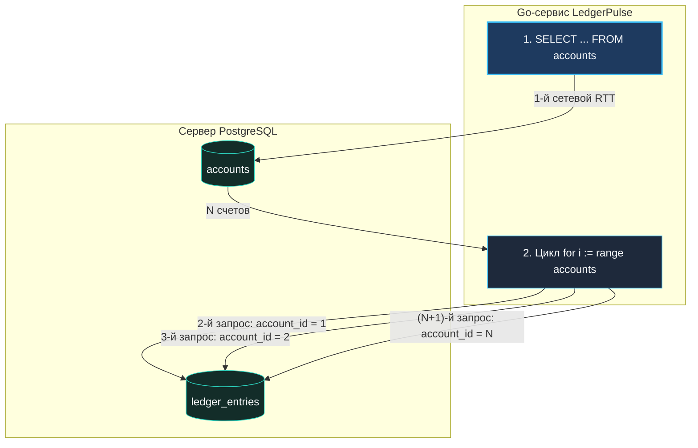

*Почему естественный для программиста цикл превращается в сетевую и системную катастрофу для PostgreSQL, сколько стоит один `db.QueryContext` и как победить `N+1` в Go 1.24 через `JOIN`, батчинг `= ANY($1)`, `json_agg` и `DataLoader`.*

> «В идеальном мире прикладному программисту достаточно знать только API — без того, как этот API реализован и к какому железу он обращается. В реальности же чуть более глубокие знания порой оказываются весьма кстати.»  
> — Чарльз Петцольд

В разработке существует фундаментальный разрыв — **объектно-реляционный диссонанс (*Object-Relational Impedance Mismatch*)**. Программист мыслит структурами и итерациями: «Есть список счетов, для каждого счёта нужно загрузить его проводки». На Go цикл `for _, acc := range accounts { fetchEntries(acc.ID) }` выглядит коротким и ясным.

Для реляционной базы данных и ядра Linux такой цикл оборачивается аварией. Этот антипаттерн называется **проблемой `N+1`**: приложение делает 1 запрос для выборки $N$ родительских записей, а затем в цикле отправляет ещё $N$ отдельных запросов за дочерними строками. Если первый запрос вернул 10 000 счетов `LedgerPulse`, сервис обрушит на PostgreSQL **10 001 запрос**.

---

## Как выглядит `N+1` в `LedgerPulse`

В схеме `LedgerPulse` (`001_init_ledger.sql`) таблица проводок `ledger_entries` связана с таблицей счетов `accounts` внешним ключом `account_id`. Суммы хранятся в целых единицах (`BIGINT`). Наивная загрузка счетов с проводками на Go выглядит так:

```go
type LedgerEntry struct {
	ID, TransactionID, Amount int64
	Currency                  string
}

type Account struct {
	ID, Balance           int64
	ExternalID, OwnerName string
	Entries               []LedgerEntry
}

func GetAccountsWithEntriesNaive(ctx context.Context, db *sql.DB) ([]Account, error) {
	rows, err := db.QueryContext(ctx,
		`SELECT id, external_id, owner_name, balance FROM accounts WHERE status = 'active'`)
	if err != nil {
		return nil, err
	}
	defer rows.Close()

	var accounts []Account
	for rows.Next() {
		var a Account
		if err := rows.Scan(&a.ID, &a.ExternalID, &a.OwnerName, &a.Balance); err != nil {
			return nil, err
		}
		accounts = append(accounts, a)
	}
	if err := rows.Err(); err != nil {
		return nil, err
	}

	// Ещё N запросов: отдельный round-trip для каждого счёта
	for i := range accounts {
		entryRows, err := db.QueryContext(ctx,
			`SELECT id, transaction_id, amount, currency FROM ledger_entries WHERE account_id = $1`,
			accounts[i].ID)
		if err != nil {
			return nil, err
		}
		for entryRows.Next() {
			var e LedgerEntry
			if err := entryRows.Scan(&e.ID, &e.TransactionID, &e.Amount, &e.Currency); err != nil {
				_ = entryRows.Close()
				return nil, err
			}
			accounts[i].Entries = append(accounts[i].Entries, e)
		}
		_ = entryRows.Close()
	}
	return accounts, nil
}
```

При 100 счетах сервис выполнит $1 + 100 = 101$ запрос, при 10 000 счетов — 10 001 запрос. Задержка ответа подскакивает с миллисекунд до десятков секунд, хотя каждый единичный запрос по индексу быстрый.



---

## Физика `N+1`: цена одного `db.QueryContext`

Возражение «каждый запрос длится 0.3 мс, что тут страшного» игнорирует физику сети, ядра ОС и СУБД. Сравним задержки: доступ к RAM — **~100 нс**, чтение случайной страницы NVMe — **~100 мкс**, сетевой обмен туда-обратно (**Round-Trip Time, RTT**) внутри дата-центра — **0.3–1 мс**. Десять тысяч последовательных запросов тратят $10\,000 \times 1\text{ мс} = 10\text{ секунд}$ только на ожидание сети, пока CPU простаивает.

Один вызов `db.QueryContext` проходит 10 этапов по всей вертикали системы:
1. Захват мьютекса пула соединений `database/sql` для получения свободного сокета.
2. Кодирование SQL и аргументов драйвером (`pgx` или `database/sql`) в сетевой буфер.
3. Системный вызов `writev()` / `sendto()` ядра Linux и переключение контекста в режим ядра.
4. Формирование TCP/IP-пакетов, прохождение через сетевую карту (NIC) и коммутатор.
5. Пробуждение процесса PostgreSQL через `epoll_wait()` и `read()`.
6. Обработка сообщений протокола Frontend/Backend (`Parse`, `Bind`, `Execute`, `Sync`), выделение `MemoryContext` и проверка прав.
7. Оценка путей доступа планировщиком CBO ([[11. Стоимостной оптимизатор (Cost-Based Optimizer)]]).
8. Чтение страниц из `shared_buffers` с захватом легковесных блокировок (latches) и вытеснением горячего кэша.
9. Сериализация ответа и системный вызов `send()` на сервере БД.
10. Чтение из сокета `recv()` в Go, декодирование и аллокации в куче (`Heap Allocs`), нагружающие GC.

Цикл `N+1` прогоняет систему через эту цепочку тысячи раз. При конкурентной нагрузке горутины надолго монополизируют соединения, **пул соединений исчерпывается** (о пулах соединений подробнее далее в томе), и весь сервис начинает отказывать по таймауту.

---

## Три способа устранить `N+1`

Реляционная алгебра создана для работы над **множествами данных (*sets*)**. Устранить `N+1` можно тремя паттернами.

### 1. Классический `LEFT JOIN` (1 RTT)

Объединяем таблицы прямо в PostgreSQL за один проход (`Hash Join` или индексированный `Nested Loop`):

```sql
SELECT
    a.id, a.external_id, a.owner_name, a.balance,
    le.id AS entry_id, le.transaction_id, le.amount, le.currency
FROM accounts a
LEFT JOIN ledger_entries le ON le.account_id = a.id
WHERE a.status = 'active'
ORDER BY a.id, le.id;
```

`LEFT JOIN` сохраняет счета без проводок (поля `ledger_entries` придут как `NULL`). На стороне Go плоский поток сворачивается в дерево через мапу за $O(N)$:

```go
func GetAccountsWithEntriesJoin(ctx context.Context, db *sql.DB) ([]Account, error) {
	const query = `
		SELECT a.id, a.external_id, a.owner_name, a.balance,
		       le.id, le.transaction_id, le.amount, le.currency
		FROM accounts a
		LEFT JOIN ledger_entries le ON le.account_id = a.id
		WHERE a.status = 'active'
		ORDER BY a.id, le.id`

	rows, err := db.QueryContext(ctx, query)
	if err != nil {
		return nil, err
	}
	defer rows.Close()

	byID := make(map[int64]*Account)
	var ordered []*Account

	for rows.Next() {
		var (
			aID, balance           int64
			extID, owner           string
			entryID, txID, amount  sql.NullInt64
			currency               sql.NullString
		)
		if err := rows.Scan(&aID, &extID, &owner, &balance, &entryID, &txID, &amount, &currency); err != nil {
			return nil, err
		}
		acc, ok := byID[aID]
		if !ok {
			acc = &Account{ID: aID, ExternalID: extID, OwnerName: owner, Balance: balance}
			byID[aID] = acc
			ordered = append(ordered, acc)
		}
		if entryID.Valid {
			acc.Entries = append(acc.Entries, LedgerEntry{
				ID: entryID.Int64, TransactionID: txID.Int64,
				Amount: amount.Int64, Currency: currency.String,
			})
		}
	}
	if err := rows.Err(); err != nil {
		return nil, err
	}
	res := make([]Account, len(ordered))
	for i, acc := range ordered {
		res[i] = *acc
	}
	return res, nil
}
```

**Плюсы:** ровно 1 запрос. **Минусы:** **избыточность данных (*Data Multiplication*)**. Если у счёта 5 000 проводок, `owner_name` и `external_id` продублируются в ответе 5 000 раз. А соединение двух независимых связей 1:N в одном `JOIN` породит декартово размножение строк.

### 2. Пакетная загрузка (`Batch Loading` через `= ANY($1)` / `WHERE IN`)

Выполняем строго **2 запроса**:
1. Выгружаем счета: `SELECT id, external_id, owner_name, balance FROM accounts WHERE status = 'active'`.
2. Собираем `accountIDs []int64` и загружаем все проводки пачкой через `= ANY($1)` (в `pgx` слайсы нативно передаются как массив `bigint[]`, сохраняя единый кэшированный план при любой длине списка):

```go
func FetchEntriesBatch(ctx context.Context, conn *pgx.Conn, accountIDs []int64) (map[int64][]LedgerEntry, error) {
	out := make(map[int64][]LedgerEntry, len(accountIDs))
	if len(accountIDs) == 0 {
		return out, nil
	}
	rows, err := conn.Query(ctx,
		`SELECT id, transaction_id, account_id, amount, currency
		 FROM ledger_entries WHERE account_id = ANY($1) ORDER BY account_id, id`,
		accountIDs)
	if err != nil {
		return nil, err
	}
	defer rows.Close()

	for rows.Next() {
		var accID int64
		var e LedgerEntry
		if err := rows.Scan(&e.ID, &e.TransactionID, &accID, &e.Amount, &e.Currency); err != nil {
			return nil, err
		}
		out[accID] = append(out[accID], e)
	}
	return out, rows.Err()
}
```

При использовании `database/sql` + `sqlx` аналогичный приём строится через `sqlx.In` + `db.Rebind`. Никакого дублирования родительских столбцов и всегда 2 round-trip.

### 3. Агрегация в JSON на стороне PostgreSQL (`json_agg`)

PostgreSQL способен собрать вложенный JSON-массив прямо в ядре СУБД:

```sql
SELECT
    a.id, a.external_id, a.owner_name, a.balance,
    COALESCE(
        json_agg(
            json_build_object('id', le.id, 'tx_id', le.transaction_id, 'amount', le.amount)
            ORDER BY le.id
        ) FILTER (WHERE le.id IS NOT NULL),
        '[]'
    ) AS entries_json
FROM accounts a
LEFT JOIN ledger_entries le ON le.account_id = a.id
WHERE a.status = 'active'
GROUP BY a.id;
```

`FILTER (WHERE le.id IS NOT NULL)` и `COALESCE(..., '[]')` гарантируют пустой массив `'[]'` вместо `[null]` для счетов без проводок. Компромисс: ноль дублирования и 1 RTT, но возрастает нагрузка на CPU БД при сериализации JSON.

| Подход | Запросов (RTT) | Дублирование родителя | Нагрузка на CPU БД | Когда выбирать |
|---|---|---|---|---|
| **Наивный `N+1`** | $1 + N$ | Нет | Высокий оверхед парсера | Никогда |
| **`LEFT JOIN`** | $1$ | Да (при 1:N) | Минимальная | Небольшие 1:1 / 1:N выборки |
| **Batch `= ANY($1)`** | $2$ (константа) | Нет | Минимальная | Широкие родители, несколько связей 1:N |
| **`json_agg`** | $1$ | Нет | Средняя/высокая (JSON) | Готовые JSON-ответы, умеренный объём |

---

## `N+1` в Go ORM и методы обнаружения

В Go ORM (GORM, Ent, Bun) опасность кроется в обращении к связям внутри циклов:

```go
// АНТИПАТТЕРН в GORM: отдельный запрос на каждой итерации
var accounts []Account
db.Find(&accounts)
for i := range accounts {
	db.Model(&accounts[i]).Association("Entries").Find(&accounts[i].Entries)
}

// ПРАВИЛЬНО: жадная загрузка (Eager Loading)
db.Preload("Entries").Find(&accounts)
```

При вызове `Preload("Entries")` GORM обычно делает не `JOIN`, а **два запроса** (`SELECT * FROM accounts` и `SELECT * FROM ledger_entries WHERE account_id IN (...)`). Всегда проверяйте реальный SQL в логах.

**Как находить `N+1` до и после релиза:**
1. **Распределённая трассировка (OpenTelemetry / Jaeger):** характерная «расчёска» из сотен одинаковых коротких спанов БД внутри одного HTTP-запроса (подробнее о трейсинге см. Тома 3 и 4).
2. **Статистика `pg_stat_statements`:** сортировка по `calls` показывает шаблоны вроде `SELECT ... WHERE account_id = $1`, вызываемые миллионы раз со временем `0.2 ms`.
3. **Счётчик запросов в тестах:** тестовая обёртка над `DBTX`, падающая при превышении лимита запросов на вызов эндпоинта.

> [!warning] Ловушка: Маскировка `N+1` пулом `pgBouncer`
> На локальном стенде с `pgBouncer` (в режиме `transaction` или `statement` pooling) и горячим кэшем `N+1` кажется быстрым. Но сетевые прерывания, RTT и разбор протокола никуда не деваются: под реальной нагрузкой пул сокетов исчерпается, и задержка `p99` взлетит до секунд. Устраняйте `N+1` архитектурно.

---

> [!tip] Собеседование [Middle]: Паттерн `DataLoader` в GraphQL и gRPC
> **Вопрос:** В GraphQL или композитном gRPC API резолвер поля `Account.Entries` вызывается независимо для каждого узла графа. Как убрать `N+1` без объединения всего API в один монолитный SQL?
>
> **Ответ:** Использовать паттерн **DataLoader** (отложенный батчинг).
> Когда разные горутины-резолверы запрашивают проводки по разным `account_id`, DataLoader не идёт в БД сразу, а накапливает ключи в течение короткого окна (1–5 мс или до конца батча). Затем он объединяет все ключи в один запрос `WHERE account_id = ANY($1)` и раздаёт нарезанные результаты ожидающим горутинам.

---

## Упражнения

### Базовое упражнение

Перепишите цикл подсчёта суммы дебетовых проводок (`amount > 0`) для последних 50 транзакций в **один SQL-запрос** с `LEFT JOIN` (транзакции без дебетовых проводок должны получить `0`):

```go
// Было: 1 запрос SELECT id, reference_id FROM transactions ... + 50 запросов:
// SELECT COALESCE(SUM(amount), 0) FROM ledger_entries WHERE transaction_id = $1 AND amount > 0
```

> [!solution] Показать решение
> ```sql
> SELECT
>     t.id,
>     t.reference_id,
>     COALESCE(SUM(le.amount), 0) AS total_debit
> FROM (
>     SELECT id, reference_id
>     FROM transactions
>     WHERE status = 'posted'
>     ORDER BY id DESC
>     LIMIT 50
> ) t
> LEFT JOIN ledger_entries le
>     ON le.transaction_id = t.id AND le.amount > 0
> GROUP BY t.id, t.reference_id
> ORDER BY t.id DESC;
> ```
> Условие `le.amount > 0` стоит именно в `ON`, чтобы не отбрасывать транзакции с нулевым числом подходящих проводок.

### Практическое упражнение

Напишите на Go 1.24 функцию `AttachEntriesBatch(ctx context.Context, accounts []Account, fetchFn func(context.Context, []int64) ([]EntryWithAccount, error)) error`: при пустом слайсе она не вызывает `fetchFn`, дедуплицирует `Account.ID` и раскладывает проводки по счетам за $O(N + M)$.

> [!solution] Показать решение
> ```go
> type EntryWithAccount struct {
> 	AccountID int64
> 	Entry     LedgerEntry
> }
>
> func AttachEntriesBatch(
> 	ctx context.Context,
> 	accounts []Account,
> 	fetchFn func(context.Context, []int64) ([]EntryWithAccount, error),
> ) error {
> 	if len(accounts) == 0 {
> 		return nil
> 	}
> 	byID := make(map[int64]*Account, len(accounts))
> 	ids := make([]int64, 0, len(accounts))
> 	for i := range accounts {
> 		id := accounts[i].ID
> 		if _, seen := byID[id]; !seen {
> 			ids = append(ids, id)
> 			byID[id] = &accounts[i]
> 		}
> 	}
> 	entries, err := fetchFn(ctx, ids)
> 	if err != nil {
> 		return err
> 	}
> 	for _, item := range entries {
> 		if acc, ok := byID[item.AccountID]; ok {
> 			acc.Entries = append(acc.Entries, item.Entry)
> 		}
> 	}
> 	return nil
> }
> ```

### Упражнение со звёздочкой (*)

Напишите на Go 1.24 потокобезопасную обёртку `CountingDBTX` вокруг интерфейса `DBTX` (методы `ExecContext`, `QueryContext`, `QueryRowContext` из `project/final/repo.go`) и тест-хелпер `AssertMaxQueries`, проваливающий тест при превышении лимита запросов.

> [!solution] Показать решение
> ```go
> type DBTX interface {
> 	ExecContext(ctx context.Context, query string, args ...any) (sql.Result, error)
> 	QueryContext(ctx context.Context, query string, args ...any) (*sql.Rows, error)
> 	QueryRowContext(ctx context.Context, query string, args ...any) *sql.Row
> }
>
> type CountingDBTX struct {
> 	inner DBTX
> 	calls atomic.Int64
> }
>
> func (c *CountingDBTX) ExecContext(ctx context.Context, q string, a ...any) (sql.Result, error) {
> 	c.calls.Add(1)
> 	return c.inner.ExecContext(ctx, q, a...)
> }
> func (c *CountingDBTX) QueryContext(ctx context.Context, q string, a ...any) (*sql.Rows, error) {
> 	c.calls.Add(1)
> 	return c.inner.QueryContext(ctx, q, a...)
> }
> func (c *CountingDBTX) QueryRowContext(ctx context.Context, q string, a ...any) *sql.Row {
> 	c.calls.Add(1)
> 	return c.inner.QueryRowContext(ctx, q, a...)
> }
>
> func AssertMaxQueries(t *testing.T, inner DBTX, maxCalls int64, fn func(DBTX)) {
> 	t.Helper()
> 	c := &CountingDBTX{inner: inner}
> 	fn(c)
> 	if got := c.calls.Load(); got > maxCalls {
> 		t.Fatalf("N+1 detected: %d queries > limit %d", got, maxCalls)
> 	}
> }
> ```

---

## Мостик к следующей главе

Устранив `N+1`, мы сжали тысячи сетевых вызовов до одного `JOIN` или двух батч-запросов. Но если в `accounts` миллион строк, а в `ledger_entries` сто миллионов, соединение таблиц способно занять секунды уже внутри самой СУБД. В следующей главе [[14. Оптимизация JOIN — Nested Loop, Hash Join и Merge Join]] мы разберём физику трёх алгоритмов `JOIN`, роль `work_mem` и расстановку индексов на внешних ключах.
