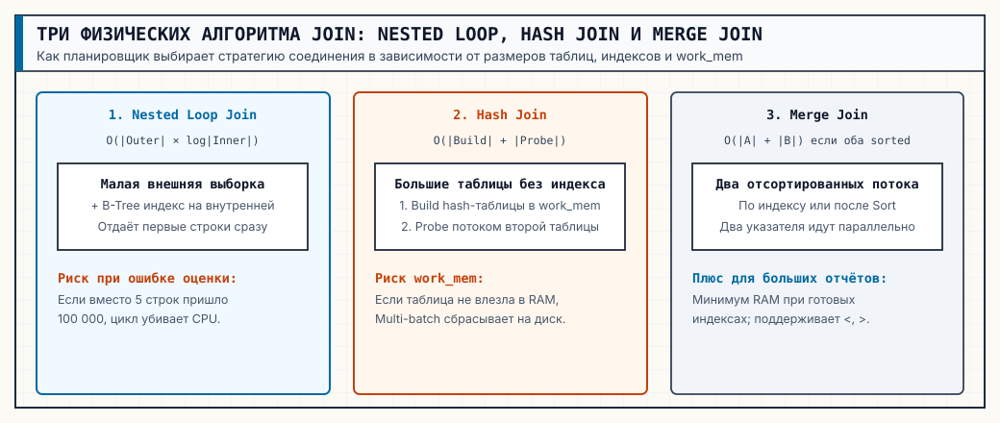
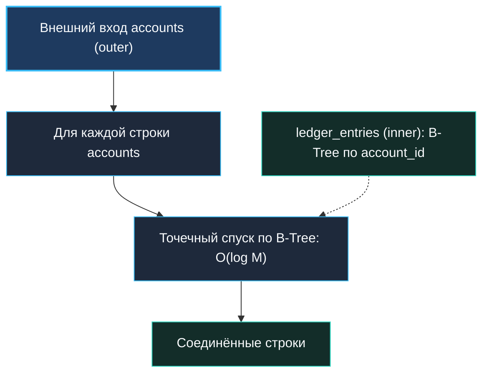
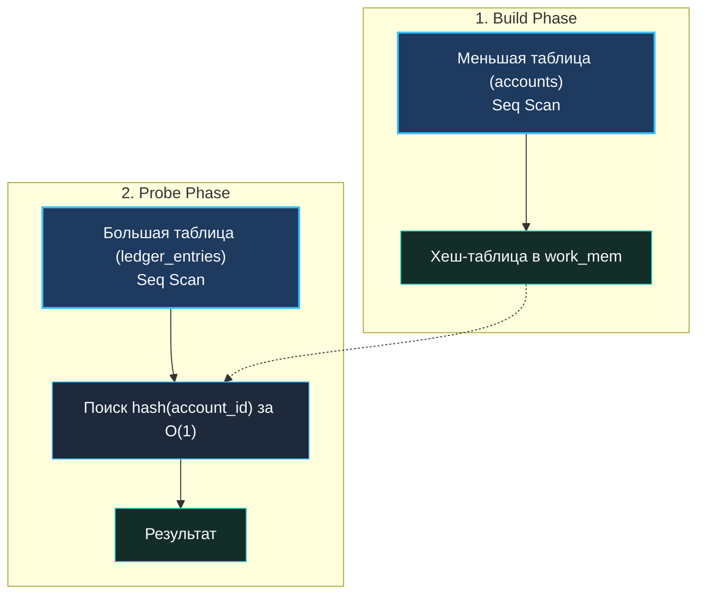
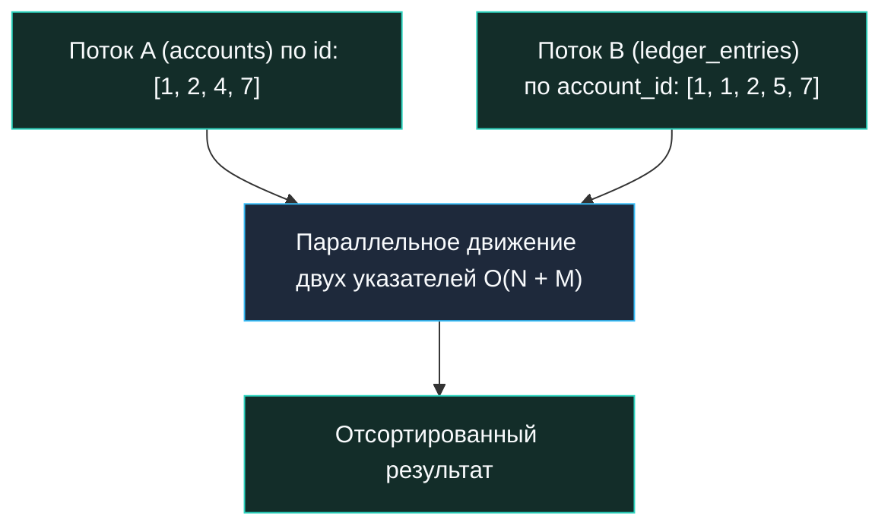

*Как PostgreSQL выбирает между `Nested Loop`, `Hash Join` и `Merge Join`, почему `Batches > 1` роняет скорость в десятки раз и как в Go 1.24 контролировать планы соединений.*

> «Цель вычислений — понимание сути, а не числа.»  
> — Ричард Хэмминг

Реляционная модель Эдгара Кодда позволяет разделить данные по нормализованным таблицам и соединять их во время запроса через `JOIN`. В `LedgerPulse` счета хранятся в `accounts`, заголовки операций — в `transactions`, а проводки — в `ledger_entries`. Но математическое соединение двух таблиц по $N$ и $M$ строк без фильтров даёт декартово произведение размером $N \times M$: для 100 000 счетов и 100 000 проводок это **10 миллиардов пар**. Если в главе [[13. Проблема N+1 и как её устранить]] нагрузку создавал цикл в Go, то медленный `JOIN` возникает внутри СУБД из-за неверного физического плана или отсутствия индексов.

---

## Три физических алгоритма: `Nested Loop`, `Hash Join` и `Merge Join`



Оптимизатор CBO ([[11. Стоимостной оптимизатор (Cost-Based Optimizer)]]) выбирает один из трёх алгоритмов соединения, опираясь на кардинальность ([[12. Кардинальность, селективность и статистика]]), индексы и память `work_mem` (по умолчанию `4MB`).

### 1. `Nested Loop Join` (вложенные циклы)

Движок берёт каждую строку из **внешней** таблицы (*outer*) и ищет совпадения во **внутренней** таблице (*inner*).



**Когда эффективен:** внешний вход (`outer`) мал после `WHERE` (от 1 до сотен строк); на ключе соединения `inner` есть селективный B-Tree индекс; запрос содержит `LIMIT` (минимальный `startup cost`, ранний выход); условие — диапазон (`<`, `>`, `BETWEEN`).

**Физика железа и локальность:** без индекса на `inner` каждая строка `outer` запускает полный `Seq Scan` внутренней таблицы. С B-Tree индексом при малом `outer` верхние страницы дерева оседают в кэшах CPU и `shared_buffers`, давая ответ за доли миллисекунды. При большом `outer` (скажем, 500 000 строк) даже с индексом `Nested Loop` порождает миллионы случайных чтений (~100 мкс на NVMe против ~100 нс в RAM), убивая IOPS.

### 2. `Hash Join` (хеш-соединение)

Главная рабочая лошадка для массовых выборок и отчётов:
1. **Фаза построения (*Build Phase*):** движок сканирует меньшую таблицу и строит по ключу соединения хеш-таблицу в `work_mem`.
2. **Фаза зондирования (*Probe Phase*):** последовательно читает большую таблицу и ищет совпадения в хеш-таблице за $O(1)$.



**Когда эффективен:** обе таблицы велики, подходящих индексов нет, предикат соединения — строгое равенство (**equi-join** `=`), а меньшая выборка помещается в `work_mem`.

**Физика железа и ловушка памяти:** `Hash Join` читает таблицы последовательно, эффективно задействуя упреждающее чтение ядра Linux (*Read-Ahead*) и шину NVMe. Но при нехватке `work_mem` включается **многопакетный режим (*Multi-batch Hash Join*)**: лишние партиции сбрасываются во временные файлы на диск (`temp written`), замедляя запрос в 50–100 раз.

### 3. `Merge Join` (соединение слиянием)

Оба потока данных предварительно отсортированы по ключу соединения. Движок ведёт два курсора и синхронно сдвигает меньший за $O(N + M)$.



**Когда эффективен:** оба входа **уже отсортированы** B-Tree индексами (тогда нет узла `Sort`); в запросе есть `ORDER BY` по ключу соединения; таблицы слишком велики для хеша в RAM. Если хотя бы один вход требует внешней дисковой сортировки (`Sort`), выгода теряется.

| Критерий | `Nested Loop` | `Hash Join` | `Merge Join` |
|---|---|---|---|
| **Сложность** | $O(N \log M)$ с индексом | $O(N + M)$ | $O(N + M)$ без явного `Sort` |
| **Операторы** | Любые (`=`, `<`, `>`, `BETWEEN`) | Только `=` (equi-join) | Сортируемые (обычно `=`) |
| **Индексы** | Критичны на `inner` | Не нужны | Желательны B-Tree на обоих входах |
| **Память `work_mem`** | Минимальная | Высокая (хеш-таблица) | Минимальная (без узла `Sort`) |
| **Ранний выход (`LIMIT`)** | Мгновенный | Блокируется Build Phase | Быстрый при готовых индексах |

---

## Как планировщик выбирает алгоритм

Оптимизатор оценивает ожидаемое число строк после `WHERE`, наличие индексов и размер `work_mem`. В тестовой сессии (не в проде) алгоритмы можно временно отключать для проверки альтернативных планов:

```sql
SET enable_nestloop = off;
SET enable_hashjoin = off;
SET enable_mergejoin = off;
```

Если отключение `Nested Loop` ускоряет запрос с секунд до миллисекунд, причина обычно кроется в устаревшей статистике (`ANALYZE`) или перекосе оценки кардинальности.

---

## Шесть правил оптимизации `JOIN` в `LedgerPulse` и Go

1. **Индексируйте внешние ключи явно.** PostgreSQL создаёт индекс для `PRIMARY KEY` и `UNIQUE`, но **не** для `FOREIGN KEY`. Без индекса на `ledger_entries(transaction_id)` соединение или проверка `ON DELETE RESTRICT` уйдёт в `Seq Scan`.
2. **Фильтруйте строки до соединения.** Чем сильнее `WHERE` сжимает таблицы на входе, тем дешевле `JOIN`.
3. **Ставьте покрывающие индексы на `inner`.** Колонки в `INCLUDE` ([[6. Покрывающие (Covering) индексы, INCLUDE и Index-Only Scan]]) переводят внутренний цикл `Nested Loop` в `Index-Only Scan` без `Heap Fetches`.
4. **Соблюдайте совпадение типов (*Type Alignment*).** Несоответствие `BIGINT` (`int8`) и `INTEGER` (`int4`) на связываемых ключах порождает неявный каст и отключает индекс.
5. **Управляйте `work_mem` локально в транзакции.** Глобально высокий `work_mem` опасен риском OOM при множестве соединений. В Go повышайте память через `SET LOCAL work_mem` внутри транзакции — после `COMMIT`/`ROLLBACK` лимит сбросится и не просочится в пул:

```go
type CurrencyReport struct {
	Currency        string
	TxCount, Volume int64
}

func BuildCurrencyReport(ctx context.Context, conn *pgx.Conn) ([]CurrencyReport, error) {
	tx, err := conn.Begin(ctx)
	if err != nil {
		return nil, err
	}
	defer func() { _ = tx.Rollback(ctx) }()

	if _, err := tx.Exec(ctx, "SET LOCAL work_mem = '64MB'"); err != nil {
		return nil, err
	}
	rows, err := tx.Query(ctx, `
		SELECT a.currency, COUNT(*), COALESCE(SUM(ABS(le.amount)), 0)
		FROM accounts a
		JOIN ledger_entries le ON le.account_id = a.id
		WHERE a.status = 'active'
		GROUP BY a.currency`)
	if err != nil {
		return nil, err
	}
	defer rows.Close()

	var out []CurrencyReport
	for rows.Next() {
		var r CurrencyReport
		if err := rows.Scan(&r.Currency, &r.TxCount, &r.Volume); err != nil {
			return nil, err
		}
		out = append(out, r)
	}
	if err := rows.Err(); err != nil {
		return nil, err
	}
	return out, tx.Commit(ctx)
}
```

6. **Фиксируйте порядок соединений через `WITH ... AS MATERIALIZED`.** При сильном перекосе данных материализация промежуточного среза не даёт оптимизатору ошибочно переставить порядок таблиц.

---

## Разбор `EXPLAIN (ANALYZE, BUFFERS)` для `JOIN`

```sql
EXPLAIN (ANALYZE, BUFFERS)
SELECT a.external_id, le.amount
FROM accounts a
JOIN ledger_entries le ON le.account_id = a.id
WHERE a.created_at >= '2026-01-01'::timestamptz;
```

```text
Hash Join  (cost=18.40..412.80 rows=2400 width=24) (actual time=0.710..3.420 rows=2350 loops=1)
  Hash Cond: (le.account_id = a.id)
  Buffers: shared hit=918
  ->  Seq Scan on ledger_entries le  (cost=0.00..310.00 rows=15000 width=16)
  ->  Hash  (cost=15.90..15.90 rows=200 width=16)
        Buckets: 1024  Batches: 1  Memory Usage: 17kB
        ->  Index Scan using idx_accounts_created on accounts a
              Index Cond: (created_at >= '2026-01-01 00:00:00+00'::timestamptz)
```

Здесь `accounts` отфильтрован по индексу до 200 строк, хеш-таблица заняла `17kB` при `Batches: 1` (сброса на диск нет), а все 918 страниц взяты из `shared_buffers` (`shared hit=918`).

> [!warning] Ловушка: Сброс хеша, несовпадение типов и декартов взрыв
> 1. **Дисковый сброс (`Batches > 1`):** появление `Batches: 16` и `temp written=...` означает нехватку `work_mem`.
> 2. **Недооценка кардинальности перед `Sort`:** ожидание `rows=10` при реальных `500000` ломает память последующей сортировки.
> 3. **Несколько связей 1:N в одном `JOIN`:** соединение `accounts` сразу с `ledger_entries` и `audit_logs` без предварительной агрегации перемножает строки.

---

> [!tip] Собеседование [Middle]: Когда `Nested Loop` быстрее `Hash Join` на сотнях миллионов строк?
> **Вопрос:** В `accounts` 10 млн строк, в `ledger_entries` 100 млн строк. Может ли `Nested Loop` обогнать `Hash Join`?
>
> **Ответ:** Да, в двух случаях:
> 1. **Высокая селективность внешнего фильтра:** выборка по `a.external_id = 'acc_99182'` даёт 1 строку `outer`. С индексом на `ledger_entries(account_id)` `Nested Loop` делает 1 спуск по B-Tree за доли миллисекунды, тогда как `Hash Join` просканировал бы всю 100-миллионную таблицу.
> 2. **Ранний выход с `LIMIT`:** `Nested Loop` отдаёт первые $K$ строк сразу, а `Hash Join` обязан дождаться окончания Build Phase.

---

## Мониторинг планов `JOIN` в Go 1.24

В тестах удобно автоматически проверять `EXPLAIN (ANALYZE, BUFFERS, FORMAT JSON)` на дисковый сброс и перекос кардинальности:

```go
type planNode struct {
	NodeType          string     `json:"Node Type"`
	PlanRows          float64    `json:"Plan Rows"`
	ActualRows        float64    `json:"Actual Rows"`
	HashBatches       int        `json:"Hash Batches"`
	TempWrittenBlocks int64      `json:"Temp Written Blocks"`
	Plans             []planNode `json:"Plans"`
}

func AuditJoinStrategy(ctx context.Context, db *sql.DB, query string, args ...any) error {
	var raw []byte
	if err := db.QueryRowContext(ctx, "EXPLAIN (ANALYZE, BUFFERS, FORMAT JSON) "+query, args...).Scan(&raw); err != nil {
		return err
	}
	var parsed []struct {
		Plan planNode `json:"Plan"`
	}
	if err := json.Unmarshal(raw, &parsed); err != nil {
		return err
	}
	if len(parsed) > 0 {
		inspectNode(parsed[0].Plan)
	}
	return nil
}

func inspectNode(n planNode) {
	if n.HashBatches > 1 || n.TempWrittenBlocks > 0 {
		log.Printf("SPILL %s: batches=%d temp=%d", n.NodeType, n.HashBatches, n.TempWrittenBlocks)
	}
	if n.PlanRows > 0 && n.ActualRows > n.PlanRows*10 {
		log.Printf("SKEW %s: plan=%.0f actual=%.0f", n.NodeType, n.PlanRows, n.ActualRows)
	}
	for _, ch := range n.Plans {
		inspectNode(ch)
	}
}
```

---

## Упражнения

### Базовое упражнение

В запросе `SELECT t.reference_id, le.account_id, le.amount FROM transactions t JOIN ledger_entries le ON le.transaction_id = t.id WHERE t.reference_id = 'tx_42'` таблица `ledger_entries` (40 млн строк) не имеет индекса на `transaction_id`. Что произойдёт в плане и какой индекс это исправит?

> [!solution] Показать решение
> Без индекса на `ledger_entries(transaction_id)` база не сможет сделать быстрый `Nested Loop` и уйдёт в `Seq Scan` по 40 млн строк (через `Hash Join` или прямой перебор). Решение — покрывающий индекс на внешнем ключе:
> ```sql
> CREATE INDEX CONCURRENTLY idx_ledger_entries_tx_id
>     ON ledger_entries (transaction_id)
>     INCLUDE (account_id, amount);
> ```
> Это переведёт соединение в `Nested Loop` с `Index-Only Scan` по обоим узлам.

### Практическое упражнение

В `EXPLAIN (ANALYZE, BUFFERS)` отчёта вы видите `Batches: 8  Memory Usage: 4096kB` и `Buffers: ... temp read=4850 written=4860`. Объясните причину и покажите, как исправить её в Go без глобального изменения `postgresql.conf`.

> [!solution] Показать решение
> Хеш-таблица не поместилась в `work_mem = 4MB`, из-за чего PostgreSQL разделил её на 8 батчей со сбросом временных файлов на диск. Исправление в Go: открыть транзакцию и перед запросом выполнить `tx.Exec(ctx, "SET LOCAL work_mem = '64MB'")`, чтобы повышенный лимит действовал строго до конца транзакции и не влиял на другие запросы из пула.

### Упражнение со звёздочкой (*)

Для запроса `SELECT a.id, a.external_id, le.id, le.amount FROM accounts a JOIN ledger_entries le ON le.account_id = a.id WHERE a.status = 'active' ORDER BY a.id` укажите два индекса, которые позволят PostgreSQL выполнить чистый `Merge Join` без узла `Sort`, и объясните, когда планировщик всё равно предпочтёт `Hash Join`.

> [!solution] Показать решение
> 1. Для `accounts`: первичный ключ `(id)` (или частичный `ON accounts (id) INCLUDE (external_id) WHERE status = 'active'`) отдаёт строки уже в порядке `a.id`.
> 2. Для `ledger_entries`: `idx_ledger_entries_account_created` из `002_indexes.sql` имеет ведущую колонку `account_id` и `INCLUDE (amount, ...)`, отдавая проводки отсортированными по `account_id`.
> При большой доле активных счетов `Merge Join` читает оба индекса линейно за $O(N + M)$ без хеш-таблицы и без `Sort`. `Hash Join` + `Sort` победит, если статистика решит, что последовательный `Seq Scan` таблиц дешевле случайных обращений к страницам индекса и кучи.

---

## Мостик к следующей главе

Мы разобрали физику `JOIN` и научились беречь `work_mem` и индексы на внешних ключах. Но в OLTP-нагрузке до 90% проблем приходят от обычных выборок `SELECT`. В следующей главе [[15. Оптимизация SELECT — SARGable-условия и кейсы LedgerPulse]] мы свяжем `002_indexes.sql` и код `project/step04/btree.go`, чтобы научиться писать SARGable-запросы без `SELECT *`, `Sort` и `OFFSET`.
