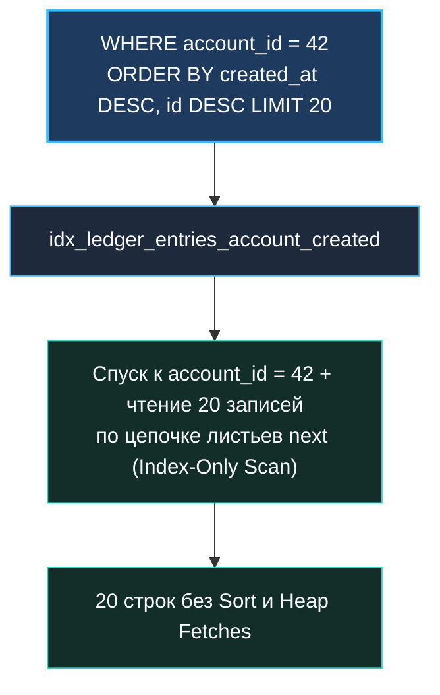

*Почему `SELECT *` убивает `Index-Only Scan` и вытаскивает `TOAST`, как устроены SARGable-условия, как индексы `002_indexes.sql` и `BPlusTree.RangeScan` из `project/step04/` убирают `Sort` и `OFFSET`, и когда включается `JOIN LATERAL`.*

> «Пишите ясно — не умничайте.»  
> — Брайан Керниган *(совместно с П. Дж. Плоджером)*

Оператор `SELECT` кажется тривиальным, но в нагруженных OLTP-сервисах до 90% узких мест производительности скрываются именно в операциях чтения. За короткой строкой SQL скрывается длинный конвейер: парсер, планировщик (аналог `EstimatePlan` в `project/step04/btree.go`), обход страниц B-Tree, поиск в `shared_buffers`, чтение `TOAST`, сериализация по TCP и аллокации памяти в Go. Лишняя звёздочка `*`, функция над индексированной колонкой или глубокий `OFFSET` способны снизить пропускную способность базы в десятки раз.

---

## Запретите `SELECT *` в продакшн-коде

Привычка писать `SELECT *` (особенно в ORM) приносит тройной ущерб:

1. **Убийство `Index-Only Scan`.**  
   В миграции `002_indexes.sql` для `LedgerPulse` создан покрывающий индекс ([[6. Покрывающие (Covering) индексы, INCLUDE и Index-Only Scan]]):
   ```sql
   CREATE INDEX IF NOT EXISTS idx_ledger_entries_account_created
       ON ledger_entries (account_id, created_at DESC, id DESC)
       INCLUDE (amount, currency, transaction_id);
   ```
   Он хранит в листьях `amount`, `currency` и `transaction_id`. Если запрос перечисляет только эти поля и `Visibility Map` подтверждает видимость страниц, PostgreSQL обходится без чтения таблицы (`Index-Only Scan`). Стоит добавить `SELECT *` или лишнюю колонку — оптимизатор вынужден идти в кучу (`Heap Fetches`).
2. **Случайные чтения `TOAST`.**  
   Поля `TEXT`, `JSONB` (`accounts.metadata`) и `BYTEA` размером более **2 КБ** вытесняются механизмом **TOAST** в скрытую таблицу `pg_toast_*` ([[8. JSON и JSONB в SQL]]). `SELECT *` заставляет СУБД читать и распаковывать эти чанки (~100 мкс на NVMe вместо ~100 нс в RAM), даже если коду нужен только `balance`.
3. **Лишний сетевой трафик и аллокации в Go.**  
   Драйвер (`pgx` или `database/sql`) всё равно принимает и парсит байты всех запрошенных колонок, создавая лишние объекты в куче Go и нагрузку на GC.

> [!info] Под капотом: `EstimatePlan` в `project/step04/btree.go` и цена кучи
> В учебном симуляторе `EstimatePlan` из `project/step04/btree.go` выбор между `PlanIndexOnlyScan` и `PlanIndexScan` выражен формулой: `PlanIndexOnlyScan` платит лишь за индексные страницы и кортежи (`indexPages * 4.0 + matchedRows * 0.005`), тогда как `PlanIndexScan` добавляет `heapPages * 4.0 + matchedRows * 0.01`. Отказ от лишних столбцов физически убирает стоимость чтения кучи.

**Правило:** всегда запрашивайте строго нужные столбцы, как в `project/final/repo.go`:

```sql
SELECT id, transaction_id, account_id, amount, currency, created_at
FROM ledger_entries
WHERE account_id = $1;
```

---

## SARGable-условия: позвольте индексам работать

**SARGable** (*Search ARGument ABLE*) — это предикат в `WHERE`, который позволяет движку выполнять логарифмический поиск по индексу ($O(\log N)$) вместо полного перебора таблицы (`Seq Scan`). К SARGable-операторам относятся `=`, `<`, `>`, `BETWEEN`, префиксный `LIKE 'acc_%'`, `IN (...)` / `= ANY($1)` с константами и `IS NULL`.

Разберём четыре **не-SARGable** ошибки на примерах `LedgerPulse` и `002_indexes.sql`.

### 1. Функция над индексированной колонкой

```sql
-- ПЛОХО: индекс по created_at отключён
SELECT id, amount FROM ledger_entries
WHERE account_id = 42 AND date_trunc('day', created_at) = '2026-05-01'::timestamptz;

-- ПРАВИЛЬНО: полуоткрытый диапазон работает по idx_ledger_entries_account_created
SELECT id, amount FROM ledger_entries
WHERE account_id = 42
  AND created_at >= '2026-05-01 00:00:00+00'::timestamptz
  AND created_at <  '2026-05-02 00:00:00+00'::timestamptz;
```

Аналогично для `WHERE LOWER(external_id) = 'acc-10'`: обычный `UNIQUE`-индекс не сработает, нужен функциональный индекс `CREATE INDEX ON accounts (LOWER(external_id))` ([[7. Частичные (Partial) индексы и индексы по выражениям]]).

### 2. Арифметика над столбцом

```sql
-- ПЛОХО: balance * 1.05 > 100000
-- ПРАВИЛЬНО: правая часть вычисляется один раз на запрос
SELECT id, external_id FROM accounts WHERE balance > 100000 / 1.05;
```

### 3. Неявное приведение типов и шаблоны `LIKE`

Передавайте из Go строгие типы: `time.Time` для `TIMESTAMPTZ`, `int64` для `BIGINT`. Несовпадение типов способно отключить индекс. А шаблон `LIKE '%invoice%'` с ведущим `%` не работает по обычному B-Tree (дерево отсортировано с начала строки); при префиксном `LIKE 'invoice%'` в не-`C` локалях PostgreSQL требуется класс операторов `text_pattern_ops`.

### 4. Согласование с частичными и GIN-индексами `002_indexes.sql`

```sql
CREATE INDEX IF NOT EXISTS idx_transactions_pending
    ON transactions (created_at) WHERE status = 'pending';

CREATE INDEX IF NOT EXISTS idx_accounts_metadata_gin
    ON accounts USING GIN (metadata jsonb_path_ops);
```

Частичный индекс `idx_transactions_pending` включится только при наличии `status = 'pending'` в `WHERE`. А `idx_accounts_metadata_gin` с `jsonb_path_ops` поддерживает оператор `@>`, но игнорирует `->>`:

```sql
-- ИГНОРИРУЕТ GIN (Seq Scan):
SELECT id, external_id FROM accounts WHERE metadata->>'tier' = 'pro';

-- ИСПОЛЬЗУЕТ GIN (Bitmap Index Scan):
SELECT id, external_id FROM accounts WHERE metadata @> '{"tier": "pro"}'::jsonb;
```

---

## Индексы для `ORDER BY` + `LIMIT` и `BPlusTree.RangeScan`

Без подходящего индекса запрос ленты проводок:

```sql
SELECT id, transaction_id, amount, currency, created_at
FROM ledger_entries
WHERE account_id = $1
ORDER BY created_at DESC, id DESC
LIMIT 20;
```

заставит СУБД прочитать все проводки счёта и пропустить их через усечённую пирамидальную сортировку **top-N heapsort** (узел `Sort`).

Индекс `idx_ledger_entries_account_created (account_id, created_at DESC, id DESC) INCLUDE (amount, currency, transaction_id)` физически упорядочивает листья ровно так же, как требует `ORDER BY`. Подобно методу `RangeScan` в `project/step04/btree.go`, который спускается к первому листу и шагает по указателям `next` без возврата к корню, PostgreSQL спускается к началу диапазона `account_id = $1`, забирает первые 20 записей из листьев и останавливается. Узел `Sort` исчезает из плана.



---

## Пагинация: `OFFSET` против Keyset Pagination

Конструкция `LIMIT 20 OFFSET 200000` заставляет базу прочитать и выбросить 200 000 строк ради следующих 20. На больших глубинах это разрушает I/O и буферный кэш.

Правильный паттерн — **keyset-пагинация (*Seek Method*)**. В `project/final/repo.go` (`ListEntriesKeyset`) используется простой курсор по `id < $2`. Для сортировки по `(created_at DESC, id DESC)` из `002_indexes.sql` применяют сравнение кортежей (**Row Value Constructors**):

```go
type LedgerEntry struct {
	ID, TransactionID, AccountID, Amount int64
	Currency                             string
	CreatedAt                            time.Time
}

func ListEntriesKeysetByDate(
	ctx context.Context, db *sql.DB,
	accountID int64, cursorTime time.Time, cursorID int64, limit int,
) ([]LedgerEntry, error) {
	if limit <= 0 || limit > 200 {
		limit = 50
	}
	const query = `
		SELECT id, transaction_id, account_id, amount, currency, created_at
		FROM ledger_entries
		WHERE account_id = $1 AND (created_at, id) < ($2, $3)
		ORDER BY created_at DESC, id DESC
		LIMIT $4`

	rows, err := db.QueryContext(ctx, query, accountID, cursorTime, cursorID, limit)
	if err != nil {
		return nil, err
	}
	defer rows.Close()

	var out []LedgerEntry
	for rows.Next() {
		var e LedgerEntry
		if err := rows.Scan(&e.ID, &e.TransactionID, &e.AccountID, &e.Amount, &e.Currency, &e.CreatedAt); err != nil {
			return nil, err
		}
		out = append(out, e)
	}
	return out, rows.Err()
}
```

> [!warning] Ловушка: Неуникальный курсор и смешанное направление
> 1. Поле `created_at` не уникально — у проводок одной транзакции метка времени совпадает. Всегда добавляйте тай-брейкер `id` в кортеж `(created_at, id)`.
> 2. Направления сортировки в кортеже должны совпадать (`created_at DESC, id DESC` и `<`), чтобы планировщик использовал `idx_ledger_entries_account_created` за один скан.

---

## `GROUP BY`, `CTE`, `JOIN LATERAL` и параллелизм (`Gather`)

* **Агрегация:** для подсчёта активных счетов по валютам (`GROUP BY currency WHERE status = 'active'`) в `002_indexes.sql` есть `idx_accounts_status_currency`, обеспечивающий `Index-Only Scan`. В аналитике также применяют *Index Skip Scan* (перепрыгивание через повторяющиеся ключи) и материализованные представления ([[12. Представления (VIEW) и материализованные представления]]).
* **`CTE` в PostgreSQL 12+:** не-рекурсивные `WITH` по умолчанию ведут себя как `NOT MATERIALIZED` — оптимизатор встраивает их в общий план и проталкивает фильтры внутрь. Явный барьер задаётся через `AS MATERIALIZED`.
* **`JOIN LATERAL`:** для выбора «последних 3 проводок каждого активного USD-счёта» латеральный подзапрос работает в разы быстрее оконного `ROW_NUMBER() OVER (...)`, так как для каждого счёта делает точечный `Index-Only Scan` по `idx_ledger_entries_account_created`:
  ```sql
  SELECT a.id, a.external_id, le.id AS entry_id, le.amount, le.created_at
  FROM accounts a
  JOIN LATERAL (
      SELECT id, amount, created_at
      FROM ledger_entries
      WHERE account_id = a.id
      ORDER BY created_at DESC, id DESC
      LIMIT 3
  ) le ON true
  WHERE a.status = 'active' AND a.currency = 'USD';
  ```
* **Параллельное выполнение:** тяжёлые сканы PostgreSQL распараллеливает под узлом **`Gather`** (`max_parallel_workers_per_gather`, `min_parallel_table_scan_size`). Для коротких OLTP-запросов параллелизм не включается из-за накладных расходов IPC через Shared Memory.

---

## Практические приёмы в Go и чек-лист `EXPLAIN (ANALYZE, BUFFERS)`

На уровне Go-приложения используйте:
1. **Prepared Statements:** в `pgx/v5` кэширование планов через расширенный протокол работает по умолчанию.
2. **Конвейеризацию (`SendBatch`):** несколько независимых `SELECT` отправляются за 1 RTT (подробнее в [[16. Пакетные (Batch) запросы, UNNEST и COPY]]).
3. **Локальное или распределённое кэширование справочников:** редкие статичные данные (валюты, тарифы) не должны каждый раз идти по сети в БД (подробнее см. Модуль 9).

Отказ от `SELECT *` и переход на keyset-пагинацию уменьшают трафик через `send()`/`recv()`, число аллокаций в Go и паузы GC. Проверяйте каждый важный запрос через `EXPLAIN (ANALYZE, BUFFERS)` по чек-листу:
* Отсутствуют паразитные `Seq Scan` на крупных таблицах.
* Отсутствуют лишние узлы `Sort` (сортировку закрывает индекс).
* `Plan Rows` и `Actual Rows` близки по порядку величины.
* Доминируют `shared hit` над дисковыми `read` и отсутствуют `temp read/written`.

---

> [!tip] Собеседование [Middle]: Проблемы `OFFSET` и `LIKE '%term%'`
> **Вопрос:** Пагинация `LIMIT 20 OFFSET 100000` и поиск `WHERE description LIKE '%refund%'` на 10 млн строк выполняются по 4 секунды. Почему и как починить?
>
> **Ответ:**
> 1. `OFFSET 100000` заставляет БД читать и отбрасывать 100 000 строк на каждом шаге. Переход на keyset-пагинацию `(created_at, id) < ($1, $2)` стабилизирует время на уровне $O(\log N)$.
> 2. Ведущий `%` в `LIKE '%refund%'` отключает B-Tree (ключи отсортированы от начала строки). Для префиксного поиска используйте `'refund%'` с `text_pattern_ops`, а для поиска произвольной подстроки — триграммный индекс `pg_trgm`: `USING GIN (description gin_trgm_ops)`.

---

## Упражнения

### Базовое упражнение

Найдите ошибки производительности в запросе и перепишите его под индексы из `002_indexes.sql`:
```sql
SELECT * FROM transactions
WHERE status = 'pending' AND EXTRACT(EPOCH FROM (now() - created_at)) > 300;
```

> [!solution] Показать решение
> 1. `SELECT *` тянет ненужные колонки. 2. Функция `EXTRACT(...)` над `created_at` делает условие не-SARGable и отключает частичный индекс `idx_transactions_pending`.
> ```sql
> SELECT id, reference_id, kind, created_at
> FROM transactions
> WHERE status = 'pending' AND created_at < now() - interval '5 minutes';
> ```

### Практическое упражнение

Напишите на Go 1.24 функцию `FetchLatestEurEntries`, выбирающую **2 последние проводки каждого активного счёта в `EUR`** через `JOIN LATERAL` (с опорой на `idx_accounts_status_currency` и `idx_ledger_entries_account_created`).

> [!solution] Показать решение
> ```go
> type AccountLatestEntry struct {
> 	AccountID, EntryID, Amount int64
> 	ExternalID                 string
> 	CreatedAt                  time.Time
> }
>
> func FetchLatestEurEntries(ctx context.Context, db *sql.DB) ([]AccountLatestEntry, error) {
> 	const query = `
> 		SELECT a.id, a.external_id, le.id, le.amount, le.created_at
> 		FROM accounts a
> 		JOIN LATERAL (
> 			SELECT id, amount, created_at FROM ledger_entries
> 			WHERE account_id = a.id ORDER BY created_at DESC, id DESC LIMIT 2
> 		) le ON true
> 		WHERE a.status = 'active' AND a.currency = 'EUR'
> 		ORDER BY a.id, le.created_at DESC, le.id DESC`
> 	rows, err := db.QueryContext(ctx, query)
> 	if err != nil {
> 		return nil, err
> 	}
> 	defer rows.Close()
> 	var out []AccountLatestEntry
> 	for rows.Next() {
> 		var item AccountLatestEntry
> 		if err := rows.Scan(&item.AccountID, &item.ExternalID, &item.EntryID, &item.Amount, &item.CreatedAt); err != nil {
> 			return nil, err
> 		}
> 		out = append(out, item)
> 	}
> 	return out, rows.Err()
> }
> ```

### Упражнение со звёздочкой (*)

По формуле `EstimatePlan` из `project/step04/btree.go` (`tablePages=10000`, `rows=1_000_000`, `seqPageCost=1.0`, `randPageCost=4.0`, `cpuTupleCost=0.01`, `cpuIndexTuple=0.005`) сравните стоимость при `selectivity = 0.01` и `0.40` для `coveredByIndex = false` и `coveredByIndex = true`. Почему покрывающий индекс сохраняет преимущество на порядок дольше?

> [!solution] Показать решение
> `seqCost = 10000 * 1.0 + 1_000_000 * 0.01 = 20000`.
> * При `selectivity = 0.01` (10 000 строк):
>   - `coveredByIndex = false`: `indexPages=15`, `heapPages=10000`, `idxCost = 15*4 + 10000*4 + 10000*0.015 = 40210 > 20000` (выигрывает `Seq Scan`).
>   - `coveredByIndex = true`: `cost = 15*4 + 10000*0.005 = 110 << 20000` (`Index-Only Scan`).
> * При `selectivity = 0.40` (400 000 строк): с покрывающим индексом `indexPages=600`, `cost = 600*4 + 400000*0.005 = 4400 < 20000` — он всё ещё выгоднее `Seq Scan`, потому что исключает случайные чтения страниц кучи (`heapPages * 4.0`).

---

## Мостик к следующей главе

Мы научились писать быстрые `SELECT` и `JOIN`, которые читают миллионы записей без `Seq Scan` и `Sort`. Но высокая нагрузка на чтение всегда идёт рядом с пакетной записью данных из очередей, выписок и платёжных шлюзов. В финальной главе модуля [[16. Пакетные (Batch) запросы, UNNEST и COPY]] мы разберём, как загружать и обновлять тысячи строк за один сетевой цикл через `UNNEST`, `pgx.SendBatch` и протокол `COPY`.
