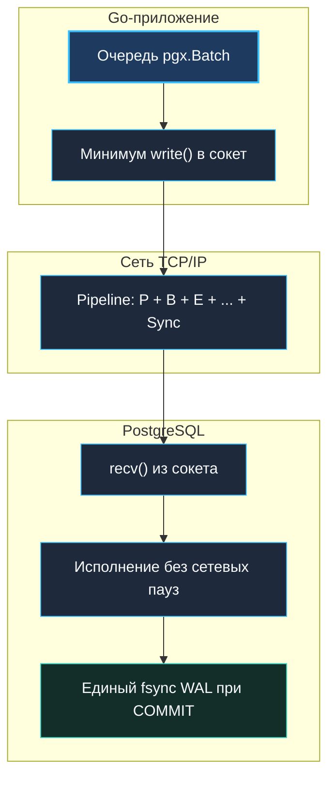

*Почему 10 000 одиночных `INSERT` сжигают секунды на сетевых паузах и `fsync`, чем колоночный `UNNEST` лучше динамического `VALUES`, как устроен конвейер `pgx.SendBatch` и как поток `COPY` разгоняет вставку до сотен тысяч строк в секунду.*

> «Гениальность конвейера Unix именно в том, что он собирается из тех самых команд, которыми постоянно пользуются поодиночке.»  
> — Деннис Ритчи

Представьте строителя, которому нужно перевезти тысячу кирпичей со склада на площадку. Если возить в багажнике по одному кирпичу, делая тысячу рейсов туда и обратно, стройка затянется на месяцы, хотя сама укладка занимает часы. Инженер возьмёт грузовик и перевезёт партию за один рейс.

При взаимодействии Go-сервиса с PostgreSQL таким грузовиком выступают **пакетные (*batch*) операции**. Когда воркер `LedgerPulse` читает из Kafka или платёжного шлюза 1 000 проводок, отправка их одиночными `INSERT` заставит систему сделать 1 000 сетевых пересылок и до 1 000 сбросов диска. Уплотнение работы через `UNNEST`, конвейер `pgx.SendBatch` или протокол `COPY` увеличивает пропускную способность на один-два порядка.

---

## Почему одиночный round-trip обходится так дорого

Даже в локальной сети дата-центра скорость сигнала в волокне конечна ($c \approx 200\,000$ км/с), а сетевой стек ОС добавляет прерывания и буферизацию. Один цикл обмена туда-обратно (**Round-Trip Time, RTT**) составляет **0.3–1.5 мс** (против ~100 нс доступа к RAM и ~100 мкс чтения NVMe).

Каждый одиночный `db.ExecContext` проходит четыре звена:
1. **Go-процесс:** кодирование параметров, системный вызов `sendto()` ядра Linux.
2. **Сеть TCP/IP:** сегментация пакетов, передача через виртуальный коммутатор и NIC.
3. **Сервер PostgreSQL:** пробуждение через `epoll_wait()`, `recvfrom()`, парсер, планировщик, запись в журнал транзакций (WAL) и `fsync()` при автокоммите.
4. **Обратный путь:** сериализация ответа и чтение в Go.

Для 1 000 одиночных вставок ожидание сети составит:

$$\text{Время ожидания} = 1\,000 \times 1\text{ мс} = 1\text{ секунда}$$

При этом процессор базы выполнит полезную работу за пару миллисекунд, а остальные 998 мс система будет ждать сеть и диск.

---

## Четыре способа пакетного SQL

### 1. Множественный `INSERT ... VALUES`

```sql
INSERT INTO ledger_entries (transaction_id, account_id, amount, currency)
VALUES ($1, $2, $3, $4), ($5, $6, $7, $8), ($9, $10, $11, $12);
```

Парсер разбирает запрос один раз, а строки вставляются атомарно. Но у подхода есть два минуса:
* **Лимит параметров протокола PostgreSQL:** счётчик параметров в бинарном протоколе 16-битный — максимум **65 535 параметров** на запрос.
* **Размывание кэша планов:** батчи разной длины генерируют разный текст SQL, мешая переиспользованию подготовленного плана.

### 2. `UNNEST`: идиоматичный колоночный батчинг в PostgreSQL

Функция **`UNNEST`** синхронно разворачивает несколько массивов одинаковой длины в строки таблицы:

```sql
INSERT INTO ledger_entries (transaction_id, account_id, amount, currency)
SELECT tx_id, acc_id, amt, cur
FROM UNNEST($1::bigint[], $2::bigint[], $3::bigint[], $4::char(3)[])
    AS t(tx_id, acc_id, amt, cur);
```

Здесь всегда ровно **4 параметра** — хоть для 10 строк, хоть для 5 000. Текст запроса неизменен, план кэшируется один раз, а лимит в 65 535 параметров не достигается. В Go 1.24 с `pgx/v5` слайсы передаются напрямую:

```go
type LedgerEntryInput struct {
	TransactionID, AccountID, Amount int64
	Currency                         string
}

func InsertEntriesUnnest(ctx context.Context, conn *pgx.Conn, entries []LedgerEntryInput) error {
	if len(entries) == 0 {
		return nil
	}
	txIDs := make([]int64, len(entries))
	accIDs := make([]int64, len(entries))
	amounts := make([]int64, len(entries))
	currencies := make([]string, len(entries))
	for i, e := range entries {
		txIDs[i], accIDs[i], amounts[i], currencies[i] = e.TransactionID, e.AccountID, e.Amount, e.Currency
	}
	const query = `
		INSERT INTO ledger_entries (transaction_id, account_id, amount, currency)
		SELECT tx_id, acc_id, amt, cur
		FROM UNNEST($1::bigint[], $2::bigint[], $3::bigint[], $4::char(3)[])
			AS t(tx_id, acc_id, amt, cur)`
	_, err := conn.Exec(ctx, query, txIDs, accIDs, amounts, currencies)
	return err
}
```

### 3. Пакетные `UPDATE` (`FROM UNNEST` / `FROM VALUES`) и `DELETE`

Массовое обновление разных счетов разными дельтами удобно строить через `UPDATE ... FROM UNNEST` (или `FROM (VALUES ...)` для фиксированных наборов):

```sql
UPDATE accounts AS a
SET balance = a.balance + v.delta, updated_at = now()
FROM UNNEST($1::bigint[], $2::bigint[]) AS v(account_id, delta)
WHERE a.id = v.account_id AND a.balance + v.delta >= 0;
```

Для массового удаления используйте `DELETE FROM outbox_events WHERE id = ANY($1::bigint[])`.

### 4. Пакетная выборка (`= ANY($1)` и `sqlx.In`)

В `pgx` для выборки по списку ключей используйте `WHERE id = ANY($1::bigint[])` (фиксированный план), а в проектах с `database/sql` и `sqlx` — `sqlx.In`:

```go
func GetAccountsByIDs(ctx context.Context, db *sqlx.DB, ids []int64) ([]Account, error) {
	if len(ids) == 0 {
		return nil, nil
	}
	query, args, err := sqlx.In(
		`SELECT id, external_id, owner_name, balance FROM accounts WHERE id IN (?);`, ids)
	if err != nil {
		return nil, err
	}
	var accounts []Account
	err = db.SelectContext(ctx, &accounts, db.Rebind(query), args...)
	return accounts, err
}
```

---

## Конвейеризация (`Pipeline Mode`): `pgx.SendBatch`

Когда нужно отправить пачку **разнородных** SQL-команд в одном сетевом обмене, используйте `pgx.Batch` и `conn.SendBatch`:

```go
func InsertEntriesPipeline(ctx context.Context, conn *pgx.Conn, entries []LedgerEntryInput) error {
	if len(entries) == 0 {
		return nil
	}
	batch := &pgx.Batch{}
	const stmt = `INSERT INTO ledger_entries (transaction_id, account_id, amount, currency) VALUES ($1, $2, $3, $4)`
	for _, e := range entries {
		batch.Queue(stmt, e.TransactionID, e.AccountID, e.Amount, e.Currency)
	}
	br := conn.SendBatch(ctx, batch)
	defer br.Close()

	for i := range entries {
		if _, err := br.Exec(); err != nil {
			return fmt.Errorf("batch item %d: %w", i, err)
		}
	}
	return br.Close()
}
```

### Под капотом: протокол PostgreSQL, TCP и WAL

1. **Конвейер расширенного протокола:** вместо одиночных сообщений `'Q'` (*Query*) драйвер укладывает в буфер серию `'P'` (*Parse*), `'B'` (*Bind*), `'E'` (*Execute*) и одно финальное `'S'` (*Sync*).
2. **Уплотнение TCP:** ядро Linux отправляет весь буфер минимумом системных вызовов `write()`.
3. **Непрерывное исполнение:** процесс PostgreSQL читает поток через `recv()` и выполняет команды подряд без сетевых пауз.
4. **Сжатие WAL:** если команды обёрнуты в явную транзакцию (`BEGIN`/`COMMIT`), сервер выполняет **один `fsync`** журнала WAL на всю пачку вместо тысячи отдельных сбросов диска.

*(Несколько текстовых команд можно также разделять точкой с запятой `;` в простом протоколе, но такой режим не поддерживает бинарную привязку параметров.)*



---

## `COPY`: максимальная скорость массовой загрузки

Для импорта сотен тысяч и миллионов строк (исторические выписки, ETL) протокол **`COPY`** обходит SQL-парсер и планировщик, потоком передавая кортежи напрямую в страницы таблицы:

```go
func StreamEntriesCopy(ctx context.Context, conn *pgx.Conn, entries []LedgerEntryInput) (int64, error) {
	return conn.CopyFrom(
		ctx,
		pgx.Identifier{"ledger_entries"},
		[]string{"transaction_id", "account_id", "amount", "currency"},
		pgx.CopyFromSlice(len(entries), func(i int) ([]any, error) {
			e := entries[i]
			return []any{e.TransactionID, e.AccountID, e.Amount, e.Currency}, nil
		}),
	)
}
```

Скорость вставки вырастает с ~2 000 строк/сек (одиночные `INSERT`) до **100 000–300 000 строк в секунду**.

---

## Ловушки батчинга, дедлоки и границы применения

> [!warning] Ловушка: Гигантские батчи, частичная фиксация и дедлоки
> 1. **Размер пачки (*Batch Bloat*):** отправка 100 000 строк за раз нагружает память сервера, срывает `statement_timeout` и долго удерживает блокировки. Оптимальный размер батча в OLTP — **100–1 000 строк** (делите крупные слайсы через `slices.Chunk`).
> 2. **Атомарность ошибок:** одиночный `INSERT ... SELECT FROM UNNEST` атомарен. А в `pgx.Batch` без явной транзакции (`BEGIN`/`COMMIT`) команды до сбойной зафиксируются в базе.
> 3. **Взаимные блокировки (*Deadlocks*):** если горутина A обновляет в батче счета `[10, 20]`, а горутина B одновременно обновляет `[20, 10]`, транзакции уйдут в deadlock (подробнее о графе ожидания см. Модуль 5).

**Правило против дедлоков:** перед формированием батча на `UPDATE` или `DELETE` всегда сортируйте данные по возрастанию ключа:

```go
type BalanceDelta struct {
	AccountID, Delta int64
}

func SortDeltasDeterministic(deltas []BalanceDelta) {
	slices.SortFunc(deltas, func(a, b BalanceDelta) int {
		return cmp.Compare(a.AccountID, b.AccountID)
	})
}
```

Единый порядок захвата строковых блокировок (`10 -> 20`) делает цикл ожидания невозможным.

**Когда батч не нужен:** для одиночного интерактивного запроса пользователя (клик «Перевести») искусственное накопление буфера только добавит задержку ответа. Батчинг уместен там, где данные уже приходят пачками: консьюмеры Kafka/RabbitMQ, ретранслятор Outbox, загрузка банковских реестров.

---

> [!tip] Собеседование [Senior/Staff]: `INSERT` vs `UNNEST` vs `pgx.Batch` vs `COPY`
> **Вопрос:** В одном сервисе нужно ежедневно импортировать 2 млн проводок, а в другом — регулярно обновлять балансы пачками по 200 счетов. Что выбрать для каждой задачи?
>
> **Ответ:**
> 1. Для загрузки 2 млн строк — **`COPY` (`conn.CopyFrom`)** чанками по 10 000–50 000 строк: обходит парсер и планировщик, минимизирует CPU и WAL.
> 2. Для OLTP-обновления 200 счетов — **`UPDATE ... FROM UNNEST($1::bigint[], $2::bigint[])`** с сортировкой по `account_id`: 1 RTT, фиксированный план в кэше, атомарность и защита от дедлоков. `pgx.Batch` остаётся для пачек разнородных SQL-команд.

---

## Упражнения

### Базовое упражнение

Оцените минимальное время сетевого ожидания для 5 000 одиночных `INSERT` в цикле при RTT = 0.8 мс и перепишите вставку с разбиением на чанки по 1 000 строк (`slices.Chunk`) через `UNNEST`.

> [!solution] Показать решение
> Сетевое ожидание при цикле: $5\,000 \times 0.8\text{ мс} = 4\text{ секунды}$ (плюс 5 000 парсингов и 5 000 `fsync`).
> Через `UNNEST` и `slices.Chunk` (5 запросов вместо 5 000):
> ```go
> for chunk := range slices.Chunk(entries, 1000) {
> 	txIDs := make([]int64, len(chunk))
> 	accIDs := make([]int64, len(chunk))
> 	amounts := make([]int64, len(chunk))
> 	currencies := make([]string, len(chunk))
> 	for i, e := range chunk {
> 		txIDs[i], accIDs[i], amounts[i], currencies[i] = e.TransactionID, e.AccountID, e.Amount, e.Currency
> 	}
> 	if _, err := conn.Exec(ctx, `
> 		INSERT INTO ledger_entries (transaction_id, account_id, amount, currency)
> 		SELECT tx_id, acc_id, amt, cur
> 		FROM UNNEST($1::bigint[], $2::bigint[], $3::bigint[], $4::char(3)[])
> 			AS t(tx_id, acc_id, amt, cur)`,
> 		txIDs, accIDs, amounts, currencies); err != nil {
> 		return err
> 	}
> }
> ```

### Практическое упражнение

Напишите на Go 1.24 функцию `ApplyBalanceBatch(ctx context.Context, conn *pgx.Conn, deltas []BalanceDelta) error`, которая: 1) суммирует дублирующиеся `AccountID`; 2) сортирует ключи по возрастанию; 3) обновляет счета через `UPDATE ... FROM UNNEST` и проверяет `RowsAffected()`, откатывая транзакцию при расхождении.

> [!solution] Показать решение
> ```go
> func ApplyBalanceBatch(ctx context.Context, conn *pgx.Conn, deltas []BalanceDelta) error {
> 	if len(deltas) == 0 {
> 		return nil
> 	}
> 	merged := make(map[int64]int64, len(deltas))
> 	for _, d := range deltas {
> 		merged[d.AccountID] += d.Delta
> 	}
> 	ids := make([]int64, 0, len(merged))
> 	for id := range merged {
> 		ids = append(ids, id)
> 	}
> 	slices.Sort(ids)
> 	amounts := make([]int64, len(ids))
> 	for i, id := range ids {
> 		amounts[i] = merged[id]
> 	}
> 	tx, err := conn.Begin(ctx)
> 	if err != nil {
> 		return err
> 	}
> 	defer func() { _ = tx.Rollback(ctx) }()
>
> 	tag, err := tx.Exec(ctx, `
> 		UPDATE accounts AS a
> 		SET balance = a.balance + v.delta, updated_at = now()
> 		FROM UNNEST($1::bigint[], $2::bigint[]) AS v(id, delta)
> 		WHERE a.id = v.id AND a.balance + v.delta >= 0`, ids, amounts)
> 	if err != nil {
> 		return err
> 	}
> 	if tag.RowsAffected() != int64(len(ids)) {
> 		return fmt.Errorf("updated %d of %d accounts", tag.RowsAffected(), len(ids))
> 	}
> 	return tx.Commit(ctx)
> }
> ```

### Упражнение со звёздочкой (*)

Ретранслятор `Outbox` (`project/final/repo.go`) должен пометить опубликованными 500 сообщений `outbox_events` с их метками времени. Сравните `pgx.Batch` (в транзакции) и `UPDATE ... FROM UNNEST($1::bigint[], $2::timestamptz[])`, а также объясните роль `defer br.Close()` в `SendBatch`.

> [!solution] Показать решение
> 1. `UPDATE ... FROM UNNEST(...)` запускает ровно 1 узел модификации в PostgreSQL. `pgx.Batch` из 500 `UPDATE` уложится в 1 RTT, но заставит сервер выполнить 500 отдельных планов `Bind`/`Execute` и 500 спусков по индексу, проигрывая по CPU БД.
> 2. Вызов `defer br.Close()` обязателен для вычитывания оставшихся ответов из сетевого буфера: если выйти по ошибке на 10-й команде без закрытия `BatchResults`, TCP-соединение останется рассинхронизированным. Явная транзакция гарантирует откат всех 500 изменений при сбое.

---

## Итоги Модуля 4 и мостик к Модулю 5

За шестнадцать глав раздела мы прошли путь от 8-КБ страниц диска до конвейеризации сетевых пакетов в Go:
* Разобрали физику B-Tree (`project/step04/btree.go`), Hash, Bitmap, GIN и GiST, научились проектировать составные, покрывающие (`INCLUDE`) и частичные индексы (`002_indexes.sql`).
* Освоили чтение `EXPLAIN (ANALYZE, BUFFERS)` ([[10. План выполнения запроса — читаем EXPLAIN ANALYZE BUFFERS]]), расчёты стоимостного оптимизатора (`EstimatePlan`) и статистику кардинальности.
* Искоренили `N+1` ([[13. Проблема N+1 и как её устранить]]), научились оптимизировать `JOIN` ([[14. Оптимизация JOIN — Nested Loop, Hash Join и Merge Join]]), писать SARGable `SELECT` с keyset-пагинацией ([[15. Оптимизация SELECT — SARGable-условия и кейсы LedgerPulse]]) и ускорять массовую запись через `UNNEST`, `pgx.SendBatch` и `COPY`.

Но скорость без сохранности денег опасна. Что произойдёт, если питание сервера пропадёт посреди фиксации батча `UNNEST`, как журнал `WAL` с контрольными суммами защищает страницы данных и как `MVCC` изолирует параллельные транзакции и отлавливает дедлоки? Эти механизмы ждут вас в **Модуле 5 «Транзакции, ACID, MVCC и WAL»** и его реализации в `project/step05/mvcc_wal.go`.
