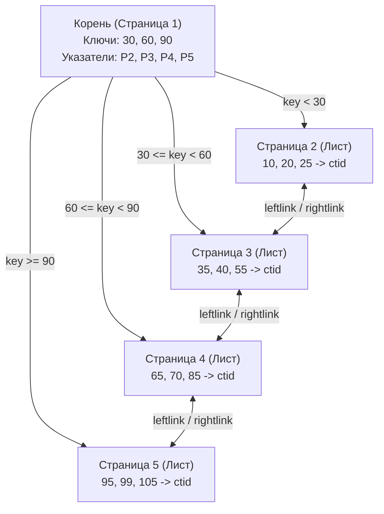

*Как устроена 8-килобайтная страница $B^+$-Tree, почему миллиард строк укладывается в три-четыре уровня и как работает расщепление узлов в `project/step04/btree.go`.*

> «Go поощряет понимание устройства современных компьютеров — и прежде всего важности локальности данных в памяти.»  
> — Алан Донован, Брайан Керниган

В главе [[1. Что такое индекс и зачем он нужен]] мы увидели, как индекс заменяет линейное чтение таблицы логарифмическим поиском. Когда инженеры переносят эту идею в код, первым кандидатом кажется двоичное дерево поиска (BST) или его сбалансированные версии (AVL, красно-чёрное дерево). В оперативной памяти они работают безупречно: поиск идёт за $O(\log_2 N)$, а переход по указателю длится наносекунды.

На диске бинарное дерево превращается в катастрофу. Каждый узел BST хранит ровно один ключ и два указателя, поэтому высота дерева для миллиарда строк ($N = 10^9$) равна:

$$\log_2(10^9) \approx 30 \text{ уровней}$$

Каждый переход по указателю на накопителе — случайное чтение сектора с задержкой **5–10 мс** на HDD или **50–100 мкс** на NVMe SSD. Тридцать последовательных дисковых чтений для поиска одного счёта в `LedgerPulse` обойдутся в сотни миллисекунд на HDD или в миллисекунды чистого I/O на SSD — под нагрузкой OLTP-база не выдержит.

---

## Блочная физика диска и сплющивание дерева

Блочные накопители не читают отдельные байты. Жёсткий диск оперирует секторами по 512 байт или 4 КБ, а SSD работает страницами флеш-памяти по 4–16 КБ. Чтобы не тратить целый цикл I/O на один 8-байтный ключ, СУБД делает узел дерева равным одной **странице данных**: **8 КБ** в PostgreSQL и **16 КБ** в MySQL/InnoDB.

Один узел B-Tree вмещает сотни ключей и указателей на потомков. Когда процесс PostgreSQL через системный вызов `pread()` читает страницу с диска (если её ещё нет в `shared_buffers` или Page Cache ОС), контроллер за одну операцию загружает в RAM сразу 300–500 ключей. Повторные обращения к странице не трогают диск, работая на скорости памяти (~100 нс против ~100 мкс на NVMe SSD).

За счёт этого **степень ветвления (`Fanout`)** вырастает с 2 до ~500, а дерево сплющивается с 30 уровней до **3–4 уровней**. Поиск строки сводится к 0–1 реальному чтению с SSD, поскольку верхние уровни почти всегда горячие в RAM.

---

## Анатомия 8-КБ страницы и стандарт $B^+$-Tree

Внутри 8-килобайтного блока PostgreSQL память организована так, чтобы быстро вести бинарный поиск и не двигать крупные массивы при вставках:

1. **Заголовок (`Page Header`):** метаданные — LSN из WAL, флаги состояния, границы свободного места и ссылки на соседей (`leftlink`, `rightlink`).
2. **Массив указателей (`Line Pointers` / `ItemIDs`):** отсортированный массив 4-байтных смещений, растущий от начала страницы к концу.
3. **Область элементов (`Items`):** ключи и адреса строк, растущие от конца страницы навстречу `ItemIDs`. При вставке тело кладётся в свободное место, а сдвигаются только короткие смещения.

Промышленные СУБД (PostgreSQL, MySQL/InnoDB, Oracle, SQLite) применяют модификацию **$B^+$-Tree**, разделяющую узлы на два типа:

- **Внутренние узлы (`Branch Nodes`):** хранят только ключи-разделители и номера дочерних страниц ($k$ ключей и $k+1$ указателей), без ссылок на строки таблицы. Это максимизирует Fanout и сжимает высоту дерева.
- **Листовые узлы (`Leaf Nodes`):** содержат абсолютно все ключи и физические адреса кортежей (`ctid` в PostgreSQL или значение PK в InnoDB).
- **Двусвязный список листьев:** соседние листья связаны `leftlink` и `rightlink`. Для диапазона `BETWEEN` или `ORDER BY` движок спускается к началу диапазона один раз и далее скользит по листьям без возврата в родителей.



Маршрут точечного запроса `SELECT * FROM accounts WHERE id = 40`:

1. Корень (Страница 1) уже зафиксирован в `shared_buffers`.
2. Бинарный поиск по `ItemIDs` в кэше CPU ($O(\log_2 M)$) по условию $30 \le 40 < 60$ выбирает Страницу 3.
3. При промахе кэша движок читает Страницу 3 с диска через `pread()`.
4. Бинарный поиск в листе находит ключ `40` и его `ctid` (например, блок `1`, смещение `5`).
5. Движок читает страницу кучи таблицы по `ctid` (или обходится без этого шага при покрывающем индексе, о котором пойдёт речь в главе 6).

---

## Расчёт высоты дерева для миллиарда строк

Проверим масштаб для индекса по `BIGINT` (`accounts.id` в `LedgerPulse`):

- Страница PostgreSQL: **8 192 байта** (минус ~100 байт заголовка).
- Запись в листе: 8 байт ключа + 6 байт `ctid` + 2 байта выравнивания/`ItemID` = **16 байт**.

Ёмкость листа и степень ветвления:

$$\frac{8192 - 100}{16} \approx 505 \text{ записей на страницу}$$

Высота дерева при $N = 10^9$ и Fanout $\approx 500$:

$$H \approx \log_{500}(10^9) = \frac{9}{\log_{10}(500)} \approx \frac{9}{2.7} \approx 3.33 \longrightarrow 3\text{--}4 \text{ уровня}$$

Распределение уровней по памяти:

- **Уровень 1 (корень):** 1 страница (8 КБ) — всегда в L3-кэше или RAM.
- **Уровень 2:** ~500 страниц (~4 МБ) — стабильно в `shared_buffers`.
- **Уровень 3:** ~250 000 страниц (~2 ГБ) — почти целиком в RAM сервера.
- **Уровень 4 (листья):** ~2 000 000 страниц (~16 ГБ) — частично в кэше ОС, частично на NVMe SSD.

Точечный запрос к миллиардной таблице требует от 0 до 1 физического чтения с SSD. В Go по тем же принципам устроен встраиваемый движок `bbolt` (основа `etcd` в Kubernetes), хранящий $B^+$-дерево в страницах фиксированного размера.

---

## Вставка, расщепление (`page split`) и конкурентный доступ

При `INSERT` движок спускается к целевому листу. Если на странице есть место (с учётом плотности `fillfactor`), ключ дописывается на страницу, а изменение уходит в WAL (подробнее о WAL — в Модуле 5). Если страница переполнена, запускается **расщепление (`page split`)**:

1. Аллоцируется новая пустая 8-КБ страница.
2. Половина ключей переносится в новую страницу (обе заполнены на ~50%).
3. В родителя вставляется новый ключ-разделитель и указатель на новую страницу.
4. При переполнении родителя расщепление каскадно поднимается вверх.
5. Расщепление корня создаёт новый корень над двумя потомками — **это единственный способ роста высоты $B^+$-Tree**.

На уровне железа `page split` обходится дорого: синхронно правятся несколько страниц, удерживаются защелки узлов, увеличивается объём WAL, а новая страница выделяется в произвольном месте файла, вызывая фрагментацию и скачки задержки. Для сжатия фрагментированного дерева запускают `REINDEX` (PostgreSQL) или `OPTIMIZE TABLE` (MySQL).

> [!tip] Собеседование [Middle]
> **Вопрос:** Почему монотонные первичные ключи (`BIGSERIAL`, `GENERATED ALWAYS AS IDENTITY`) вставляются быстрее, чем случайные UUID v4?
>
> **Ответ:** Монотонный ключ всегда попадает в **крайний правый лист**. Страницы заполняются последовательно, правая граница остаётся горячей в `shared_buffers`, а старые страницы не расщепляются. Случайный UUID v4 разбрасывает записи по всему дереву: возникают хаотичные `page split`, вымывается буферный пул и растёт случайная запись на диск. Индустриальная замена — упорядоченный по времени **UUID v7**.

При `DELETE` большинство СУБД (включая PostgreSQL) **не делают автоматического слияния (`merge`)** полупустых страниц: одновременные эксклюзивные блокировки соседей и родителя парализовали бы параллельные транзакции. Разреженные страницы ждут новых вставок или сжимаются при `VACUUM` и `REINDEX`.

Конкурентный доступ защищают легковесные **защелки (`Latches` / `LWLocks`)**: чтение берёт Read Latch, вставка — Write Latch. В алгоритме **Lehman-Yao B-Tree** каждая страница хранит максимальный ключ `High Key` и правую ссылку `rightlink`. Если читатель спустился на страницу во время её расщепления, он проверяет `High Key` и без долгих блокировок переходит по `rightlink` к странице-близнецу.

---

## Разбор реализации `BPlusTree` в `project/step04/btree.go`

Посмотрим, как ветвление, `page split` и диапазонный скан реализованы в учебном индексе `LedgerPulse` (`project/step04/btree.go`):

```go
type BPlusTree struct {
	maxKeys int
	root    *node
	height  int
	splits  int
}

type node struct {
	isLeaf   bool
	keys     []int64
	values   []string // имитация ctid/payload на листьях
	children []*node  // указатели на потомков во внутренних узлах
	next     *node    // правый сосед для листьев
}
```

> `// NOTE:` В `step04/btree.go` узлы хранятся как слайсы Go в RAM вместо 8-КБ байтовых буферов, а листья связаны однонаправленным `next` (`rightlink`) без `leftlink`.

Когда `Insert` получает `split == true` от корня, он строит новый корень и увеличивает высоту:

```go
func (t *BPlusTree) Insert(key int64, val string) {
	sepKey, rightNode, split := t.insertInto(t.root, key, val)
	if split {
		newRoot := &node{
			isLeaf:   false,
			keys:     []int64{sepKey},
			children: []*node{t.root, rightNode},
		}
		t.root = newRoot
		t.height++
	}
}
```

Самое важное отличие $B^+$-Tree от классического B-Tree видно внутри `insertInto` при переполнении листа и внутреннего узла:

```go
func (t *BPlusTree) insertInto(n *node, key int64, val string) (int64, *node, bool) {
	if n.isLeaf {
		pos, found := slices.BinarySearch(n.keys, key)
		if found {
			n.values[pos] = val
			return 0, nil, false
		}
		n.keys = slices.Insert(n.keys, pos, key)
		n.values = slices.Insert(n.values, pos, val)
		if len(n.keys) <= t.maxKeys {
			return 0, nil, false
		}
		t.splits++
		mid := len(n.keys) / 2
		right := &node{
			isLeaf: true,
			keys:   slices.Clone(n.keys[mid:]),
			values: slices.Clone(n.values[mid:]),
			next:   n.next,
		}
		n.keys = slices.Clone(n.keys[:mid])
		n.values = slices.Clone(n.values[:mid])
		n.next = right
		return right.keys[0], right, true // разделитель КОПИРУЕТСЯ наверх
	}

	idx := 0
	for idx < len(n.keys) && key >= n.keys[idx] {
		idx++
	}
	sepKey, rightChild, split := t.insertInto(n.children[idx], key, val)
	if !split {
		return 0, nil, false
	}
	n.keys = slices.Insert(n.keys, idx, sepKey)
	n.children = slices.Insert(n.children, idx+1, rightChild)
	if len(n.keys) <= t.maxKeys {
		return 0, nil, false
	}
	t.splits++
	mid := len(n.keys) / 2
	upKey := n.keys[mid] // средний ключ ПЕРЕНОСИТСЯ наверх
	right := &node{
		isLeaf:   false,
		keys:     slices.Clone(n.keys[mid+1:]),
		children: slices.Clone(n.children[mid+1:]),
	}
	n.keys = slices.Clone(n.keys[:mid])
	n.children = slices.Clone(n.children[:mid+1])
	return upKey, right, true
}
```

Разница принципиальна: лист **копирует** `right.keys[0]` в родителя и оставляет ключ у себя, а внутренний узел **поднимает** `upKey := n.keys[mid]` наверх, исключая его из левого (`[:mid]`) и правого (`[mid+1:]`) узлов.

Метод `RangeScan` спускается к первому подходящему листу один раз и далее шагает по `cur = cur.next`, не возвращаясь к корню:

```go
func (t *BPlusTree) RangeScan(low, high int64) []int64 {
	if low > high {
		return nil
	}
	cur := t.root
	for !cur.isLeaf {
		idx := 0
		for idx < len(cur.keys) && low >= cur.keys[idx] {
			idx++
		}
		cur = cur.children[idx]
	}
	var res []int64
	for cur != nil {
		for _, k := range cur.keys {
			if k > high {
				return res
			}
			if k >= low {
				res = append(res, k)
			}
		}
		cur = cur.next
	}
	return res
}
```

Запуск `go test -v ./step04/...` проверяет вставку 100 ключей (`10, 20, ..., 1000`) при `maxKeys = 4`, рост высоты до $\ge 3$, `Search(420)` и `RangeScan(250, 310)`:

```text
$ go test -v ./step04/...
=== RUN   TestBPlusTreeAndCostPlanner
--- PASS: TestBPlusTreeAndCostPlanner (0.00s)
PASS
ok  	github.com/UnrealTemplier/go-textbook-v2-vol2/project/step04	0.002s
```

> [!warning] Ловушка: раздувание индекса (`Index Bloat`)
> Массовые `DELETE` и обновления без HOT-оптимизации оставляют в листьях пустые слоты. Поскольку автоматического слияния страниц в PostgreSQL нет, индекс может вырасти в разы сверх реального объёма ключей, вытесняя горячие данные из `shared_buffers`. Обычный `VACUUM` помечает слоты свободными для будущих вставок, но физически сжимает индекс и возвращает место на диск только `REINDEX INDEX CONCURRENTLY`.

---

## Упражнения

**Упражнение 1 (Базовое). Трассировка `page split` в `BPlusTree`.**
В пустое дерево `NewBPlusTree(3)` последовательно вставляются ключи `10, 20, 30, 40, 50`. Опишите состояние корня и листьев после расщепления и назовите итоговые значения `Height()` и `Splits()`.

> [!solution] Показать решение
> 1. После `10, 20, 30` корневой лист содержит `[10, 20, 30]` (`height = 1`, `splits = 0`).
> 2. Вставка `40` переполняет лист (`len = 4 > 3`). При `mid = 2` левый лист получает `[10, 20]`, правый — `[30, 40]`, в новый корень копируется `30` (`height = 2`, `splits = 1`).
> 3. Вставка `50` уходит в правый лист (`50 >= 30`), итого: корень `[30]`, листья `[10, 20] -> [30, 40, 50]`, `Height() == 2`, `Splits() == 1`.

**Упражнение 2 (Практическое). Счётчик узлов в `RangeScan`.**
Напишите метод со следующей сигнатурой для `BPlusTree`:
```go
func (t *BPlusTree) RangeScanCount(low, high int64) (keys []int64, visitedNodes int)
```
Он должен возвращать найденные ключи в `[low, high]` и суммарное число посещённых узлов (внутренних при спуске + листьев по `next`).

> [!solution] Показать решение
> Увеличиваем `visited` при каждом переходе во внутреннем узле и на каждом шаге по цепочке листьев:
> ```go
> func (t *BPlusTree) RangeScanCount(low, high int64) ([]int64, int) {
> 	if low > high {
> 		return nil, 0
> 	}
> 	visited := 0
> 	cur := t.root
> 	for !cur.isLeaf {
> 		visited++
> 		idx := 0
> 		for idx < len(cur.keys) && low >= cur.keys[idx] {
> 			idx++
> 		}
> 		cur = cur.children[idx]
> 	}
> 	var res []int64
> 	for cur != nil {
> 		visited++
> 		for _, k := range cur.keys {
> 			if k > high {
> 				return res, visited
> 			}
> 			if k >= low {
> 				res = append(res, k)
> 			}
> 		}
> 		cur = cur.next
> 	}
> 	return res, visited
> }
> ```
> Для 100 ключей при `maxKeys = 4` спуск и диапазон `[250, 310]` посещают всего ~5–6 узлов вместо обхода всех 100 элементов.

**Упражнение 3 (Со звёздочкой \*). Симметрия границы в `insertInto` и `Search`.**
Объясните, почему цикл выбора ветви в `insertInto`, `Search` и `RangeScan` использует нестрогое сравнение `key >= n.keys[idx]`, а не строгое `key > n.keys[idx]`, и к какому багу приведёт замена на `>` только в `Search`.

> [!solution] Показать решение
> При расщеплении листа в родителя копируется **`right.keys[0]`** — минимальный ключ правого листа. Следовательно, ключ, равный разделителю `n.keys[idx]`, лежит в правой ветви `n.children[idx+1]`. Если заменить `>=` на `>` только в `Search`, поиск ключа, равного разделителю (`right.keys[0]`), пойдёт в левую ветвь `n.children[idx]`, где этого ключа нет, и вернёт `false`.

---

$B^+$-Tree сжимает миллиард строк до четырёх уровней и ускоряет и точечный поиск, и диапазоны. Но если запросу нужно только точное равенство (`WHERE reference_id = $1`), можно ли обойти спуск по дереву и попасть в страницу за $O(1)$? В главе [[3. Hash-индекс — устройство, границы и сравнение с B-Tree]] разберём дисковые хеш-индексы и их ограничения.
