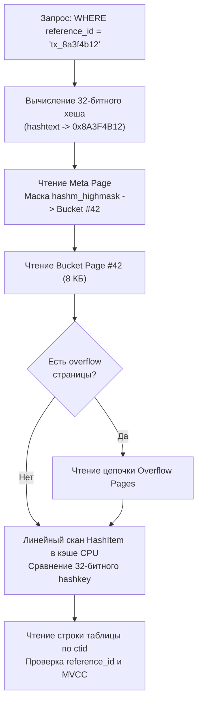

*Как дисковая хеш-таблица достигает $O(1)$ при поиске по равенству, почему до PostgreSQL 10 от хеш-индексов бежали и в чём они уступают B-Tree.*

В главе [[2. B-Tree индекс под капотом — страницы, ветвление и page split]] мы выяснили, что спуск по $B^+$-дереву на миллиарде строк занимает 3–4 шага. Но в высоконагруженном биллинге `LedgerPulse` есть запросы, которые проверяют только точное совпадение ключа — например, поиск идемпотентной транзакции по длинному `reference_id` или проверка токена сессии сотни тысяч раз в секунду.

Если порядок строк не важен, а диапазон никогда не запрашивается, возникает естественный инженерный вопрос: можно ли отказаться от 3–4 уровней дерева и попадать в нужную страницу за константное время **$O(1)$**?

Ответ даёт **Hash-индекс** — адаптация классической хеш-таблицы под 8-килобайтные блочные страницы диска.

---

## Интуиция: постамат вместо алфавитного каталога

$B^+$-дерево похоже на библиотечный каталог с карточками по алфавиту: вы быстро находите нужную букву, а соседние карточки легко перелистывать подряд. **Hash-индекс** работает как автоматический постамат: вы вводите штрихкод заказа, система мгновенно вычисляет номер ячейки и сразу открывает нужную дверцу.

Граница этой аналогии проявляется сразу, как только меняется формулировка запроса. Если попросить постамат «выдать все посылки, оформленные между понедельником и средой» или «отсортировать ячейки по фамилии получателя», он не сможет этого сделать без полного обхода всех ячеек. Хеш-функция намеренно перемешивает биты ключа так, чтобы близкие значения разлетались по разным адресам.

---

## Хеш-функции, коллизии и рост без остановки базы

В основе хеш-индекса лежит детерминированная функция, превращающая ключ произвольной длины в беззнаковое целое число фиксированной разрядности — обычно 32 или 64 бита. По принципу Дирихле бесконечное множество строковых ключей невозможно без потерь сжать в конечное число корзин (**buckets**), поэтому неизбежны **коллизии** — разные ключи дают один и тот же номер корзины или даже совпадают по 32-битному хешу.

Теория алгоритмов предлагает два способа разрешать коллизии:

1. **Метод цепочек (`chaining`):** каждая корзина хранит список записей; при переполнении к ней привязывается дополнительная страница переполнения (`overflow page`).
2. **Открытая адресация (`open addressing`):** все элементы лежат в одном массиве, а при коллизии алгоритм ищет следующую свободную ячейку линейным или квадратичным пробированием.

На дисках открытая адресация почти не применяется: удаление ключей и длинные пробы по разным страницам порождают лавину случайных чтений. Дисковые СУБД выбирают метод цепочек в сочетании с алгоритмами **расширяемого хеширования (`extendible hashing`)** или **линейного хеширования (`linear hashing`)**. Они позволяют наращивать число корзин порциями, не останавливая базу данных на полное перехеширование всего файла.

---

## Устройство Hash-индекса в PostgreSQL

История хеш-индексов в PostgreSQL поучительна. До версии 9.6 включительно операции с хеш-индексами **не записывались в журнал упреждающей записи WAL**. Любой сбой питания оставлял индекс в несогласованном состоянии и требовал ручного `REINDEX`, а потоковая репликация вообще не передавала его изменения на реплики. Поэтому в документации много лет висело предупреждение не использовать `USING hash` в продакшене.

Начиная с **PostgreSQL 10** (вышедшего в 2017 году), хеш-индексы получили полноценную интеграцию с WAL (подробнее о WAL — в Модуле 5), стали отказоустойчивыми и начали корректно реплицироваться.

Внутри ядра PostgreSQL (`src/backend/access/hash/`) используется расширяемое хеширование. Файл индекса делится на три типа 8-КБ страниц:

1. **Мета-страница (`meta page`, страница 0):** описывается структурой `HashMetaPageData`. Хранит текущее число корзин (`hashm_maxbucket`), битовую маску (`hashm_highmask`) и списки свободных страниц переполнения.
2. **Страницы корзин (`bucket pages`):** основные страницы под конкретные номера корзин. Внутри лежит массив структур `HashItem` — каждая хранит **только 32-битный хеш-код `hashkey` и физический адрес строки в куче `ctid` (`ItemPointerData`)**.
3. **Страницы переполнения (`overflow pages`):** если корзина переполняется сверх 8 КБ, к ней прицепляется односвязный список дополнительных страниц.

Путь выполнения точечного запроса `SELECT * FROM transactions WHERE reference_id = 'tx_8a3f4b12'` показан на схеме ниже:



Ключевой шаг — последний. Когда процессор находит в корзине совпадение 32-битного `hashkey`, движок обязан сходить в кучу таблицы по `ctid` и **сравнить исходное значение `reference_id`** байт за байтом, чтобы отсеять возможную хеш-коллизию и проверить видимость версии строки.

---

## Железо и память: почему $O(1)$ так быстр в точке

С точки зрения процессора и подсистемы памяти хеш-индекс на точечных запросах очень эффективен:

- Вычисление современной хеш-функции (например, `hashlittle()` или MurmurHash) занимает единицы наносекунд в регистрах CPU.
- Перевод 32-битного хеша в номер корзины (`_hash_hashkey2bucket`) сводится к одной побитовой операции `AND` с маской `hashm_highmask`.
- Вместо 3–4 прыжков по страницам $B^+$-дерева (и возможных промахов предсказателя ветвлений внутри каждого узла) движок сразу читает **ровно одну страницу корзины** (если цепочка переполнения не разрослась) и одну страницу таблицы.
- Внутри 8-КБ страницы корзины массив `HashItem` сканируется линейно. Последовательный проход по плотному массиву идеально предсказывается аппаратным префетчером CPU и ложится в кэш-линии L1 без задержек.

Кроме того, по сравнению с B-Tree хеш-индекс на длинных строковых ключах (например, 64-символьные токены или URL) часто оказывается компактнее на диске: в страницах корзин хранятся не сами 64-байтные строки, а их 4-байтные хеши `hashkey`.

---

## Adaptive Hash Index в MySQL/InnoDB и другие СУБД

Поведение хеш-индексов сильно отличается в разных базах данных:

- **MySQL / InnoDB:** движок InnoDB не позволяет создавать постоянные дисковые хеш-индексы. Если выполнить `CREATE INDEX ... USING HASH`, MySQL молча создаст обычное B-Tree. Однако внутри InnoDB работает автоматический **Adaptive Hash Index (AHI)** (управляется параметром `innodb_adaptive_hash_index`). Когда монитор замечает горячие повторяющиеся точечные запросы по B-Tree, движок сам строит в оперативной памяти (`Buffer Pool`) хеш-таблицу, связывающую ключ напрямую с адресом фрейма страницы в памяти.
- **MySQL движок `MEMORY (HEAP)`:** поддерживает явные `USING HASH` индексы, но сама таблица живёт только в RAM и теряет строки при перезапуске.
- **SQLite:** не поддерживает хеш-индексы, полностью полагаясь на B-Tree.
- **Oracle Database:** предлагает механизм **Hash Clusters**, физически размещающий строки связанных таблиц на одних блоках по значению хеша ключа.

---

## Ограничения, ловушки и сравнение с B-Tree

Сравним $B^+$-Tree и дисковый Hash-индекс по ключевым инженерным параметрам:

| Критерий | $B^+$-Tree (PostgreSQL `btree`) | Hash-индекс (PostgreSQL `hash`) |
|---|---|---|
| Точечный поиск (`=`) | $O(\log N)$, 3–4 уровня | $O(1)$, 1 корзина (+ overflow) |
| Диапазоны (`>`, `<`, `BETWEEN`) | Да (по `leftlink`/`rightlink`) | Нет |
| Префиксный поиск (`LIKE 'abc%'`) | Да (при подходящей локали) | Нет |
| Сортировка `ORDER BY` / `MIN` / `MAX` | Да (листья уже отсортированы) | Нет |
| `UNIQUE`-ограничения | Да | Нет (в PG только B-Tree) |
| `Index-Only Scan` | Да (при наличии Visibility Map) | Никогда |
| Размер записи на странице | Ключ целиком + `ctid` | 4-байтный `hashkey` + `ctid` |

> [!warning] Ловушка: анатомические ограничения Hash-индекса
> - **Никаких диапазонов и сортировок:** операторы `>`, `<`, `BETWEEN`, `MIN()`, `MAX()`, `ORDER BY` и `LIKE 'tx_%'` полностью игнорируют хеш-индекс и сваливаются в `Seq Scan`.
> - **Нельзя повесить `UNIQUE`:** в PostgreSQL уникальность ключа гарантирует только `btree`. Если в `LedgerPulse` на `transactions(reference_id)` стоит `UNIQUE`, база уже создала `btree`, и дублировать его хеш-индексом бессмысленно.
> - **Рывки при расширении:** при удвоении числа корзин в процессе роста таблицы движок расщепляет страницы корзин и удерживает блокировки, что на интенсивных вставках вызывает всплески задержек.

> [!tip] Собеседование [Senior/Staff]
> **Вопрос:** Почему хеш-индекс в PostgreSQL принципиально не может использоваться для `Index-Only Scan`?
>
> **Ответ:** По двум архитектурным причинам:
> 1. **В корзинах лежат только 32-битные хеши, а не исходные ключи.** Восстановить строку `reference_id` из её хеш-кода невозможно, а при коллизии две разные строки дают одинаковый 32-битный хеш — значит, движок обязан прочитать строку из кучи и проверить равенство исходного значения.
> 2. **Нет метаданных видимости MVCC.** Как и любой индекс в PostgreSQL, хеш-индекс не содержит `xmin`/`xmax` и не знает, видна ли строка текущему снимку транзакции, а исходного ключа для возврата пользователю в нём всё равно нет.

---

## Практика: DDL в PostgreSQL и модель выбора в Go

В PostgreSQL явный хеш-индекс создаётся указанием метода доступа `USING hash`. Например, если в `LedgerPulse` появится отдельная таблица логирования вебхуков `webhook_deliveries` без ограничения `UNIQUE` на длинный внешний идентификатор события `delivery_token`, где ищут строго по равенству:

```sql
CREATE INDEX idx_webhook_deliveries_token_hash
    ON webhook_deliveries USING hash (delivery_token);

EXPLAIN
SELECT id, status, created_at
FROM webhook_deliveries
WHERE delivery_token = 'whsec_9d84b2c71a0e4f91b3e2';
```

В плане выполнения `EXPLAIN` вы увидите `Index Scan using idx_webhook_deliveries_token_hash`, причём у этого узла никогда не бывает варианта `Index Scan Backward`, поскольку физического порядка ключей не существует.

В коде на Go встроенная мапа `map[string]int64` и отсортированный слайс с бинарным поиском воспроизводят ровно ту же дилемму между $O(1)$ и $O(\log N)$:

```go
package main

import (
	"fmt"
	"slices"
)

func main() {
	// Аналог Hash-индекса: O(1) по точному ключу, но порядок и диапазоны недоступны.
	byToken := map[string]int64{
		"wh_003": 103,
		"wh_001": 101,
		"wh_002": 102,
	}
	if id, ok := byToken["wh_002"]; ok {
		fmt.Println("hash exact hit:", id)
	}

	// Аналог B-Tree: O(log N), но поддерживает префикс/диапазон по отсортированным ключам.
	sortedKeys := []string{"wh_001", "wh_002", "wh_003", "wh_010"}
	start, _ := slices.BinarySearch(sortedKeys, "wh_002")
	for _, k := range sortedKeys[start:] {
		if k > "wh_003" {
			break
		}
		fmt.Println("btree range:", k)
	}
}
```

На практике инженеры выбирают `USING hash` в PostgreSQL только при совпадении четырёх условий: очень большая таблица (сотни миллионов строк), длинные ключи без требования `UNIQUE`, строго точечные запросы `WHERE key = $1` без сортировок и `LIKE`, а также сравнительно предсказуемый поток записи. В большинстве остальных сценариев прогретый в `shared_buffers` верх $B^+$-Tree работает почти с той же задержкой, оставаясь универсальным.

---

## Упражнения

**Упражнение 1 (Базовое). Какие запросы примут Hash-индекс?**
На столбце `external_id` таблицы `accounts` создан только хеш-индекс (`USING hash`), других индексов по этому столбцу нет. Какие из четырёх запросов ниже смогут использовать этот индекс, а какие неизбежно перейдут на `Seq Scan`?
1. `SELECT balance FROM accounts WHERE external_id = 'ext_42';`
2. `SELECT balance FROM accounts WHERE external_id LIKE 'ext_4%';`
3. `SELECT MAX(external_id) FROM accounts;`
4. `SELECT balance FROM accounts WHERE external_id IN ('ext_42', 'ext_99');`

> [!solution] Показать решение
> - **Запрос 1 (`=`):** использует Hash-индекс (`Index Scan`), так как это точное равенство.
> - **Запрос 2 (`LIKE 'ext_4%'`):** уйдёт в `Seq Scan` — хеш от префикса `'ext_4'` никак не связан с хешем полной строки `'ext_42'`.
> - **Запрос 3 (`MAX(...)`):** уйдёт в `Seq Scan` — хеш-индекс не упорядочен и не хранит максимум на краю структуры.
> - **Запрос 4 (`IN (...)`):** может использовать хеш-индекс через `Bitmap Index Scan` + `BitmapOr` (или серию индексных проверок в плане `Bitmap Heap Scan`), вычисляя хеш для каждого из двух константных значений отдельно.

**Упражнение 2 (Практическое). Ограничение `UNIQUE` и лишний индекс.**
Разработчик команды `LedgerPulse` заметил, что все запросы к `transactions` ищут транзакцию строго по `WHERE reference_id = $1`, и решил ускорить поиск, добавив миграцию:
```sql
CREATE INDEX idx_transactions_ref_hash ON transactions USING hash (reference_id);
```
Посмотрите на базовую схему `001_init_ledger.sql`, где уже объявлено `reference_id TEXT NOT NULL UNIQUE`. Объясните, что произошло внутри базы после этой миграции, почему это ошибка и как правильно проверить, используется ли новый индекс.

> [!solution] Показать решение
> Ограничение `UNIQUE` в `001_init_ledger.sql` уже автоматически создало уникальный B-Tree индекс `transactions_reference_id_key`. Добавление `idx_transactions_ref_hash` привело к **дублированию индекса на одном и том же столбце**: теперь каждая вставка в `transactions` вынуждена обновлять оба индекса, удваивая Write Amplification и трафик WAL.
>
> Учитывая, что на 32-символьном `reference_id` прогретый B-Tree индекс заодно позволяет делать `Index-Only Scan` (в отличие от `hash`), лишний хеш-индекс стоит удалить. Проверить использование можно через `EXPLAIN ANALYZE` и статистику `pg_stat_user_indexes` (`idx_scan` — о диагностике неиспользуемых индексов речь пойдёт в главе 9 этого модуля).

**Упражнение 3 (Со звёздочкой \*). Модель коллизий в Go.**
Напишите функцию на Go, которая моделирует страницу корзины дискового хеш-индекса: `HashBucket` хранит слайс пар `{hash32 uint32, ctid uint64}` и метод `Lookup(hash32 uint32, verify func(ctid uint64) bool) (uint64, bool)`. Покажите в тесте случай искусственной коллизии, где две разные строки имеют одинаковый `hash32`, и продемонстрируйте, как `verify` отсеивает ложное совпадение.

> [!solution] Показать решение
> Передавая функцию проверки `verify` (имитацию чтения кортежа из кучи по `ctid`), мы воспроизводим защиту PostgreSQL от 32-битных коллизий:
> ```go
> package main
>
> import "fmt"
>
> type hashItem struct {
> 	hash32 uint32
> 	ctid   uint64
> }
>
> type HashBucket struct {
> 	items []hashItem
> }
>
> func (b *HashBucket) Lookup(targetHash uint32, verify func(ctid uint64) bool) (uint64, bool) {
> 	for _, it := range b.items {
> 		if it.hash32 == targetHash && verify(it.ctid) {
> 			return it.ctid, true
> 		}
> 	}
> 	return 0, false
> }
>
> func main() {
> 	// Два разных ключа дали одинаковый 32-битный хеш 0xdeadbeef.
> 	heap := map[uint64]string{
> 		1001: "tx_alpha",
> 		1002: "tx_beta",
> 	}
> 	bucket := HashBucket{
> 		items: []hashItem{
> 			{hash32: 0xdeadbeef, ctid: 1001},
> 			{hash32: 0xdeadbeef, ctid: 1002},
> 		},
> 	}
> 	ctid, ok := bucket.Lookup(0xdeadbeef, func(id uint64) bool {
> 		return heap[id] == "tx_beta"
> 	})
> 	fmt.Printf("found=%v ctid=%d\n", ok, ctid) // Вывод: found=true ctid=1002
> }
> ```
> Без шага `verify` поиск вернул бы `ctid = 1001` (`"tx_alpha"`), приняв коллизию за целевую строку.

---

Мы разобрали две полярные структуры — универсальный упорядоченный $B^+$-Tree и точечный $O(1)$ Hash-индекс. Но ни один из них не решает задачу, когда аналитический запрос фильтрует огромную таблицу сразу по нескольким столбцам с малым числом уникальных значений — например, `currency = 'USD' AND status = 'active' AND kind = 'transfer'`. В следующей главе [[4. Bitmap-индекс и Bitmap Index Scan]] разберём, как битовые векторы превращают фильтрацию в побитовую арифметику процессора и как PostgreSQL собирает их на лету.
