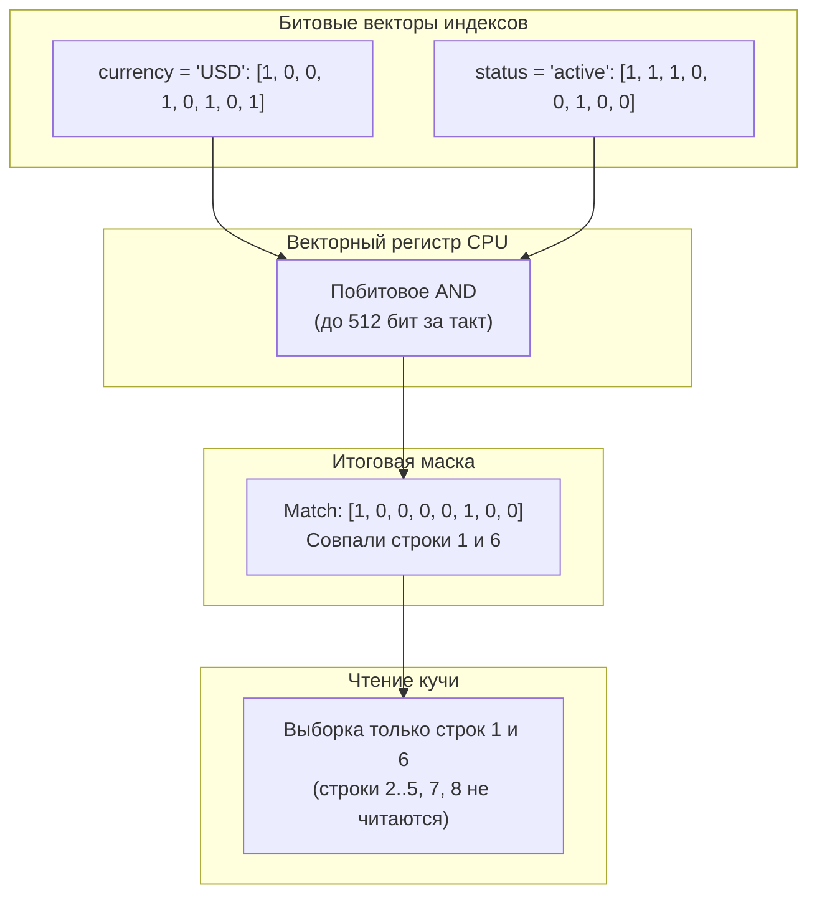
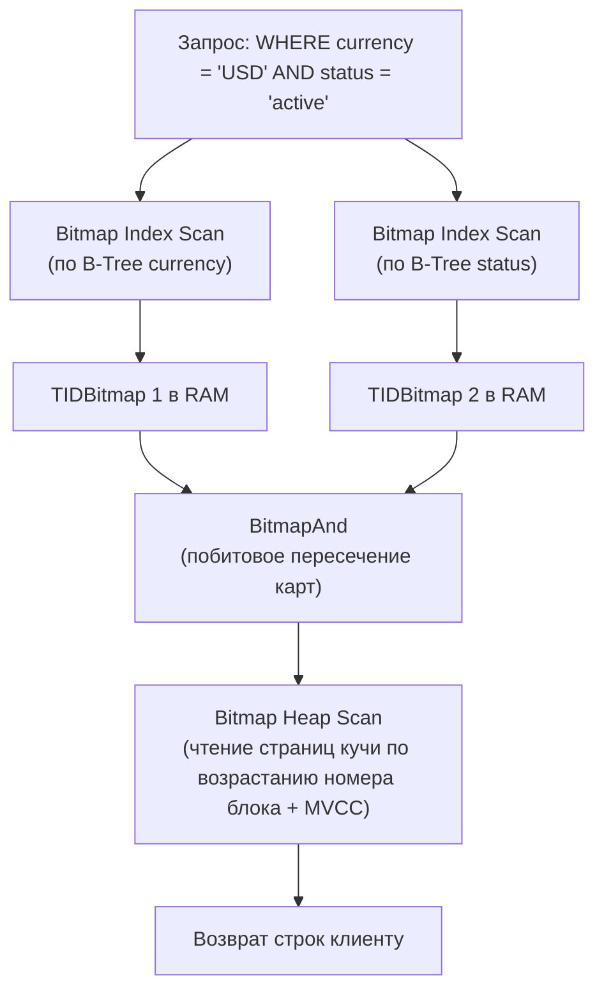

*Как побитовая арифметика заменяет скачки по деревьям в аналитике, почему в PostgreSQL нет дисковых bitmap-индексов и зачем планировщик собирает `TIDBitmap` на лету.*

Самые быстрые операции в кремниевом процессоре — побитовые `AND`, `OR`, `NOT` и `XOR`. Они не требуют многотактного умножения, деления или условных переходов, а векторные инструкции CPU (AVX2, AVX-512, ARM NEON) прогоняют через логические вентили 256 или 512 бит за один такт.

$B^+$-дерево и Hash-индекс отлично справляются с уникальными или высокоселективными ключами. Но предположим, что в аналитической базе миллиард строк, а фильтровать нужно по столбцам с малым числом уникальных значений (**низкой кардинальностью**): валюта (`USD`, `EUR`, `RUB`), статус счёта (`active`, `frozen`, `closed`) или тип операции (`transfer`, `deposit`, `withdrawal`, `fee`). В B-Tree на каждый такой ключ придётся хранить сотни миллионов повторяющихся записей с `ctid`, раздувая дерево и вынуждая процессор прыгать по разрозненным адресам памяти.

Эту задачу решает **Bitmap-индекс (битовый индекс)** — структура для аналитических систем (OLAP), которая заменяет длинные списки указателей на строки компактными битовыми векторами.

---

## Интуиция и устройство битовых карт

Представим таблицу счетов `accounts` в `LedgerPulse`, в которой пока 8 строк, столбец `currency` принимает три значения (`USD`, `EUR`, `RUB`), а `status` — два (`active`, `frozen`). Вместо пар `(значение, ctid)` битовый индекс строит матрицу векторов — по одному битовому вектору на каждое уникальное значение столбца:

```text
Номер строки (RowID):   1  2  3  4  5  6  7  8
Вектор currency='USD':  1  0  0  1  0  1  0  1
Вектор currency='EUR':  0  1  0  0  1  0  1  0
Вектор currency='RUB':  0  0  1  0  0  0  0  0
```

Единица в позиции `i` означает, что в $i$-й строке таблицы записано именно это значение. Найти все счета в долларах или евро (`WHERE currency = 'USD' OR currency = 'EUR'`) теперь можно без единого обхода дерева — обычным побитовым `OR`:

```text
USD:        1 0 0 1 0 1 0 1
EUR:        0 1 0 0 1 0 1 0
---------------------------
USD | EUR:  1 1 0 1 1 1 1 1   -> строки 1, 2, 4, 5, 6, 7, 8
```

Добавим второе условие из другого столбца: `WHERE currency = 'USD' AND status = 'active'`. При наличии битовой карты для `status = 'active'` процессор выполняет побитовое `AND`:

```text
USD:           1 0 0 1 0 1 0 1
active:        1 1 1 0 0 1 0 0
------------------------------
USD & active:  1 0 0 0 0 1 0 0   -> строки 1 и 6
```

Только для позиций, где осталась единица, движок поднимает реальные страницы таблицы с накопителя:



> [!info] Под капотом: сжатие битовых карт и Roaring Bitmaps
> Несжатый вектор на $10^9$ строк занимает $10^9 / 8 = 125\text{ МБ}$ на одно уникальное значение. Для редких значений вектор почти целиком состоит из нулей, поэтому промышленные системы всегда сжимают битовые карты:
> 1. **RLE (Run-Length Encoding):** кодирует длинные серии одинаковых бит счётчиком повторений.
> 2. **WAH (`Word Aligned Hybrid`) и EWAH:** выравнивают сжатые фрагменты по 32- или 64-битным машинным словам, позволяя выполнять `AND`/`OR` прямо над сжатыми словами без полной распаковки.
> 3. **Roaring Bitmap:** современный стандарт в аналитических движках и высоконагруженных сервисах. Пространство 32-битных идентификаторов делится на чанки по $2^{16} = 65\,536$ элементов, и для каждого чанка выбирается самый компактный контейнер: **Array Container** (отсортированный массив `uint16`, если элементов меньше 4 096), **Bitmap Container** (обычная битовая карта на 8 КБ = 65 536 бит, если элементов 4 096 и больше) или **Run Container** (пары `(старт, длина)` для сплошных диапазонов).

---

## Сильные стороны и цена обновления битовых карт

На уровне железа и кэшей процессора битовый индекс даёт три серьёзных преимущества перед B-Tree для низкокардинальных фильтров:

1. **Потоковая работа без промахов ветвления:** в B-Tree каждый шаг спуска — это условный переход и чтение по разным адресам. Побитовые операции над битовой картой идут линейно через векторные регистры CPU без ветвлений и сброса конвейера.
2. **Компактность и плотность кэша:** сжатая битовая карта для столбца с 5–20 уникальными значениями занимает в разы меньше места, чем B-Tree с дублирующимися ключами, и лучше удерживается в L2/L3-кэшах и Page Cache ОС.
3. **Свободная комбинация фильтров:** в аналитических дашбордах пользователь может выбрать произвольное сочетание валюты, статуса, страны и тарифа. Один составной B-Tree не покроет все перестановки фильтров, а независимые битовые карты комбинируются за микросекунды через серию `AND`/`OR`.

Но за эти свойства приходится платить жёсткими ограничениями на запись:

- **Тяжёлое усиление записи (Write Amplification):** добавление, удаление или изменение даже одной строки заставляет пересчитывать и перепаковывать сжатые битовые карты для каждого индексируемого столбца.
- **Конфликты блокировок:** в строковой OLTP-таблице транзакция блокирует отдельную строку (`Row Lock`). В битовом индексе один блок сжатой карты хранит флаги сразу тысяч соседних строк — обновление одного бита блокирует весь блок карты, выстраивая параллельные OLTP-записи в очередь.

---

## Bitmap-индекс в Oracle и `Bitmap Index Scan` в PostgreSQL

Разные СУБД решили эту дилемму по-разному:

- **Oracle Database** предоставляет полноценный постоянный дисковый битовый индекс (`CREATE BITMAP INDEX`). Он спроектирован специально для корпоративных хранилищ данных (Data Warehouse) со схемой «звезда» или «снежинка», где данные загружаются пакетами ночью, а днём идут аналитические выборки. Документация Oracle прямо запрещает ставить такие индексы на OLTP-таблицы с конкурентными вставками.
- **PostgreSQL** сознательно **не содержит встроенного дискового bitmap-индекса** (сторонние расширения вроде `pg_bitmap` применяются крайне редко). Причина — архитектура MVCC (подробно её разберём в Модуле 5): любое `UPDATE` в PostgreSQL создаёт новую физическую версию строки с новым `ctid`, что превратило бы поддержку постоянных битовых карт под OLTP-нагрузкой в узкое место.

Вместо хранения битовых карт на диске PostgreSQL реализует **динамический битовый скан в оперативной памяти**: пару узлов плана **`Bitmap Index Scan`** и **`Bitmap Heap Scan`**.

Механизм работает в пять шагов, когда планировщик видит комбинацию нескольких фильтров или выборку умеренного объёма (условно 5–15% строк таблицы, где обычный `Index Scan` задохнулся бы от случайных чтений кучи, а `Seq Scan` ещё слишком дорог):

1. Для каждого подходящего индекса (обычного B-Tree, а также GIN или GiST) запускается **`Bitmap Index Scan`**. Он не ходит в таблицу сразу, а собирает в памяти битовую карту найденных адресов `ctid` — структуру **`TIDBitmap`** (исходник `src/backend/nodes/tidbitmap.c`).
2. Если в `WHERE` несколько условий по разным индексам (например, по `currency` и по `status`), полученные `TIDBitmap` объединяются в памяти операциями **`BitmapAnd`** или **`BitmapOr`**.
3. Внутри `TIDBitmap` адреса физически упорядочены по возрастанию номера 8-КБ страницы кучи.
4. Далее запускается **`Bitmap Heap Scan`**: движок читает только нужные страницы таблицы, но делает это **строго по возрастанию номеров страниц**, превращая хаотичные прыжки по диску в упорядоченное сканирование.
5. Для каждой прочитанной строки проверяется видимость транзакции по правилам MVCC.



> [!tip] Собеседование [Middle]
> **Вопрос:** В `EXPLAIN ANALYZE` вы увидели `Bitmap Heap Scan` и строку `Recheck Cond`. Означает ли это, что на таблице создан постоянный bitmap-индекс, и почему базе приходится перепроверять условие?
>
> **Ответ:**
> 1. Постоянного bitmap-индекса на диске в стандартном PostgreSQL нет. `Bitmap Index Scan` означает, что движок динамически построил временную битовую карту `TIDBitmap` в оперативной памяти поверх обычных B-Tree (или GIN/GiST) индексов.
> 2. `Recheck Cond` появляется в плане для защиты от деградации карты в режим **«с потерями» (`Lossy`)**. Пока `TIDBitmap` помещается в лимит памяти `work_mem`, он работает в точном режиме (**`Exact`**, 1 бит = 1 конкретная строка). Если совпавших строк слишком много и карта не влезает в `work_mem`, PostgreSQL сжимает её до гранулярности страницы: 1 бит начинает означать **целую 8-КБ страницу** таблицы. На этапе `Bitmap Heap Scan` движок читает всю отмеченную страницу и с помощью `Recheck Cond` заново проверяет условие для каждой строки на ней (в отчёте `EXPLAIN ANALYZE` рядом появятся счётчики `Heap Blocks: exact=... lossy=...`).

---

## Когда битовые карты оправданы, а когда вредны

> [!warning] Ловушка: высокая кардинальность и `Seq Scan`
> - **Высокая кардинальность:** строить постоянный bitmap-индекс (в OLAP/Oracle) на столбцах вроде `email`, `external_id` или `transaction_id` нельзя. У каждого значения будет собственный вектор, суммарный объём индекса многократно превысит размер самой таблицы, а сжатие перестанет работать.
> - **Интенсивный OLTP:** постоянный поток конкурентных `INSERT`/`UPDATE` разрушает преимущества дисковых bitmap-индексов из-за блокировок страниц и Write Amplification.
> - **Очень низкая избирательность:** если фильтр пропускает 85–90% строк, даже `Bitmap Heap Scan` проиграет прямому `Seq Scan` (потому что тратит лишнее время на обход индекса, хотя читать всё равно придётся почти каждую страницу таблицы).

При этом для аналитических витрин с массовой ночной загрузкой и произвольными комбинациями фильтров в BI-дашбордах постоянные битовые карты (или колоночные сжатые структуры в аналитических СУБД, которые мы разберём в Модуле 9) остаются одним из самых быстрых инструментов.

---

## Практика: диагностика в SQL и битовые маски в Go

Посмотрим на характерный план PostgreSQL, когда в `LedgerPulse` запрос отбирает умеренную долю активных счетов в конкретной валюте, комбинируя два B-Tree индекса (или один не слишком селективный индекс):

```sql
EXPLAIN (ANALYZE, BUFFERS)
SELECT id, external_id, balance
FROM accounts
WHERE currency = 'EUR' AND status = 'frozen';
```

Фрагмент реального плана с пересечением двух карт выглядит так:

```text
Bitmap Heap Scan on accounts  (cost=184.20..2410.55 rows=1850 width=36) (actual time=3.412..8.904 rows=1912 loops=1)
  Recheck Cond: ((currency = 'EUR'::bpchar) AND (status = 'frozen'::text))
  Heap Blocks: exact=1420
  Buffers: shared hit=1448
  ->  BitmapAnd  (cost=184.20..184.20 rows=1850 width=0) (actual time=2.980..2.981 rows=0 loops=1)
        ->  Bitmap Index Scan on idx_accounts_currency  (cost=0.00..88.10 rows=12000 width=0)
              Index Cond: (currency = 'EUR'::bpchar)
        ->  Bitmap Index Scan on idx_accounts_status  (cost=0.00..95.40 rows=15000 width=0)
              Index Cond: (status = 'frozen'::text)
```

Строка `Heap Blocks: exact=1420` подтверждает, что весь `TIDBitmap` поместился в `work_mem`, поэтому `Recheck Cond` не потребовал перебирать лишние строки с огрублённых страниц. Если же в `EXPLAIN ANALYZE` вы заметили большой счётчик `lossy=...`, точечное увеличение `work_mem` для аналитической сессии вернёт карту в режим `exact` и снизит нагрузку на CPU.

В самом коде на Go битовая логика работает по тем же законам. Первый классический приём — замена множества `bool`-полей или слайсов флагов на компактную битовую маску (`uint64`) для проверки прав или статусов за одну процессорную инструкцию; второй — пересечение битовых векторов `[]uint64` при фильтрации кэшированных в памяти счетов:

```go
package main

import "fmt"

type Permission uint64

const (
	PermReadLedger Permission = 1 << iota // 0001
	PermTransfer                          // 0010
	PermFreeze                            // 0100
	PermAdmin                             // 1000
)

func HasAccess(userPerms, required Permission) bool {
	return (userPerms & required) == required
}

// IntersectBitsets выполняет побитовое AND двух битовых карт по 64 строки за шаг.
func IntersectBitsets(a, b []uint64) []uint64 {
	n := min(len(a), len(b))
	out := make([]uint64, n)
	for i := range n {
		out[i] = a[i] & b[i]
	}
	return out
}

func main() {
	perms := PermReadLedger | PermTransfer
	fmt.Println("can transfer:", HasAccess(perms, PermTransfer)) // Вывод: can transfer: true
	fmt.Println("can freeze:", HasAccess(perms, PermFreeze))     // Вывод: can freeze: false

	usdMask := []uint64{0b10101001}    // строки 0, 3, 5, 7
	activeMask := []uint64{0b00100111} // строки 0, 1, 2, 5
	both := IntersectBitsets(usdMask, activeMask)
	fmt.Printf("matched mask: %08b\n", both[0]) // Вывод: matched mask: 00100001 (строки 0 и 5)
}
```

Если сервису на Go нужно фильтровать в памяти миллионы идентификаторов по десяткам признаков (например, в антифрод-правилах или сегментации аудитории), вместо плоских `[]uint64` подключают готовые реализации Roaring Bitmaps (например, `github.com/RoaringBitmap/roaring`), получая одновременно сжатие и скорость побитовых операций в кэше CPU.

---

## Упражнения

**Упражнение 1 (Базовое). Побитовая фильтрация на таблице.**
Даны битовые векторы для 8 проводок `ledger_entries`:
- `currency = 'USD'`: `1 1 0 1 0 0 1 0`
- `currency = 'EUR'`: `0 0 1 0 1 0 0 1`
- `amount > 0` (пополнение): `1 0 1 1 0 1 0 0`

Вычислите вручную результирующий вектор и номера подходящих строк (нумерация с 1) для условия:
`(currency = 'USD' OR currency = 'EUR') AND NOT (amount > 0)`.

> [!solution] Показать решение
> 1. `USD | EUR` = `(1 1 0 1 0 0 1 0) | (0 0 1 0 1 0 0 1)` = `1 1 1 1 1 0 1 1` (подходят все, кроме строки 6).
> 2. `NOT (amount > 0)` = инверсия `1 0 1 1 0 1 0 0` = `0 1 0 0 1 0 1 1`.
> 3. Побитовое `AND`: `(1 1 1 1 1 0 1 1) & (0 1 0 0 1 0 1 1)` = **`0 1 0 0 1 0 1 1`**.
>
> Итог: условию удовлетворяют строки **2, 5, 7 и 8** (списания в USD или EUR).

**Упражнение 2 (Практическое). Дешифровка `EXPLAIN ANALYZE` с `lossy`-блоками.**
При выполнении аналитического отчёта по `ledger_entries` администратор получил фрагмент плана:
```text
Bitmap Heap Scan on ledger_entries  (actual time=45.100..612.840 rows=410200 loops=1)
  Recheck Cond: (currency = 'USD'::bpchar)
  Rows Removed by Index Recheck: 1840500
  Heap Blocks: exact=1240 lossy=31800
  ->  Bitmap Index Scan on idx_ledger_currency  (actual time=38.200..38.201 rows=410200 loops=1)
```
Объясните две вещи: (1) почему появилась строка `Rows Removed by Index Recheck: 1840500`, хотя сам индекс точный (B-Tree); (2) какой конфигурационный параметр PostgreSQL вызвал переход `31 800` блоков в состояние `lossy` и как проверить эффект от его увеличения в рамках одной сессии.

> [!solution] Показать решение
> 1. `TIDBitmap`, построенный на этапе `Bitmap Index Scan`, превысил выделенный лимит памяти и переключился в огрублённый режим `lossy` на 31 800 страницах: вместо конкретных смещений строк в карте остался только номер всей 8-КБ страницы. `Bitmap Heap Scan` прочитал эти 31 800 страниц целиком и заново проверил условие `currency = 'USD'` для каждой строки — 1 840 500 строк на этих страницах имели другую валюту и были отброшены фильтром `Rows Removed by Index Recheck`.
> 2. Размер `TIDBitmap` ограничивается параметром **`work_mem`**. Для проверки в текущей сессии достаточно выполнить `SET work_mem = '64MB';` (или больше, в зависимости от числа совпадений) и повторить `EXPLAIN ANALYZE` — `lossy` уйдёт в ноль, а `Rows Removed by Index Recheck` исчезнет.

**Упражнение 3 (Со звёздочкой \*). Сборщик номеров совпавших строк из `[]uint64`.**
Дополните функцию `IntersectBitsets` из раздела практики функцией на Go:
```go
func ExtractRowIDs(bitmap []uint64) []int
```
Она должна возвращать индексы всех установленных в `1` битов по возрастанию, используя стандартный пакет `math/bits` (`bits.TrailingZeros64`), чтобы не проверять нулевые биты циклом по одному.

> [!solution] Показать решение
> Приём с `bits.TrailingZeros64(w)` и сбросом младшего единичного бита `w &= w - 1` позволяет пропускать все нули за одну процессорную инструкцию (`TZCNT`/`BSF`):
> ```go
> package main
>
> import (
> 	"fmt"
> 	"math/bits"
> )
>
> func ExtractRowIDs(bitmap []uint64) []int {
> 	var ids []int
> 	for wordIdx, w := range bitmap {
> 		base := wordIdx * 64
> 		for w != 0 {
> 			bit := bits.TrailingZeros64(w)
> 			ids = append(ids, base+bit)
> 			w &= w - 1 // сбрасываем младшую единицу
> 		}
> 	}
> 	return ids
> }
>
> func main() {
> 	res := ExtractRowIDs([]uint64{0b00100001, 0b10})
> 	fmt.Println(res) // Вывод: [0 5 65]
> }
> ```
> Сложность обхода пропорциональна только числу реальных единиц в битовой карте, а не её полной длине.

---

Мы разобрали три фундаментальных одноколоночных механизма индексирования — универсальный $B^+$-Tree, точечный $O(1)$ Hash и побитовые карты Bitmap. Однако в реальных запросах `LedgerPulse` фильтрация и сортировка почти всегда задействуют сразу несколько столбцов: например, поиск ленты проводок по `account_id` с сортировкой по `created_at DESC` и `id DESC` (`idx_ledger_entries_account_created`). В следующей главе разберём устройство составных (Composite) индексов и правило левого префикса, от которого зависит порядок колонок в каждом `CREATE INDEX`.
