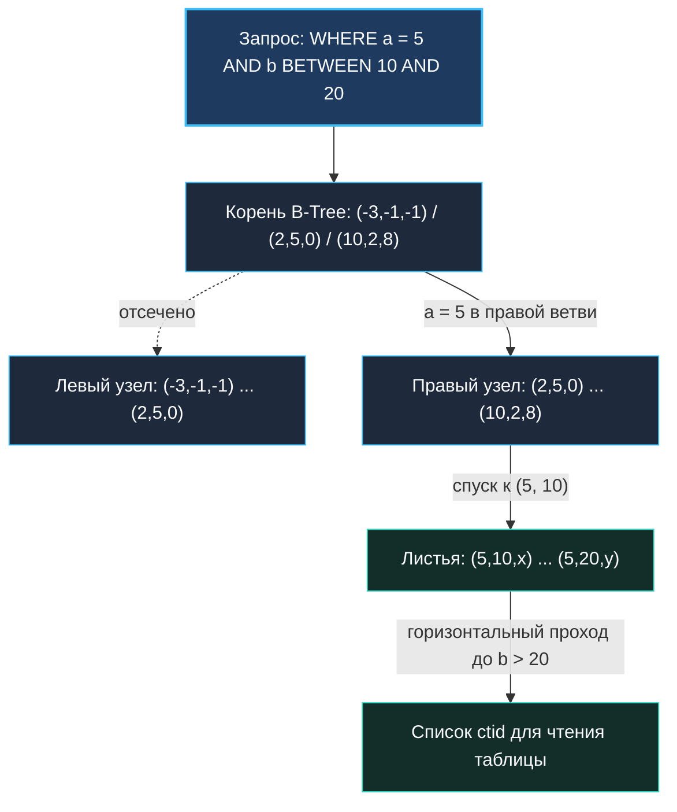
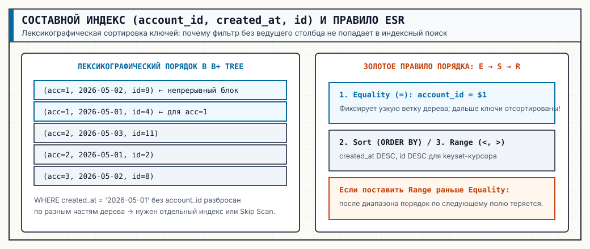

*Как работает лексикографический порядок кортежей в B-Tree, почему правило левого префикса обрывается на первом диапазоне, зачем соблюдать формулу ESR и сколько байтов стоит лишний столбец на 8-КБ странице.*

> «Go поощряет понимание устройства современных компьютеров — и прежде всего важности локальности данных в памяти.»  
> — Алан Донован и Брайан Керниган, *The Go Programming Language*

В реальном бэкенде запросы редко фильтруют по одному столбцу. Финансовому сервису `LedgerPulse` нужна лента операций конкретного счёта за неделю в обратном хронологическом порядке или список активных счетов в заданной валюте.

Если повесить отдельный B-Tree индекс на каждую колонку, база данных заплатит двойную цену: при записи придётся обновлять несколько деревьев, а при чтении — либо фильтровать лишние строки через *Heap Fetch*, либо собирать битовые карты в памяти через `BitmapAnd` / `BitmapOr` ([[4. Bitmap-индекс и Bitmap Index Scan]]). Решение — **составной (*composite*) индекс**: единое B-Tree дерево на нескольких столбцах.

---

## Бумажный справочник и устройство кортежей в B-Tree

Наглядная модель двухколоночного индекса `(last_name, first_name)` — телефонный справочник. Записи упорядочены сначала по фамилии, затем по имени. Поиск «Иванов Иван» идёт за $O(\log N)$; поиск только по «Иванов» читает сплошной блок; а поиск только по имени «Иван» бесполезен — «Иваны» разбросаны по всему тому.

В отличие от книги, в PostgreSQL дерево разбито на 8-КБ страницы, а ключи в узлах являются кортежами `(val_a, val_b, val_c)` и сравниваются **лексикографически** ([[2. B-Tree индекс под капотом — страницы, ветвление и page split]]): сначала по `a`, при равенстве — по `b`, затем — по `c`. Внутренние узлы содержат такие же кортежи-разделители, а листовые страницы связаны горизонтальными указателями.



При `WHERE a = 5 AND b BETWEEN 10 AND 20` движок спускается к первому ключу `(5, 10, ...)` и последовательно идёт вправо по листьям, пока `a = 5` и `b <= 20`, читая непрерывный диапазон страниц.

---

## Правило левого префикса



Составной B-Tree индекс сужает спуск по дереву только тогда, когда условия запроса образуют непрерывный **левый префикс** его колонок, начиная с самой первой. Для индекса `(a, b, c)`:

| Предикат `WHERE` | Поведение B-Tree |
|---|---|
| `a = 1` / `a = 1 AND b = 2` / `a = 1 AND b = 2 AND c = 3` | Полное использование префикса `(a)`, `(a, b)` или `(a, b, c)`. |
| `a = 1 AND c = 3` | **Частично:** дерево сужается только по `a = 1`, а `c = 3` проверяется на лету (*Index Filter*) без отсечения листьев, так как `b` неизвестно. |
| `b = 2` / `b = 2 AND c = 3` | Ведущая колонка пропущена. Точный спуск невозможен: планировщик выберет `Seq Scan` или полное сканирование всех листьев (`Index Full Scan`). |
| `a = 1 OR b = 2` | Единым спуском решить нельзя. Нужен отдельный индекс на `b` для `BitmapOr`, иначе `Seq Scan`. |

Начиная с PostgreSQL 18 для низкокардинальной ведущей колонки появился *B-Tree Skip Scan*, перебирающий уникальные значения `a`, но в PostgreSQL 17 и на высококардинальных ключах вроде `account_id` правило левого префикса остаётся строгим.

> [!tip] Собеседование [Middle]
> **Вопрос:** На таблице создан индекс `(a, b)`. Ускорит ли он `SELECT * FROM t ORDER BY b, a` без сортировки в памяти?
>
> **Ответ:** Нет. Ключи в листьях отсортированы сначала по `a`, и только внутри одного `a` — по `b`. Глобального порядка по `b` в дереве нет. Запрос `ORDER BY a, b` (или `ORDER BY a DESC, b DESC`) пройдёт без узла `Sort`, а `ORDER BY b, a` или `ORDER BY b` потребуют явной сортировки (`Sort`) с риском сброса в `pgsql_tmp` при нехватке `work_mem`.

---

## Граница диапазона и правило ESR

> [!warning] Ловушка: первый диапазон обрывает сужение по дереву
> После первого же диапазонного оператора (`>`, `<`, `BETWEEN`, префиксного `LIKE 'tx-%'`) все следующие столбцы составного индекса теряют способность сужать границы обхода листьев — они работают лишь как *Index Filter* по прочитанным ключам.

Сравните индексы для выборки проведённых транзакций `LedgerPulse` (`WHERE status = 'posted' AND created_at >= '2026-01-01' ORDER BY created_at DESC`):
* `(created_at, status)`: из-за диапазона `created_at >= ...` движок читает все статусы вперемешку с начала года и фильтрует `'posted'` на каждом ключе.
* `(status, created_at DESC)`: точечный переход в сплошной блок `'posted'`, где записи уже лежат по убыванию `created_at`. Сортировка не нужна, скан останавливается на границе даты.

Отсюда **правило ESR (*Equality → Sort → Range*)**:
1. **Equality (`=`, `IN`):** первыми ставьте колонки строгого равенства (более селективные — в самом начале).
2. **Sort (`ORDER BY`, `GROUP BY`):** затем колонки сортировки с точным совпадением направлений `ASC`/`DESC`.
3. **Range (`>`, `<`, `BETWEEN`):** последней ставьте колонку диапазона.

Колонки, нужные только в `SELECT`, выносите из ключа в `INCLUDE` (см. [[6. Покрывающие (Covering) индексы, INCLUDE и Index-Only Scan]]).

---

## `JOIN` и составные ключи

В таблицах связей «многие ко многим» первичный ключ сам по себе образует составной уникальный индекс:

```sql
CREATE TABLE transaction_participants (
    transaction_id BIGINT NOT NULL REFERENCES transactions(id),
    account_id     BIGINT NOT NULL REFERENCES accounts(id),
    role           TEXT   NOT NULL CHECK (role IN ('source', 'destination', 'fee')),
    PRIMARY KEY (transaction_id, account_id)
);
```

Индекс `(transaction_id, account_id)` ускоряет `JOIN` и фильтр `WHERE transaction_id = $1`, но бесполезен для `WHERE account_id = $1`. Для поиска по счёту нужен отдельный индекс на `(account_id)`.

---

## Анатомия 8-КБ страницы и локальность данных

Оценим физику 8-КБ (8 192 байта) листа для индекса на трёх `BIGINT` — например, `(account_id, transaction_id, id)`:
* 3 ключа по 8 байт: `24` байта;
* заголовок кортежа `IndexTupleData` (с `ctid`): `8` байт (`32` байта уже выровнены по 8);
* слот смещения `ItemIdData` в заголовке страницы: `4` байта.

Итого **36 байт** на запись (при некратном ключе с padding — ~36–40 байт). При `fillfactor = 90%`:

$$\text{Записей на листе} \approx \frac{8192 \times 0.9}{36} \approx 204$$

Во внутреннем узле (~32 байта на кортеж) ветвление (*fanout*) составляет ~230 потомков против >500 у одиночного `int4`. Это прямо бьёт по железу:
1. **Высота дерева:** меньший fanout превращает трёхуровневое дерево на миллиард строк в четырёхуровневое (+1 чтение 8-КБ страницы ~100 мкс на NVMe при промахе мимо кэша).
2. **Кэш L1/L2 CPU:** целые кортежи сравниваются регистровыми инструкциями `CMP`; строковые ключи (`TEXT`) вызывают разыменования и локаль-зависимый `strcoll`/`memcmp`, провоцируя промахи кэша.
3. **Write Amplification:** изменение *любой* колонки составного индекса требует удаления старого и вставки нового ключа с записью в WAL.

---

## Практический пример: keyset-лента `LedgerPulse` в Go 1.24

В миграции `002_indexes.sql` ключ для ленты проводок построен строго по правилу ESR: `(account_id, created_at DESC, id DESC)` (там добавлен ещё и `INCLUDE`, который разберём в следующей главе). Столбец `id DESC` служит детерминированным тай-брейкером при совпадении `created_at` ([[4. ORDER BY, LIMIT и пагинация (OFFSET против keyset)]]):

```go
package ledger

import (
	"context"
	"database/sql"
	"fmt"
	"time"
)

type LedgerEntry struct {
	ID            int64
	TransactionID int64
	Amount        int64
	Currency      string
	CreatedAt     time.Time
}

func FetchAccountEntriesPage(
	ctx context.Context,
	db *sql.DB,
	accountID int64,
	cursorTime time.Time,
	cursorID int64,
	limit int,
) ([]LedgerEntry, error) {
	// Сравнение кортежей (created_at, id) < ($2, $3) напрямую транслируется в границы B-Tree.
	const query = `
		SELECT id, transaction_id, amount, currency, created_at
		FROM ledger_entries
		WHERE account_id = $1
		  AND (created_at, id) < ($2, $3)
		ORDER BY created_at DESC, id DESC
		LIMIT $4;`

	rows, err := db.QueryContext(ctx, query, accountID, cursorTime, cursorID, limit)
	if err != nil {
		return nil, fmt.Errorf("query entries page: %w", err)
	}
	defer rows.Close()

	entries := make([]LedgerEntry, 0, limit)
	for rows.Next() {
		var e LedgerEntry
		if err := rows.Scan(&e.ID, &e.TransactionID, &e.Amount, &e.Currency, &e.CreatedAt); err != nil {
			return nil, fmt.Errorf("scan entry: %w", err)
		}
		entries = append(entries, e)
	}
	return entries, rows.Err()
}
```

Для проверки плана из тестов на Go удобно использовать обёртку над `EXPLAIN (ANALYZE, BUFFERS)`:

```go
func ExplainPlan(ctx context.Context, db *sql.DB, query string, args ...any) ([]string, error) {
	rows, err := db.QueryContext(ctx, "EXPLAIN (ANALYZE, BUFFERS) "+query, args...)
	if err != nil {
		return nil, fmt.Errorf("explain: %w", err)
	}
	defer rows.Close()
	var lines []string
	for rows.Next() {
		var s string
		if err := rows.Scan(&s); err != nil {
			return nil, err
		}
		lines = append(lines, s)
	}
	return lines, rows.Err()
}
```

План подтвердит точечный обход без сортировки:

```text
Limit  (cost=0.43..18.24 rows=50 width=44) (actual time=0.041..0.095 rows=50 loops=1)
  Buffers: shared hit=48
  ->  Index Scan using idx_ledger_entries_account_created on ledger_entries
        Index Cond: ((account_id = 42) AND (ROW(created_at, id) < ROW('2026-02-01 12:00:00+00'::timestamptz, 910500)))
```

---

## Четыре правила проектирования и антипаттерны

1. Сначала равенства (`=`, `IN`) по убыванию селективности, затем `ORDER BY`, затем одна диапазонная колонка, остальное — в `INCLUDE`.
2. **Не дублируйте префикс:** если есть индекс `(a, b)`, отдельный индекс `(a)` лишний — он удваивает нагрузку на запись без пользы для чтения.
3. **Не стройте индексы на 5–7 колонок «про запас»:** падает fanout, учащаются *Page Split* и растёт WAL-трафик.

> [!tip] Собеседование [Middle]
> **Вопрос:** В `transactions` есть индекс `(kind, status, created_at DESC)`. Повлияет ли на выбор плана то, что разработчик написал `WHERE status = 'posted' AND kind = 'transfer'` (колонки в обратном порядке)?
>
> **Ответ:** Нет. SQL декларативен: стоимостной оптимизатор нормализует конъюнкцию предикатов `WHERE` независимо от их порядка в тексте запроса и корректно применит ведущий префикс `(kind, status)`.

---

## Упражнения

### Упражнение 1 (Базовое)
В `transactions` создан индекс `(kind, status, created_at DESC)`. Определите поведение планировщика для запросов:
1. `SELECT id FROM transactions WHERE kind = 'transfer' AND status = 'posted' ORDER BY created_at DESC LIMIT 20;`
2. `SELECT id FROM transactions WHERE status = 'pending' ORDER BY created_at DESC LIMIT 20;`
3. `SELECT id FROM transactions WHERE kind = 'deposit' AND created_at >= '2026-01-01' ORDER BY created_at DESC;`
4. `SELECT id FROM transactions WHERE kind = 'deposit' ORDER BY status, created_at DESC;`

> [!solution] Показать решение
> 1. **Полное попадание:** префикс `(kind, status)` закрыт равенствами, порядок `created_at DESC` готов без `Sort`.
> 2. **Индекс не применим для спуска:** ведущий столбец `kind` отсутствует (`Seq Scan` или `Index Full Scan`).
> 3. **Частично + `Sort`:** спуск по `kind = 'deposit'`, затем перебор всех статусов внутри него с фильтрацией по дате и явный `Sort` по `created_at DESC`.
> 4. **Полное попадание без `Sort`:** равенство по `kind`, а оставшиеся две колонки совпадают с `ORDER BY status ASC, created_at DESC`.

### Упражнение 2 (Практическое)
Спроектируйте оптимальный составной индекс (без `INCLUDE`) для отчёта `LedgerPulse`:
```sql
SELECT id, external_id, balance
FROM accounts
WHERE currency = 'EUR' AND status = 'active' AND balance >= 100000
ORDER BY balance DESC
LIMIT 50;
```

> [!solution] Показать решение
> ```sql
> CREATE INDEX idx_accounts_currency_status_balance
>     ON accounts (currency, status, balance DESC);
> ```
> По ESR: равенства `(currency, status)` идут первыми, а `balance DESC` одновременно обслуживает диапазон `>= 100000` и сортировку `ORDER BY balance DESC` с ранней остановкой на 50 строках.

### Упражнение 3 (Со звёздочкой `*`)
Для запроса к `ledger_entries`:
```sql
SELECT id, amount, created_at
FROM ledger_entries
WHERE account_id = $1 AND created_at >= $2 AND created_at < $3 AND amount > 0
ORDER BY created_at DESC, id DESC;
```
объясните, почему добавление `amount` в ключ — как `(account_id, amount, created_at DESC)` или `(account_id, created_at DESC, amount)` — хуже, чем ключ `(account_id, created_at DESC, id DESC)`.

> [!solution] Показать решение
> 1. `(account_id, amount, created_at DESC)`: первый диапазон `amount > 0` обрывает спуск до `created_at`, поэтому движок не сузит интервал дат и запустит тяжёлый `Sort`.
> 2. `(account_id, created_at DESC, amount)`: диапазон по `created_at` уже оборвал спуск, поэтому `amount` не сузит границы чтения листьев, но вытеснит `id DESC` и собьёт порядок сортировки.
> 3. Ключ `(account_id, created_at DESC, id DESC)` сохраняет сужение по датам и порядок без `Sort`, а `amount` эффективно проверяется в листьях при добавлении через `INCLUDE`.

---

## Мостик к следующему уроку

Составной ключ `(account_id, created_at DESC, id DESC)` находит нужные записи без сортировки, но за значениями `amount`, `currency` и `transaction_id` движку всё ещё приходится прыгать в страницы таблицы (`Heap Fetch`). В следующей главе — [[6. Покрывающие (Covering) индексы, INCLUDE и Index-Only Scan]] — мы разберём, как положить эти поля прямо в листья через `INCLUDE` и какую роль здесь играет карта видимости.
