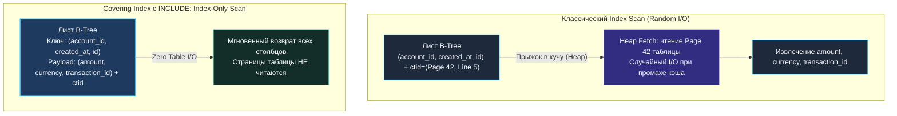
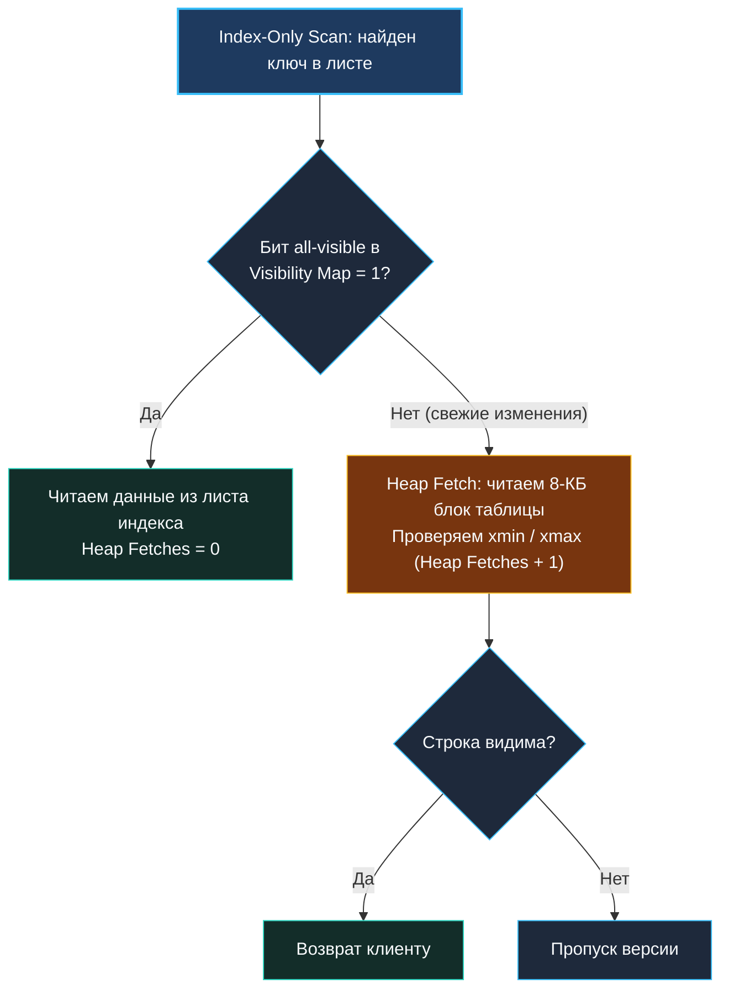

*Почему `Index Scan` всё равно делает тысячи случайных чтений таблицы, как устроен `idx_ledger_entries_account_created` с `INCLUDE` в `002_indexes.sql`, зачем нужна карта видимости (`Visibility Map`) и как поля в `INCLUDE` ломают HOT-обновления.*

> «Мы пишем, а позже читаем. Сохраняем, а позже извлекаем. Храним, а позже обращаемся к сохранённому. Назначение памяти — уберечь информацию без искажений между двумя этими событиями.»  
> — Чарльз Петцольд, *Code* (2-е изд.)

Самый быстрый ввод-вывод — тот, которого удалось избежать. Обычный B-Tree индекс ([[2. B-Tree индекс под капотом — страницы, ветвление и page split]]) сокращает поиск с $O(N)$ до $O(\log N)$, но у `Index Scan` есть скрытая цена: найдя в листе адрес строки (`ctid` в PostgreSQL), движок прыгает на страницу самой таблицы (*Heap Fetch*), чтобы прочитать столбцы вроде `amount`, `currency` или `transaction_id`. Если 5 000 подходящих строк разбросаны по таблице, база данных делает до 5 000 случайных чтений (*Random I/O*, ~100 мкс на NVMe SSD или ~10 мс на HDD против ~100 нс в RAM).

**Покрывающий индекс (*Covering Index*)** хранит все запрашиваемые столбцы прямо на листовых страницах самого индекса. В плане появляется **Index-Only Scan** — чтение данных без единого обращения к таблице.

---

## Данные в листьях и `idx_ledger_entries_account_created`

Добавить нужные в `SELECT` колонки в индекс можно двумя способами:
1. **Расширить сам ключ:** включить столбцы в составной ключ. Это засоряет внутренние узлы дерева, снижает коэффициент ветвления (*fanout*) и навязывает лишнюю сортировку.
2. **Использовать секцию `INCLUDE` (PostgreSQL 11+, SQL Server):** неключевые поля записываются **только в листовые страницы** как полезный груз (*payload*), не занимая места во внутренних узлах и не влияя на порядок ключей.

В миграции `project/sql/migrations/002_indexes.sql` проекта `LedgerPulse` этот приём применён для ленты проводок:

```sql
-- Составной покрывающий индекс для keyset-пагинации ленты проводок по счёту без обращения к Heap
CREATE INDEX IF NOT EXISTS idx_ledger_entries_account_created
    ON ledger_entries (account_id, created_at DESC, id DESC)
    INCLUDE (amount, currency, transaction_id);
```

Разберём его структуру по слоям:
* **Ключ `(account_id, created_at DESC, id DESC)`:** отвечает за быстрый спуск к счёту и готовый порядок для keyset-пагинации ([[4. ORDER BY, LIMIT и пагинация (OFFSET против keyset)]]) без узла `Sort`.
* **Нагрузка `INCLUDE (amount, currency, transaction_id)`:** кладётся только в листья. Запрос выписки по счёту забирает все пять столбцов прямо из листьев B-Tree, не касаясь страниц `ledger_entries`.



---

## `Index-Only Scan` и карта видимости (`Visibility Map`)

В PostgreSQL под моделью MVCC метаданные видимости транзакций (`xmin`, `xmax`, флаги `t_infomask`) хранятся **только в страницах таблицы (Heap)** — в индексных кортежах их нет. Если читать листья вслепую, запрос вернёт незакоммиченные или удалённые строки.

Чтобы не бегать в таблицу на каждом кортеже, PostgreSQL проверяет **карту видимости (*Visibility Map*, файл `_vm`)** — компактную битовую карту по 2 бита на каждую 8-КБ страницу таблицы:
1. **`all-visible`:** все строки на этой странице гарантированно видны всем текущим и будущим транзакциям.
2. **`all-frozen`:** все строки на странице заморожены процессом `VACUUM` (подробнее о MVCC и `VACUUM` см. в следующих модулях).



Карта видимости почти всегда помещается в `Shared Buffers` (RAM ~100 нс). Пока бит `all-visible` выставлен, `Heap Fetches` равен `0`. Любой `INSERT`/`UPDATE`/`DELETE` на странице сбрасывает этот бит до следующего запуска `VACUUM`.

> [!warning] Ловушка: деградация из-за отстающего `VACUUM`
> При интенсивных записях и мягком `autovacuum` в `EXPLAIN (ANALYZE, BUFFERS)` появляется `Heap Fetches: 4850` при 5 000 возвращённых строк. Такой `Index-Only Scan` фактически вырождается в обычный `Index Scan`. Контролируйте `n_dead_tup` и `last_autovacuum` в `pg_stat_user_tables` (а для append-only таблиц вроде `ledger_entries` — порог `autovacuum_vacuum_insert_scale_factor`).

---

## Кластерный индекс в `InnoDB` (MySQL)

В `InnoDB` таблица физически устроена как **кластерный индекс (*Clustered Index*)**: B+Tree по `PRIMARY KEY` хранит в листьях полные строки. Поиск по `PRIMARY KEY` здесь покрывающий по определению.

Вторичные индексы в `InnoDB` хранят в листьях `(secondary_key, PRIMARY KEY)`. Если запросу не хватает столбцов, движок делает **Bookmark Lookup** — второй спуск по кластерному B+Tree за телом строки. Если же все нужные колонки входят во вторичный индекс (или `PRIMARY KEY`), MySQL показывает в плане `Using index` и обходится без `Bookmark Lookup`. Конструкции `INCLUDE` в MySQL нет — неключевые поля просто дописывают в хвост составного индекса.

---

## Локальность данных и физика накопителей

Покрывающий индекс превращает хаотичное случайное чтение 8-КБ страниц (упирающееся в лимит IOPS) в последовательное чтение смежных листьев:
1. **Полоса пропускания NVMe и Read-Ahead:** ядро Linux предзагружает последовательные блоки на полной скорости шины PCIe.
2. **Экономия `Shared Buffers`:** в листьях нет 23-байтовых заголовков `HeapTupleHeaderData`, ненужных текстовых полей и старых версий MVCC, поэтому в кэше RAM помещается больше полезных строк.
3. **Меньше системных вызовов:** меньше вызовов `pread64`, переключений контекста и промахов TLB-кэша CPU.

---

## Практический пример: выписка по счёту в Go 1.24

Используем `idx_ledger_entries_account_created` из `002_indexes.sql`. Главное правило — указывать в `SELECT` строго поля ключа и `INCLUDE`:

```go
package ledger

import (
	"context"
	"database/sql"
	"fmt"
	"time"
)

type StatementRow struct {
	ID            int64
	TransactionID int64
	Amount        int64
	Currency      string
	CreatedAt     time.Time
}

func FetchStatementCovering(
	ctx context.Context,
	db *sql.DB,
	accountID int64,
	limit int,
) ([]StatementRow, error) {
	// Запрашиваем только поля из ключа и INCLUDE. Любой лишний столбец (или SELECT *)
	// немедленно отключит Index-Only Scan.
	const query = `
		SELECT id, transaction_id, amount, currency, created_at
		FROM ledger_entries
		WHERE account_id = $1
		ORDER BY created_at DESC, id DESC
		LIMIT $2;`

	rows, err := db.QueryContext(ctx, query, accountID, limit)
	if err != nil {
		return nil, fmt.Errorf("query statement covering: %w", err)
	}
	defer rows.Close()

	out := make([]StatementRow, 0, limit)
	for rows.Next() {
		var r StatementRow
		if err := rows.Scan(&r.ID, &r.TransactionID, &r.Amount, &r.Currency, &r.CreatedAt); err != nil {
			return nil, fmt.Errorf("scan statement row: %w", err)
		}
		out = append(out, r)
	}
	return out, rows.Err()
}
```

План через `EXPLAIN (ANALYZE, BUFFERS)` подтверждает нулевое чтение кучи:

```text
Limit  (cost=0.43..4.28 rows=50 width=36) (actual time=0.025..0.048 rows=50 loops=1)
  Buffers: shared hit=4
  ->  Index Only Scan using idx_ledger_entries_account_created on ledger_entries
        Index Cond: (account_id = 42)
        Heap Fetches: 0
        Buffers: shared hit=4
```

---

## Компромиссы, разрушение HOT и сравнение

> [!info] Под капотом: размер листа и `Page Split`
> Широкие поля (`TEXT`, `JSONB`) в `INCLUDE` резко уменьшают число записей на 8-КБ странице (с ~200 до 30–40), раздувая размер индекса и ускоряя расщепление страниц (*Page Split*).

> [!warning] Ловушка: убийство оптимизации HOT (*Heap-Only Tuples*)
> В PostgreSQL, если `UPDATE` меняет поля, не входящие ни в один индекс, новая версия строки помещается на ту же страницу таблицы, а индексы не трогаются вообще (оптимизация HOT). Добавление столбца в `INCLUDE` **разрушает HOT при обновлении этого столбца**: движок вынужден писать новые индексные кортежи и генерировать поток WAL. Поэтому `INCLUDE` не ставят на часто обновляемый `accounts.balance`, но для неизменяемых (`append-only`) строк `ledger_entries` он безопасен.

Также помните о главном враге покрывающих индексов в коде — `SELECT *` (и ORM-генераторах, выбирающих всю сущность по умолчанию).

| Критерий | Составной ключ `(a, b, c)` | Покрывающий `(a) INCLUDE (b, c)` |
|---|---|---|
| **Расположение `b, c`** | Во всех узлах дерева | Только в листовых страницах |
| **Влияние на fanout** | Снижает ветвление внутренних узлов | Внутренние узлы остаются компактными |
| **Сортировка** | Сортирует по `(a, b, c)` | Сортирует только по `(a)` |
| **Уникальность (`UNIQUE`)** | По всей тройке `(a, b, c)` | Строго по `(a)`, `b, c` — полезная нагрузка |

Свойство `UNIQUE ... INCLUDE (...)` удобно для быстрых проверок в `LedgerPulse`:
```sql
ALTER TABLE accounts
    ADD CONSTRAINT uq_accounts_external_id
    UNIQUE (external_id) INCLUDE (status, currency);
```

Покрывающие индексы оправданы для узких высокочастотных чтений (авторизация, проверка статуса, выписки `ledger_entries`), диапазонных агрегаций и read-heavy справочников.

> [!tip] Собеседование [Senior/Staff]
> **Вопрос:** Почему `Index Only Scan` на `idx_ledger_entries_account_created` в тесте показывает `Heap Fetches: 12000`, и чем опасно добавить `INCLUDE (balance)` в индекс на таблице `accounts`?
>
> **Ответ:** Большое число `Heap Fetches` означает, что после недавних вставок `VACUUM` ещё не выставил биты `all-visible` в карте видимости (`_vm`), и движок ходит в кучу проверять `xmin`/`xmax`. На `accounts` включение часто меняемого `balance` в `INCLUDE` ломает **HOT-обновления**, умножая записи в индекс и WAL при каждом переводе и постоянно сбрасывая `all-visible`.

---

## Упражнения

### Упражнение 1 (Базовое)
При наличии `idx_ledger_entries_account_created` (`(account_id, created_at DESC, id DESC) INCLUDE (amount, currency, transaction_id)`) определите, пройдёт ли `Index-Only Scan`:
1. `SELECT amount, created_at FROM ledger_entries WHERE account_id = 10 ORDER BY created_at DESC LIMIT 20;`
2. `SELECT SUM(amount) FROM ledger_entries WHERE account_id = 10 AND created_at >= '2026-01-01';`
3. На таблице `accounts` с индексом `(external_id) INCLUDE (status, currency)` выполнен `SELECT * FROM accounts WHERE external_id = 'acc-1';`.

> [!solution] Показать решение
> 1. **Да (`Index-Only Scan`):** `account_id`, `amount`, `created_at` покрыты ключом и `INCLUDE`.
> 2. **Да (`Index-Only Scan`):** фильтрация по префиксу ключа, а `amount` для `SUM` читается прямо из `INCLUDE`.
> 3. **Нет (`Index Scan`):** `SELECT *` требует `id`, `owner_name`, `balance`, `metadata`, которых нет в индексе — обязателен `Heap Fetch`.

### Упражнение 2 (Практическое)
Сервис 50 000 раз в секунду проверяет счёт по `external_id`:
```sql
SELECT id, status, currency FROM accounts WHERE external_id = $1;
```
Спроектируйте уникальное покрывающее ограничение/индекс и объясните, почему сюда нельзя включать `balance`.

> [!solution] Показать решение
> ```sql
> CREATE UNIQUE INDEX idx_accounts_external_covering
>     ON accounts (external_id)
>     INCLUDE (id, status, currency);
> ```
> (Если уже есть ограничение `UNIQUE(external_id)`, разумно заменить его на `UNIQUE (external_id) INCLUDE (id, status, currency)`, чтобы не держать два индекса по `external_id`.) Поле `balance` обновляется при каждой проводке: его включение разрушит HOT-обновления и перегрузит индекс и WAL.

### Упражнение 3 (Со звёздочкой `*`)
В `idx_ledger_entries_account_created` одна листовая запись весит ~60 байт (ключ 24 Б + `INCLUDE` 20 Б + заголовок и выравнивание 12 Б + `ItemId` 4 Б). При странице 8 192 байта и `fillfactor = 90%` оцените число страниц для чтения 500 последних проводок одного счёта через `Index-Only Scan` (`Heap Fetches: 0`) по сравнению с обычным `Index Scan`, если эти 500 проводок записывались вперемешку с другими счетами на протяжении трёх недель.

> [!solution] Показать решение
> 1. На один лист помещается $(8192 \times 0.9) / 60 \approx 122$ записи. Так как проводки счёта лежат в смежных листьях подряд, нужно прочитать ~5 листовых страниц (+ 3–4 страницы спуска от корня).
> 2. Без `INCLUDE` проводки трёхнедельной давности разбросаны по разным страницам таблицы: обычный `Index Scan` выполнит **до 500 случайных чтений 8-КБ страниц кучи** — в десятки раз больше дисковых обращений.

---

## Мостик к следующему уроку

Покрывающий индекс убирает чтения кучи, но всё равно индексирует каждую строку таблицы — даже если 99,5% строк давно перешли в статус `'posted'` и больше никогда не запрашиваются воркерами. В следующей главе — [[7. Частичные (Partial) индексы и индексы по выражениям]] — разберём индексы `idx_transactions_pending` и `idx_accounts_status_currency` из `002_indexes.sql`, а также индексы по вычисляемым формулам.
