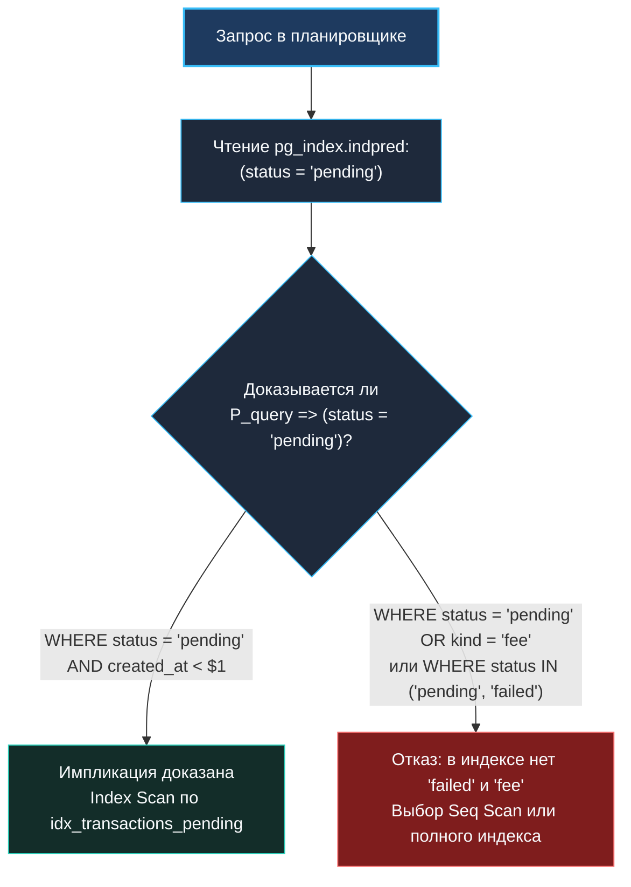

*Как индексировать только 1% горячих строк таблицы, как устроены `idx_transactions_pending` и `idx_accounts_status_currency` в `002_indexes.sql`, почему параметр `$1` мешает планировщику в `Generic Plan` и как строить индексы по `IMMUTABLE`-выражениям.*

> «Блеск Unix заключался в выборе абстракции, достаточно общей, чтобы быть поразительно полезной, и при этом не слишком дорогой по производительности.»  
> — Брайан Керниган, *UNIX: A History and a Memoir*

Представьте городской архив на десять миллионов формуляров, где прямо сейчас на руках у читателей ровно сто книг. Держать гигантскую картотеку на все десять миллионов бланков бессмысленно — проще завести на столе тонкий блокнот только для ста выданных книг.

В реляционных СУБД эту идею реализует **частичный индекс (*Partial Index*)**: B-Tree строится не по всей таблице, а только по строкам, удовлетворяющим явному предикату `WHERE`. Его напарник — **индекс по выражению (*Expression Index*)**, хранящий результат детерминированной функции от столбца.

---

## Частичные индексы в `002_indexes.sql` и типовые сценарии

В миграции `project/sql/migrations/002_indexes.sql` проекта `LedgerPulse` определены два частичных индекса:

```sql
-- Частичный индекс: быстрый поиск только незавершённых транзакций (экономит память и кэш)
CREATE INDEX IF NOT EXISTS idx_transactions_pending
    ON transactions (created_at)
    WHERE status = 'pending';

-- Составной индекс для поиска счетов клиента в разрезе валюты
CREATE INDEX IF NOT EXISTS idx_accounts_status_currency
    ON accounts (status, currency)
    WHERE status = 'active';
```

Разберём оба решения:
1. **`idx_transactions_pending`:** в реальном леджере 99% транзакций уже завершены (`'posted'`, `'failed'`, `'reversed'`). Воркерам допроведения нужны только `'pending'`-операции. Как только статус транзакции меняется на `'posted'`, её ключ удаляется из индекса. Вместо десятков миллионов записей дерево хранит пару сотен горячих ключей.
2. **`idx_accounts_status_currency`:** отсекает замороженные (`'frozen'`) и закрытые (`'closed'`) счета. Тонкая деталь: раз предикат `WHERE status = 'active'` уже гарантирует `status = 'active'` на каждой строке индекса, ведущий столбец `status` в ключе `(status, currency)` константен (вариант `ON accounts (currency) WHERE status = 'active'` получился бы чуть компактнее, хотя `(status, currency)` позволяет выполнить `Index-Only Scan`, если в `SELECT` запрашивается `status`).

Четыре классические задачи для частичных индексов:
* **Очереди задач и статусные воронки:** выборка `status = 'pending'` или `'new'`.
* **Мягкое удаление (*Soft Delete*) и частичная уникальность:** `CREATE UNIQUE INDEX ... ON accounts (external_id) WHERE deleted_at IS NULL` гарантирует уникальность среди активных записей и разрешает повторно создать удалённую сущность.
* **Исключение доминирующих значений:** `WHERE is_spam = true`, если у 99,9% строк флаг `false`.
* **Горячие срезы с фиксированной датой:** `WHERE created_at >= '2026-01-01'` для оперативных отчётов без холодного архива.

---

## Под капотом: `pg_index.indpred` и логическая импликация

Предикат `WHERE` частичного индекса сериализуется в нормализованное дерево выражений и записывается в системный каталог `pg_index.indpred`. Когда поступает запрос, оптимизатор (Cost-Based Optimizer) доказывает теорему **предикатной импликации**: следует ли истинность предиката индекса из фильтра `WHERE` запроса ($P_{\text{query}} \implies P_{\text{index}}$)?



> [!tip] Собеседование [Middle]
> **Вопрос:** На `transactions` создан индекс `ON transactions (created_at) WHERE status = 'pending'`. Сработает ли он для `SELECT * FROM transactions WHERE status IN ('pending', 'failed')`?
>
> **Ответ:** Нет. Условие запроса шире предиката индекса — строк со статусом `'failed'` в дереве физически нет. Импликация $P_{\text{query}} \implies P_{\text{index}}$ не выполняется, планировщик не станет смешивать индекс со сканированием таблицы и уйдёт в `Seq Scan` (либо выберет другой полный индекс).

---

## Экономия памяти, Write Amplification и ловушка смены статуса

1. **Попадание в `Shared Buffers`:** полный индекс на 100 млн строк весит ~5 ГБ и вымывает кэш, а частичный на 1% горячих строк весит ~50 МБ и целиком лежит в RAM (~100 нс против ~100 мкс на NVMe SSD).
2. **Нулевая нагрузка на запись для «чужих» строк:** перед модификацией индекса СУБД проверяет предикат. Для `status = 'posted'` частичный индекс вообще не трогается — 0 I/O, 0 записей в WAL, 0 *Page Split*.
3. **Изоляция фрагментации:** монотонные вставки в архив не раздувают горячий индекс.

> [!warning] Ловушка: шторм массовых переходов статуса
> Если воркер одной транзакцией переводит 100 000 строк из `'pending'` в `'posted'`, из частичного индекса синхронно удаляются 100 000 ключей. Это нагружает WAL и оставляет пустые страницы (*bloat*), которые очистит только `VACUUM` (подробнее в модуле администрирования).

---

## Индексы по выражениям (*Expression Indexes*)

Когда запрос фильтрует по результату функции или оператора, обычный индекс по столбцу не работает (см. главу 15 этого раздела о SARGable-условиях). Решение — индекс по выражению, где PostgreSQL предварительно вычисляет формулу при записи:

```sql
-- 1. Регистронезависимый поиск владельца счёта
CREATE INDEX IF NOT EXISTS idx_accounts_owner_lower
    ON accounts (lower(owner_name));

-- 2. Комбинация: индекс по выражению + частичный фильтр
CREATE INDEX IF NOT EXISTS idx_accounts_daily_limit
    ON accounts (((metadata->>'daily_limit')::bigint))
    WHERE metadata ? 'daily_limit';
```

Для сложных выражений с операторами и `::` обязательны двойные круглые скобки `((...))`. Действуют четыре правила:
1. **Строгая детерминированность (`IMMUTABLE`):** функции `now()`, `CURRENT_DATE` или приведение `created_at::date` над `TIMESTAMPTZ` (зависящее от часового пояса сессии) запрещены с ошибкой `functions in index expression must be marked IMMUTABLE`. Для даты в UTC используют `((created_at AT TIME ZONE 'UTC')::date)`.
2. **Точное совпадение формулы:** если индекс построен на `lower(owner_name)`, то и `WHERE` обязан использовать `lower(owner_name) = lower($1)`.
3. **Цена записи и свежая статистика:** выражение пересчитывается на каждом `INSERT`/`UPDATE` (блокируя HOT при изменении исходной колонки), а после создания индекса нужно выполнить `ANALYZE`, чтобы собрать гистограммы именно по вычисленному значению.

---

## Ловушка `$1` и `Generic Plan` в Go 1.24

Самая частая ошибка в Go с частичными индексами — передача фильтрующего статуса через параметр `$1`:

```sql
SELECT id, reference_id, created_at
FROM transactions
WHERE status = $1 AND created_at < $2;
```

На первых пяти вызовах в `pgx` PostgreSQL строит *Custom Plan* (подставляя `$1 = 'pending'`), где импликация проходит. Но с шестого вызова оптимизатор может переключиться на общий *Generic Plan*, где значение `$1` неизвестно — доказать `$1 = 'pending'` нельзя, и запрос срывается в `Seq Scan`.

**Правило для Go:** константное условие частичного индекса всегда прописывайте литералом прямо в SQL:

```go
package ledger

import (
	"context"
	"database/sql"
	"fmt"
	"time"
)

type PendingTx struct {
	ID          int64
	ReferenceID string
	CreatedAt   time.Time
}

// FetchStalePendingTransactions всегда использует литерал status = 'pending',
// чтобы планировщик доказывал импликацию idx_transactions_pending даже в Generic Plan.
func FetchStalePendingTransactions(
	ctx context.Context,
	db *sql.DB,
	cutoff time.Time,
	limit int,
) ([]PendingTx, error) {
	const query = `
		SELECT id, reference_id, created_at
		FROM transactions
		WHERE status = 'pending'
		  AND created_at < $1
		ORDER BY created_at ASC
		LIMIT $2;`

	rows, err := db.QueryContext(ctx, query, cutoff, limit)
	if err != nil {
		return nil, fmt.Errorf("query pending transactions: %w", err)
	}
	defer rows.Close()

	out := make([]PendingTx, 0, limit)
	for rows.Next() {
		var tx PendingTx
		if err := rows.Scan(&tx.ID, &tx.ReferenceID, &tx.CreatedAt); err != nil {
			return nil, fmt.Errorf("scan pending transaction: %w", err)
		}
		out = append(out, tx)
	}
	return out, rows.Err()
}
```

Проверка плана через `EXPLAIN (ANALYZE, BUFFERS)`:

```text
Limit  (cost=0.14..12.40 rows=50 width=32) (actual time=0.019..0.044 rows=18 loops=1)
  Buffers: shared hit=6
  ->  Index Scan using idx_transactions_pending on transactions
        Index Cond: (created_at < '2026-02-01 10:00:00+00'::timestamptz)
```

В других СУБД: нативные частичные индексы есть в **PostgreSQL**, **SQLite** и **SQL Server**. В **MySQL / InnoDB** их эмулируют через виртуальный столбец (`GENERATED ALWAYS AS (IF(status='pending', created_at, NULL)) VIRTUAL`) и индекс по нему, а функциональные индексы `((expr))` поддерживаются начиная с MySQL 8.0.13.

Для ревизии размеров в `psql` используйте `\di+` (частичный индекс обычно в 20–50 раз меньше полного) и проверяйте запросы из ORM через `EXPLAIN` — лишний или потерянный предикат мгновенно отключает индекс.

---

## Упражнения

### Упражнение 1 (Базовое)
В `LedgerPulse` создан индекс:
```sql
CREATE INDEX idx_accounts_active_usd
    ON accounts (balance DESC)
    WHERE status = 'active' AND currency = 'USD';
```
Какие из запросов смогут использовать его?
1. `SELECT id, balance FROM accounts WHERE status = 'active' AND currency = 'USD' AND balance > 100000 ORDER BY balance DESC;`
2. `SELECT id, balance FROM accounts WHERE status = 'active' AND balance > 100000;`
3. `SELECT id, balance FROM accounts WHERE status = 'active' AND currency IN ('USD', 'EUR') AND balance > 100000;`
4. `SELECT id, balance FROM accounts WHERE status = 'active' AND currency = 'USD' AND owner_name LIKE 'A%';`

> [!solution] Показать решение
> 1. **Да:** условие совпадает с предикатом индекса, а `balance > 100000` и сортировка ложатся на ключ.
> 2. **Нет:** `currency = 'USD'` не гарантировано.
> 3. **Нет:** `'EUR'` отсутствует в индексе.
> 4. **Да:** конъюнкция содержит оба предиката индекса (`P_query => P_index`), а `owner_name LIKE 'A%'` отфильтруется после чтения таблицы.

### Упражнение 2 (Практическое)
В таблице `accounts` сервис комплаенса ищет активные счета по дате проверки `kyc_checked_at` внутри `metadata JSONB`:
```sql
SELECT id, external_id
FROM accounts
WHERE status = 'active'
  AND (metadata->>'kyc_checked_at')::timestamptz < $1;
```
Спроектируйте частичный индекс по выражению и объясните, почему прямое приведение `::timestamptz` не пройдёт проверку `IMMUTABLE`.

> [!solution] Показать решение
> Приведение `text::timestamptz` помечено в PostgreSQL как `STABLE`, так как зависит от настроек `TimeZone` и `DateStyle` — `CREATE INDEX` упадёт с ошибкой `functions in index expression must be marked IMMUTABLE`.
>
> **Правильное решение:** хранить время проверки в `metadata` как целое число миллисекунд/секунд Unix epoch (или сортируемую UTC-строку ISO-8601 вида `2026-02-01T10:00:00Z` и сравнивать как `text`):
> ```sql
> CREATE INDEX idx_accounts_kyc_epoch
>     ON accounts (((metadata->>'kyc_checked_ms')::bigint))
>     WHERE status = 'active' AND metadata ? 'kyc_checked_ms';
> ```
> Приведение `((...)::bigint)` строго `IMMUTABLE`, а условие `WHERE` отсекает неактивные счета и счета без этого поля.

### Упражнение 3 (Со звёздочкой `*`)
В Go-сервисе функция `A` передаёт `WHERE status = $1 AND created_at < $2` (всегда передавая `"pending"`), а функция `B` вшивает `WHERE status = 'pending' AND created_at < $1`. Что случится с функцией `A` в `pgx` после серии вызовов в одном соединении и как воспроизвести проблему в `psql`?

> [!solution] Показать решение
> Первые 5 вызовов используют **Custom Plan** с подставленным `'pending'` и применяют `idx_transactions_pending`. Начиная с 6-го вызова PostgreSQL проверяет **Generic Plan**, где `$1` не раскрыто: доказать `$1 = 'pending'` нельзя, и индекс отбрасывается в пользу `Seq Scan`. Проверить это можно в `psql` через `PREPARE` и `SET plan_cache_mode = force_generic_plan; EXPLAIN ANALYZE EXECUTE ...` или по счётчику `generic_plans` в `pg_prepared_statements`. Функция `B` гарантирует использование индекса в любом режиме.

---

## Мостик к следующему уроку

Частичные и функциональные индексы работают со скалярными ключами и формулами. Но для фильтрации по вложенным ключам `JSONB`, пересечения массивов и проверки непересекающихся временных интервалов B-Tree не подходит. В следующей главе — [[8. Индексы для JSONB, массивов и диапазонов — GIN и GiST]] — разберём `idx_accounts_metadata_gin` из `002_indexes.sql`, внутреннее устройство `GIN` и ограничения исключения `EXCLUDE USING gist`.
