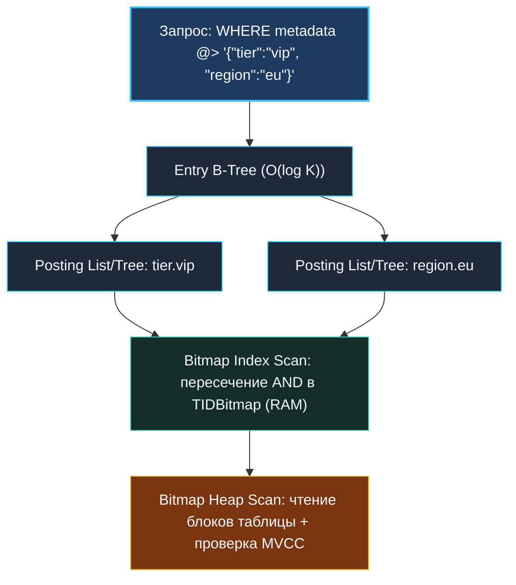

*Почему B-Tree бессилен против `JSONB`, массивов и диапазонов, как устроен `GIN` в `idx_accounts_metadata_gin` из `002_indexes.sql`, почему `gin_pending_list` даёт скачок задержек и как `GiST` с `EXCLUDE USING gist` защищает временные интервалы.*

> «В идеальном мире прикладному программисту достаточно знать только API — без того, как этот API реализован и к какому железу он обращается. В реальности же чуть более глубокие знания порой оказываются весьма кстати.»  
> — Чарльз Петцольд, *Code* (2-е изд.)

В таблице `accounts` схемы `LedgerPulse` рядом со строгими финансовыми колонками живёт поле `metadata JSONB` ([[8. JSON и JSONB в SQL]], [[9. Массивы в SQL и их ограничения]]). Но стоит начать фильтровать по вложенным ключам `metadata @> '{"tier": "vip"}'`, искать транзакции по тегам `tags @> ARRAY['cross_border']` или проверять пересечение периодов лимитов `valid_during && $1::tstzrange`, и привычный B-Tree индекс оказывается бессилен.

B-Tree трактует колонку как неделимый скаляр и требует строгого линейного порядка (`<`, `=`, `>`). Он не умеет искать вхождение элемента в массив или документ, а двумерные границы интервала `(lower, upper)` не сводятся к одномерному дереву при проверке пересечения `&&`. Для таких задач PostgreSQL предлагает два специализированных движка — **GIN** и **GiST**.

---

## GIN: обобщённый инвертированный индекс

**GIN (*Generalized Inverted Index*)** — инвертированный индекс для составных значений, раскладываемых на отдельные элементы (ключи/пути JSONB, элементы массивов, лексемы `tsvector`). Его точная аналогия — **предметный указатель в конце книги**: вместо чтения 1 000 страниц вы находите термин `fork` в алфавитном списке и сразу получаете отсортированный список страниц `[42, 115, 203, 780]`.

В ядре PostgreSQL (`src/include/access/gin_private.h`) GIN устроен как двухуровневая структура:
1. **`GinMetaPageData`:** мета-страница конфигурации и ссылок на корень.
2. **`Entry Tree`:** B-Tree по отсортированным уникальным элементам (ключам). Поиск элемента идёт за $O(\log K)$.
3. **`Posting List`:** для редких элементов — компактный отсортированный список адресов строк (`ctid`) прямо в листе `Entry Tree`.
4. **`Posting Tree`:** если элемент встречается в миллионах строк (например, `"tier": "basic"`), его список `ctid` выносится в **отдельное внутреннее B-Tree дерево** по самим `ctid`, не давая пересечению списков деградировать в линейный перебор.
5. **`gin_pending_list`:** буфер отложенных вставок (`fastupdate = on` по умолчанию).

Поиск идёт в три этапа: извлечение элементов из фильтра → спуск в `Entry Tree` за posting lists/trees → объединение или пересечение `ctid` в оперативной памяти через битовую карту (`Bitmap Index Scan` → `Bitmap Heap Scan`, [[4. Bitmap-индекс и Bitmap Index Scan]]).



---

## `JSONB` и `idx_accounts_metadata_gin` из `002_indexes.sql`

В миграции `project/sql/migrations/002_indexes.sql` индекс для `accounts.metadata` создан с классом операторов **`jsonb_path_ops`**:

```sql
-- GIN-индекс для фильтрации по JSONB-метаданным счетов (например, тариф или регион)
CREATE INDEX IF NOT EXISTS idx_accounts_metadata_gin
    ON accounts USING GIN (metadata jsonb_path_ops);
```

Для GIN над `JSONB` существуют два класса операторов:
* **`jsonb_ops` (по умолчанию):** индексирует каждый ключ и каждое значение отдельно; поддерживает все операторы (`@>`, `?`, `?|`, `?&`), но сильно раздувает индекс и замедляет запись.
* **`jsonb_path_ops`:** хеширует полную цепочку пути от корня до значения в 32-битный хеш (например, путь `limits.tier.vip`). Поддерживает **только оператор включения `@>`** (и `jsonpath`-операторы `@?`, `@@`), зато весит в **2–5 раз меньше** `jsonb_ops` и быстрее фильтрует документы. Редкие хеш-коллизии отсекает шаг `Recheck Cond` при чтении кучи.

Поскольку `LedgerPulse` фильтрует счета через включение `metadata @> '{"tier": "vip"}'::jsonb`, выбор `jsonb_path_ops` в `002_indexes.sql` напрямую экономит память `Shared Buffers`.

> [!warning] Ловушка: функциональный B-Tree вместо GIN
> Если сервис всегда фильтрует только по одному конкретному полю (`WHERE metadata->>'tier' = 'vip'`) или по числовому диапазону (`>`), GIN избыточен (а для `->>` вообще не сработает). Гораздо компактнее и быстрее будет **индекс по выражению** `CREATE INDEX idx_accounts_tier ON accounts ((metadata->>'tier'));` ([[7. Частичные (Partial) индексы и индексы по выражениям]]).

---

## Массивы и расширение `intarray`

Массивы (`TEXT[]`, `INTEGER[]`) индексируются GIN для операторов `@>` (содержит), `<@` (входит в) и `&&` (имеет общие элементы):

```sql
ALTER TABLE transactions ADD COLUMN IF NOT EXISTS tags TEXT[] NOT NULL DEFAULT '{}';
CREATE INDEX idx_transactions_tags_gin ON transactions USING GIN (tags);

SELECT id, reference_id FROM transactions WHERE tags @> ARRAY['cross_border', 'high_risk'];
```

> [!tip] Собеседование [Middle]
> **Вопрос:** Почему для колонки `category_ids INTEGER[]` расширение `intarray` с классом `gin__int_ops` эффективнее стандартного GIN по умолчанию?
>
> **Ответ:** Стандартный класс `array_ops` полиморфный — он работает с любым типом через обобщённые функции. Специализированный `gin__int_ops` из `intarray` оптимизирован под 4-байтовые целые (`int4`): использует сжатые битовые структуры и прямое сравнение машинных слов CPU без полиморфного оверхеда. Индекс получается на 30–50% компактнее и быстрее (ценой запрета `NULL`-элементов внутри массива).

---

## GiST: диапазоны, `EXCLUDE` и сигнатурные деревья

**GiST (*Generalized Search Tree*)** — расширяемый каркас сбалансированных деревьев, где внутренние узлы хранят обобщающие предикаты поддерева: охватывающие прямоугольники (R-Tree), битовые сигнатуры Блума (для `JSONB`) или объемлющие интервалы `[min_lower, max_upper]`.

В `LedgerPulse` главная суперсила GiST — **типы диапазонов (`TSTZRANGE`, `INT8RANGE`) и ограничения исключения (`EXCLUDE USING gist`)**. Обычный `UNIQUE` не запретит пересекающиеся интервалы действия лимитов, а GiST решает это на уровне движка (с расширением `btree_gist`, позволяющим сочетать `=` для `BIGINT` и `&&` для `TSTZRANGE`):

```sql
CREATE EXTENSION IF NOT EXISTS btree_gist;

CREATE TABLE account_limit_windows (
    id           BIGINT GENERATED ALWAYS AS IDENTITY PRIMARY KEY,
    account_id   BIGINT    NOT NULL REFERENCES accounts(id),
    valid_during TSTZRANGE NOT NULL CHECK (NOT isempty(valid_during)),
    daily_limit  BIGINT    NOT NULL CHECK (daily_limit > 0),
    EXCLUDE USING gist (account_id WITH =, valid_during WITH &&)
);
```

Теперь ни две конкурирующие горутины, ни пакетная миграция не смогут вставить перекрывающиеся лимиты на один счёт, а запрос `WHERE account_id = $1 AND valid_during @> $2::timestamptz` выполнится через `Index Scan` по этому же GiST-индексу.

Для `JSONB` GiST применяется реже GIN: он обновляется быстрее при частых мутациях (пересчитывается одна битовая сигнатура к корню вместо десятков posting lists, меньше WAL), но коллизии битовых масок вызывают ложные срабатывания и обязательный `Recheck` по страницам таблицы.

---

## Физика дисков, `fastupdate` и MySQL

1. **Write Amplification в GIN:** вставка 80-ключевого JSONB-документа без буферизации потребовала бы до 80 спусков в `Entry Tree`, обновлений posting lists и записей в WAL.
2. **Скачки p99 из-за `fastupdate = on`:** по умолчанию вставки в GIN складываются в плоский буфер `gin_pending_list`. Но при чтении его приходится просматривать линейно, а как только буфер достигает `gin_pending_limit` (**4 МБ**), **очередной случайный `INSERT` клиента «залипает»**, синхронно сбрасывая тысячи записей в основное дерево. Для систем со строгим SLA задержки задают `WITH (fastupdate = off)` или уменьшают `gin_pending_limit`.
3. **Давление на `Shared Buffers`:** широкий GIN на `JSONB` легко весит в 2–4 раза больше таблицы; при нехватке RAM запросы уходят в Random I/O (~100 мкс на NVMe SSD).

В **MySQL / InnoDB** нет аналога GIN/GiST: используют хранимые генерируемые столбцы (`GENERATED ALWAYS AS ... STORED`) с B-Tree индексом, а с MySQL **8.0.17** — многозначные индексы (`CAST(data->'$.tags' AS CHAR(32) ARRAY)`) для `JSON_CONTAINS`, `MEMBER OF()` и `JSON_OVERLAPS`.

---

## Практический пример: фильтрация по `JSONB` в Go 1.24

```go
package accounts

import (
	"context"
	"database/sql"
	"encoding/json"
	"fmt"
)

type AccountHit struct {
	ID         int64
	ExternalID string
	Currency   string
}

func FindAccountsByMetadataFilter(
	ctx context.Context,
	db *sql.DB,
	filter map[string]any,
	limit int,
) ([]AccountHit, error) {
	payload, err := json.Marshal(filter)
	if err != nil {
		return nil, fmt.Errorf("marshal metadata filter: %w", err)
	}

	// Явное приведение $1::jsonb обязательно для работы оператора @> и GIN-индекса.
	const query = `
		SELECT id, external_id, currency
		FROM accounts
		WHERE metadata @> $1::jsonb
		  AND status = 'active'
		ORDER BY id
		LIMIT $2;`

	rows, err := db.QueryContext(ctx, query, string(payload), limit)
	if err != nil {
		return nil, fmt.Errorf("query accounts by metadata: %w", err)
	}
	defer rows.Close()

	out := make([]AccountHit, 0, limit)
	for rows.Next() {
		var h AccountHit
		if err := rows.Scan(&h.ID, &h.ExternalID, &h.Currency); err != nil {
			return nil, fmt.Errorf("scan account hit: %w", err)
		}
		out = append(out, h)
	}
	return out, rows.Err()
}
```

Вывод `EXPLAIN (ANALYZE, BUFFERS)` подтверждает работу `idx_accounts_metadata_gin`:

```text
Bitmap Heap Scan on accounts  (cost=12.04..15.80 rows=50 width=44)
  Recheck Cond: (metadata @> '{"tier": "vip"}'::jsonb)
  Filter: (status = 'active'::text)
  ->  Bitmap Index Scan on idx_accounts_metadata_gin  (cost=0.00..12.03 rows=52 width=0)
        Index Cond: (metadata @> '{"tier": "vip"}'::jsonb)
```

> [!tip] Собеседование [Senior/Staff]
> **Вопрос:** На таблице с `JSONB` и GIN-индексом раз в несколько минут p99 задержки `INSERT` подскакивает до 400 мс при низкой средней загрузке диска. В чём причина и как её убрать?
>
> **Ответ:** Переполнение `gin_pending_list` при включённом `fastupdate = on`. Достигнув `gin_pending_limit` (4 МБ), очередной клиентский `INSERT` синхронно перекладывает накопленный буфер в `Entry Tree` и `Posting Trees`. Лечение: переключить индекс в `fastupdate = off` (стабильная запись без пиков), либо уменьшить `gin_pending_limit` и агрессивнее настроить `autovacuum`, либо перейти на `jsonb_path_ops` / узкий функциональный B-Tree.

---

## Упражнения

### Упражнение 1 (Базовое)
Для `idx_accounts_metadata_gin` (`USING GIN (metadata jsonb_path_ops)`) определите, какие запросы используют индекс, а какие пойдут в `Seq Scan`:
1. `SELECT id FROM accounts WHERE metadata @> '{"region": "eu", "kyc": {"level": 2}}'::jsonb;`
2. `SELECT id FROM accounts WHERE metadata ? 'region';`
3. `SELECT id FROM accounts WHERE metadata->>'region' = 'eu';`
4. `SELECT id FROM accounts WHERE metadata @? '$.limits.daily ? (@ > 100000)';`

> [!solution] Показать решение
> 1. **GIN (`jsonb_path_ops`):** оператор включения `@>` поддерживается на любой глубине.
> 2. **`Seq Scan`:** проверка наличия ключа `?` не поддерживается `jsonb_path_ops` (требует `jsonb_ops`).
> 3. **`Seq Scan`:** `->>` не индексируется GIN; нужно `@>` или функциональный B-Tree на `(metadata->>'region')`.
> 4. **GIN (`jsonb_path_ops`):** в PostgreSQL 12+ `jsonb_path_ops` ускоряет часть предикатов `jsonpath` с `@?` и `@@`.

### Упражнение 2 (Практическое)
В `LedgerPulse` нужна таблица `fee_schedules` со ставками комиссий `rate_bps` для пары `(kind, currency)` на интервале `valid_during TSTZRANGE`. Напишите DDL с ограничением, запрещающим наложение двух ставок во времени для одной пары `(kind, currency)`, и покажите запрос поиска ставки на момент `$3`.

> [!solution] Показать решение
> ```sql
> CREATE EXTENSION IF NOT EXISTS btree_gist;
>
> CREATE TABLE fee_schedules (
>     id           BIGINT GENERATED ALWAYS AS IDENTITY PRIMARY KEY,
>     kind         TEXT      NOT NULL CHECK (kind IN ('transfer', 'deposit', 'withdrawal', 'fee')),
>     currency     CHAR(3)   NOT NULL CHECK (currency ~ '^[A-Z]{3}$'),
>     valid_during TSTZRANGE NOT NULL CHECK (NOT isempty(valid_during)),
>     rate_bps     INTEGER   NOT NULL CHECK (rate_bps >= 0),
>     EXCLUDE USING gist (kind WITH =, currency WITH =, valid_during WITH &&)
> );
>
> SELECT rate_bps
> FROM fee_schedules
> WHERE kind = $1 AND currency = $2 AND valid_during @> $3::timestamptz;
> ```
> При попытке вставить пересекающийся период PostgreSQL отклонит транзакцию с кодом `23P01` (`exclusion_violation`).

### Упражнение 3 (Со звёздочкой `*`)
В таблице `accounts` 10 млн строк: у 80% в `metadata` есть `{"tier": "basic"}`, а `"partner_code": "acme"` встречается лишь у 5 000 строк. Объясните на уровне `Entry Tree`, `Posting List`, `Posting Tree` и `TIDBitmap`, почему `WHERE metadata @> '{"tier": "basic", "partner_code": "acme"}'::jsonb` выполняется быстро, и почему под нагрузкой на запись `jsonb_path_ops` переносит этот сценарий ощутимо легче, чем `jsonb_ops`.

> [!solution] Показать решение
> 1. По `Entry Tree` находятся `Posting List` для `partner_code.acme` (~5 000 `ctid`) и гигантское `Posting Tree` для `tier.basic` (8 млн `ctid`). Пересечение (`AND`) отбрасывает всё, чего нет в коротком списке (~5 000 кандидатов), поэтому `Bitmap Heap Scan` читает лишь малую долю страниц таблицы.
> 2. При вставке документа из 10 полей `jsonb_ops` добавляет до 20 ключей/значений в `gin_pending_list`, а `jsonb_path_ops` — только 10 компактных 32-битных хешей путей. Буфер заполняется вдвое реже, а `VACUUM` тратит вдвое меньше I/O на обновление `Posting Tree`.

---

## Мостик к следующему уроку

Мы собрали полный инструментарий индексов: B-Tree, Hash, Bitmap, составные, покрывающие, частичные, функциональные, GIN и GiST. Но добавление каждого нового индекса стоит места в памяти и процессорного времени при записи. В следующей главе — «9. Когда индекс вреден — цена записи, раздувание и ложная селективность» — разберём *Write Amplification*, блокировку HOT и поиск неиспользуемых индексов.
