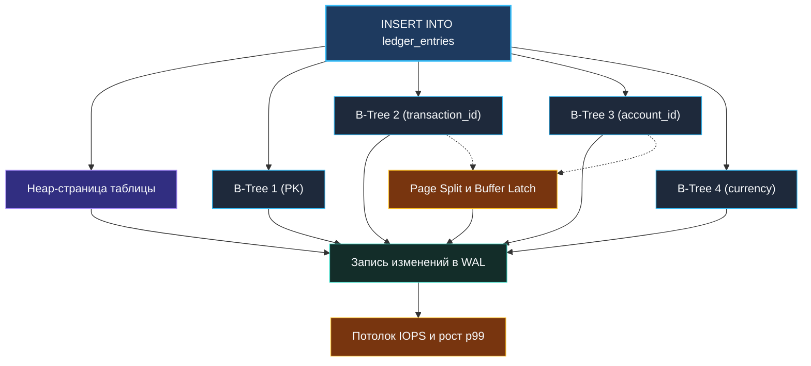

*Почему лишний индекс замедляет запись, вымывает буферный кэш, отключает HOT-оптимизацию и как безопасно находить и удалять индексный балласт в PostgreSQL и Go.*

> «О продуктивности программистов иногда судят по числу написанных строк кода; в мире Unix её нередко измеряли числом особых случаев или строк кода, которые удалось удалить.»  
> — Брайан Керниган

Среди разработчиков, привыкших к ORM, держится заблуждение: «Запрос тормозит — добавь индекс. Запросов много — проиндексируй все поля». Со стороны абстракции индекс кажется бесплатным ускорителем, который включается одной миграцией.

В системах хранения бесплатных ускорений нет. Индекс — отдельная структура на диске и в RAM, которая мутирует при каждой записи. Создавая индекс, вы выигрываете миллисекунды на чтении, но платите процессором, операциями ввода-вывода (IOPS) и буферным кэшем при каждом изменении данных. **Переизбыток индексов парализует OLTP-систему быстрее, чем их нехватка.**

---

## Цена записи и Write Amplification

Пока сервис только читает, индексы приносят пользу. Но в `LedgerPulse` таблицы `ledger_entries` и `transactions` принимают тысячи вставок в секунду. Когда Go-код выполняет простую вставку:

```sql
INSERT INTO ledger_entries (transaction_id, account_id, amount, currency)
VALUES (1042, 77, -15000, 'RUB');
```

при 5 индексах на таблице PostgreSQL делает каскад операций:

1. Пишет кортеж в 8-КБ страницу кучи (**Heap Page**).
2. В **каждом из 5 индексов** спускается к листовой странице B-Tree (при промахе мимо кэша: ~100 мкс на NVMe или ~10 мс на HDD против ~100 нс в RAM).
3. Вставляет ключ и указатель `ctid`.
4. При переполнении листа выполняет **Page Split** и обновляет родительские узлы (см. [[2. B-Tree индекс под капотом — страницы, ветвление и page split]]).
5. Пишет изменения всех затронутых страниц в журнал **WAL** (его разберём в следующем модуле).

Один логический `INSERT` превращается в 6–10 модификаций страниц и сотни байт в WAL — классическое **усиление записи (Write Amplification)**.



> [!info] Под капотом: Buffer Latches при Page Split
> Расщепление страницы требует кратковременной эксклюзивной блокировки в памяти (**Buffer Content Lock / Latch**). Пока лист делится пополам и перелинковывается с соседом, параллельные транзакции ждут освобождения узла (**Contention**), вызывая всплески задержек `p99`.

### Нагрузка на железо в цифрах

Пусть микросервис пишет 10 000 строк в секунду в таблицу с 6 индексами. Каждая вставка меняет минимум 7 страниц по 8 КБ (1 Heap + 6 листьев B-Tree), не считая сплитов и `full_page_writes`:

$$\text{Поток страниц} = 10\,000 \times 7 \times 8\text{ КБ} \approx 560\text{ МБ/с}$$

Такой поток упирается в предел SATA/SAS SSD. Причём если в Heap строки дописываются в конец файла, то вставки во вторичные B-Tree бьют в **случайные страницы**. Контроллер захлёбывается в Random IOPS; удалив 4 лишних индекса, вы втрое разгружаете диски.

---

## Вымывание буферного кэша

Память под кэш страниц (`shared_buffers` в PostgreSQL, `innodb_buffer_pool_size` в MySQL InnoDB) строго ограничена. Если таблица занимает 10 ГБ, а шесть её индексов — ещё 15 ГБ, рабочее множество вырастает до 25 ГБ.

Страницы редких индексов при каждой записи **вытесняют горячие страницы таблицы и нужных B-Tree**. Падает **Cache Hit Ratio**, каждый промах вызывает системный вызов `pread()`, процессор простаивает в `iowait`, а задержки API растут на порядки.

---

## Неиспользуемые индексы и ловушка `idx_scan = 0`

Индексы часто остаются после старых фич или разовых выгрузок. Код их не читает, а СУБД исправно обновляет их при каждой записи. В PostgreSQL обращения учитывает `pg_stat_user_indexes` (`idx_scan`, `idx_tup_read`, `idx_tup_fetch`):

```sql
SELECT
    schemaname,
    relname                                       AS table_name,
    indexrelname                                  AS index_name,
    idx_scan,
    pg_size_pretty(pg_relation_size(indexrelid))  AS index_size
FROM pg_stat_user_indexes
WHERE idx_scan = 0
  AND indexrelname NOT LIKE '%pkey'
ORDER BY pg_relation_size(indexrelid) DESC;
```

> [!warning] Ловушка: `idx_scan = 0` требует проверки
> 1. **Ограничения целостности (`UNIQUE`, `PRIMARY KEY`).** Индекс под `accounts_external_id_key` может иметь `idx_scan = 0`, если по нему не делают `SELECT`, но он запрещает дубликаты при вставке. Всегда фильтруйте `NOT indisunique AND NOT indisprimary`.
> 2. **Редкие регламентные отчёты.** Индекс может требоваться раз в месяц или квартал для биллинга. Если статистику сбрасывали (`pg_stat_reset()`), `idx_scan` обнулится; проверяйте статистику на горизонте не короче бизнес-цикла, включая читающие реплики.

---

## Ложная селективность и дубликаты индексов

### Низкая селективность

Допустим, в таблице `ledger_entries` 10 млн строк, и половина имеет `currency = 'RUB'`. Для запроса `WHERE currency = 'RUB'` обычный B-Tree собрал бы 5 млн указателей `ctid` и породил миллионы случайных прыжков по Heap. Оптимизатор (см. [[11. Стоимостной оптимизатор (Cost-Based Optimizer)]]) отклоняет такой индекс и выбирает линейный `Seq Scan` с упреждающим чтением ядра Linux (**Read-Ahead**). Полный B-Tree на полях вроде `boolean`, `gender` или `currency` почти не работает на чтение, принося чистый убыток. Если же нужен редкий срез (например, 1% строк `status = 'pending'`), выручает компактный частичный индекс из [[7. Частичные (Partial) индексы и индексы по выражениям]], как в `002_indexes.sql`.

### Дублирующие и перекрывающиеся индексы

1. **Поглощение левым префиксом.** В `002_indexes.sql` есть `idx_ledger_entries_account_created` на `(account_id, created_at DESC, id DESC) INCLUDE (...)`. Отдельный индекс на `(account_id)` избыточен: ведущий столбец закрывает те же запросы (см. [[5. Составные (Composite) индексы и правило левого префикса]]).
2. **Перестановки `(a, b)` и `(b, a)`.** Оба оправданы лишь при независимых частых запросах по каждому ведущему полю.
3. **Повтор поверх `PK`/`UNIQUE`.** Отдельный индекс на `accounts(id)` или `transactions(reference_id)` дублирует уникальный B-Tree.

Поиск префиксных дублей через каталог `pg_index` (для системного аудита и кросс-анализа телеметрии также применяют аналитические расширения вроде `pg_duckdb`):

```sql
SELECT
    a.indrelid::regclass   AS table_name,
    a.indexrelid::regclass AS redundant_index,
    b.indexrelid::regclass AS covering_index
FROM pg_index AS a
JOIN pg_index AS b
  ON a.indrelid = b.indrelid AND a.indexrelid <> b.indexrelid
 AND a.indisvalid AND b.indisvalid
WHERE NOT a.indisprimary AND NOT a.indisunique
  AND a.indpred IS NULL AND b.indpred IS NULL
  AND (b.indkey::int2[])[0:array_length(a.indkey::int2[], 1) - 1] = a.indkey::int2[];
```

---

## Часто обновляемые колонки, Index Bloat и убийство HOT

В модели MVCC `UPDATE` создаёт новую версию кортежа. Если обновляемое поле (например, `accounts.updated_at` или `accounts.balance`) входит в индекс, система теряет дважды:

1. **Раздувание индекса (Index Bloat).** Листья B-Tree засоряются мёртвыми ссылками и переживают частые `Page Split`.
2. **Блокировка HOT (Heap-Only Tuples).** Когда `UPDATE` меняет только *неиндексируемые* поля и на странице хватает места, новая версия ложится рядом со старой, а **индексы не трогаются вовсе**. Стоит проиндексировать `updated_at` — и HOT отключается для всей таблицы: каждый `UPDATE balance` переписывает все индексы строки.

Раздувание лечат фоновым `REINDEX INDEX CONCURRENTLY`, онлайн-утилитой `pg_repack` или блокирующим `VACUUM FULL` (неприменимым в проде). Кроме того, обилие индексов тормозит работу `VACUUM`: биты в карте видимости (**Visibility Map**) обновляются с задержкой, и `Index-Only Scan` ([[6. Покрывающие (Covering) индексы, INCLUDE и Index-Only Scan]]) деградирует в `Index Scan` с лавиной `Heap Fetches`.

---

## Блокировки при создании и статус `INVALID`

Команда `CREATE INDEX idx_tx_kind ON transactions (kind);` берёт блокировку `ShareLock`, запрещая любые `INSERT`/`UPDATE`/`DELETE` на всё время построения — пул Go быстро исчерпает соединения. В проде используют только неблокирующий режим:

```sql
CREATE INDEX CONCURRENTLY idx_tx_kind ON transactions (kind);
DROP INDEX CONCURRENTLY IF EXISTS idx_tx_kind;
```

`CONCURRENTLY` строит индекс за два прохода вне явной транзакции `BEGIN ... COMMIT`. Если построение оборвётся из-за ошибки или дедлока, индекс останется в статусе **`INVALID`** (`pg_index.indisvalid = false`): он **замедляет запись, но игнорируется при чтении**.

---

## Аудит в Go и стратегия очистки

Для поиска узких мест сочетают `pg_stat_statements` (`shared_blks_read`), `pg_stat_user_indexes`, `pg_statio_user_indexes`, `log_min_duration_statement = '250ms'` и `pg_qualstats`. В Go-сервис удобно встроить проверку на невалидные и мёртвые индексы:

```go
package main

import (
	"context"
	"database/sql"
	"fmt"

	_ "github.com/jackc/pgx/v5/stdlib"
)

type SuspectIndex struct {
	TableName string
	IndexName string
	Size      string
	Scans     int64
	IsValid   bool
}

func AuditSuspectIndexes(ctx context.Context, db *sql.DB) ([]SuspectIndex, error) {
	const query = `
		SELECT s.relname, s.indexrelname,
		       pg_size_pretty(pg_relation_size(s.indexrelid)),
		       s.idx_scan, i.indisvalid
		FROM pg_stat_user_indexes AS s
		JOIN pg_index AS i ON i.indexrelid = s.indexrelid
		WHERE s.schemaname = 'public'
		  AND NOT i.indisprimary AND NOT i.indisunique
		  AND (NOT i.indisvalid OR s.idx_scan = 0)
		ORDER BY i.indisvalid ASC, pg_relation_size(s.indexrelid) DESC;`

	rows, err := db.QueryContext(ctx, query)
	if err != nil {
		return nil, fmt.Errorf("audit suspect indexes: %w", err)
	}
	defer rows.Close()

	var result []SuspectIndex
	for rows.Next() {
		var idx SuspectIndex
		if err := rows.Scan(&idx.TableName, &idx.IndexName, &idx.Size, &idx.Scans, &idx.IsValid); err != nil {
			return nil, fmt.Errorf("scan suspect index: %w", err)
		}
		result = append(result, idx)
	}
	return result, rows.Err()
}
```

### Чек-лист безопасного удаления

1. Проверьте `idx_scan` за 2–4 недели на primary и репликах.
2. Исключите `PRIMARY KEY` и `UNIQUE`; сразу удаляйте `INVALID`-индексы.
3. Замените широкие индексы на узкие частичные (`WHERE status = 'pending'`).
4. Удаляйте через `DROP INDEX CONCURRENTLY`.
5. Наблюдайте за CPU, IOPS и `p99` 48 часов после удаления.

> [!tip] Собеседование [Middle]: индексирование append-only таблиц
> **Вопрос:** Сервис аудита на Go вставляет 50 000 строк/с в PostgreSQL, а читает их только при разборе инцидентов по времени. Какой набор индексов оптимален?
>
> **Ответ:** Минимальный. Оставляют суррогатный `PRIMARY KEY` и компактный индекс **BRIN** (*Block Range Index*) по `created_at`. BRIN хранит только `min`/`max` для диапазонов физических страниц, занимает в сотни раз меньше памяти, чем B-Tree, почти не расходует IOPS при вставке и быстро отсекает лишние гигабайты при фильтрации по времени.

---

## Упражнения

### Упражнение 1 (Базовое). Аудит индексов `LedgerPulse`

Напишите SQL-запрос к `pg_stat_user_indexes` и `pg_index`, выводящий индексы схемы `public` с `idx_scan < 10`, их размер в байтах, `indisvalid` и флаг частичности (`indpred IS NOT NULL`), исключая `PRIMARY KEY` и `UNIQUE`.

> [!solution] Показать решение
> ```sql
> SELECT
>     s.relname AS table_name,
>     s.indexrelname AS index_name,
>     s.idx_scan,
>     pg_relation_size(s.indexrelid) AS size_bytes,
>     i.indisvalid,
>     (i.indpred IS NOT NULL) AS is_partial
> FROM pg_stat_user_indexes AS s
> JOIN pg_index AS i ON i.indexrelid = s.indexrelid
> WHERE s.schemaname = 'public'
>   AND s.idx_scan < 10
>   AND NOT i.indisprimary
>   AND NOT i.indisunique
> ORDER BY size_bytes DESC;
> ```
> Фильтр `NOT i.indisprimary AND NOT i.indisunique` защищает ограничения целостности вроде `accounts.external_id` и `transactions.reference_id`.

### Упражнение 2 (Практическое). Восстановление HOT-оптимизации

На таблицу `accounts` повесили `CREATE INDEX idx_accounts_updated_at ON accounts (updated_at);`. Скорость обновлений баланса упала, `pg_stat_user_tables.n_tup_hot_upd` перестал расти. Удалите индекс безопасно и напишите запрос контроля доли HOT-обновлений.

> [!solution] Показать решение
> Поскольку триггер обновляет `updated_at` при каждом изменении `balance`, индекс на `updated_at` полностью отключил HOT. Лечение:
> ```sql
> DROP INDEX CONCURRENTLY IF EXISTS idx_accounts_updated_at;
>
> SELECT relname, n_tup_upd, n_tup_hot_upd,
>        round(100.0 * n_tup_hot_upd / NULLIF(n_tup_upd, 0), 2) AS hot_pct
> FROM pg_stat_user_tables
> WHERE relname = 'accounts';
> ```

### Упражнение 3 (\*). Детектор невалидных индексов в Go

Доработайте `AuditSuspectIndexes`, добавив функцию `CheckInvalidIndexes(ctx context.Context, db *sql.DB) error`, которая возвращает ошибку с готовой командой `DROP INDEX CONCURRENTLY`, если найден индекс с `!idx.IsValid`.

> [!solution] Показать решение
> ```go
> func CheckInvalidIndexes(ctx context.Context, db *sql.DB) error {
> 	suspects, err := AuditSuspectIndexes(ctx, db)
> 	if err != nil {
> 		return err
> 	}
> 	var broken []string
> 	for _, idx := range suspects {
> 		if !idx.IsValid {
> 			broken = append(broken, fmt.Sprintf("DROP INDEX CONCURRENTLY IF EXISTS %s;", idx.IndexName))
> 		}
> 	}
> 	if len(broken) > 0 {
> 		return fmt.Errorf("invalid indexes detected: %v", broken)
> 	}
> 	return nil
> }
> ```

---

## Мостик к следующему уроку

Мы выяснили, почему лишние индексы замедляют запись и отключают HOT. Но как убедиться, что нужный индекс реально используется при чтении и сколько страниц поднято с диска? Для этого откроем рентген запросов: [[10. План выполнения запроса — читаем EXPLAIN ANALYZE BUFFERS]].
