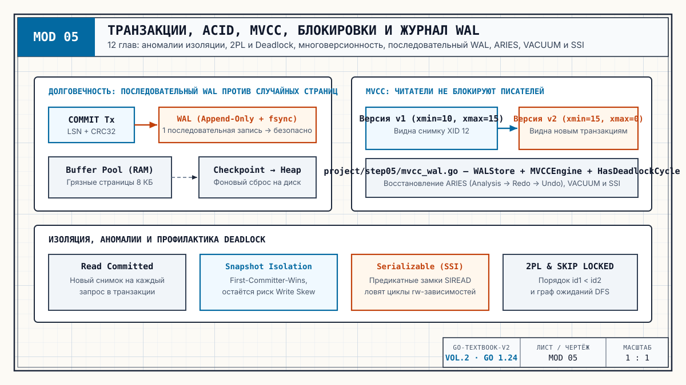

*Двенадцать глав о внутреннем устройстве транзакций: от гарантий ACID и аномалий конкурентности до блокировок, MVCC, журнала WAL, алгоритма ARIES, VACUUM и сериализуемости SSI в `project/step05/`.*

> «Мы пишем, а позже читаем. Сохраняем, а позже извлекаем. Храним, а позже обращаемся к сохранённому. Назначение памяти — уберечь информацию без искажений между двумя этими событиями. Стоит отключить питание — и энергозависимая память забывает всё, что когда-либо знала.»  
> — Чарльз Петцольд, *Code: The Hidden Language of Computer Hardware and Software*

## Что нужно знать до старта

* **Модули 1–4:** таблица `LedgerPulse` (`accounts`, `transactions`, `ledger_entries`), 8-КБ страницы, `Buffer Pool`, `ctid`, B-Tree индексы и `EXPLAIN (ANALYZE, BUFFERS)`.
* **Том 1, Модуль 5:** представление о системных вызовах `write`/`fsync`, кэше страниц ОС (Page Cache) и гонках данных.

## Что вы соберёте в этом разделе

* **Безопасную конкурентность данных** — разберёте четыре свойства ACID, уровни изоляции, аномалии (`Dirty Read`, `Phantom Read`, `Lost Update`, `Write Skew`), оптимистичные и пессимистичные блокировки (`FOR UPDATE`, `SKIP LOCKED`), а также профилактику взаимоблокировок (`Deadlock`).
* **Понимание движка хранения под капотом** — увидите, как многоверсионность (MVCC) избавляет читателей от блокировки писателей, почему последовательная запись в WAL с `fsync` быстрее случайных правок Heap, как контрольные точки (`Checkpointing`) и алгоритм ARIES восстанавливают базу после отключения питания, и зачем нужен `VACUUM`.
* **Работающий мини-движок в `project/step05/mvcc_wal.go`** — разберёте на Go 1.24 append-only WAL с `CRC32` и восстановлением после сбоя, `MVCCEngine` с `Snapshot Isolation` (`First-Committer-Wins`) и графовый детектор циклов `HasDeadlockCycle`.

## Карта раздела

1. [[1. ACID — четыре гарантии транзакции без иллюзий]] — атомарность, согласованность (ответственность приложения и схемы), изоляция и долговечность (`fsync`).
2. [[2. Транзакции и уровни изоляции — зачем ослаблять строгий порядок]] — цена полной сериализации и компромисс между пропускной способностью и строгостью.
3. [[3. Read Committed, Repeatable Read и Serializable]] — как ведут себя уровни изоляции в PostgreSQL и стандарте SQL, и где `READ UNCOMMITTED` не существует физически.
4. [[4. Аномалии — Dirty Read, Phantom Read, Lost Update и Write Skew]] — пошаговые таймлайны каждой аномалии на переводах `LedgerPulse` и как не потерять списание баланса.
5. [[5. Блокировки (Locking) — 2PL, SELECT FOR UPDATE и SKIP LOCKED]] — двухфазная блокировка, гранулярность замков, очереди задач в SQL через `SKIP LOCKED` и оптимистичные версии.
6. [[6. Взаимоблокировки (Deadlock) — граф ожиданий и предотвращение]] — цикл ожиданий, канонический порядок захвата строк (`id1 < id2`) и детектор `HasDeadlockCycle` из `project/step05/`.
7. [[7. MVCC — многоверсионный контроль конкурентности]] — цепочки версий строк, мгновенные снимки и почему читатели не ждут писателей.
8. [[8. WAL — журнал упреждающей записи и долговечность на диске]] — физика последовательного ввода-вывода, LSN, `fsync`, групповой коммит и разбор `WALStore` из `project/step05/`.
9. [[9. Контрольные точки (Checkpointing) и сброс грязных страниц]] — как база ограничивает время восстановления после сбоя и сглаживает всплески записи (`checkpoint_completion_target`).
10. [[10. Восстановление после сбоя (Crash Recovery) и алгоритм ARIES]] — фазы Analysis, Redo и Undo, `full_page_writes` против порванных страниц и разбор `WALStore.recover()`.
11. [[11. VACUUM и сборка мёртвых версий кортежей]] — цена MVCC, раздувание таблиц (Bloat) и почему долгие транзакции парализуют очистку.
12. [[12. Snapshot Isolation и Serializable Snapshot Isolation (SSI)]] — правило First-Committer-Wins в `project/step05/mvcc_wal.go`, предикатные замки `SIREAD` и защита от `Write Skew`.
