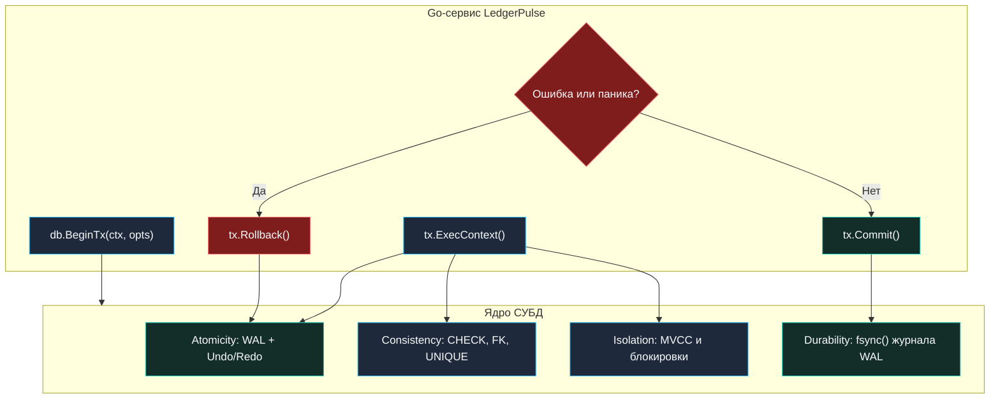
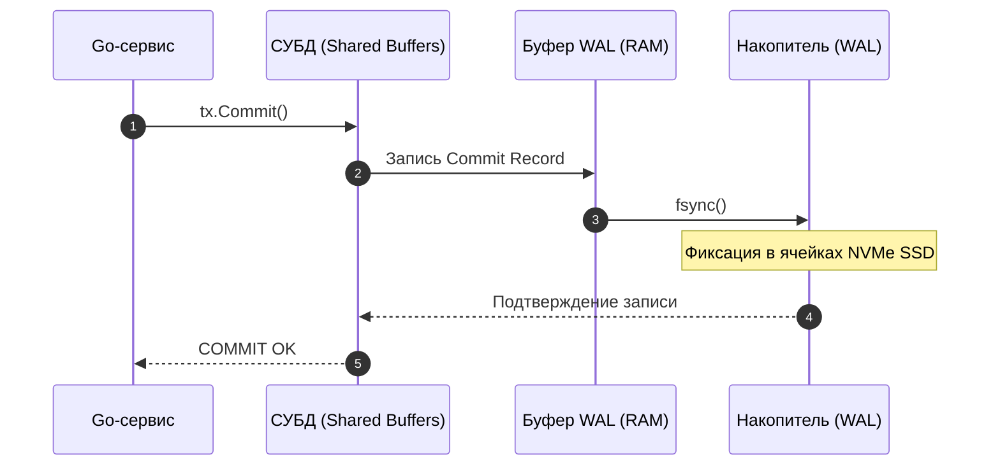

*Из чего состоят атомарность, согласованность, изоляция и долговечность — от `fsync` и счётчика LSN до безопасной транзакции на Go в `LedgerPulse`.*

> «Любая функция ввода-вывода обязана считаться с вероятностью сбоя, и лишь наивный программист верит, что простое чтение или запись не могут завершиться ошибкой. Именно тогда, когда внезапно отказывают самые надёжные операции, нам нужнее всего знать почему.»  
> — Алан Донован и Брайан Керниган, *The Go Programming Language*

Когда сервис `LedgerPulse` переводит средства между счетами, приложение неявно заключает контракт с СУБД: при отключении питания, падении процесса или гонке горутин баланс не уйдёт в минус, а деньги не исчезнут между таблицами. Эти гарантии в конце 1970-х сформулировал Джим Грэй при создании System R в IBM, а в 1983 году Тео Хардер и Андреас Рейтер закрепили их акронимом **ACID**: **Atomicity**, **Consistency**, **Isolation**, **Durability**. Для бэкенд-инженера ACID — это инструмент предсказания отказов и расчёта цены каждой гарантии.



---

## Atomicity (Атомарность): всё или ничего

**Атомарность** объявляет транзакцию неделимой: либо применяются **все** её операции, либо **ни одна** из них не оставляет следа. Промежуточное состояние, когда списание в `accounts` уже прошло, а зачисление и проводка в `ledger_entries` не успели, никогда не становится видимым внешним запросам.

Для этого движок использует **Write-Ahead Log (WAL)** — журнал упреждающей записи (в MySQL InnoDB — связку Redo- и Undo-логов; физику журнала мы разберём в главе 8):
1. **Запись вперёд данных:** до изменения байта в буферном кэше таблиц операция попадает в WAL.
2. **Redo и Undo:** запись позволяет накатить зафиксированные изменения после сбоя и откатить незавершённые (в PostgreSQL старая версия строки остаётся на странице кучи).
3. **Точка невозврата:** запись `COMMIT` в WAL. Пока она не сброшена на диск, транзакция не считается завершённой.
4. **Crash Recovery:** при рестарте после аварии восстановление читает журнал и убирает следы незафиксированных транзакций (глава 10).

> [!info] Под капотом: LSN и `shared_buffers`
> Страницы данных по **8 КБ** в `shared_buffers` PostgreSQL несут в заголовке 64-битный монотонный счётчик **LSN (Log Sequence Number)**. Движок соблюдает правило WAL: фоновый `bgwriter` или контрольная точка (глава 9) не вытеснят грязную страницу на диск, пока запись WAL с тем же или большим LSN не сброшена в файл журнала.

### Атомарность в Go 1.24

В `database/sql` транзакцией управляет `*sql.Tx`. В `LedgerPulse` суммы хранятся в целых центах/копейках (`int64`). Чтобы ошибки бизнес-логики и паники не оставляли транзакцию открытой, используйте именованный возврат ошибки и защитный `defer`:

```go
func TransferFunds(ctx context.Context, db *sql.DB, refID string, fromID, toID, amount int64) (err error) {
	if amount <= 0 || fromID == toID {
		return errors.New("invalid transfer arguments")
	}
	tx, err := db.BeginTx(ctx, nil)
	if err != nil {
		return fmt.Errorf("begin tx: %w", err)
	}
	defer func() {
		if p := recover(); p != nil {
			_ = tx.Rollback()
			panic(p)
		} else if err != nil {
			_ = tx.Rollback()
		}
	}()

	res, err := tx.ExecContext(ctx,
		"UPDATE accounts SET balance = balance - $1, updated_at = now() WHERE id = $2 AND balance >= $1",
		amount, fromID,
	)
	if err != nil {
		return fmt.Errorf("debit: %w", err)
	}
	if n, _ := res.RowsAffected(); n == 0 {
		return errors.New("insufficient funds or source missing")
	}

	if _, err = tx.ExecContext(ctx,
		"UPDATE accounts SET balance = balance + $1, updated_at = now() WHERE id = $2",
		amount, toID,
	); err != nil {
		return fmt.Errorf("credit: %w", err)
	}

	var txRowID int64
	if err = tx.QueryRowContext(ctx,
		"INSERT INTO transactions (reference_id, kind, status) VALUES ($1, 'transfer', 'posted') RETURNING id",
		refID,
	).Scan(&txRowID); err != nil {
		return fmt.Errorf("insert tx: %w", err)
	}
	return tx.Commit()
}
```

> [!warning] Ловушка: зависшая транзакция (`idle in transaction`)
> Забытый `tx.Rollback()` на ветке раннего возврата удерживает сокет пула и оставляет сессию в состоянии `idle in transaction`. Это блокирует строки, тормозит `VACUUM` (глава 11) и исчерпывает лимит подключений. Вызов `Rollback()` после успешного `Commit()` безопасен и возвращает `sql.ErrTxDone`.

---

## Consistency (Согласованность): инварианты и ограничения

В теореме CAP (Модуль 8) *Consistency* означает линеаризуемость чтений между репликами. В ACID **согласованность** — это переход базы из одного корректного состояния в другое без нарушения правил:
* ограничений схемы (`NOT NULL`, `FOREIGN KEY`, `UNIQUE`, `CHECK` из [[7. Ограничения целостности данных — NOT NULL, UNIQUE, CHECK]]);
* триггеров (`BEFORE`/`AFTER`);
* бизнес-инвариантов (баланс неотрицателен, сумма проводок одной валюты в сделке равна нулю).

Ответственность делится на два слоя. **СУБД** проверяет декларативные правила: внешний ключ `REFERENCES accounts(id) ON DELETE RESTRICT` запретит удалить счёт с проводками, а `CHECK (balance >= 0)` не даст записать минус. При каждом `INSERT` и `UPDATE` движок тратит такты CPU на проверку типов и `CHECK`, поиск дубликатов в уникальных B-Tree индексах с защёлками узлов, проверку FK по индексу и запуск триггеров. **Go-приложение** отвечает за межстрочные и временные правила (например, суточный лимит переводов), опираясь на транзакции и блокировки.

> [!tip] Собеседование [Middle]
> **Вопрос:** Может ли транзакция успешно пройти `COMMIT`, соблюсти все ограничения БД, но нарушить согласованность данных?
> **Ответ:** Да. Если в таблице `accounts` забыли `CHECK (balance >= 0)`, а две горутины параллельно прочитали `balance = 10000` и каждая списала `8000`, на счёте окажется `-6000`. Все известные СУБД правила выполнены, но бизнес-инвариант сломан. Согласованность — результат совместной работы схемы БД и кода.

---

## Isolation (Изоляция): иллюзия одиночного выполнения

Строго последовательная очередь транзакций надёжна, но загружает только одно ядро и снижает пропускную способность в сотни раз. **Изоляция** создаёт для параллельных транзакций видимость последовательной работы. Стандарт SQL-92 ввёл четыре уровня изоляции и три базовые аномалии:
* **Dirty Read:** чтение незафиксированных данных другой транзакции, которая ещё может откатиться.
* **Non-Repeatable Read:** повторный `SELECT` той же строки внутри транзакции даёт другое значение после чужого `COMMIT`.
* **Phantom Read:** повторный запрос с тем же `WHERE` возвращает новые или исчезнувшие строки, добавленные или удалённые другой транзакцией.

| Уровень | Dirty Read | Non-Repeatable Read | Phantom Read | PostgreSQL | MySQL InnoDB |
|---|:---:|:---:|:---:|---|---|
| **Read Uncommitted** | Возможна | Возможна | Возможна | Работает как `Read Committed` | Чтение без снимков и замков |
| **Read Committed** | Защищён | Возможна | Возможна | Снимок на каждый запрос | Снимок на каждый запрос |
| **Repeatable Read** | Защищён | Защищён | Зависит от СУБД | Снимок на транзакцию (фантомов нет) | Снимок на транзакцию + Next-Key Locks |
| **Serializable** | Защищён | Защищён | Защищён | SSI (`rw`-конфликты) | Строгий 2PL и замки диапазонов |

В Go уровень изоляции передаётся через `sql.TxOptions`:

```go
tx, err := db.BeginTx(ctx, &sql.TxOptions{
	Isolation: sql.LevelRepeatableRead,
	ReadOnly:  true,
})
```

> [!warning] Ловушка: поведение драйверов
> Драйверы по-разному транслируют `sql.TxOptions`: `pgx` формирует `BEGIN ISOLATION LEVEL ...`, тогда как SQLite фактически работает в `Serializable` и игнорирует промежуточные уровни. Проверяйте поддержку в тестах с целевой СУБД.

---

## Durability (Долговечность): путь байта на диск

**Долговечность** гарантирует, что после возврата `tx.Commit()` изменения переживут отключение питания, сбой процесса и панику ядра ОС. В оперативной памяти данные доступны за ~100 нс, но при снятии напряжения энергозависимая DRAM обнуляется.

1. Изменения правят 8-КБ страницы в `shared_buffers` (PostgreSQL) или `Buffer Pool` (InnoDB), помечая их грязными (`Dirty Pages`). Сразу писать разбросанные страницы на диск нельзя: случайный ввод-вывод (Random I/O) уничтожит производительность.
2. Дельта операции пишется последовательно в буфер WAL.
3. При `Commit()` буфер WAL сбрасывается системным вызовом `fsync()` (или `fdatasync()`).
4. Ядро Linux сбрасывает кэш страниц на контроллер NVMe SSD.
5. После подтверждения от накопителя СУБД отвечает приложению `COMMIT OK`.



> [!info] Под капотом: `fsync()` и групповой коммит
> В сравнительном масштабе доступ к RAM занимает ~100 нс, `fsync()` на серверном NVMe SSD — от 50 мкс до 1 мс, а на магнитном HDD — 10–15 мс. Чтобы тысячи транзакций не встали в одиночную очередь, СУБД применяют **групповой коммит (Group Commit)**: параллельные коммиты в одном микросекундном окне объединяются в один общий `fsync()`.

В PostgreSQL долговечность настраивается параметром `synchronous_commit`: `remote_apply` (ждём реплику), `on` (ждём локальный `fsync()`, по умолчанию) и `off` (асинхронный возврат без ожидания диска). Для некритичной телеметрии в Go это можно включить локально на одну транзакцию:

```go
_, _ = tx.ExecContext(ctx, "SET LOCAL synchronous_commit TO off")
_, err = tx.ExecContext(ctx, "INSERT INTO audit_clicks (event_name) VALUES ($1)", "view")
```

> [!tip] Собеседование [Senior/Staff]
> **Вопрос:** Повредится ли база данных при внезапном отключении питания с `synchronous_commit = off`?
> **Ответ:** Нет. Атомарность и согласованность сохранятся полностью, разорванных записей не будет. Пропадут лишь целиком самые свежие уже подтверждённые транзакции за окно до сброса буфера WAL (обычно до `3 * wal_writer_delay`, около 600 мс).

---

## Устройство железа и производительность ACID

1. **Размер WAL:** гигантские транзакции на миллионы строк перегружают дисковый контроллер и канал репликации.
2. **Блокировки против MVCC:** пессимистичный `SELECT ... FOR UPDATE` вызывает ожидание горутин и риск дедлоков; MVCC не блокирует читателей, но долгие транзакции держат старые версии строк и провоцируют раздувание таблиц (**table bloat**).
3. **Пакетная запись вместо одиночных `INSERT`:** каждый `db.ExecContext` без явной транзакции — это отдельный коммит и лишний `fsync()`. Объединение вставок в одну транзакцию с `tx.PrepareContext` (или через `UNNEST`/`COPY`, см. [[16. Пакетные (Batch) запросы, UNNEST и COPY]]) сокращает число системных вызовов на порядки:

```go
tx, err := db.BeginTx(ctx, nil)
if err != nil {
	return err
}
defer func() { _ = tx.Rollback() }()

stmt, err := tx.PrepareContext(ctx,
	"INSERT INTO ledger_entries (transaction_id, account_id, amount, currency) VALUES ($1, $2, $3, $4)",
)
if err != nil {
	return err
}
defer stmt.Close()

for _, e := range entries {
	if _, err = stmt.ExecContext(ctx, e.TxID, e.AccountID, e.Amount, e.Currency); err != nil {
		return err
	}
}
return tx.Commit()
```

> [!warning] Ловушка: сеть внутри транзакции
> Никогда не вызывайте внешние HTTP API или тяжёлые расчёты между `BeginTx` и `Commit`. Таймаут внешнего шлюза удержит сокет пула, строковые замки и снимок видимости MVCC. Выносите сеть **до** старта транзакции или **после** фиксации.

---

## Границы ACID в распределённых системах

Классический ACID опирается на единый узел с общей памятью и общим диском. Когда бизнес-процесс затрагивает 3–5 независимых сервисов и баз данных, единая строгая транзакция резко снижает доступность и увеличивает задержки. В распределённых системах используют **Two-Phase Commit (2PC)**, паттерн **Saga** (цепочку локальных ACID-транзакций с компенсирующими действиями) и связку **Transactional Outbox / Event Sourcing / CQRS**. Со стороны баз данных мы разберём их в Модулях 8 и 10 этого тома, а сервисную архитектуру — в Томах 3 и 4.

---

## Упражнения

### Упражнение 1 (Базовое): Утечка сокета и паника в `*sql.Tx`
Какие две проблемы скрыты в этом коде и чем они грозят под нагрузкой?

```go
func FreezeAccount(ctx context.Context, db *sql.DB, id int64) error {
	tx, err := db.BeginTx(ctx, nil)
	if err != nil {
		return err
	}
	res, err := tx.ExecContext(ctx, "UPDATE accounts SET status = 'frozen' WHERE id = $1", id)
	if err != nil {
		return err
	}
	if n, _ := res.RowsAffected(); n == 0 {
		return errors.New("not found")
	}
	return tx.Commit()
}
```

> [!solution] Показать решение
> 1. **Нет `defer tx.Rollback()`.** При ошибке `ExecContext` или `n == 0` транзакция останется открытой (`idle in transaction`), удерживая строковый замок и соединение из пула `*sql.DB`.
> 2. **Нет перехвата паники.** Если код внутри транзакции вызовет `panic`, простой `if err != nil` в `defer` не сработает.
>
> Безопасный вариант — безусловный `defer func() { _ = tx.Rollback() }()`, который откатит транзакцию и при ошибке, и при панике, а после успешного `Commit()` просто вернёт `sql.ErrTxDone`.

### Упражнение 2 (Практическое): Пакетная проводка с проверкой двойной записи
Напишите функцию `PostBatch(ctx context.Context, db *sql.DB, entries []Entry) error`, которая проверяет, что сумма `Amount` по всем элементам равна `0` и нет нулевых сумм, а затем записывает весь слайс в `ledger_entries` за один `fsync` через `tx.PrepareContext`.

> [!solution] Показать решение
> ```go
> type Entry struct {
> 	TxID, AccountID, Amount int64
> 	Currency                string
> }
>
> func PostBatch(ctx context.Context, db *sql.DB, entries []Entry) error {
> 	var sum int64
> 	for _, e := range entries {
> 		if e.Amount == 0 {
> 			return errors.New("amount cannot be zero")
> 		}
> 		sum += e.Amount
> 	}
> 	if sum != 0 {
> 		return fmt.Errorf("double-entry sum mismatch: %d", sum)
> 	}
>
> 	tx, err := db.BeginTx(ctx, nil)
> 	if err != nil {
> 		return err
> 	}
> 	defer func() { _ = tx.Rollback() }()
>
> 	stmt, err := tx.PrepareContext(ctx,
> 		"INSERT INTO ledger_entries (transaction_id, account_id, amount, currency) VALUES ($1, $2, $3, $4)",
> 	)
> 	if err != nil {
> 		return err
> 	}
> 	defer stmt.Close()
>
> 	for _, e := range entries {
> 		if _, err = stmt.ExecContext(ctx, e.TxID, e.AccountID, e.Amount, e.Currency); err != nil {
> 			return err
> 		}
> 	}
> 	return tx.Commit()
> }
> ```
> Проверка инварианта `sum != 0` выполняется до открытия транзакции без удержания соединения БД, а вставка всех строк укладывается в один `Commit()`.

### Упражнение 3 (Со звёздочкой \*): Граница ответственности буквы `C`
В `LedgerPulse` действуют два правила: 1) баланс счёта `>= 0`; 2) владелец `owner_name` может списать суммарно со всех своих счетов не более `100_000` центов за сутки (UTC). Почему первое правило надёжно держит схема `CHECK (balance >= 0)`, а второе может быть нарушено на уровне `Read Committed` даже при проверке перед обновлением?

> [!solution] Показать решение
> 1. `CHECK (balance >= 0)` относится к одной обновляемой строке, на которую `UPDATE` берёт строковый замок, поэтому СУБД проверяет инвариант атомарно.
> 2. Суточный лимит зависит от агрегата `SUM` по множеству строк в `ledger_entries`. На уровне `Read Committed` две параллельные горутины могут одновременно прочитать суточный расход `70_000`, обе разрешат списание `40_000` и в сумме спишут `110_000`. Защита требует явной блокировки родительской записи владельца (`FOR UPDATE`) или уровня `Serializable`.

---

## Мостик к следующему уроку

За каждой буквой ACID стоят физические механизмы: WAL, ограничения схемы, снимки и `fsync()`. Полная изоляция обходится дорого, поэтому базы предлагают уровни компромисса. В следующей главе мы проследим полный жизненный цикл транзакции от `BEGIN` до возврата сокета в пул Go и сравним два подхода к изоляции — блокировки и MVCC.
