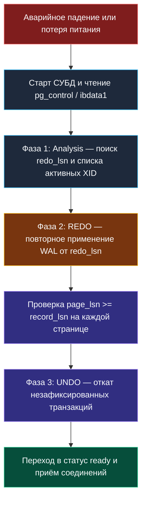

*Как движок восстанавливает согласованность после внезапного отключения питания по алгоритму ARIES, зачем `full_page_writes` спасает от рваных страниц, как устроен `WALStore.recover()` в `project/step05/` и почему бэкенд на Go не должен добивать стартующую базу.*

> «Любая функция ввода-вывода обязана считаться с вероятностью сбоя, и лишь наивный программист верит, что простое чтение или запись не могут завершиться ошибкой. Именно тогда, когда внезапно отказывают самые надёжные операции, нам нужнее всего знать почему.»  
> — Алан Донован и Брайан Керниган, *The Go Programming Language*

В серверной инфраструктуре сбой — не экзотика, а статистическая неизбежность. Выбитый автомат в стойке дата-центра, паника ядра Linux, принудительное завершение процесса СУБД из-за нехватки памяти (`OOM Killer`) или сбой контроллера NVMe происходят без предупреждения.

В момент аварии содержимое `shared_buffers` в оперативной памяти бесследно исчезает, а часть 8-килобайтных страниц на диске остаётся недописанной. Незафиксированные транзакции могли успеть сбросить свои грязные страницы на накопитель, а зафиксированные — наоборот, жили только в WAL и не дождались ближайшего [[9. Контрольные точки (Checkpointing) и сброс грязных страниц|чекпоинта]].

Автоматическое восстановление после сбоя (**Crash Recovery**) возвращает базу данных в математически согласованное состояние без ручной правки файлов. Понимание этого процесса критично для архитектора и бэкенд-разработчика по трём причинам:

* оно задаёт реальное время восстановления (**RTO**) и выполнимость SLA;
* десятки подов микросервиса `LedgerPulse`, одновременно пытающихся переподключиться при рестарте базы, создают лавину запросов (**thundering herd**) и затягивают запуск;
* настройки `checkpoint_timeout` и `synchronous_commit` находятся в прямом конфликте между скоростью записи и скоростью подъёма после аварии.

---

## Три фазы алгоритма ARIES: Analysis, REDO и UNDO

Классическая модель восстановления реляционных СУБД опирается на алгоритм **ARIES** (*Algorithms for Recovery and Isolation Exploiting Semantics*), предложенный исследователями IBM в начале 1990-х годов. Он состоит из трёх строго последовательных фаз.



### Фаза 1: Analysis (Анализ)

СУБД читает служебный контрольный файл (`global/pg_control` в PostgreSQL или заголовок системного табличного пространства `ibdata1` в MySQL/InnoDB) и находит `redo_lsn` последней успешно завершённой [[9. Контрольные точки (Checkpointing) и сброс грязных страниц|контрольной точки]]. От этой позиции движок последовательно сканирует WAL вперёд, чтобы:

* восстановить таблицу активных транзакций (**ATT**, Active Transaction Table) на момент катастрофы и таблицу грязных страниц (**DPT**, Dirty Page Table);
* определить судьбу каждой транзакции — успела ли она записать `COMMIT` до падения;
* проверить контрольные суммы записей (CRC32/CRC64) и установить точную границу целого журнала.

### Фаза 2: REDO (Повторное применение истории)

Движок проходит по WAL от `redo_lsn` до конца лога и накатывает изменения на страницы данных. Ключевой принцип ARIES — **повторение истории**: применяются все записи подряд, независимо от того, попали ли грязные страницы на диск до сбоя и завершилась ли транзакция коммитом.

Идемпотентность обеспечивается сравнением двух номеров LSN:

* перед применением записи с адресом `record_lsn` движок проверяет метку `pd_lsn` (`page_lsn`) в заголовке самой страницы на диске;
* если `page_lsn >= record_lsn`, модификация уже лежит в файле и шаг безопасно пропускается;
* если `page_lsn < record_lsn`, операция накатывается повторно, а `page_lsn` обновляется.

К концу фазы REDO состояние страниц точно воспроизводит картину за микросекунду до сбоя — включая следы незафиксированных транзакций.

### Фаза 3: UNDO (Откат незавершённых транзакций)

Все транзакции, не успевшие записать маркер `COMMIT`, признаются прерванными. В InnoDB движок проходит по `undo`-логам в обратном порядке и физически откатывает правки. В PostgreSQL благодаря MVCC физически стирать кортежи не нужно: статусы прерванных транзакций помечаются как `aborted` в журнале статусов (`pg_xact` / `clog`), поэтому будущие читатели по заголовкам `xmin`/`xmax` просто не увидят мусорные версии. После этого база открывает сокеты и переходит в режим приёма клиентских запросов.

> [!info] Под капотом: почему REDO в PostgreSQL однопоточный
> В PostgreSQL фазу REDO исполняет один процесс `startup`. Это осознанный компромисс: последовательное чтение WAL упирается в линейную пропускную способность диска, тогда как распараллеливание наката потребовало бы сложнейшей синхронизации порядка операций над одной и той же страницей. В MySQL/InnoDB `redo` также применяется последовательно при старте, а фоновая отмена (`purge`) работает уже параллельно после открытия базы для клиентов.

---

## Разбор `WALStore.recover()` в `project/step05/mvcc_wal.go`

В учебном движке `project/step05/mvcc_wal.go` реализована компактная модель журнала с контрольными суммами `CRC32` и восстановлением после сбоя. Посмотрим на метод `recover()`, который вызывается из `OpenWALStore()`:

```go
func (s *WALStore) recover() error {
	f, err := os.Open(s.walPath)
	if errors.Is(err, os.ErrNotExist) {
		return nil
	}
	if err != nil {
		return err
	}
	defer f.Close()

	pending := make(map[uint64][]walRecord)
	sc := bufio.NewScanner(f)
	for sc.Scan() {
		line := sc.Bytes()
		if len(line) == 0 {
			continue
		}
		var rec walRecord
		if err := json.Unmarshal(line, &rec); err != nil {
			// Оборванный хвост после сбоя питания отбрасываем при восстановлении
			break
		}
		if rec.CRC != rec.checksum() {
			return fmt.Errorf("%w at lsn=%d", ErrCorruptedWAL, rec.LSN)
		}
		s.nextLSN = max(s.nextLSN, rec.LSN)
		switch rec.Op {
		case "PUT":
			pending[rec.TxID] = append(pending[rec.TxID], rec)
		case "COMMIT":
			for _, w := range pending[rec.TxID] {
				s.state[w.Key] = w.Value
			}
			delete(pending, rec.TxID)
		case "ABORT":
			delete(pending, rec.TxID)
		}
	}
	return sc.Err()
}
```

Разберём четыре инженерных решения в этом коде:

1. **Холодный старт (`os.ErrNotExist`).** Если файл журнала ещё не создан, восстановление завершается без ошибки — хранилище стартует с пустой картой `s.state`.
2. **Обрыв хвоста против повреждения середины.** Если питание пропало в момент записи последней JSON-строки, `json.Unmarshal` вернёт ошибку на оборванной строке. Метод делает `break`, отбрасывая недописанный хвост. Но если JSON распарсился, а `rec.CRC != rec.checksum()`, это означает тихое искажение байтов на диске (bit rot) внутри уже сохранённой записи — возвращается `ErrCorruptedWAL`.
3. **Непрерывность нумерации `LSN`.** Вызов `s.nextLSN = max(s.nextLSN, rec.LSN)` гарантирует, что после рестарта новые записи продолжат монотонный рост номеров LSN без коллизий.
4. **Модель REDO без UNDO-записей.** Операции `"PUT"` складываются во временную мапу `pending[rec.TxID]` и попадают в рабочее состояние `s.state` только при встрече записи `"COMMIT"`. Запись `"ABORT"` очищает буфер. В тесте `TestWALRecoveryAndMVCC` (`project/step05/mvcc_wal_test.go`) зафиксированная транзакция `1` (`acc:1 = 1000`) переживает переоткрытие `OpenWALStore(walPath)`, а незавершённая запись `WriteUncommitted(2, "acc:1", 9999)` остаётся в `pending` и бесследно отбрасывается.

Учебный `WALStore` читает журнал с самого начала, потому что не делает чекпоинтов. В промышленном PostgreSQL эту проблему решает `redo_lsn`: сканировать старые сегменты не нужно, а изменения применяются прямо к 8-КБ страницам с опорой на `page_lsn`.

---

## Физика железа: «рваные страницы» и кэши CPU

В теории проигрывание лога выглядит как чистый цикл `for`. На реальных накопителях движок сталкивается с жёсткой физикой контроллеров и секторов.

### Проблема «рваных страниц» (Torn Page)

Страница данных в PostgreSQL занимает **8 КБ**, в MySQL InnoDB — **16 КБ**. При этом диски и операционная система гарантируют атомарность записи только в пределах физического сектора — обычно **512 байт** или **4 КБ** (Advanced Format).

Если питание пропадает в момент сброса грязной 8-КБ страницы, контроллер может успеть записать первые 4 КБ и не записать вторые. На диске остаётся гибрид: верхняя половина от новой версии страницы, нижняя — от старой. Контрольная сумма страницы не сходится, а накатывать дельта-запись WAL поверх битого блока бесполезно — структура кортежей разрушена.

Решение в PostgreSQL — параметр **`full_page_writes = on`**: при первом изменении любой страницы после чекпоинта движок записывает в WAL **полный 8-килобайтный образ страницы**, а не только компактную дельту. При сбое REDO сначала переписывает «рваную» страницу целиком чистым образом из WAL, а уже затем накатывает последующие дельты. Цена надёжности — кратковременный рост объёма WAL сразу после контрольной точки (в среднем на 20–40% на всём интервале). В MySQL InnoDB аналогичную роль играет **Doublewrite Buffer**: страницы сначала пишутся последовательно в буферную область, а потом — в основные файлы таблиц.

> [!warning] Ловушка: отключение `full_page_writes` на ZFS или Btrfs
> Иногда возникает соблазн выключить `full_page_writes` на файловых системах с Copy-on-Write (ZFS, Btrfs) ради экономии трафика WAL. Делать этого нельзя, если размер блока файловой системы или `recordsize` не гарантирует строгой атомарности 8 КБ во всех сценариях записи с учётом контроллера диска. Малейшее расхождение при сбое питания оставит молчаливо повреждённые индексы, которые проявятся ошибками через недели.

### Кэш CPU, prefetcher и сбойные блоки

Последовательное чтение сегментов WAL в фазе REDO благосклонно к кэшам процессора: аппаратный `prefetcher` заранее подтягивает следующие строки кэша `L2/L3`. Но при попадании на битый сектор контроллер диска уходит в цикл повторных попыток чтения (`retry`), процесс `startup` зависает в состоянии ядра `D` (*Uninterruptible Sleep*), и минутное восстановление превращается в многочасовой простой.

> [!warning] Ловушка: облачные тома с `burst balance`
> На локальном NVMe (~100 мкс на I/O) фаза REDO способна переваривать гигабайты WAL за 1–2 минуты. На облачном виртуальном диске с квотой базовых IOPS интенсивный REDO быстро сжигает `burst balance`, провайдер включает жёсткое троттлинг-ограничение, и подъём базы растягивается на 30–40 минут. Всегда закладывайте в расчёт RTO облачного сервиса коэффициент 3–5 и отслеживайте метрику `await` диска.

---

## Практика в Go: защита от шторма подключений при старте базы

Когда база данных восстанавливается после сбоя, 100 подов Go-сервиса `LedgerPulse` не должны одновременно бомбардировать порт `5432` попытками открыть пул из 50 соединений. Такой шторм (**thundering herd**) отбирает у процесса `startup` ресурсы CPU и дисковых очередей.

### Паттерн: мягкий прогрев пула и экспоненциальный backoff

Используйте постепенное расширение пула соединений и экспоненциальную задержку с джиттером или верхним порогом:

```go
package storage

import (
	"context"
	"database/sql"
	"fmt"
	"time"
)

func ConnectWithRecoveryCheck(ctx context.Context, dsn string) (*sql.DB, error) {
	db, err := sql.Open("pgx", dsn)
	if err != nil {
		return nil, fmt.Errorf("open db: %w", err)
	}

	// Стартуем с узкого пула, чтобы не создавать шторм при подъёме СУБД
	db.SetMaxOpenConns(4)
	db.SetMaxIdleConns(2)
	db.SetConnMaxLifetime(15 * time.Minute)

	backoff := 500 * time.Millisecond
	const maxBackoff = 30 * time.Second
	const maxAttempts = 20

	for attempt := range maxAttempts {
		var inRecovery bool
		err := db.QueryRowContext(ctx, "SELECT pg_is_in_recovery()").Scan(&inRecovery)
		if err == nil && !inRecovery {
			db.SetMaxOpenConns(50)
			db.SetMaxIdleConns(10)
			return db, nil
		}

		if attempt == maxAttempts-1 {
			break
		}

		select {
		case <-ctx.Done():
			_ = db.Close()
			return nil, fmt.Errorf("recovery wait cancelled: %w", ctx.Err())
		case <-time.After(backoff):
			backoff = min(backoff*2, maxBackoff)
		}
	}

	_ = db.Close()
	return nil, fmt.Errorf("primary database not ready after %d attempts", maxAttempts)
}
```

> [!tip] Собеседование [Middle]: почему `db.Ping()` недостаточно во время восстановления
> **Вопрос:** В чём опасность проверки готовности базы только через `db.PingContext(ctx)` после рестарта СУБД?
>
> **Ответ:** Во время crash recovery сетевой сокет PostgreSQL может уже принимать TCP-подключения, но на любые запросы отвечать ошибкой `FATAL: the database system is starting up` (SQLSTATE `57P03`). Кроме того, если сервис случайно переключился на read-only реплику после failover, `PingContext` пройдёт успешно, но все `INSERT`/`UPDATE` в `LedgerPulse` упадут с ошибкой. Явная проверка `SELECT pg_is_in_recovery()` гарантирует, что инстанс завершил восстановление и работает как пишущий мастер.

### Идемпотентные миграции с `advisory lock`

Если после подъёма базы несколько экземпляров сервиса одновременно запускают стартовые проверки или миграции, защитите критическую секцию консультативной блокировкой на уровне СУБД (`pg_advisory_lock`), чтобы параллельные поды не конфликтовали за DDL:

```go
func RunStartupHookSafe(ctx context.Context, db *sql.DB, fn func(context.Context) error) error {
	conn, err := db.Conn(ctx)
	if err != nil {
		return fmt.Errorf("acquire conn: %w", err)
	}
	defer conn.Close()

	const lockKey int64 = 900142 // уникальный ключ для сервиса LedgerPulse
	if _, err := conn.ExecContext(ctx, "SELECT pg_advisory_lock($1)", lockKey); err != nil {
		return fmt.Errorf("advisory lock: %w", err)
	}
	defer func() {
		_, _ = conn.ExecContext(context.WithoutCancel(ctx), "SELECT pg_advisory_unlock($1)", lockKey)
	}()

	return fn(ctx)
}
```

Обратите внимание на выделение одного физического соединения `db.Conn(ctx)`: в PostgreSQL сессионная блокировка `pg_advisory_lock` привязана к конкретному бэкенду, и вызов `unlock` на другом соединении из пула `database/sql` не снимет замок.

---

## Компромиссы настроек ACID и время восстановления

| Настройка СУБД | Влияние на REDO | Влияние на UNDO / целостность | Итоговый RTO и RPO |
| :--- | :--- | :--- | :--- |
| `checkpoint_timeout = 5min` | Короткий хвост WAL, быстрое чтение | Меньше незакоммиченного мусора | Низкий RTO (секунды), RPO = 0 |
| `checkpoint_timeout = 60min` | Длинный проигрыш лога, высокий I/O | Больше прерванных XID | Высокий RTO (минуты), RPO = 0 |
| `synchronous_commit = off` | Чуть короче хвост за счёт потери несинкнутых записей | Риск потери последних подтверждений | Низкий RTO, но **RPO > 0** (потеря до `3 * wal_writer_delay`) |
| `full_page_writes = on` | Объём WAL выше на 20–40% | Полная защита от рваных страниц | Предсказуемый RTO без порчи данных |

---

## Упражнения

### Упражнение 1 (Базовое). Трассировка `WALStore.recover()`

В файле `ledger.wal` лежат последовательные записи с валидными контрольными суммами `CRC32`:
1. `LSN=1, TxID=10, Op="PUT", Key="acc:1", Value=500`
2. `LSN=2, TxID=11, Op="PUT", Key="acc:2", Value=900`
3. `LSN=3, TxID=10, Op="COMMIT"`
4. `LSN=4, TxID=11, Op="PUT", Key="acc:1", Value=100`
5. Оборванная строка `{"lsn":5,"tx":11,"op":"COM` (питание отключилось).

Что окажется в `s.state` и чему будет равно `s.nextLSN` после вызова `OpenWALStore`?

> [!solution] Показать решение
> * `s.state`: `{"acc:1": 500}` (`acc:2` и перезапись `acc:1 = 100` отсутствуют).
> * `s.nextLSN`: `4`.
>
> **Разбор:** записи LSN 1 и 3 относятся к зафиксированной транзакции 10 — её изменения попадают в `s.state`. Строка с LSN 5 обрывается на `json.Unmarshal`, цикл завершается через `break` без возврата ошибки. Транзакция 11 не получила целый маркер `"COMMIT"`, поэтому её буфер в `pending[11]` не применяется и отбрасывается.

### Упражнение 2 (Практическое). Идемпотентность REDO в мини-движке на Go

Предположим, у каждой страницы данных есть поле `PageLSN uint64`. Напишите функцию `ApplyRedoRecord(page *Page, rec walRecord) (applied bool)`, которая реализует правило ARIES: применяет изменение только при необходимости и обновляет `page.PageLSN`.

> [!solution] Показать решение
> ```go
> type Page struct {
> 	PageLSN uint64
> 	Data    map[string]int64
> }
>
> func ApplyRedoRecord(page *Page, rec walRecord) bool {
> 	if page.PageLSN >= rec.LSN {
> 		return false
> 	}
> 	if rec.Op == "PUT" {
> 		page.Data[rec.Key] = rec.Value
> 	}
> 	page.PageLSN = rec.LSN
> 	return true
> }
> ```
> Повторный вызов `ApplyRedoRecord` с тем же `rec` вернёт `false` и не исказит более новые изменения на странице, даже если до аварии часть буферов уже успела сброситься на диск.

### Упражнение 3 (\*). Защита от падения `checkpointer` при потере середины лога

Почему в `WALStore.recover()` ошибка `json.Unmarshal` вызывает `break` (молчаливое усечение хвоста), а несоответствие `rec.CRC != rec.checksum()` немедленно возвращает ошибку `ErrCorruptedWAL`? Что произойдёт, если в одном файле после битой записи попадётся ещё одна корректная строка?

> [!solution] Показать решение
> Ошибка `json.Unmarshal` в самом конце файла — типичный след обрыва системного вызова `write` при потере питания: транзакция не успела дописать буфер и точно не возвращала клиенту подтверждение `COMMIT`, поэтому отбрасывание хвоста безопасно.
>
> Несовпадение `CRC32` при синтаксически целом JSON означает аппаратное повреждение сектора, ошибку контроллера или ручное вмешательство в уже записанный сегмент — пропуск такой записи нарушил бы атомарность и целостность прошлых коммитов. Останавливать чтение и сигнализировать `ErrCorruptedWAL` безопаснее, чем строить состояние поверх искажённого прошлого. Если же в файле после оборванной строки каким-то чудом идёт ещё одна (например, при сбое конкурентной записи без мьютекса), `break` остановит чтение на первом разрыве, не позволяя применить более поздние записи в обход потерянной середины.

---

## Мостик к следующему уроку

Алгоритм ARIES поднимает базу после аварии и возвращает согласованный снимок, а прерванные и устаревшие изменения в MVCC остаются лежать внутри 8-КБ страниц таблиц и индексов. Если их не вычищать, таблицы `LedgerPulse` раздуются в десятки раз, а счётчик транзакций упрётся в потолок. Как фоновая уборка освобождает место и не останавливает работу сервиса — разберём в следующей главе: [[11. VACUUM и сборка мёртвых версий кортежей]].
