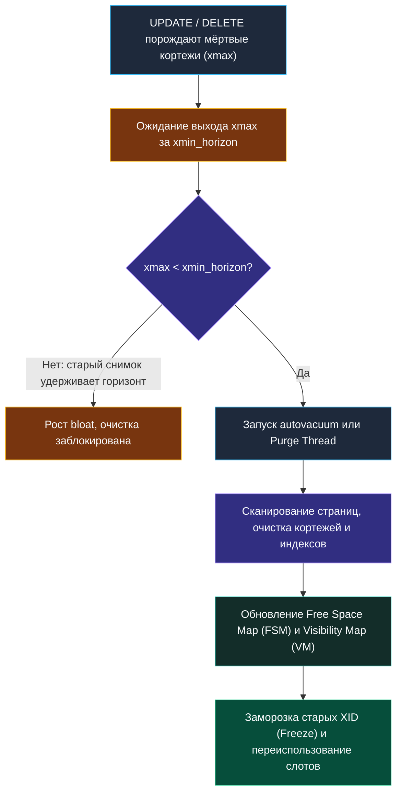

*Почему в MVCC удаление и обновление не освобождают место сразу, как `autovacuum` обновляет карты `FSM` и `VM`, чем грозит переполнение `xid` и почему одна зависшая транзакция в Go раздувает таблицы в десятки раз.*

> «Сборка мусора — огромное подспорье при написании корректных программ, но она не избавляет вас от необходимости думать о памяти. Вам не нужно выделять и освобождать память вручную, однако для написания эффективного кода всё равно приходится понимать время жизни переменных.»  
> — Алан Донован и Брайан Керниган, *The Go Programming Language*

В [[7. MVCC — многоверсионный контроль конкурентности|модели MVCC]] ни один `UPDATE` и ни один `DELETE` не затирают физические байты на диске мгновенно. Вместо этого движок создаёт новую версию кортежа (`xmin`), а старую помечает идентификатором удалившей транзакции (`xmax`). Пока в системе жива хотя бы одна транзакция, чей снимок может видеть старую версию, эта строка обязана оставаться на странице.

Без автоматической уборки база данных `LedgerPulse` за несколько дней превратилась бы в гигантский архив мёртвых версий:

* таблицы и B-Tree индексы раздуваются (**bloat**) в 10–50 раз;
* запросы читают сотни мегабайт пустых или мёртвых страниц, срывая задержки;
* переполнение 32-битного счётчика транзакций (**Transaction ID Wraparound**) вынуждает PostgreSQL аварийно остановить приём любых записей, чтобы не потерять историю видимости данных.

Сборщик мусора в реляционной СУБД — **`VACUUM`** в PostgreSQL или **`Purge`** в MySQL/InnoDB — решает задачу, родственную `runtime.GC` в Go, только вместо объектов в куче RAM (~100 нс) он работает с 8-килобайтными страницами на накопителях (~100 мкс на NVMe и ~10 мс на HDD).

---

## Горизонт очистки (`xmin_horizon`) и рождение мёртвых кортежей

Когда транзакция обновляет баланс счёта в `accounts`, в 8-КБ странице таблицы появляются два кортежа: старый с проставленным `xmax` и новый с `xmin`. Старая версия становится **мёртвым кортежем (dead tuple)** лишь тогда, когда завершаются все транзакции, стартовавшие до её удаления.

Самый старый активный снимок в кластере определяет **горизонт очистки (cleanup horizon / `xmin_horizon`)**. Любой мёртвый кортеж с `xmax < xmin_horizon` гарантированно невидим ни одному текущему или будущему читателю — его слот можно безопасно переиспользовать.



> [!warning] Ловушка: одна открытая транзакция замораживает весь кластер
> Если Go-сервис открыл транзакцию через `BeginTx`, прочитал список счетов, а затем пошёл выполнять тяжёлую аналитику или ждать ответа внешнего платёжного шлюза по HTTP, он «прибивает» `xmin_horizon` гвоздями к моменту старта этой транзакции. Фоновый `autovacuum` продолжит просыпаться, но не сможет удалить ни одного мёртвого кортежа, созданного после этого момента. За пару часов активного потока `UPDATE` таблица `accounts` способна раздуться в десятки раз.

---

## Под капотом: два архитектурных лагеря

Подходы PostgreSQL и MySQL/InnoDB к сборке мусора принципиально различаются местом хранения старых версий.

### 1. PostgreSQL: Inline `VACUUM` внутри страниц кучи

PostgreSQL хранит все версии кортежа прямо в основной таблице (**Heap**). Поэтому фоновый воркер `autovacuum` (или ручная команда `VACUUM`) работает непосредственно с файлами данных и индексами:

* **Сканирование и очистка.** Процесс последовательно читает страницы таблицы (пропуская уже полностью видимые по карте `VM`), удаляет мёртвые кортежи с `xmax < xmin_horizon` и чистит ссылки `ctid` на них в индексах.
* **Заморозка XID (`Freeze`).** Слишком старые живые `xmin` заменяются флагом «заморожен» (`frozen`), что защищает базу от переполнения 32-битного счётчика транзакций.
* **Обновление `FSM` и `VM`.** В отдельных служебных файлах таблицы (`_fsm` и `_vm`) обновляются две структуры:
  * **Free Space Map (FSM)** хранит карту свободного пространства в байтах на каждой странице, чтобы будущие `INSERT` и `UPDATE` знали, куда положить новые строки без расширения файла.
  * **Visibility Map (VM)** выделяет по одному биту на каждую 8-КБ страницу: установленный бит означает, что абсолютно все строки на странице видимы всем транзакциям. Благодаря этому `Index-Only Scan` ([[6. Покрывающие (Covering) индексы, INCLUDE и Index-Only Scan]]) проверяет только `VM` и не заходит в кучу, сокращая логические чтения вдвое.
* **Граница возврата места ОС.** Обычный `VACUUM` **не уменьшает физический размер файла** на диске (за редким исключением обрезки полностью пустых страниц в самом конце файла). Внутри файла появляются свободные слоты, которые повторно заселяются новыми записями.

### 2. MySQL/InnoDB: Background `Purge` по Undo-логам

В InnoDB старые версии строк не засоряют основные B+Tree страницы кластерного индекса — при `UPDATE`/`DELETE` они копируются в отдельное пространство отката (**Undo Tablespace**):

* **Purge Thread.** Фоновый поток проходит по истории undo-сегментов, вышедших за горизонт активных `Read View`, удаляет старые версии из undo-логов и физически вычищает записи, помеченные флагом удаления («призраки»), из кластерного и вторичных индексов.
* **Освобождение страниц.** Полностью опустевшие 16-КБ страницы возвращаются в `Free List` табличного пространства. При этом агрессивную дефрагментацию наполовину пустых страниц InnoDB на лету не делает — для сжатия файла требуется `OPTIMIZE TABLE` или `ALTER TABLE ... FORCE`.

---

## Учёт устройства железа: дисковый I/O, кэш ОС и CPU

Запуск `VACUUM` — не бесплатная магия. Под нагрузкой фоновая уборка активно конкурирует с пользовательскими запросами за накопитель, шину памяти и кэши ядра.

### Поток I/O и вытеснение кэша страниц ОС

`VACUUM` выполняет последовательное чтение страниц таблицы, но обновление индексов, `FSM` и `VM` порождает множество мелких случайных записей. Ядро Linux помечает их в Page Cache как `dirty pages`, которые позже сбрасываются фоновыми потоками `writeback`.

* Если `autovacuum` настроен слишком агрессивно (высокий `autovacuum_vacuum_cost_limit`), он выедает пропускную способность `I/O queue`. На облачных дисках с ограниченным `burst IOPS` это напрямую бьёт по задержкам `QueryRowContext` и `ExecContext` в Go.
* Чтобы линейное сканирование редких таблиц не вымывало «горячий» рабочий набор из памяти, PostgreSQL использует кольцевой буфер внутри `shared_buffers` и системные подсказки вроде `posix_fadvise(POSIX_FADV_DONTNEED)`, прося ОС не удерживать обработанные холодные страницы в Page Cache.

### Кэш-линии CPU и предсказание ветвлений

Проверка кортежей на странице — это обход массива указателей (`ItemIdData`) и чтение битовых масок видимости в `HeapTupleHeader`. На сильно фрагментированных («разряженных») страницах плотность полезных данных падает:

* процессор тащит в кэш `L3` (~10–20 нс) целые кэш-линии с мёртвым мусором;
* непредсказуемое чередование живых, мёртвых и замороженных кортежей ухудшает работу предсказателя переходов (**branch predictor**), вызывая сбросы конвейера и снижение `IPC` (*Instructions Per Cycle*).

---

## `VACUUM FULL` и возврат места операционной системе

Когда таблица уже раздулась с 2 ГБ до 60 ГБ из-за давнего сбоя, обычный `VACUUM` освободит слоты внутри файла, но не вернёт гигабайты файловой системе. Для физического сжатия в PostgreSQL существует `VACUUM FULL`:

1. Создаётся абсолютно новая копия файла таблицы, куда переписываются только живые кортежи.
2. Все индексы перестраиваются с нуля.
3. Старый файл подменяется новым и удаляется с возвратом места ОС через `truncate` / `unlink`.

> [!warning] Ловушка: `VACUUM FULL` останавливает сервис
> `VACUUM FULL` накладывает самую жёсткую блокировку таблицы — **`ACCESS EXCLUSIVE`**. Она блокирует абсолютно всё, включая обычные `SELECT`. В работающем сервисе `LedgerPulse` это мгновенно приводит к исчерпанию пула соединений `sql.DB` (`connection pool exhaustion`) и каскадным таймаутам во всех подах. Никогда не вызывайте `VACUUM FULL` из приложения или по крону на живых таблицах. Для сжатия без блокировки читателей и писателей применяют онлайн-инструменты `pg_repack` или `pg_squeeze`.

---

## Практика в Go: возраст XID и короткие транзакции `LedgerPulse`

Инженер на Go отвечает за два критических аспекта: не мешать `autovacuum` работать и вовремя видеть приближение кризиса счётчика транзакций.

### 1. Мониторинг возраста транзакций (`age(datfrozenxid)`)

В PostgreSQL идентификаторы транзакций 32-битные (~4,29 млрд значений, половина пространства — около 2 млрд — отводится на прошлое и будущее для сравнения по модулю $2^{32}$). Если таблица давно не проходила заморозку, `age(datfrozenxid)` приближается к 2 миллиардам, и СУБД в панике переходит в режим «только чтение». Отслеживайте этот показатель в метриках сервиса или экспортера:

```go
package monitoring

import (
	"context"
	"database/sql"
	"fmt"
)

type DBAgeMetric struct {
	Name string
	Age  int64
}

func GetDatabaseAgeMetrics(ctx context.Context, db *sql.DB) ([]DBAgeMetric, error) {
	rows, err := db.QueryContext(ctx, `
		SELECT datname, age(datfrozenxid)
		FROM pg_database
		WHERE datallowconn = true
	`)
	if err != nil {
		return nil, fmt.Errorf("query db ages: %w", err)
	}
	defer rows.Close()

	var result []DBAgeMetric
	for rows.Next() {
		var m DBAgeMetric
		if err := rows.Scan(&m.Name, &m.Age); err != nil {
			return nil, fmt.Errorf("scan db age: %w", err)
		}
		result = append(result, m)
	}
	if err := rows.Err(); err != nil {
		return nil, fmt.Errorf("iterate db ages: %w", err)
	}
	return result, nil
}
```

Если `Age` перевалил за `1_000_000_000`–`1_500_000_000`, пора бить тревогу и выяснять, какая длинная транзакция или сломанный слот репликации не дают `autovacuum` заморозить старые кортежи.

### 2. Антипаттерн удержания горизонта против коротких транзакций

Сравним обработчик платёжных поручений `LedgerPulse`, который обращается к внешнему банку по сети:

```go
// ПЛОХО: транзакция БД держится открытой на время внешнего HTTP-запроса
func ProcessTransferBad(ctx context.Context, db *sql.DB, txID int64) error {
	tx, err := db.BeginTx(ctx, nil)
	if err != nil {
		return err
	}
	defer func() { _ = tx.Rollback() }()

	var amount int64
	err = tx.QueryRowContext(ctx,
		`SELECT amount FROM transactions WHERE id = $1 FOR UPDATE`, txID,
	).Scan(&amount)
	if err != nil {
		return err
	}

	// Внешний вызов длится 1–5 секунд (а при таймауте — 30 секунд).
	// Всё это время открытая транзакция держит замок строки и xmin_horizon!
	if err := callExternalGateway(ctx, txID, amount); err != nil {
		return err
	}

	_, err = tx.ExecContext(ctx,
		`UPDATE transactions SET status = 'settled' WHERE id = $1`, txID,
	)
	if err != nil {
		return err
	}
	return tx.Commit()
}

// ХОРОШО: короткая транзакция захвата -> внешний I/O вне БД -> короткий финиш
func ProcessTransferGood(ctx context.Context, db *sql.DB) error {
	var txID, amount int64
	// Атомарно переводим задачу в 'processing' за миллисекунды
	err := db.QueryRowContext(ctx, `
		UPDATE transactions
		SET status = 'processing'
		WHERE id = (
			SELECT id FROM transactions
			WHERE status = 'pending'
			ORDER BY created_at
			FOR UPDATE SKIP LOCKED
			LIMIT 1
		)
		RETURNING id, amount
	`).Scan(&txID, &amount)
	if err != nil {
		return err
	}

	// Сетевой вызов выполняется без открытой транзакции и без удержания снимка
	nextStatus := "settled"
	if err := callExternalGateway(ctx, txID, amount); err != nil {
		nextStatus = "failed"
	}

	_, err = db.ExecContext(ctx,
		`UPDATE transactions SET status = $1 WHERE id = $2`, nextStatus, txID,
	)
	return err
}
```

> [!tip] Собеседование [Middle]: почему `COUNT(*)` тормозит после массового `DELETE` и `VACUUM`
> **Вопрос:** Из таблицы `ledger_entries` удалили 95% строк и сразу выполнили `VACUUM ledger_entries`. Почему `SELECT count(*) FROM ledger_entries` по-прежнему выполняется почти так же долго, как до удаления?
>
> **Ответ:** Обычный `VACUUM` освобождает слоты внутри страниц и записывает их в `FSM`, но **не сжимает файл таблицы** — количество выделенных 8-КБ блоков на диске остаётся прежним (если только в самом хвосте таблицы не образовалась непрерывная полоса пустых страниц). Чтобы вычислить `COUNT(*)`, PostgreSQL без `Index-Only Scan` (или даже по раздутому индексу) всё равно вынужден прочитать все существующие страницы, проверить заголовки и убедиться, что в них пусто. Уменьшить физический размер и вернуть прежнюю скорость поможет `VACUUM FULL` (с блокировкой) или `pg_repack` (онлайн).

---

## Параллель с Garbage Collector в рантайме Go

Сборка мусора в Go (`runtime.GC`) и `VACUUM` в БД устроены удивительно симметрично:

| Критерий | Go `runtime.GC` | СУБД `VACUUM` / `Purge` |
| :--- | :--- | :--- |
| **Объекты уборки** | Структуры и слайсы в куче RAM | Мёртвые версии строк (tuples) на страницах |
| **Триггер запуска** | Порог `GOGC` / лимит памяти `GOMEMLIMIT` | Порог мёртвых кортежей (`autovacuum_vacuum_scale_factor`) или возраст `xid` |
| **Остановка мира (STW)** | Микропаузы STW (десятки микросекунд) | Нет (кроме `VACUUM FULL`, блокирующего таблицу целиком) |
| **Возврат памяти ОС** | `madvise(MADV_DONTNEED)` в фоне | Обычно нет (только при усечении хвоста или через `VACUUM FULL`) |
| **Проблема удержания** | Живой указатель в глобальной мапе держит граф | Долгая транзакция держит `xmin_horizon` |
| **Цена промедления** | Рост RSS и OOM Killer | Раздувание таблиц (`bloat`), падение `Seq Scan` и переполнение `xid` |

Главный враг в обеих системах одинаков: ссылки на прошлое, которые программа забыла отпустить.

---

## Упражнения

### Упражнение 1 (Базовое). Оценка горизонта и раздувания

В 10:00 в `LedgerPulse` открыли отчётную транзакцию `BEGIN ISOLATION LEVEL REPEATABLE READ` и оставили соединение висеть в статусе `idle in transaction`. За следующие два часа платежи сделали 4 миллиона `UPDATE` по счетам. Что произойдёт, если в 12:00 запустить ручной `VACUUM ANALYZE accounts`, и когда он реально сможет освободить эти 4 миллиона старых версий?

> [!solution] Показать решение
> `VACUUM ANALYZE accounts` в 12:00 соберёт свежую статистику для планировщика, но **не сможет удалить ни одной мёртвой версии**, созданной после 10:00: их `xmax` старше/равен `xmin` открытого снимка отчётной транзакции (`xmax >= xmin_horizon`). Пространство освободится только после того, как зависшая транзакция завершится (`COMMIT`, `ROLLBACK` или обрыв по `idle_in_transaction_session_timeout`) и запустится следующий цикл `VACUUM`/`autovacuum`.

### Упражнение 2 (Практическое). Диагностический SQL для поиска врага `autovacuum`

Напишите SQL-запрос к системным представлениям PostgreSQL (`pg_stat_activity` и `pg_stat_user_tables`), который одновременно покажет: а) топ-5 таблиц с наибольшим числом мёртвых кортежей `n_dead_tup`, б) активные или зависшие транзакции дольше 5 минут, которые могут удерживать `xmin_horizon`.

> [!solution] Показать решение
> ```sql
> -- Топ-5 раздутых таблиц по мёртвым кортежам
> SELECT schemaname, relname, n_live_tup, n_dead_tup, last_autovacuum
> FROM pg_stat_user_tables
> ORDER BY n_dead_tup DESC
> LIMIT 5;
>
> -- Транзакции, потенциально удерживающие горизонт очистки более 5 минут
> SELECT pid, usename, state, now() - xact_start AS xact_age, backend_xmin, left(query, 80) AS query_head
> FROM pg_stat_activity
> WHERE xact_start IS NOT NULL
>   AND now() - xact_start > interval '5 minutes'
> ORDER BY xact_age DESC;
> ```
> Столбец `backend_xmin` прямо указывает на идентификатор транзакции, ниже которого `VACUUM` не имеет права сдвинуть горизонт очистки.

### Упражнение 3 (\*). Почему страдает `Index-Only Scan`

В таблице `ledger_entries` есть покрывающий индекс, и обычно запрос баланса выполняется через `Index-Only Scan` с `Heap Fetches: 0`. После ночной пакетной очистки старых записей вы заметили, что тот же запрос стал делать десятки тысяч `Heap Fetches` и резко выросло чтение с SSD. Объясните связь этого эффекта с `Visibility Map` и `VACUUM`.

> [!solution] Показать решение
> `Index-Only Scan` пропускает обращение в кучу только для тех страниц, у которых выставлен бит «все видимы» в **Visibility Map (`_vm`)**. Любое изменение на странице (`INSERT`, `UPDATE`, `DELETE`) сбрасывает её бит в `VM`. Ночная пакетная операция затронула множество страниц и сбросила их биты видимости, а `autovacuum` ещё не успел пройти по таблице, проверить `xmin_horizon` и снова выставить биты в `VM`. В результате движок вынужден ходить по `ctid` из индекса обратно в страницы кучи (`Heap Fetches`), превращая последовательное или чисто индексное чтение в случайный дисковый ввод-вывод.

---

## Мостик к следующему уроку

Вы увидели, как `VACUUM` убирает отслужившие версии строк и почему снимки транзакций удерживают горизонт очистки. Но как устроен сам снимок внутри памяти СУБД, как он решает конфликт двух одновременных обновлений одной строки (First-Committer-Wins) и почему даже при идеальных снимках возникает аномалия `Write Skew`? В заключительной главе модуля разберём `Snapshot Isolation`, сериализуемость `SSI` и реализацию `SnapshotTx` в `project/step05/`: [[12. Snapshot Isolation и Serializable Snapshot Isolation (SSI)]].
