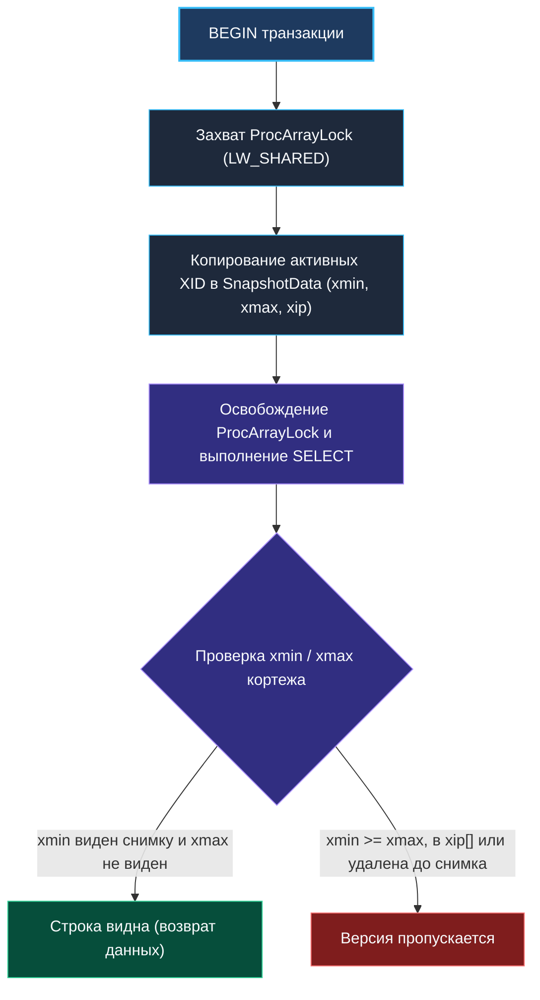

*Как устроен снимок видимости в памяти `ProcArray`, как `SnapshotTx.Commit()` в `project/step05/` реализует правило First-Committer-Wins, почему даже снимки допускают Write Skew и как SSI закрывает эту дыру без блокировки читателей.*

> «Хотя поддержка конкурентности — одна из главных сильных сторон Go, рассуждать о конкурентных программах по природе труднее, чем о последовательных, и интуиция, выработанная на последовательном коде, порой подводит.»  
> — Алан Донован и Брайан Керниган, *The Go Programming Language*

Классическая двухфазная блокировка (**2PL**, [[5. Блокировки (Locking) — 2PL, SELECT FOR UPDATE и SKIP LOCKED]]) заставляет читателей ждать писателей, а писателей — читателей. Для высоконагруженного OLTP-сервиса вроде `LedgerPulse` это прямой путь к очередям на строках счетов: пока отчётный `SELECT SUM(amount)` суммирует проводки, входящие переводы встают в ожидание.

**Snapshot Isolation (SI)** решает эту проблему радикально. Каждая транзакция получает согласованный моментальный срез базы на момент своего старта. Все её чтения видят данные строго из этого неизменного снимка, а параллельные изменения других транзакций проявляются только после их `COMMIT` и только для новых снимков. Операциям `SELECT` не нужны разделяющие блокировки (`Shared Lock`): читатели никогда не блокируют писателей, а писатели — читателей.

Но у изоляции снимков есть тонкая граница: она защищает от `Dirty Read`, `Non-Repeatable Read`, `Phantom Read` и даже от `Lost Update`, однако допускает аномалию **`Write Skew`**. Чтобы закрыть её без возврата к блокировкам 2PL, был создан алгоритм **Serializable Snapshot Isolation (SSI)**.

---

## Механика видимости: как рождается и проверяется снимок

При старте транзакции СУБД не копирует таблицы в оперативную память. Она создаёт компактную структуру — **снимок (Snapshot)**, фиксирующую три границы: нижний порог `xmin` (все транзакции с меньшим ID уже завершились), верхний порог `xmax` (следующий свободный ID на момент снимка) и массив `xip[]` — список ещё активных в эту секунду транзакций.



Алгоритм проверки видимости кортежа (упрощённо для MVCC-движка):

1. Если `tuple.xmin >= snapshot.xmax` — строка создана после снятия снимка. **Невидима.**
2. Если `tuple.xmin < snapshot.xmin` (и транзакция зафиксирована) — строка родилась и закоммитилась до старта всех текущих транзакций. **Видима** (если не удалена).
3. Если `tuple.xmin` попадает в массив `xip[]` активных транзакций — создатель ещё не завершился на момент снимка. **Невидима.**
4. Если `tuple.xmax != 0`, меньше `snapshot.xmax`, отсутствует в `xip[]` и удалившая транзакция зафиксирована — строка уже удалена в прошлом снимка. **Невидима.**

Все четыре проверки сводятся к сравнению целых чисел и битовых флагов подсказки (`hint bits`) прямо в регистрах процессора — без обращений к менеджеру блокировок и без дискового ввода-вывода.

> [!info] Под капотом: `ProcArray` в PostgreSQL против `trx_sys` в MySQL
> В PostgreSQL глобальное состояние активных транзакций лежит в разделяемой памяти в структуре `ProcArray`. Чтобы создать `SnapshotData`, бэкенд берёт `ProcArrayLock` в режиме `LW_SHARED`, быстро копирует активные `xid` в локальную память процесса и отпускает замок. В InnoDB аналогичный список `trx_sys->rw_trx_list` защищён мьютексом, формирующим структуру `read_view_t` с полями `up_limit_id` и `low_limit_id`. При тысячах одновременных `BEGIN` этот мьютекс способен стать точкой сериализации, поэтому современные версии движков используют атомарные снимки и оптимизации без глобальной блокировки.

---

## Разбор `SnapshotTx` и First-Committer-Wins в `project/step05/`

В файле `project/step05/mvcc_wal.go` реализован учебный многоверсионный движок `MVCCEngine`, который наглядно демонстрирует и чтение из снимка, и правило **First-Committer-Wins** («побеждает первый зафиксировавшийся»).

### Снимок при `Begin()` и чтение в `Get()`

При старте `Begin()` движок выделяет монотонный `XID` и копирует множество уже зафиксированных транзакций `e.committed` в локальный снимок `tx.Snapshot`:

```go
func (e *MVCCEngine) Begin() *SnapshotTx {
	e.mu.Lock()
	defer e.mu.Unlock()

	xid := e.nextXID
	e.nextXID++
	snap := make(map[uint64]bool, len(e.committed))
	for k, v := range e.committed {
		snap[k] = v
	}
	return &SnapshotTx{
		XID:      xid,
		Snapshot: snap,
		writeset: make(map[string]int64),
		readXmax: make(map[string]uint64),
		engine:   e,
	}
}
```

Метод `tx.Get(key)` сначала заглядывает в собственный буфер `tx.writeset` (гарантия *Read Your Own Writes*), а затем просматривает цепочку версий `versions[key]` с конца, ища последнюю версию, чей создатель `v.Xmin` входит в `tx.Snapshot`, а удалитель `v.Xmax` ещё не зафиксирован в снимке (`v.Xmax == 0 || !tx.Snapshot[v.Xmax]`).

### Правило First-Committer-Wins в `SnapshotTx.Commit()`

Самая важная часть происходит в момент фиксации (`project/step05/mvcc_wal.go`, строки 223–254):

```go
func (tx *SnapshotTx) Commit() error {
	if tx.finished {
		return errors.New("tx already finished")
	}
	tx.engine.mu.Lock()
	defer tx.engine.mu.Unlock()
	tx.finished = true

	// Проверка First-Committer-Wins: никто вне нашего снимка не успел обновить те же ключи
	for k := range tx.writeset {
		vers := tx.engine.versions[k]
		for _, v := range vers {
			if tx.engine.committed[v.Xmin] && !tx.Snapshot[v.Xmin] && v.Xmin != tx.XID {
				return ErrWriteConflict
			}
		}
	}

	for k, val := range tx.writeset {
		vers := tx.engine.versions[k]
		for i := len(vers) - 1; i >= 0; i-- {
			if tx.Snapshot[vers[i].Xmin] && vers[i].Xmax == 0 {
				vers[i].Xmax = tx.XID
				break
			}
		}
		vers = append(vers, TupleVersion{Xmin: tx.XID, Value: val})
		tx.engine.versions[k] = vers
	}
	tx.engine.committed[tx.XID] = true
	return nil
}
```

Условие конфликта `tx.engine.committed[v.Xmin] && !tx.Snapshot[v.Xmin] && v.Xmin != tx.XID` читается буквально: «по ключу `k`, который мы собираемся записать, появилась новая версия, созданная транзакцией `v.Xmin`, которая зафиксировалась уже *после* снятия нашего снимка». В этом случае побеждает тот, кто зафиксировался первым, а опоздавший получает `ErrWriteConflict` (`could not serialize access due to concurrent update`).

В тесте `TestWALRecoveryAndMVCC` (`project/step05/mvcc_wal_test.go`) этот сценарий воспроизведён по шагам:

1. `seed` фиксирует `balance = 500` и `audit_tag = 1`.
2. Параллельно стартуют `tx1` и `tx2` с одинаковым снимком.
3. `tx1` пишет `balance = 600`, `audit_tag = 2` и успешно вызывает `Commit()`.
4. `tx2.Get("audit_tag")` по-прежнему возвращает `1` — снимок изолирован от коммита `tx1`.
5. Но `tx2` тоже изменяла ключ `balance` (`700`), поэтому при `tx2.Commit()` срабатывает First-Committer-Wins и возвращается `ErrWriteConflict` — потерянное обновление (**Lost Update**) исключено.

В реальном PostgreSQL на уровне `REPEATABLE READ` (который физически реализует Snapshot Isolation) происходит то же самое: при попытке обновить строку, уже изменённую и закоммиченную параллельной транзакцией после старта снимка, PostgreSQL прерывает вторую транзакцию ошибкой с кодом SQLSTATE **`40001`** (`could not serialize access due to concurrent update`).

---

## Граница Snapshot Isolation: аномалия Write Skew и переход к SSI

First-Committer-Wins ловит пересечения **по записи одного и того же ключа**. Но что если две транзакции читают общий набор строк, принимают решение на основе прочитанного, а записывают **разные** ключи?

Классический пример — правило дежурств в больнице: «на смене всегда должен оставаться хотя бы один врач». В таблице `doctors` дежурят `Alice` и `Bob` (`on_call = true`). Либо представьте бизнес-инвариант в `LedgerPulse`: у клиента есть два связанных субсчёта (`sub_a` и `sub_b`, на каждом по `500`), и сумма на них не должна падать ниже `500`.

```sql
-- Транзакция 1: проверяет сумму (500 + 500 = 1000) и списывает 500 с sub_a
BEGIN ISOLATION LEVEL REPEATABLE READ;
SELECT sum(balance) FROM accounts WHERE owner_id = 42; -- вернёт 1000
UPDATE accounts SET balance = balance - 500 WHERE id = 'sub_a';
COMMIT;

-- Транзакция 2 (параллельно): видит тот же снимок (1000) и списывает 500 с sub_b
BEGIN ISOLATION LEVEL REPEATABLE READ;
SELECT sum(balance) FROM accounts WHERE owner_id = 42; -- вернёт 1000
UPDATE accounts SET balance = balance - 500 WHERE id = 'sub_b';
COMMIT;
```

Обе транзакции обновили разные строки (`sub_a` и `sub_b`), поэтому ни блокировки строк, ни First-Committer-Wins не увидели конфликта. В нашем `MVCCEngine` оба `writeset` не пересеклись бы, и обе транзакции завершились бы без ошибки — но сумма счетов упала до `0`, нарушив инвариант. Эта аномалия и называется **перекосом записи (`Write Skew`)**, подробно разобранная в [[4. Аномалии — Dirty Read, Phantom Read, Lost Update и Write Skew]].

### Как работает Serializable Snapshot Isolation (SSI)

Чтобы гарантировать полную сериализуемость (результат эквивалентен некоторому последовательному выполнению транзакций) и не скатиться к блокировкам чтения 2PL, в PostgreSQL начиная с версии 9.1 реализован алгоритм **SSI** (Майкл Кэхилл и коллеги, 2008), включаемый через `ISOLATION LEVEL SERIALIZABLE`:

1. **Без блокировки читателей.** Транзакции по-прежнему читают из снимков без `Shared Lock`.
2. **Предикатные замки `SIREAD`.** Движок отслеживает, какие строки, страницы или диапазоны индексов прочитала каждая сериализуемая транзакция. Замок `SIREAD` ничего не блокирует — это лишь запись в памяти о факте чтения.
3. **Поиск `rw`-антизависимостей.** Когда `T2` изменяет или вставляет строку, попадающую под `SIREAD`-область параллельной `T1`, возникает антизависимость чтения-записи (`T1 --rw--> T2`: `T1` не увидела версию, которую записала `T2`).
4. **Опасная структура в графе сериализации.** Одиночная `rw`-связь ещё не нарушает сериализуемость. Цикл невозможен без опасной цепочки из двух последовательных антизависимостей (`T1 --rw--> T2 --rw--> T3`), где `T3` фиксируется первой. Заметив такую структуру, SSI прерывает одну из транзакций с тем же SQLSTATE **`40001`** (`could not serialize access due to read/write dependencies among transactions`).

> [!tip] Собеседование [Senior/Staff]: Snapshot Isolation против SSI
> **Вопрос:** Почему `REPEATABLE READ` в PostgreSQL защищает от `Lost Update`, но всё равно допускает `Write Skew`, и какой ценой `SERIALIZABLE` (SSI) решает эту проблему?
>
> **Ответ:** `REPEATABLE READ` в PostgreSQL реализует Snapshot Isolation с проверкой First-Committer-Wins только на уровне перезаписи одной и той же физической строки (`write-write` конфликт). При `Write Skew` транзакции читают пересекающиеся диапазоны, но пишут в разные строки, поэтому конфликта записи нет. Уровень `SERIALIZABLE` включает SSI: он вешает неблокирующие предикатные метки `SIREAD` на прочитанные кортежи и индексные страницы, отслеживает `rw`-антизависимости и при обнаружении опасной пары `rw`-ребёр откатывает одну из транзакций с кодом `40001`. Цена — дополнительная память под `SIREAD`-таблицы, риск ложноположительных откатов (когда предикатный замок укрупняется до страницы или таблицы) и обязательная логика повторов (retry) на стороне Go-приложения.

---

## Учёт устройства железа: кэш CPU, пул Go и `VACUUM`

Изоляция через снимки напрямую отражается на работе процессора, пула соединений `sql.DB` и фоновой сборки мусора.

* **Кэш-линии CPU и ветвление.** При проверке видимости на странице процессору приходится сверяться с массивом `xip[]`, который при тысячах активных соединений может выходить за пределы кэша `L1` (~1 нс). Перескоки по ссылкам `ctid` между мёртвыми и живыми версиями на разных страницах ухудшают локальность данных и сбивают предсказатель ветвлений (`branch predictor`).
* **Истощение пула соединений в Go.** Длинный `SELECT` в транзакции `REPEATABLE READ` удерживает бэкенд PostgreSQL в состоянии `active` и сохраняет структуру `SnapshotData` в памяти. Если в Go-сервисе `SetMaxOpenConns(50)` заняты долгими отчётными снимками, новые платёжные транзакции выстраиваются в очередь `db.connRequests`, взвинчивая `p99`-латентность.
* **Удар по `VACUUM` и `Index-Only Scan`.** Как вы видели в [[11. VACUUM и сборка мёртвых версий кортежей]], любой долгоживущий снимок замораживает горизонт очистки `xmin_horizon`. Пока открыт старый снимок, `autovacuum` не может выставить биты в `Visibility Map`, из-за чего `Index-Only Scan` деградирует до случайных чтений в куче, поднимая дисковый `await` на SSD.

---

## Практика в Go: паттерны `LedgerPulse` и повторы `40001`

### Паттерн 1: консистентный отчёт в `ReadOnly` снимке

Для сверки дневного оборота в `LedgerPulse` используйте явный `sql.LevelRepeatableRead` с флагом `ReadOnly: true` и жёстким таймаутом контекста:

```go
package reporting

import (
	"context"
	"database/sql"
	"fmt"
	"time"
)

func CalcDailyTurnover(ctx context.Context, db *sql.DB, day time.Time) (int64, error) {
	ctx, cancel := context.WithTimeout(ctx, 5*time.Second)
	defer cancel()

	tx, err := db.BeginTx(ctx, &sql.TxOptions{
		Isolation: sql.LevelRepeatableRead,
		ReadOnly:  true,
	})
	if err != nil {
		return 0, fmt.Errorf("begin readonly snapshot: %w", err)
	}
	defer func() { _ = tx.Rollback() }()

	var totalMinorUnits int64
	err = tx.QueryRowContext(ctx, `
		SELECT COALESCE(SUM(amount), 0)
		FROM ledger_entries
		WHERE created_at >= $1 AND created_at < $2
	`, day, day.Add(24*time.Hour)).Scan(&totalMinorUnits)
	if err != nil {
		return 0, fmt.Errorf("query daily turnover: %w", err)
	}

	if err := tx.Commit(); err != nil {
		return 0, fmt.Errorf("commit readonly snapshot: %w", err)
	}
	return totalMinorUnits, nil
}
```

Флаг `ReadOnly: true` сообщает PostgreSQL (`BEGIN ISOLATION LEVEL REPEATABLE READ READ ONLY`), что транзакция не будет менять данные: ей не нужен настоящий `XID`, она не рискует получить ошибку сериализации записи (а при добавлении `DEFERRABLE` может дождаться полностью безопасного снимка без SSI-накладных расходов).

### Паттерн 2: обязательный retry-цикл для `SERIALIZABLE` (`40001`)

Если вы включаете `sql.LevelSerializable` для защиты от `Write Skew` (например, проверка общего лимита по группе счетов), база данных **имеет право** откатить транзакцию с кодом `40001`. Приложение на Go обязано корректно повторять всю транзакцию целиком:

```go
package ledger

import (
	"context"
	"database/sql"
	"errors"
	"fmt"
	"time"

	"github.com/jackc/pgx/v5/pgconn"
)

func isSerializationFailure(err error) bool {
	var pgErr *pgconn.PgError
	return errors.As(err, &pgErr) && pgErr.Code == "40001"
}

func RunSerializableWithRetry(ctx context.Context, db *sql.DB, fn func(*sql.Tx) error) error {
	const maxAttempts = 5
	backoff := 10 * time.Millisecond

	for attempt := range maxAttempts {
		tx, err := db.BeginTx(ctx, &sql.TxOptions{Isolation: sql.LevelSerializable})
		if err != nil {
			return fmt.Errorf("begin serializable tx: %w", err)
		}

		err = fn(tx)
		if err == nil {
			err = tx.Commit()
		} else {
			_ = tx.Rollback()
		}

		if err == nil {
			return nil
		}
		if !isSerializationFailure(err) || attempt == maxAttempts-1 {
			return err
		}

		select {
		case <-ctx.Done():
			return ctx.Err()
		case <-time.After(backoff):
			backoff *= 2
		}
	}
	return nil
}
```

> [!warning] Ловушка: зависшая сессия `idle in transaction`
> Если после вызова `db.BeginTx` в Go произошла сетевая проблема, горутина потеряла контекст или заблокировалась на внешнем канале до вызова `tx.Rollback()`, серверное соединение остаётся висеть в статусе `idle in transaction`. Снимок продолжает удерживать `xmin_horizon` и блокировать `VACUUM`. Всегда задавайте на уровне СУБД или роли параметр `idle_in_transaction_session_timeout` (например, `30s`–`5min` в OLTP), чтобы PostgreSQL принудительно обрывал брошенные транзакции.

---

## Упражнения

### Упражнение 1 (Базовое). Трассировка `SnapshotTx.Commit()`

В `MVCCEngine` (`project/step05/mvcc_wal.go`) ключ `"acc:1"` имеет единственную закоммиченную версию `Xmin=1, Xmax=0, Value=1000`. Транзакции `T2` и `T3` стартуют параллельно через `Begin()`. `T2` читает `"acc:1"`, вызывает `T2.Set("acc:2", 500)` и успешно делает `Commit()`. `T3` тоже читает `"acc:1"` и вызывает `T3.Set("acc:1", 800)`. Что вернёт `T3.Commit()` — `nil` или `ErrWriteConflict`? Обоснуйте ответ по условию проверки в `Commit()`.

> [!solution] Показать решение
> `T3.Commit()` вернёт **`nil`** (успех).
>
> **Разбор:** при проверке First-Committer-Wins цикл идёт по ключам из `T3.writeset` — там только `"acc:1"`. Все версии по ключу `"acc:1"` имеют `Xmin=1`, который уже присутствует в `T3.Snapshot[1] == true`. Транзакция `T2` записала другой ключ (`"acc:2"`), поэтому её `Xmin=2` в `versions["acc:1"]` отсутствует. Условие конфликта не выполняется. (При этом если инвариант требовал `acc:1 + acc:2 >= 1500` и обе транзакции проверяли его до записи, мы получили классический `Write Skew`.)

### Упражнение 2 (Практическое). Защита от `Write Skew` в `LedgerPulse`

В `LedgerPulse` у клиента может быть несколько активных виртуальных карт в таблице `cards (id, account_id, is_active)`, и бизнес-правило гласит: «у счёта `account_id = 10` всегда должна оставаться активной хотя бы одна карта». Две параллельные горутины деактивируют карту #1 и карту #2 под уровнем `REPEATABLE READ`. Почему возникает `Write Skew`, и как исправить это без перехода на `SERIALIZABLE` (оставаясь на `READ COMMITTED`)?

> [!solution] Показать решение
> Под `REPEATABLE READ` (SI) обе горутины видят в своих снимках по 2 активные карты и обновляют разные строки (`id = 1` и `id = 2`), из-за чего First-Committer-Wins не срабатывает и обе карты становятся неактивными.
>
> **Исправление без `SERIALIZABLE`:** сериализовать операции над картами одного счёта через пессимистичную блокировку родительской строки счёта (`SELECT 1 FROM accounts WHERE id = $1 FOR UPDATE`) в начале транзакции на уровне `READ COMMITTED`:
> ```sql
> BEGIN;
> SELECT 1 FROM accounts WHERE id = 10 FOR UPDATE;
> -- Теперь вторая транзакция ждёт завершения первой и увидит актуальное число карт
> UPDATE cards SET is_active = false
> WHERE id = $1
>   AND (SELECT count(*) FROM cards WHERE account_id = 10 AND is_active = true) > 1;
> COMMIT;
> ```

### Упражнение 3 (\*). Почему в `RunSerializableWithRetry` нельзя переиспользовать сгенерированные данные вне функции

Разработчик вынес получение внешнего номера платежа и расчёт комиссии за пределы цикла `RunSerializableWithRetry` и передал в `fn(tx)` уже вычисленный результат, но внутри `fn(tx)` при первом проходе мутировал слайс `entries`, переданный по ссылке. Какие два бага проявятся при срабатывании ошибки `40001` и повторном запуске `fn(tx)`?

> [!solution] Показать решение
> 1. **Дублирование побочных эффектов в памяти Go.** Если `fn(tx)` мутирует внешний слайс (например, делает `append` или меняет поля структур-аргументов), при втором проходе после `40001` функция отработает на уже испорченном состоянии в памяти Go, хотя транзакция в БД откатилась. Тело `fn` обязано быть идемпотентным не только по SQL, но и по Go-структурам.
> 2. **Побочные эффекты внешних I/O.** Если внутри `fn(tx)` есть вызовы сторонних API или отправка событий в брокер до `tx.Commit()`, при `40001` они уйдут дважды. Внешние эффекты нужно выносить за пределы транзакции (например, через паттерн Transactional Outbox — подробнее см. Том 3, раздел проектирования распределённых транзакций и событий).

---

## Мостик к следующему разделу

Этой главой завершается Модуль 5: вы прошли полный путь транзакции — от гарантий ACID и аномалий конкурентности до блокировок, многоверсионных цепочек MVCC, последовательной записи в WAL, контрольных точек, алгоритма ARIES, сборки мусора `VACUUM` и сериализуемости `SSI`.

Все ключевые механизмы мы рассмотрели на универсальных принципах движков и модели `project/step05/`. В следующем разделе — **Модуле 6 «PostgreSQL под капотом»** — вы перейдёте к анатомии конкретной промышленной СУБД: увидите архитектуру процессов постмастера и бэкендов, организацию `shared_buffers`, фоновых воркеров, системных каталогов и физическую раскладку файлов на диске.
