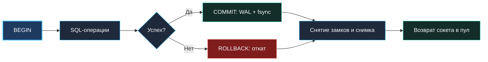

*Жизненный цикл транзакции в ядре СУБД и Go, шкала компромиссов изоляции и физическая цена блокировок и версий строк.*

> «Хотя поддержка конкурентности — одна из главных сильных сторон Go, рассуждать о конкурентных программах по природе труднее, чем о последовательных, и интуиция, выработанная на последовательном коде, порой подводит.»  
> — Алан Донован и Брайан Керниган, *The Go Programming Language*

Логический перевод денег в `LedgerPulse` на уровне ядра СУБД распадается на десятки обращений к 8-КБ страницам кучи, узлам B-Tree и журналу WAL. Выполнять все транзакции строго по очереди надёжно, но сервер на 64 ядрах превратился бы в однопоточную черепаху. Чтобы загрузить параллельное железо, СУБД ослабляют строгий порядок через уровни изоляции. Инженеру на Go важно видеть весь цикл жизни транзакции и понимать цену каждого уровня в памяти, блокировках и системных вызовах.



---

## Жизненный цикл транзакции: от `BEGIN` до возврата сокета

Теория баз данных описывает транзакцию как конечный автомат из пяти состояний:
1. **Active:** после `BEGIN` клиент отправляет `SELECT`, `INSERT`, `UPDATE`; ядро правит буферный пул и пишет WAL.
2. **Partially Committed:** последний запрос выполнен, сформирована запись `COMMIT`, но диск ещё не подтвердил сброс.
3. **Committed:** запись фиксации прошла через `fsync()`; изменения долговечны и видны по правилам изоляции.
4. **Failed:** сбой ограничения (`CHECK`, `UNIQUE`), конфликт сериализации, дедлок или отмена контекста. (В PostgreSQL после первой же ошибки блок транзакции переходит в состояние *aborted* и отклоняет любые команды до `ROLLBACK`.)
5. **Aborted:** выполнен откат, все правки аннулированы.

> [!info] Под капотом: `xmin` и `trx_id`
> В PostgreSQL читающие транзакции обходятся лёгким виртуальным `vxid`. Постоянный счётчик **XID** (на диске 32 бита с арифметикой по модулю $2^{32}$, в памяти 64-битный `FullTransactionId`) выдаётся лишь при первой модификации данных и пишется в заголовок строки `xmin`. В MySQL InnoDB эту роль играет `trx_id`, хранимый в строке кластерного индекса вместе с 7-байтовым указателем `roll_ptr` на Undo Log.

### Механика в Go и СУБД

При вызове `db.BeginTx(ctx, opts)` пакет `database/sql` забирает свободное TCP-соединение из пула и **закрепляет его за `*sql.Tx`** до конца транзакции (Tx-pinning, подробнее в Модуле 10). На стороне PostgreSQL процесс бэкенда регистрирует транзакцию в общей структуре `PGPROC` и инициализирует снимок видимости.

При `tx.Commit()` ядро дописывает `COMMIT record` в WAL, вызывает `fsync()` ([[1. ACID — четыре гарантии транзакции без иллюзий]]), снимает эксклюзивные блокировки строк, закрывает снимок (разблокируя сборку мусора для `VACUUM`) и возвращает сокет в пул Go.

> [!warning] Ловушка: утечка соединений пула
> Забытый `Rollback()` на раннем выходе не вернёт сокет в пул `*sql.DB`. Когда число потерянных транзакций достигнет `SetMaxOpenConns`, приложение встанет в таймаут.

```go
func FreezeInactiveAccount(ctx context.Context, db *sql.DB, accountID int64) error {
	tx, err := db.BeginTx(ctx, nil)
	if err != nil {
		return fmt.Errorf("begin tx: %w", err)
	}
	defer func() { _ = tx.Rollback() }()

	res, err := tx.ExecContext(ctx,
		"UPDATE accounts SET status = 'frozen', updated_at = now() WHERE id = $1 AND status = 'active'",
		accountID,
	)
	if err != nil {
		return err
	}
	if n, _ := res.RowsAffected(); n == 0 {
		return errors.New("account not active or missing")
	}
	return tx.Commit()
}
```

---

## Уровни изоляции: спектр компромиссов

Стандарт ANSI SQL-92 закрепил четыре уровня изоляции по трём феноменам (`Dirty Read`, `Non-Repeatable Read`, `Phantom Read`). В 1995 году Хэл Беренсон, Фил Бернштейн, Джим Грэй и соавторы в статье *A Critique of ANSI SQL Isolation Levels* показали, что эта шкала неполна: она упускает аномалии **Lost Update** и **Write Skew** и не отражает модель **Snapshot Isolation**, лежащую в основе PostgreSQL и Oracle.


| Уровень | Грязное чтение | Неповторяющееся чтение | Фантомы | Стоимость |
|---|---|---|---|---|
| **Read Uncommitted** | Да (по стандарту) | Да | Да | Минимальная (в PG эквивалентен `Read Committed`) |
| **Read Committed** | Нет | Да | Да | Низкая: снимок на каждый запрос |
| **Repeatable Read** | Нет | Нет | Зависит от СУБД | Средняя: долгий снимок или замки диапазонов |
| **Serializable** | Нет | Нет | Нет | Высокая: граф `rw`-конфликтов или 2PL и повторы |

> [!tip] Собеседование [Junior]
> **Вопрос:** Почему `READ COMMITTED` не защищает от неповторяющегося чтения?
> **Ответ:** Потому что каждый SQL-оператор внутри транзакции строит свежий снимок на момент своего старта, а не начала всей транзакции. Если между двумя `SELECT` другая транзакция зафиксировала изменение строки, второй запрос увидит уже новое значение.

---

## Блокировки против MVCC

Реляционные движки реализуют изоляцию двумя базовыми способами:

### 1. Пессимистические блокировки (Lock-Based / 2PL)
Для чтения строка берётся под разделяемую блокировку (`Shared`, S), для записи — под эксклюзивную (`Exclusive`, X). Читатели не мешают друг другу, но **читатели блокируют писателей, а писатели — читателей**. Модель даёт предсказуемость и хранит одну версию строки, но тормозит параллельные чтения и чревата взаимными блокировками (дедлоками). Явный замок доступен и в MVCC-системах:

```sql
BEGIN;
SELECT balance FROM accounts WHERE id = 1 FOR UPDATE;
UPDATE accounts SET balance = balance - 500 WHERE id = 1;
COMMIT;
```

### 2. Многоверсионный контроль (MVCC)
**Multi-Version Concurrency Control** опирается на идею, что конфликты редки, а читателям достаточно видеть согласованную прошлую версию строки: **читатели никогда не блокируют писателей, а писатели — читателей**. Отчёты сканируют таблицы без остановки платежей. Цена — накопление старых версий кортежей (**bloat**) и необходимость фоновой очистки (`VACUUM`).

> [!info] Под капотом: видимость версий в PostgreSQL
> Каждый кортеж содержит `xmin` (XID создателя) и `xmax` (XID удалившего или обновившего, `0` у актуальной версии). Снимок `Snapshot` хранит `xmin` (минимальный активный XID), `xmax` (первый ещё не назначенный XID) и массив активных транзакций `xip[]`. Версия видима без блокировок, если `xmin` зафиксирован и `xmin < snap.xmax` (не входя в `snap.xip[]`), а `xmax = 0` либо ещё не зафиксирован на момент снимка. Эту механику мы соберём в `project/step05/mvcc_wal.go` и разберём в главах 7 и 12.

| Критерий | Классический 2PL | Гибрид InnoDB | MVCC (PostgreSQL) |
|---|---|---|---|
| **Обычный `SELECT`** | Берёт S-замок, может ждать | Без замков (читает Undo Log) | Без замков (версии в куче) |
| **Запись (`UPDATE`)** | Берёт X-замок | X-замок + Undo Log | Новая версия кортежа + X-замок |
| **Фантомы** | Предикатные замки | Next-Key Locking | Снимок в RR; `SIREAD` в SSI |
| **Очистка** | Не нужна | Purge Undo Log | Требуется `VACUUM` |

---

## Выбор уровня изоляции и ретраи в продакшене

* **`READ COMMITTED`:** атомарные `UPDATE balance = balance + $1`, оптимистичная блокировка по `version` или явный `FOR UPDATE` — максимальная пропускная способность.
* **`REPEATABLE READ`:** многошаговые отчёты и сверки `accounts` с `ledger_entries`, где важен единый срез времени.
* **`SERIALIZABLE`:** сложные межстрочные инварианты при редких конфликтах и обязательной логике повторов при `SQLSTATE 40001`.

> [!warning] Ловушка: отказ сериализации `40001`
> В `REPEATABLE READ` и `SERIALIZABLE` PostgreSQL может вернуть `SQLSTATE 40001` (`serialization_failure`) даже на корректном запросе. Приложение обязано откатывать и повторять транзакцию целиком.

```go
type sqlStateError interface{ SQLState() string }

func isRetryable(err error) bool {
	var se sqlStateError
	return errors.As(err, &se) && (se.SQLState() == "40001" || se.SQLState() == "40P01")
}

func RunWithRetry(ctx context.Context, db *sql.DB, opts *sql.TxOptions, maxAttempts int, fn func(*sql.Tx) error) error {
	for attempt := 1; attempt <= maxAttempts; attempt++ {
		tx, err := db.BeginTx(ctx, opts)
		if err != nil {
			return err
		}
		if err = fn(tx); err == nil {
			err = tx.Commit()
		} else {
			_ = tx.Rollback()
		}
		if err == nil {
			return nil
		}
		if !isRetryable(err) || attempt == maxAttempts {
			return err
		}
		timer := time.NewTimer(time.Duration(1<<uint(attempt-1)) * 10 * time.Millisecond)
		select {
		case <-timer.C:
		case <-ctx.Done():
			timer.Stop()
			return ctx.Err()
		}
	}
	return errors.New("max retries exceeded")
}
```

---

## Практические паттерны транзакций в Go

### 1. Контекстный таймаут и `lock_timeout`

Ограничивайте время жизни транзакции и ожидания строковых замков, чтобы зависшие блокировки не выедали пул соединений:

```go
func WithdrawWithTimeout(ctx context.Context, db *sql.DB, accountID, amount int64) error {
	ctx, cancel := context.WithTimeout(ctx, 3*time.Second)
	defer cancel()

	tx, err := db.BeginTx(ctx, &sql.TxOptions{Isolation: sql.LevelReadCommitted})
	if err != nil {
		return err
	}
	defer func() { _ = tx.Rollback() }()

	if _, err = tx.ExecContext(ctx, "SET LOCAL lock_timeout = '1500ms'"); err != nil {
		return err
	}
	var bal int64
	if err = tx.QueryRowContext(ctx, "SELECT balance FROM accounts WHERE id = $1 FOR UPDATE", accountID).Scan(&bal); err != nil {
		return err
	}
	if bal < amount {
		return errors.New("insufficient funds")
	}
	if _, err = tx.ExecContext(ctx, "UPDATE accounts SET balance = $1 WHERE id = $2", bal-amount, accountID); err != nil {
		return err
	}
	return tx.Commit()
}
```

### 2. Точки сохранения (`SAVEPOINT`)

Вложенных независимых транзакций в SQL нет, но `SAVEPOINT` позволяет откатить сбойный фрагмент внутри открытой транзакции:

```go
func WithSavepoint(ctx context.Context, tx *sql.Tx, name string, fn func() error) error {
	if _, err := tx.ExecContext(ctx, "SAVEPOINT "+name); err != nil {
		return err
	}
	if err := fn(); err != nil {
		_, _ = tx.ExecContext(ctx, "ROLLBACK TO SAVEPOINT "+name)
		return err
	}
	_, err := tx.ExecContext(ctx, "RELEASE SAVEPOINT "+name)
	return err
}
```

В PostgreSQL каждая точка сохранения с записью выделяет субтранзакцию (`subxid`). При превышении лимита в 64 активных `subxid` на сессию снимок переходит в режим `suboverflowed`, и проверки видимости начинают обращаться к `pg_subtrans`, замедляя даже соседние чтения. Не используйте `SAVEPOINT` в массовых циклах.

> [!tip] Собеседование [Middle]
> **Вопрос:** Что произойдёт, если внутри функции с `*sql.Tx` по ошибке вызвать `db.ExecContext(...)` вместо `tx.ExecContext(...)`?
> **Ответ:** Драйвер возьмёт *другое* соединение из пула и выполнит запрос вне транзакции. Вы потеряете атомарность, а если строка уже заблокирована внешней `tx`, вторая горутина или даже та же горутина немедленно уйдёт в самоблокировку до срабатывания таймаута.

---

## Физическая цена изоляции на уровне железа

* **Память и кэш L3 CPU:** старые версии строк в MVCC увеличивают рабочий набор страниц в `shared_buffers` и вытесняют горячие данные из кэша L3; долгие снимки `REPEATABLE READ` не дают `VACUUM` чистить мусор.
* **Диск:** каждый `COMMIT` с `synchronous_commit = on` вызывает `fsync()` (50 мкс–2 мс на SSD, 10–15 мс на HDD); групповой коммит делит эту цену между близкими транзакциями.
* **CPU, CAS и `futex`:** управление замками через атомарные CAS-инструкции порождает трафик когерентности кэш-линий между ядрами. При `SELECT ... FOR UPDATE` на занятой строке процесс СУБД засыпает в ядре (`waiting` в `PGPROC`), горутина в Go паркуется, **но соединение пула остаётся занятым**. После коммита владельца ядро ОС будит процесс через `futex_wake`.

---

## Упражнения

### Упражнение 1 (Базовое): Диагностика ошибок в коде Go
Найдите две ошибки в функции начисления бонуса:

```go
func CreditBonus(ctx context.Context, db *sql.DB, accountID, bonus int64) error {
	tx, err := db.BeginTx(ctx, nil)
	if err != nil {
		return err
	}
	if _, err := db.ExecContext(ctx, "UPDATE accounts SET balance = balance + $1 WHERE id = $2", bonus, accountID); err != nil {
		return err
	}
	_, err = tx.ExecContext(ctx, "INSERT INTO transactions (reference_id, kind, status) VALUES ($1, 'deposit', 'posted')",
		fmt.Sprintf("bonus-%d", accountID))
	if err != nil {
		return err
	}
	return tx.Commit()
}
```

> [!solution] Показать решение
> 1. `db.ExecContext` вместо `tx.ExecContext`: списание/начисление уходит в отдельное соединение вне транзакции и не откатится при ошибке `INSERT`.
> 2. Отсутствует `defer func() { _ = tx.Rollback() }()`: при ошибке `INSERT` соединение утечёт из пула.

### Упражнение 2 (Практическое): Необязательная статистика через `SAVEPOINT`
Реализуйте `RecordWithOptionalStats(ctx context.Context, tx *sql.Tx, accountID, delta int64) error`, которая обновляет баланс в `accounts`, а вставку в `daily_stats` оборачивает в `WithSavepoint`, чтобы сбой статистики не прерывал всю транзакцию PostgreSQL.

> [!solution] Показать решение
> ```go
> func RecordWithOptionalStats(ctx context.Context, tx *sql.Tx, accountID, delta int64) error {
> 	if _, err := tx.ExecContext(ctx,
> 		"UPDATE accounts SET balance = balance + $1 WHERE id = $2", delta, accountID,
> 	); err != nil {
> 		return fmt.Errorf("update balance: %w", err)
> 	}
> 	_ = WithSavepoint(ctx, tx, "sp_stats", func() error {
> 		_, err := tx.ExecContext(ctx,
> 			"INSERT INTO daily_stats (account_id, delta) VALUES ($1, $2)", accountID, delta,
> 		)
> 		return err
> 	})
> 	return nil
> }
> ```
> Без `SAVEPOINT` любая ошибка `INSERT` перевела бы транзакцию PostgreSQL в состояние *aborted*, заблокировав `COMMIT`.

### Упражнение 3 (Со звёздочкой \*): Паралич пула из-за одной горячей строки
Пул настроен на `db.SetMaxOpenConns(20)`. 20 горутин одновременно вызвали `SELECT balance FROM accounts WHERE id = 1 FOR UPDATE`, причём первая ушла в 10-секундный HTTP-запрос. Почему перестают работать даже лёгкие `SELECT` по счёту `id = 999`?

> [!solution] Показать решение
> Каждая транзакция `*sql.Tx` монопольно удерживает соединение пула до `Commit`/`Rollback`. Пока первая горутина ждёт HTTP 10 секунд, остальные 19 соединений пула заблокированы горутинами, стоящими в очереди `FOR UPDATE` на строку `id = 1`. Все 20 слотов пула исчерпаны, и любой новый запрос к `id = 999` ждёт свободного сокета в клиентской очереди пула вплоть до таймаута. Защита — выносить сеть за границы транзакции и ставить `lock_timeout`.

---

## Мостик к следующему уроку

Мы разобрали конечный автомат транзакции, сравнили блокировки с MVCC и увидели цену ожидания на уровне железа. В следующей главе мы детально препарируем три главных рабочих уровня изоляции — `READ COMMITTED`, `REPEATABLE READ` и `SERIALIZABLE` — и разберёмся, как работает алгоритм SSI.
