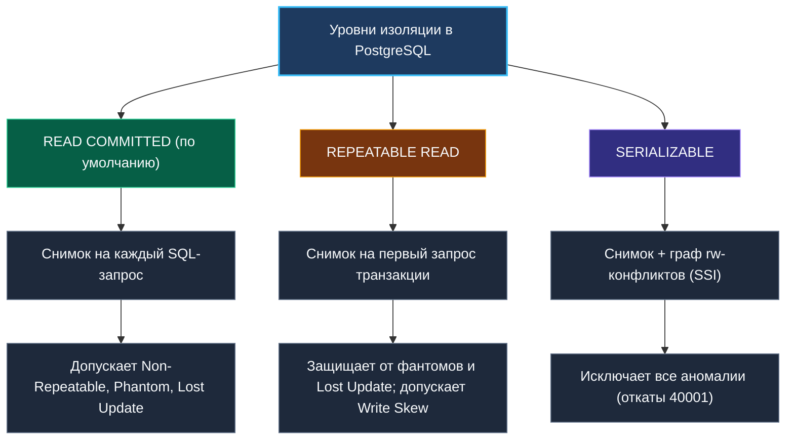

*Как движок формирует снимки данных, почему `READ UNCOMMITTED` в PostgreSQL не существует физически, и как алгоритм SSI обеспечивает серийную эквивалентность без глобальных блокировок.*

> «В идеальном мире прикладному программисту достаточно знать только API — без того, как этот API реализован и к какому железу он обращается. В реальности же чуть более глубокие знания порой оказываются весьма кстати.»  
> — Чарльз Петцольд, *Code: The Hidden Language of Computer Hardware and Software*

Две горутины в сервисе `LedgerPulse` формируют суточный отчёт по счёту и одновременно проводят переводы. На тестовом стенде цифры сходятся копейка в копейку. Под реальной нагрузкой итог проводок в `ledger_entries` расходится с балансом в `accounts`, а часть транзакций внезапно падает с ошибкой сериализации. Всё зависит от того, как база данных строит снимки видимости на уровнях **READ COMMITTED**, **REPEATABLE READ** и **SERIALIZABLE**.



---

## `READ COMMITTED`: снимок на каждый SQL-оператор

**READ COMMITTED** — уровень по умолчанию в PostgreSQL и Oracle (в MySQL InnoDB по умолчанию стоит `REPEATABLE READ`, см. Модуль 7). Режим `READ UNCOMMITTED` в PostgreSQL существует только в синтаксисе: ядро автоматически исполняет его как `READ COMMITTED`, потому что архитектура MVCC не читает незафиксированные черновики.

Принцип `READ COMMITTED`: **транзакция никогда не видит чужих незафиксированных правок, но каждый отдельный SQL-оператор строит свежий моментальный снимок**.

### Механика в PostgreSQL и `EvalPlanQual`

1. Перед каждым `SELECT`, `UPDATE` или `DELETE` движок фиксирует новый `Snapshot` с текущими `xmin`, `xmax` и `xip[]` ([[2. Транзакции и уровни изоляции — зачем ослаблять строгий порядок]]).
2. Пока выполняется один оператор, он видит срез на момент своего старта.
3. Следующий запрос в той же транзакции создаёт новый снимок и видит все коммиты, прошедшие в паузе между запросами.

Если при конкурентном `UPDATE` строка была заблокирована другой транзакцией, наш запрос ждёт снятия замка. Когда первая транзакция делает `COMMIT`, в `READ COMMITTED` срабатывает механизм **EvalPlanQual (EPQ)**: PostgreSQL перечитывает *новую* зафиксированную версию строки и заново проверяет предикат `WHERE`.

```sql
-- Транзакция 1
BEGIN TRANSACTION ISOLATION LEVEL READ COMMITTED;
SELECT balance FROM accounts WHERE id = 1; -- 10000

-- Транзакция 2 (параллельно)
BEGIN;
UPDATE accounts SET balance = balance + 5000 WHERE id = 1;
COMMIT;

-- Транзакция 1
SELECT balance FROM accounts WHERE id = 1; -- 15000: снимок обновился (Non-Repeatable Read)
COMMIT;
```

Если логика укладывается в один атомарный SQL-оператор, `READ COMMITTED` даёт максимальную скорость:

```go
func DebitAtomic(ctx context.Context, db *sql.DB, accountID, amount int64) error {
	res, err := db.ExecContext(ctx,
		"UPDATE accounts SET balance = balance - $1, updated_at = now() WHERE id = $2 AND balance >= $1",
		amount, accountID,
	)
	if err != nil {
		return err
	}
	if n, _ := res.RowsAffected(); n == 0 {
		return errors.New("insufficient funds or account missing")
	}
	return nil
}
```

> [!warning] Ловушка: Read-Modify-Write в памяти Go под `READ COMMITTED`
> Если вы читаете `balance` в Go, вычисляете новое число в коде и делаете `UPDATE accounts SET balance = $1 WHERE id = $2`, `READ COMMITTED` допустит потерю обновления (`Lost Update`). Используйте SQL-арифметику, `FOR UPDATE` или столбец `version`.

---

## `REPEATABLE READ`: замороженный снимок на всю транзакцию

Уровень **REPEATABLE READ** гарантирует, что все запросы транзакции работают с одним и тем же срезом данных.

1. Снимок фиксируется **при первом запросе** (`SELECT` или DML), а не в момент вызова `BEGIN`.
2. Чужие коммиты, случившиеся после создания снимка, полностью невидимы.
3. Благодаря единому снимку новые строки, вставленные другими транзакциями, имеют более поздний `xmin` и не попадают в выборки — поэтому **в PostgreSQL на уровне `REPEATABLE READ` нет и фантомных чтений**.
4. **Правило First-Updater-Wins:** при попытке изменить (`UPDATE`/`DELETE`) строку, которую уже обновила и зафиксировала другая транзакция после нашего снимка, PostgreSQL немедленно прерывает транзакцию с ошибкой `SQLSTATE 40001` (`could not serialize access due to concurrent update`).

```sql
-- Транзакция 1: сверка счёта в LedgerPulse
BEGIN TRANSACTION ISOLATION LEVEL REPEATABLE READ;
SELECT balance FROM accounts WHERE id = 1; -- 10000

-- Транзакция 2 (параллельно)
BEGIN;
UPDATE accounts SET balance = balance + 2500 WHERE id = 1;
INSERT INTO ledger_entries (transaction_id, account_id, amount, currency) VALUES (42, 1, 2500, 'USD');
COMMIT;

-- Транзакция 1: видит согласованный снимок
SELECT COALESCE(SUM(amount), 0) FROM ledger_entries WHERE account_id = 1; -- всё ещё 10000
COMMIT;
```

В Go для таких сверок и отчётов удобно сочетать `sql.LevelRepeatableRead` с `ReadOnly: true` (читающие транзакции в PostgreSQL не тратят счётчик XID):

```go
func ReconcileAccount(ctx context.Context, db *sql.DB, accountID int64) (stored, sum int64, err error) {
	tx, err := db.BeginTx(ctx, &sql.TxOptions{
		Isolation: sql.LevelRepeatableRead,
		ReadOnly:  true,
	})
	if err != nil {
		return 0, 0, err
	}
	defer func() { _ = tx.Rollback() }()

	if err = tx.QueryRowContext(ctx, "SELECT balance FROM accounts WHERE id = $1", accountID).Scan(&stored); err != nil {
		return 0, 0, err
	}
	if err = tx.QueryRowContext(ctx, "SELECT COALESCE(SUM(amount), 0) FROM ledger_entries WHERE account_id = $1", accountID).Scan(&sum); err != nil {
		return 0, 0, err
	}
	return stored, sum, tx.Commit()
}
```

> [!tip] Собеседование [Middle]
> **Вопрос:** Может ли транзакция на уровне `REPEATABLE READ` в PostgreSQL упасть с ошибкой сериализации на одном `UPDATE`?
> **Ответ:** Да. Если снимок уже создан, а параллельная транзакция успела обновить и зафиксировать ту же строку позже этого снимка, `UPDATE` не сможет перечитать её как в `READ COMMITTED` и сразу вернёт `ERROR: could not serialize access due to concurrent update` (`SQLSTATE 40001`). Приложение должно повторить транзакцию целиком.

---

## `SERIALIZABLE`: серийная эквивалентность и алгоритм SSI

**SERIALIZABLE** гарантирует, что результат параллельных транзакций математически эквивалентен некоторому их строго последовательному выполнению.

Долгое время сериализуемость требовала пессимистических предикатных блокировок (2PL), которые тормозили читателей. В 2008 году Майкл Кэхилл, Уве Рём и Алан Фекете предложили **Serializable Snapshot Isolation (SSI)**, а в 2011 году Кевин Гриттнер и Дэн Портс реализовали этот алгоритм в PostgreSQL 9.1:

1. Чтение идёт без блокировок по обычному снимку MVCC.
2. Запросы `SELECT` регистрируют лёгкие неблокирующие предикатные замки `SIREAD`, отмечающие прочитанные строки и диапазоны индексов.
3. Движок отслеживает конфликты «чтение-запись» (**rw-antidependency**): одна транзакция прочитала версию данных, которую конкурентная транзакция затем изменила. По теореме Кэхилла любой несериализуемый график содержит «опасную структуру» из двух смежных `rw`-рёбер (`T1 --rw--> T2 --rw--> T3`), где `T3` зафиксировалась первой. Заметив такую пару конфликтов, ядро прерывает одну из транзакций с `SQLSTATE 40001`.

> [!info] Под капотом: структуры SSI в `shared_memory`
> PostgreSQL хранит состояние SSI в двух общих структурах:
> * `PredicateLockTable` — хеш-таблица замков `SIREAD` на кортежах, страницах или таблицах (при превышении `max_pred_locks_per_transaction`, по умолчанию 64, замки укрупняются до страницы/таблицы, повышая риск ложных откатов);
> * `SerializableXact` — дескриптор транзакции с флагами входящих и исходящих конфликтов (`inConflict`, `outConflict`), позволяющий обнаруживать опасные структуры за локальное время без полного обхода графа на каждый коммит.

```sql
-- Пример защиты от Write Skew в LedgerPulse
-- T1: проверка общего лимита клиента Alice и списание со счёта 10
BEGIN TRANSACTION ISOLATION LEVEL SERIALIZABLE;
SELECT SUM(balance) FROM accounts WHERE owner_name = 'Alice'; -- 12000

-- T2 (параллельно): проверка для счёта 11
BEGIN TRANSACTION ISOLATION LEVEL SERIALIZABLE;
SELECT SUM(balance) FROM accounts WHERE owner_name = 'Alice'; -- 12000

-- T1 списывает 4000 со счёта 10 и фиксируется первой
UPDATE accounts SET balance = balance - 4000 WHERE id = 10;
COMMIT; -- OK

-- T2 списывает 4000 со счёта 11 и пытается зафиксироваться
UPDATE accounts SET balance = balance - 4000 WHERE id = 11;
COMMIT; -- ERROR: could not serialize access due to read/write dependencies among transactions
```

### Ретрай с экспоненциальной задержкой и jitter в Go 1.24

Код под `SERIALIZABLE` обязан повторять транзакцию при `40001` со случайным разбросом (`jitter`), чтобы конфликтующие горутины не сталкивались синхронно на следующем круге (в Go 1.22+ используйте потокобезопасный `math/rand/v2`):

```go
type pgSQLState interface{ SQLState() string }

func isSerializationErr(err error) bool {
	var se pgSQLState
	return errors.As(err, &se) && (se.SQLState() == "40001" || se.SQLState() == "40P01")
}

func RunSerializable(ctx context.Context, db *sql.DB, maxAttempts int, fn func(*sql.Tx) error) error {
	for attempt := 1; attempt <= maxAttempts; attempt++ {
		tx, err := db.BeginTx(ctx, &sql.TxOptions{Isolation: sql.LevelSerializable})
		if err != nil {
			return err
		}
		if err = fn(tx); err == nil {
			err = tx.Commit()
		} else {
			_ = tx.Rollback()
		}
		if err == nil {
			return nil
		}
		if !isSerializationErr(err) || attempt == maxAttempts {
			return err
		}
		base := time.Duration(1<<uint(attempt-1)) * 10 * time.Millisecond
		wait := base + time.Duration(rand.IntN(int(base/2)+1))
		timer := time.NewTimer(wait)
		select {
		case <-timer.C:
		case <-ctx.Done():
			timer.Stop()
			return ctx.Err()
		}
	}
	return errors.New("max serializable retries exceeded")
}
```

> [!warning] Ловушка: `SERIALIZABLE` без нужды
> При высокой конкуренции на горячих строках доля ошибок `40001` достигает 30–50%. Откаченные транзакции тратят CPU и оставляют мёртвые кортежи в куче. Используйте `READ COMMITTED` + явные блокировки или версионирование, оставляя `SERIALIZABLE` для редких сложных инвариантов (менее ~5% конфликтов).

---

## Сравнительная таблица и `Write Skew`

| Аномалия | `READ COMMITTED` | `REPEATABLE READ` (PG) | `SERIALIZABLE` (PG / SSI) |
|---|---|---|---|
| **Dirty Read** | Защищён | Защищён | Защищён |
| **Non-Repeatable Read** | Допускает | Защищён | Защищён |
| **Phantom Read** | Допускает | Защищён (снимком MVCC) | Защищён |
| **Lost Update** | Допускает (без `FOR UPDATE` / SQL) | Защищён (`40001`) | Защищён (`40001`) |
| **Write Skew** | Допускает | Допускает | Защищён (`40001`) |

> [!tip] Собеседование [Senior/Staff]
> **Вопрос:** Что такое `Write Skew` и почему `REPEATABLE READ` (Snapshot Isolation) его не предотвращает?
> **Ответ:** `Write Skew` возникает, когда две транзакции читают пересекающийся набор данных, проверяют общий инвариант и обновляют **разные** строки (например, два врача проверяют, что коллега на дежурстве, и оба уходят; или в `LedgerPulse` идут два списания с разных счетов одного владельца с общим неснижаемым остатком). В `REPEATABLE READ` проверка конфликтов отслеживает только запись в одну и ту же строку. Поскольку множества записи не пересекаются, оба коммита проходят. Обнаружить пересечение чтения одной транзакции с записью другой способен только `SERIALIZABLE` (через `SIREAD` и граф `rw`-конфликтов) или явная блокировка общей родительской строки `FOR UPDATE`.

---

## Цена изоляции на уровне железа и оптимистичные версии

1. **Кэш L3 CPU и раздувание таблиц:** долгие снимки `REPEATABLE READ` и `SERIALIZABLE` удерживают границу `VACUUM`, увеличивая число версий строк на 8-КБ страницах и вызывая промахи кэша L3 при обходе индексов ([[2. B-Tree индекс под капотом — страницы, ветвление и page split]]).
2. **Холостой I/O и WAL:** отменённая в `SERIALIZABLE` транзакция всё равно успела выделить XID, создать мёртвый кортеж и записать изменения в WAL.
3. **Ожидание в `SELECT ... FOR UPDATE`:** PostgreSQL находит строку в B-Tree за $O(\log N)$, обращается к `LockAcquire` в общей памяти, при конфликте усыпляет процесс в ядре (`waiting` в `PGPROC`), а горутина Go паркуется (`gopark`) с удержанием сокета пула. После `COMMIT` владельца процесс пробуждается через `futex_wake`.

На горячих путях с редкими конфликтами быстрой альтернативой `SERIALIZABLE` выступает оптимистический контроль версий под `READ COMMITTED`:

```go
func UpdateLimitOptimistic(ctx context.Context, db *sql.DB, id, newLimit, version int64) error {
	res, err := db.ExecContext(ctx, `
		UPDATE accounts
		SET metadata = jsonb_set(metadata, '{daily_limit}', to_jsonb($1::bigint)),
		    version = version + 1, updated_at = now()
		WHERE id = $2 AND version = $3
	`, newLimit, id, version)
	if err != nil {
		return err
	}
	if n, _ := res.RowsAffected(); n == 0 {
		return errors.New("optimistic lock conflict: version mismatch")
	}
	return nil
}
```

---

## Упражнения

### Упражнение 1 (Базовое): Трассировка `READ COMMITTED` против `REPEATABLE READ`
В `accounts` есть строка `id = 7, balance = 10000`.
1. T1 начинается и читает `SELECT balance FROM accounts WHERE id = 7` (`10000`).
2. T2 обновляет `balance = 6000` для `id = 7` и сразу делает `COMMIT`.
3. T1 выполняет `UPDATE accounts SET balance = balance - 3000 WHERE id = 7 AND balance >= 3000` и `COMMIT`.

Каким будет итог, если T1 работает в `READ COMMITTED`, и что произойдёт в `REPEATABLE READ`?

> [!solution] Показать решение
> * В **`READ COMMITTED`** шаг 3 строит новый снимок, видит `6000 >= 3000`, списывает `3000` и успешно фиксирует итоговый баланс `3000`.
> * В **`REPEATABLE READ`** строка `id = 7` была зафиксирована T2 уже после первого снимка T1, поэтому правило First-Updater-Wins прервёт `UPDATE` в T1 с ошибкой `ERROR: could not serialize access due to concurrent update` (`SQLSTATE 40001`).

### Упражнение 2 (Практическое): Ограниченный backoff с jitter
Доработайте `RunSerializable`: добавьте верхний предел задержки `maxBackoff` (например, `200ms`), раннюю проверку `ctx.Err()` до начала попытки и callback `onRetry(attempt int, err error)` для метрик.

> [!solution] Показать решение
> ```go
> func RunSerializableBounded(
> 	ctx context.Context, db *sql.DB, maxAttempts int, maxBackoff time.Duration,
> 	onRetry func(int, error), fn func(*sql.Tx) error,
> ) error {
> 	for attempt := 1; attempt <= maxAttempts; attempt++ {
> 		if err := ctx.Err(); err != nil {
> 			return err
> 		}
> 		tx, err := db.BeginTx(ctx, &sql.TxOptions{Isolation: sql.LevelSerializable})
> 		if err != nil {
> 			return err
> 		}
> 		if err = fn(tx); err == nil {
> 			err = tx.Commit()
> 		} else {
> 			_ = tx.Rollback()
> 		}
> 		if err == nil {
> 			return nil
> 		}
> 		if !isSerializationErr(err) || attempt == maxAttempts {
> 			return err
> 		}
> 		if onRetry != nil {
> 			onRetry(attempt, err)
> 		}
> 		backoff := min(time.Duration(1<<uint(attempt-1))*10*time.Millisecond, maxBackoff)
> 		wait := backoff/2 + time.Duration(rand.IntN(int(backoff/2)+1))
> 		timer := time.NewTimer(wait)
> 		select {
> 		case <-timer.C:
> 		case <-ctx.Done():
> 			timer.Stop()
> 			return ctx.Err()
> 		}
> 	}
> 	return errors.New("max retries exceeded")
> }
> ```

### Упражнение 3 (Со звёздочкой \*): Общий минимум без `SERIALIZABLE`
У клиента `customers (id, min_total_balance)` несколько счетов `accounts (id, customer_id, balance)`. Как гарантировать на уровне `READ COMMITTED`, что два одновременных списания с разных счетов этого клиента не опустят их сумму ниже `min_total_balance`?

> [!solution] Показать решение
> Заблокировать родительскую запись клиента или все его счета в детерминированном порядке до проверки суммы:
> ```sql
> BEGIN;
> SELECT min_total_balance FROM customers WHERE id = $1 FOR UPDATE;
> SELECT COALESCE(SUM(balance), 0) FROM accounts WHERE customer_id = $1;
> -- проверка остатка и UPDATE конкретного счёта
> COMMIT;
> ```
> Блокировка строки `customers` сериализует конкурирующие списания одного владельца без перехода всей базы на `SERIALIZABLE` и без влияния на других клиентов.

---

## Мостик к следующему уроку

Вы разобрали три рабочих уровня изоляции и увидели, как алгоритм SSI превращает снимки MVCC в строгую сериализуемость. В следующей главе мы сложим общую картину аномалий конкурентного доступа — `Dirty Read`, `Phantom Read`, `Lost Update` и `Write Skew` — разберём их пошаговые таймлайны и закрепим чеклист защиты для сервисов на Go.
