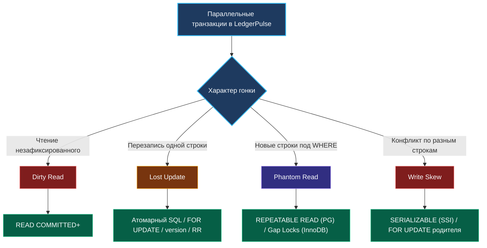

*Пошаговые таймлайны четырёх аномалий конкурентности на переводах `LedgerPulse` и выбор защиты без лишней потери пропускной способности.*

> «Только простота архитектуры позволяет системе оставаться устойчивой, безопасной и цельной по мере роста.»  
> — Алан Донован и Брайан Керниган, *The Go Programming Language*

Синтаксическую ошибку компилятор Go ловит ещё до сборки. Транзакционные аномалии молчат: запросы возвращают `200 OK`, транзакции успешно проходят `COMMIT`, логи чисты — а на счетах `LedgerPulse` пропадают пополнения, отчёты не сходятся с остатками, и клиент уходит ниже допустимого резерва. Чтобы защитить данные, нужно видеть механику каждой из четырёх аномалий — **Dirty Read**, **Lost Update**, **Phantom Read** и **Write Skew** — на уровне версий строк, предикатов и пула соединений.



---

## 1. `Dirty Read` (грязное чтение)

**Определение:** транзакция читает данные, изменённые другой незавершённой транзакцией. Если вторая выполнит `ROLLBACK`, первая примет решение на основе данных, которых в базе никогда не было.

В блокировочных движках это случается при чтении без разделяемого замка (`Shared Lock`), в MVCC — при гипотетическом чтении «черновика» версии до фиксации её `xmin` в журнале.

```sql
-- T1: меняет баланс, но ещё не фиксирует
BEGIN;
UPDATE accounts SET balance = 50000 WHERE id = 1; -- было 10000

-- T2 (гипотетический READ UNCOMMITTED)
SELECT balance FROM accounts WHERE id = 1; -- прочитало бы 50000

-- T1 откатывается
ROLLBACK; -- баланс снова 10000, но T2 уже приняла неверное решение
```

> [!warning] Ловушка: нужно ли специально защищаться от `Dirty Read`
> В PostgreSQL `Dirty Read` невозможен физически: уровень `READ UNCOMMITTED` автоматически работает как `READ COMMITTED` ([[3. Read Committed, Repeatable Read и Serializable]]). В MySQL InnoDB режим `READ UNCOMMITTED` почти не используется на практике, так как ломает согласованность и репликацию. Уровень по умолчанию `READ COMMITTED` полностью снимает эту проблему.

---

## 2. `Lost Update` (потерянное обновление)

**Определение:** две транзакции читают одну и ту же строку, независимо вычисляют новое значение в памяти Go и записывают результат обратно. Вторая транзакция затирает правку первой.

### Почему `READ COMMITTED` не спасает от Read-Modify-Write

Разберём пошаговый таймлайн для счёта `id = 1` (начальный баланс `10000` центов):

| Шаг | Транзакция A (`+1000`) | Транзакция B (`-2000`) | Баланс в БД |
|---:|---|---|---:|
| 1 | `SELECT balance ... WHERE id = 1` → `10000` | | `10000` |
| 2 | | `SELECT balance ... WHERE id = 1` → `10000` | `10000` |
| 3 | В Go: `10000 + 1000 = 11000` | В Go: `10000 - 2000 = 8000` | `10000` |
| 4 | `UPDATE ... SET balance = 11000` + `COMMIT` | | `11000` |
| 5 | | `UPDATE ... SET balance = 8000` + `COMMIT` | **`8000` вместо `9000`** |

При создании новой версии кортежа в `READ COMMITTED` PostgreSQL проверяет лишь то, что строка не заблокирована прямо сейчас другим `UPDATE` и не удалена. Как только A зафиксировалась, B без ошибок записывает `8000`, хотя опиралась на старое значение `10000`. При этом в PostgreSQL на уровне `REPEATABLE READ` (в отличие от минимального стандарта SQL-92) шаг 5 прервётся ошибкой `SQLSTATE 40001`.

### Три способа защиты от `Lost Update`

1. **Атомарный SQL-запрос** — лучший выбор для счётчиков и простых балансов:
   ```go
   func AdjustBalanceAtomic(ctx context.Context, db *sql.DB, id, delta int64) error {
   	res, err := db.ExecContext(ctx,
   		"UPDATE accounts SET balance = balance + $1, updated_at = now() WHERE id = $2 AND balance + $1 >= 0",
   		delta, id,
   	)
   	if err != nil {
   		return err
   	}
   	if n, _ := res.RowsAffected(); n == 0 {
   		return errors.New("insufficient funds or account missing")
   	}
   	return nil
   }
   ```

> [!tip] Собеседование [Junior]
> **Вопрос:** Почему `UPDATE accounts SET balance = balance + $1 WHERE id = $2` под `READ COMMITTED` не теряет обновления?
> **Ответ:** Чтение актуального баланса, прибавление дельты и запись выполняются атомарно под строковой блокировкой внутри СУБД. Конкурентный `UPDATE` ждёт коммита первого, а затем по механизму `EvalPlanQual` перечитывает уже обновлённую строку и применяет свою дельту к новому балансу.

2. **Пессимистическая блокировка `SELECT ... FOR UPDATE`** — когда между чтением и записью нужна проверка бизнес-логики или вставка в `ledger_entries` (подробно в главе 5):
   ```go
   func DebitWithRowLock(ctx context.Context, db *sql.DB, id, amount int64) error {
   	tx, err := db.BeginTx(ctx, &sql.TxOptions{Isolation: sql.LevelReadCommitted})
   	if err != nil {
   		return err
   	}
   	defer func() { _ = tx.Rollback() }()

   	var bal int64
   	if err = tx.QueryRowContext(ctx, "SELECT balance FROM accounts WHERE id = $1 FOR UPDATE", id).Scan(&bal); err != nil {
   		return err
   	}
   	if bal < amount {
   		return errors.New("insufficient funds")
   	}
   	if _, err = tx.ExecContext(ctx, "UPDATE accounts SET balance = $1 WHERE id = $2", bal-amount, id); err != nil {
   		return err
   	}
   	return tx.Commit()
   }
   ```

3. **Оптимистичная блокировка через `version`** — когда конфликты редки или между чтением и записью есть пауза на ввод пользователя:
   ```go
   func UpdateBalanceOptimistic(ctx context.Context, db *sql.DB, id, newBal, ver int64) error {
   	res, err := db.ExecContext(ctx,
   		"UPDATE accounts SET balance = $1, version = version + 1 WHERE id = $2 AND version = $3",
   		newBal, id, ver,
   	)
   	if err != nil {
   		return err
   	}
   	if n, _ := res.RowsAffected(); n == 0 {
   		return errors.New("optimistic lock conflict")
   	}
   	return nil
   }
   ```

---

## 3. `Phantom Read` (фантомное чтение)

**Определение:** транзакция дважды выполняет запрос с одинаковым предикатом `WHERE`, но получает разный набор строк из-за параллельных `INSERT` или `DELETE`, зафиксированных другой транзакцией.

Строковые замки (`FOR UPDATE`) защищают только **существующие** кортежи — они не могут заблокировать вставку новых строк, подходящих под условие `WHERE`.

```sql
-- T1: аудит проводок в READ COMMITTED
BEGIN ISOLATION LEVEL READ COMMITTED;
SELECT COUNT(*) FROM ledger_entries WHERE account_id = 1 AND amount > 0; -- 10

-- T2 (параллельно добавляет проводку)
BEGIN;
INSERT INTO ledger_entries (transaction_id, account_id, amount, currency) VALUES (99, 1, 5000, 'USD');
COMMIT;

-- T1: повторный запрос
SELECT COUNT(*) FROM ledger_entries WHERE account_id = 1 AND amount > 0; -- 11 (фантом)
COMMIT;
```

| СУБД | Механизм в `REPEATABLE READ` | Механизм в `SERIALIZABLE` |
|---|---|---|
| **PostgreSQL** | **Snapshot Isolation:** новые строки имеют `xmin` после снимка и физически невидимы. | **Предикатные замки `SIREAD`:** отслеживают пересечение чтения и вставки в графе конфликтов. |
| **MySQL InnoDB** | **Next-Key Locking:** замок строки + замок зазора (**Gap Lock**) между ключами индекса. | Аналогично + блокирующие чтения `FOR SHARE` (строгий 2PL). |

> [!info] Под капотом: `Gap Lock` в InnoDB
> Если индекс InnoDB содержит ключи `[10, 20, 30]`, запрос `WHERE id > 15 FOR UPDATE` блокирует не только записи `20` и `30`, но и промежуток `(10, 20)` и хвост `(30, +∞)`. Вставка `id = 18` или `id = 25` будет ждать (подробнее разберём в Модуле 7).

> [!tip] Собеседование [Middle]
> **Вопрос:** Как `Gap Lock` влияет на параллелизм вставок и чем помогает `SKIP LOCKED`?
> **Ответ:** `Gap Lock` сериализует параллельные `INSERT` в хвост индекса при автоинкрементных `id`. Для очередей задач в SQL переходят к `READ COMMITTED` и `FOR UPDATE SKIP LOCKED` (глава 5): воркеры пропускают заблокированные строки без блокировок диапазонов.

Для многошаговых финансовых отчётов в Go используйте `sql.LevelRepeatableRead` с `ReadOnly: true`:

```go
func BuildDailyTurnover(ctx context.Context, db *sql.DB, accountID int64, from, to time.Time) (inSum, outSum int64, err error) {
	tx, err := db.BeginTx(ctx, &sql.TxOptions{Isolation: sql.LevelRepeatableRead, ReadOnly: true})
	if err != nil {
		return 0, 0, err
	}
	defer func() { _ = tx.Rollback() }()

	err = tx.QueryRowContext(ctx,
		"SELECT COALESCE(SUM(amount), 0) FROM ledger_entries WHERE account_id = $1 AND amount > 0 AND created_at >= $2 AND created_at < $3",
		accountID, from, to,
	).Scan(&inSum)
	if err != nil {
		return 0, 0, err
	}
	err = tx.QueryRowContext(ctx,
		"SELECT COALESCE(SUM(amount), 0) FROM ledger_entries WHERE account_id = $1 AND amount < 0 AND created_at >= $2 AND created_at < $3",
		accountID, from, to,
	).Scan(&outSum)
	if err != nil {
		return 0, 0, err
	}
	return inSum, outSum, tx.Commit()
}
```

---

## 4. `Write Skew` (перекос записи)

**Определение:** две параллельные транзакции читают пересекающийся набор данных, проверяют общее правило и на его основе модифицируют **разные** (непересекающиеся) строки. Каждый запрос корректен по отдельности, но после обоих коммитов инвариант нарушен.

Даже PostgreSQL `REPEATABLE READ` (Snapshot Isolation) и правило **First-Committer-Wins** (которое мы реализуем в `project/step05/mvcc_wal.go` в главе 12) **не ловят `Write Skew`**, потому что множества записи (`writeset`) транзакций не пересекаются.

### Таймлайн на счетах `LedgerPulse`

У клиента `Alice` два счёта (`id = 10` с `6000` центов и `id = 11` с `6000` центов) и правило: сумма всех счетов клиента после списания должна оставаться не ниже `5000` центов.

| Шаг | Транзакция A (списание `4000` со счёта 10) | Транзакция B (списание `4000` со счёта 11) | Итог в `accounts` |
|---:|---|---|---|
| 1 | `BEGIN ISOLATION LEVEL REPEATABLE READ;` | `BEGIN ISOLATION LEVEL REPEATABLE READ;` | `10: 6000, 11: 6000` |
| 2 | `SELECT SUM(balance) ... WHERE owner_name='Alice'` → `12000` | `SELECT SUM(balance) ... WHERE owner_name='Alice'` → `12000` | Оба снимка видят `12000` |
| 3 | Проверка: `12000 - 4000 >= 5000` | Проверка: `12000 - 4000 >= 5000` | — |
| 4 | `UPDATE accounts SET balance = balance - 4000 WHERE id = 10;` | `UPDATE accounts SET balance = balance - 4000 WHERE id = 11;` | Правлены **разные** строки |
| 5 | `COMMIT;` (OK) | `COMMIT;` (OK) | **`10: 2000, 11: 2000` (сумма `4000 < 5000`)** |

В классическом примере та же ошибка возникает при дежурстве врачей: правило требует хотя бы одного дежурного, оба врача читают, что коллега на месте, и оба уходят со смены.

### Защита от `Write Skew`

1. **Уровень `SERIALIZABLE` (SSI):** предикатный замок `SIREAD` заметит пересечение чтения `SUM(balance)` с записью конкурентной транзакции и прервёт вторую с `SQLSTATE 40001`, отправив её на повтор.
2. **Материализация блокировки через `FOR UPDATE`:** в `READ COMMITTED` заблокируйте общую родительскую строку (`SELECT id FROM customers WHERE id = $1 FOR UPDATE`) или все счета владельца в порядке `ORDER BY id FOR UPDATE`, превратив параллельные проверки в очередь.

> [!tip] Собеседование [Senior/Staff]
> **Вопрос:** Может ли `Write Skew` проявиться через `INSERT` без обновления существующих строк?
> **Ответ:** Да. Например, при бронировании переговорной: две транзакции в `REPEATABLE READ` проверяют `SELECT COUNT(*) FROM bookings WHERE room_id = 5 AND ...`, видят `0` и вставляют разные строки. Защита — `SERIALIZABLE` (SSI) либо ограничение целостности в схеме, например `EXCLUDE USING gist` по диапазону времени.

---

## Физика железа: цена блокировок и версий

1. **Кэш-линии CPU и протокол MESI:** конкурентный `FOR UPDATE` на горячей строке вызывает атомарные операции (CAS) над таблицами замков в `shared_memory`. Если ядра меняют соседние слова в одной 64-байтной кэш-линии, протокол когерентности кэшей (MESI) постоянно инвалидирует кэш-линии, тратя такты на межъядерный обмен.
2. **Пул `*sql.DB` при ожидании:** пока горутина ждёт ответа от `SELECT ... FOR UPDATE`, планировщик Go её паркует, **но соединение пула остаётся занятым**. При `SetMaxOpenConns(20)` и 20 заблокированных горутинах встанет весь сервис. Защищайтесь `context.WithTimeout` и `SET LOCAL lock_timeout = '1s'`.
3. **Локальность данных в MVCC:** множество старых версий горячей строки размазывается по 8-КБ страницам в `shared_buffers`, снижая эффективность аппаратной предвыборки (prefetching) и увеличивая промахи кэша L3 CPU.

---

## Упражнения

### Упражнение 1 (Базовое): Распознавание аномалии
Назовите аномалию и минимальный уровень изоляции PostgreSQL, который устраняет её без ручных блокировок:
1. Внутри одной транзакции первый `SELECT COUNT(*) FROM transactions WHERE status = 'pending'` дал `12`, а второй — `14`.
2. Две транзакции прочли `balance = 5000` для `id = 3`; первая записала `6000`, вторая — `4500`, затерев пополнение `+1000`.
3. Две транзакции проверили, что у счёта минимум 2 администратора (`COUNT(*) = 2`), и закрыли **разные** строки `id = 10` и `id = 11`, оставив ноль администраторов.

> [!solution] Показать решение
> 1. **Phantom Read** — исчезает на уровне **`REPEATABLE READ`** в PostgreSQL.
> 2. **Lost Update** — исчезает в PostgreSQL на уровне **`REPEATABLE READ`** (ошибка `40001`).
> 3. **Write Skew** — исчезает только на уровне **`SERIALIZABLE`** (SSI).

### Упражнение 2 (Практическое): Оптимистичная защита начисления кэшбэка
Перепишите функцию начисления 5% кэшбэка на `accounts`, устранив `Lost Update` через оптимистичную проверку колонки `version` и до 3 попыток повтора при конфликте.

```go
func ApplyCashbackVulnerable(ctx context.Context, db *sql.DB, accountID, purchase int64) error {
	var bal int64
	if err := db.QueryRowContext(ctx, "SELECT balance FROM accounts WHERE id = $1", accountID).Scan(&bal); err != nil {
		return err
	}
	_, err := db.ExecContext(ctx, "UPDATE accounts SET balance = $1 WHERE id = $2", bal+purchase*5/100, accountID)
	return err
}
```

> [!solution] Показать решение
> ```go
> func ApplyCashbackOptimistic(ctx context.Context, db *sql.DB, accountID, purchase int64) error {
> 	cashback := purchase * 5 / 100
> 	if cashback <= 0 {
> 		return nil
> 	}
> 	for attempt := 1; attempt <= 3; attempt++ {
> 		var bal, ver int64
> 		if err := db.QueryRowContext(ctx, "SELECT balance, version FROM accounts WHERE id = $1", accountID).Scan(&bal, &ver); err != nil {
> 			return err
> 		}
> 		res, err := db.ExecContext(ctx,
> 			"UPDATE accounts SET balance = $1, version = version + 1 WHERE id = $2 AND version = $3",
> 			bal+cashback, accountID, ver,
> 		)
> 		if err != nil {
> 			return err
> 		}
> 		if n, _ := res.RowsAffected(); n == 1 {
> 			return nil
> 		}
> 	}
> 	return errors.New("optimistic lock conflict after 3 attempts")
> }
> ```

### Упражнение 3 (Со звёздочкой \*): Воспроизведение `Write Skew` в тесте Go
Напишите функцию-операцию с тестовым барьером `afterRead func()`, которая воспроизводит `Write Skew` при двух параллельных списаниях по `4000` со счетов `10` и `11` клиента `Alice` (балансы по `6000`, общий минимум `5000`) под `sql.LevelRepeatableRead`, и объясните, как поведение меняется под `sql.LevelSerializable` с повтором `40001`.

> [!solution] Показать решение
> ```go
> func withdrawWithMinTotal(
> 	ctx context.Context, tx *sql.Tx, owner string, accountID, amount, minTotal int64, afterRead func(),
> ) error {
> 	var total int64
> 	if err := tx.QueryRowContext(ctx,
> 		"SELECT COALESCE(SUM(balance), 0) FROM accounts WHERE owner_name = $1", owner,
> 	).Scan(&total); err != nil {
> 		return err
> 	}
> 	if afterRead != nil {
> 		afterRead() // барьер sync.WaitGroup для одновременного прохождения SELECT SUM обеими горутинами
> 	}
> 	if total-amount < minTotal {
> 		return errors.New("min total balance violated")
> 	}
> 	_, err := tx.ExecContext(ctx,
> 		"UPDATE accounts SET balance = balance - $1 WHERE id = $2 AND balance >= $1", amount, accountID,
> 	)
> 	return err
> }
> ```
> Под `LevelRepeatableRead` при барьере `sync.WaitGroup(2)` обе горутины видят `total = 12000`, обновляют разные строки (`10` и `11`) и обе фиксируются с суммой `4000 < 5000`. Под `LevelSerializable` первая горутина фиксируется, вторая на `Commit()` получает `SQLSTATE 40001`, повторяет транзакцию в `RunSerializable`, видит `total = 8000` и возвращает `"min total balance violated"`.

---

## Мостик к следующему уроку

Мы разложили по таймлайнам четыре аномалии конкурентного доступа — от безобидного для PostgreSQL `Dirty Read` до коварного `Write Skew`. Во многих реальных сценариях вместо дорогой полной сериализации инженеры управляют конкуренцией точечно с помощью блокировок. В следующей главе мы подробно разберём двухфазную блокировку (2PL), `SELECT ... FOR UPDATE`, `NOWAIT` и очередь задач через `SKIP LOCKED`.
