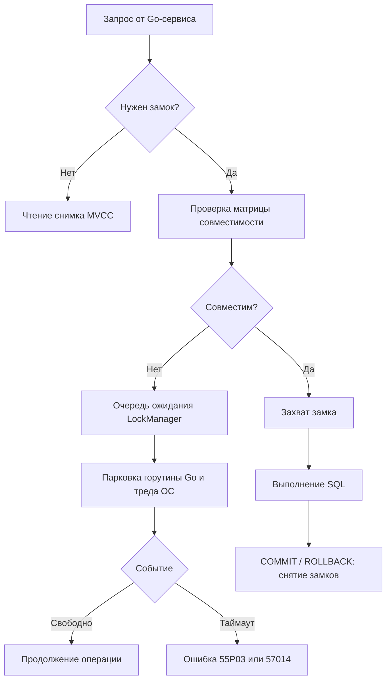

*Двухфазная блокировка (2PL), матрица совместимости, гранулярность и эскалация, физика кэш-линий CPU и паттерны PostgreSQL в Go: `SELECT FOR UPDATE`, `NOWAIT` и `SKIP LOCKED`.*

> «В идеальном мире прикладному программисту достаточно знать только API — без того, как этот API реализован и к какому железу он обращается. В реальности же чуть более глубокие знания порой оказываются весьма кстати.»  
> — Чарльз Петцольд, *Code: The Hidden Language of Computer Hardware and Software*

В [[4. Аномалии — Dirty Read, Phantom Read, Lost Update и Write Skew|предыдущей главе]] два параллельных списания со счёта `LedgerPulse` теряли деньги под `READ COMMITTED`. Поднимать всю базу до `SERIALIZABLE` дорого: при высокой конкуренции растут ошибки сериализации и повторы. Другая проблема — пул воркеров, разбирающих `outbox_events`: без координации два обработчика забирают одну задачу и отправляют дубликат вебхука.

Уровни изоляции задают математические обещания, а **блокировки (Locks)** — их физическая реализация в памяти движка. Знание этой механики критично по трём причинам:
* замки определяют реальную пропускную способность под нагрузкой;
* неверный порядок или эскалация вызывают каскадные таймауты и исчерпание пула соединений;
* в Go вы управляете транзакциями явно, и понимание взаимодействия драйвера с СУБД через сокеты и ОС спасает от скрытых зависаний.

---

## Двухфазная блокировка (2PL) и матрица совместимости

Чтобы параллельное расписание оставалось эквивалентным последовательному, классические СУБД применяют протокол **2PL (Two-Phase Locking)**:
1. **Фаза роста (Growing):** транзакция захватывает нужные замки и не освобождает ни одного.
2. **Фаза сжатия (Shrinking):** после снятия первого замка новые замки брать запрещено.

Промышленные базы используют **Strict 2PL**: все исключительные блокировки удерживаются до `COMMIT` или `ROLLBACK`, что исключает чтение незафиксированных данных и каскадные откаты.

### Режимы и гранулярность блокировок

Замок задаётся **режимом** и **гранулярностью**:
* **Shared (`S`):** разделяемое чтение (в lock-based движках ставится на `SELECT`; в многоверсионном PostgreSQL обычное чтение обходится без строковых замков — см. [[7. MVCC — многоверсионный контроль конкурентности]], а строковый разделяемый замок берётся через `FOR SHARE` или `FOR KEY SHARE`).
* **Exclusive (`X`):** исключительный доступ при `INSERT`, `UPDATE`, `DELETE` или `SELECT ... FOR UPDATE`.
* **Intent (`IS`, `IX`, `SIX`):** табличные флаги намерений. Они сообщают менеджеру о будущих строковых замках внутри таблицы, избавляя `ALTER TABLE` от проверки миллионов строк.

| Запрос \ Текущий | `IS` | `IX` | `S` | `SIX` | `X` |
|---|---|---|---|---|---|
| **`IS`** | Да | Да | Да | Да | Нет |
| **`IX`** | Да | Да | Нет | Нет | Нет |
| **`S`** | Да | Нет | Да | Нет | Нет |
| **`SIX`** | Да | Нет | Нет | Нет | Нет |
| **`X`** | Нет | Нет | Нет | Нет | Нет |

В PostgreSQL табличные режимы ещё детальнее: от `ACCESS SHARE` (`SELECT`) и `ROW EXCLUSIVE` (`UPDATE`) до `SHARE UPDATE EXCLUSIVE` (`CREATE INDEX CONCURRENTLY`, `VACUUM`) и `ACCESS EXCLUSIVE` (`ALTER TABLE`, `TRUNCATE`).



| Уровень гранулярности | Где применяется | Цена и влияние на параллелизм |
|---|---|---|
| **Строка** | `UPDATE ... WHERE id = 1`, `FOR UPDATE` | Минимальная; максимальный параллелизм. |
| **Страница (8–16 КБ)** | Внутренний слой в отдельных движках | Средняя; затрагивает соседние строки страницы. |
| **Таблица** | `ALTER TABLE`, `LOCK TABLE`, скан без индекса в lock-based БД | Высокая; полная сериализация таблицы. |
| **Диапазон (Gap / Next-Key)** | Индексные диапазоны в MySQL InnoDB | Защищает от фантомов, тормозит соседние `INSERT`. |

> [!info] Под капотом: `LockManager` и заголовки кортежей
> Табличные замки в PostgreSQL хранит `LockManager` в разделяемой памяти (`shmem`): хэш-ключ `LOCKTAG` (БД, таблица, блок, смещение) указывает на структуру `LOCK` со счётчиками и очередью `PGPROC`. Совместимость проверяется побитовым `&` за единицы тактов CPU.
>
> Миллионы строковых замков `shmem` не выдержала бы, поэтому строковые блокировки PostgreSQL пишет прямо на 8-КБ страницу в поле `xmax` заголовка кортежа и флаги `t_infomask` (например, `HEAP_XMAX_LOCK_ONLY`), а для нескольких читателей `FOR SHARE` заводит компактный `MultiXactId`.

---

## Эскалация блокировок, оптимизм и пессимизм

**Эскалация блокировок** — автоматическая замена тысяч строковых замков одним табличным при нехватке памяти под таблицу блокировок (в SQL Server порог ~5 000 замков). Для Go-сервиса это катастрофа: блокируется вся таблица, и пул `*sql.DB` мгновенно забивается ожидающими горутинами.

В PostgreSQL автоэскалации нет, поскольку строковые замки лежат в заголовках кортежей. Но похожий эффект даёт длинный `UPDATE` без индекса, задерживающий `ALTER TABLE` (`ACCESS EXCLUSIVE`), который в очереди запирает за собой все новые `SELECT`. В InnoDB `UPDATE` без индекса берёт `Next-Key` замки по всему кластерному индексу. Всегда фильтруйте массовые правки по индексу и дробите их через `LIMIT`.

**Выбор стратегии:**
* **Пессимистичная (`SELECT ... FOR UPDATE`):** запирает строку сразу. Выгодна на «горячих» счетах `LedgerPulse`, где конфликты часты.
* **Оптимистичная (`version`):** читает без замка и проверяет версию при обновлении:

```sql
UPDATE accounts
SET balance = balance + $1, version = version + 1, updated_at = now()
WHERE id = $2 AND version = $3 AND balance + $1 >= 0;
```

Если `RowsAffected() == 0`, приложение повторяет цикл. Под низкой конкуренцией это экономит замки, но на горячем счёте вызывает каскад холостых повторов.

---

## Физика железа: кэш-линии CPU и парковка тредов

Менеджер блокировок работает в разделяемой памяти, а процессор читает её **кэш-линиями по 64 байта**. Если два ядра меняют счётчики несвязанных замков в одной 64-байтной кэш-линии, протокол когерентности `MESI` гоняет линию между состояниями `Modified` и `Invalid`. Такой **False Sharing** снижает пропускную способность на 30–50%. В PostgreSQL для защиты от него таблица замков разбита на 16 партиций (`NUM_LOCK_PARTITIONS`) с отдельными `LWLock`.

При занятом ресурсе процесс не крутится в spinlock:
1. В СУБД поток паркуется на системном вызове (`futex` / `epoll_wait`).
2. В Go `netpoller` переводит горутину в `_Gwaiting` (тред ОС свободен, но **слот пула `*sql.DB` остаётся занят**).
3. Пробуждение после снятия замка стоит **5–10 мкс** (тысячи тактов CPU против ~100 нс доступа к RAM и ~100 мкс чтения NVMe).

---

## Практика в Go 1.24: `SKIP LOCKED`, `NOWAIT` и сравнение с `sync.Mutex`

В PostgreSQL есть четыре строковых режима: `FOR UPDATE` (полный запрет), `FOR NO KEY UPDATE` (обычный `UPDATE` без смены ключей), `FOR SHARE` (разделяемый) и `FOR KEY SHARE` (берётся автоматически на родителя при вставке по внешнему ключу — поэтому `INSERT` в `ledger_entries` не блокирует `UPDATE accounts.balance`).

### 1. Очередь воркеров `outbox_events` через `SKIP LOCKED`

Модификатор **`SKIP LOCKED`** заставляет PostgreSQL пропускать уже запертые строки вместо ожидания (паттерн Outbox подробно разбирается в Томе 3):

```go
func ClaimNextOutboxJob(ctx context.Context, db *sql.DB) (int64, string, bool, error) {
	tx, err := db.BeginTx(ctx, nil)
	if err != nil {
		return 0, "", false, fmt.Errorf("begin tx: %w", err)
	}
	defer func() { _ = tx.Rollback() }()

	var id int64
	var payload string
	err = tx.QueryRowContext(ctx, `
		SELECT id, payload FROM outbox_events
		WHERE published_at IS NULL
		ORDER BY id ASC
		LIMIT 1 FOR UPDATE SKIP LOCKED
	`).Scan(&id, &payload)
	if errors.Is(err, sql.ErrNoRows) {
		return 0, "", false, nil
	}
	if err != nil {
		return 0, "", false, fmt.Errorf("claim outbox: %w", err)
	}

	if _, err := tx.ExecContext(ctx,
		`UPDATE outbox_events SET published_at = now() WHERE id = $1`, id,
	); err != nil {
		return 0, "", false, fmt.Errorf("mark published: %w", err)
	}
	return id, payload, true, tx.Commit()
}
```

### 2. Мгновенный отказ через `NOWAIT`

Модификатор **`NOWAIT`** не ставит горутину в очередь, а сразу возвращает ошибку SQLSTATE `55P03` (`lock_not_available`), проверяемую в Go через `errors.As`:

```go
func LockAccountNowait(ctx context.Context, tx *sql.Tx, accountID int64) (int64, error) {
	var balance int64
	err := tx.QueryRowContext(ctx,
		`SELECT balance FROM accounts WHERE id = $1 FOR UPDATE NOWAIT`, accountID,
	).Scan(&balance)
	if err != nil {
		var pgErr *pgconn.PgError
		if errors.As(err, &pgErr) && pgErr.Code == "55P03" {
			return 0, fmt.Errorf("account %d busy: %w", accountID, ErrAccountBusy)
		}
		return 0, fmt.Errorf("lock account %d: %w", accountID, err)
	}
	return balance, nil
}
```

> [!tip] Собеседование [Middle]
> **Вопрос:** В чём разница между `NOWAIT`, `SET LOCAL lock_timeout` и `context.WithTimeout`?
> **Ответ:** `NOWAIT` и `lock_timeout` работают на стороне PostgreSQL и возвращают `55P03` без разрыва соединения. `context.WithTimeout` срабатывает в Go-драйвере и отправляет отмену запроса (`57014`, `query_canceled`). Для защиты пула соединений в высоконагруженных API предпочтительны `NOWAIT` или короткий `lock_timeout`.

> [!warning] Ловушка: `FOR UPDATE` + `ORDER BY` + `LIMIT` в `READ COMMITTED`
> Если один запрос ждёт снятия замка на первой строке выборки, а конкурент меняет её поле сортировки, PostgreSQL перепроверит `WHERE`, но **не пересортирует** строки заново — вы можете получить строку с худшим приоритетом или пустой результат. Для очередей всегда добавляйте `SKIP LOCKED`.

### Почему `FOR UPDATE` — это не `sync.Mutex`

| Свойство | `sync.Mutex` (Go) | `SELECT ... FOR UPDATE` (СУБД) |
|---|---|---|
| **Область действия** | Один процесс Go | Все процессы и поды кластера |
| **При `SIGKILL` процесса** | Мьютекс остаётся запертым навсегда | Сокет закрывается (`TCP FIN`/`RST`), СУБД откатывает tx и снимает замки |
| **Цена захвата** | Наносекунды (CPU CAS) | Сотни микросекунд (сеть, `LockManager`, `futex`) |
| **Время жизни** | До `Unlock()` | Строго до `COMMIT` / `ROLLBACK` (`Strict 2PL`) |

---

## Упражнения

### 1. Базовое: Матрица совместимости на `LedgerPulse`

`T1` вставляет проводку: `INSERT INTO ledger_entries (transaction_id, account_id, amount, currency) VALUES (101, 7, -5000, 'RUB')`. Параллельно `T2` выполняет `UPDATE accounts SET balance = balance - 5000 WHERE id = 7`. Какие строковые замки берут обе транзакции на `accounts.id = 7` и заблокируют ли они друг друга?

> [!solution] Показать решение
> Транзакции **не заблокируют** друг друга. `T1` из-за внешнего ключа `account_id` берёт на родительскую строку режим **`FOR KEY SHARE`**. `T2` не меняет ключевые столбцы `accounts` и берёт **`FOR NO KEY UPDATE`**. Эти два режима совместимы (конфликт возник бы только с `FOR UPDATE`).

### 2. Практическое: Пакетный захват `outbox_events` через CTE и `SKIP LOCKED`

Напишите один SQL-запрос с `CTE`, который атомарно захватывает до `$1` строк со статусом `'pending'` в порядке `id ASC`, переводит их в `'processing'` и возвращает `id`, `event_type`, `payload` без конкуренции между воркерами.

> [!solution] Показать решение
> ```sql
> WITH next_batch AS (
>     SELECT id
>     FROM outbox_events
>     WHERE published_at IS NULL AND status = 'pending'
>     ORDER BY id ASC
>     LIMIT $1
>     FOR UPDATE SKIP LOCKED
> )
> UPDATE outbox_events AS e
> SET status = 'processing'
> FROM next_batch
> WHERE e.id = next_batch.id
> RETURNING e.id, e.event_type, e.payload;
> ```
> Подзапрос `next_batch` пропускает заблокированные строки, а `UPDATE ... FROM` фиксирует смену статуса и отдаёт пачку воркеру за один сетевой обмен.

### 3. Со звёздочкой (*): Оптимистичное списание с `version` в Go

Реализуйте `DebitOptimistic(ctx context.Context, db *sql.DB, accountID, amount int64, maxRetries int) error` с проверкой `balance >= amount` и оптимистичным обновлением по `version`. При `RowsAffected() == 0` повторяйте цикл с проверкой `ctx.Done()`.

> [!solution] Показать решение
> ```go
> func DebitOptimistic(ctx context.Context, db *sql.DB, accountID, amount int64, maxRetries int) error {
> 	for range maxRetries + 1 {
> 		var balance, version int64
> 		if err := db.QueryRowContext(ctx,
> 			`SELECT balance, version FROM accounts WHERE id = $1`, accountID,
> 		).Scan(&balance, &version); err != nil {
> 			return fmt.Errorf("select account: %w", err)
> 		}
> 		if balance < amount {
> 			return errors.New("insufficient funds")
> 		}
> 		res, err := db.ExecContext(ctx, `
> 			UPDATE accounts SET balance = balance - $1, version = version + 1
> 			WHERE id = $2 AND version = $3 AND balance >= $1`,
> 			amount, accountID, version,
> 		)
> 		if err != nil {
> 			return fmt.Errorf("update account: %w", err)
> 		}
> 		if rows, _ := res.RowsAffected(); rows == 1 {
> 			return nil
> 		}
> 		if err := ctx.Err(); err != nil {
> 			return err
> 		}
> 	}
> 	return errors.New("optimistic retries exceeded")
> }
> ```
> При редких конфликтах код не держит замки между чтением и записью, но при высокой конкуренции на одном счёте быстрее сработает `FOR UPDATE NOWAIT` или один атомарный `UPDATE`.

---

## Главный вывод и мостик дальше

`Strict 2PL` и строковые замки гарантируют целостность при конкурентной записи, а `SKIP LOCKED` и `NOWAIT` масштабируют очереди и защищают пул соединений Go.

Но что случится при двух встречных переводах `LedgerPulse`, когда `T1` запрёт счёт `10` и запросит `25`, а `T2` одновременно запрёт `25` и запросит `10`? Ни одна не отпустит ресурс добровольно. Как движок находит такие циклы и как устранять их в коде — разберём в [[6. Взаимоблокировки (Deadlock) — граф ожиданий и предотвращение|следующей главе]].
