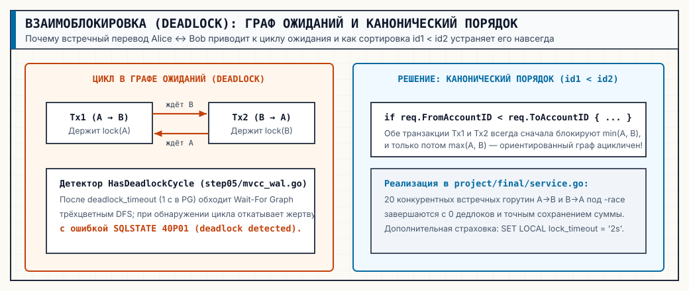
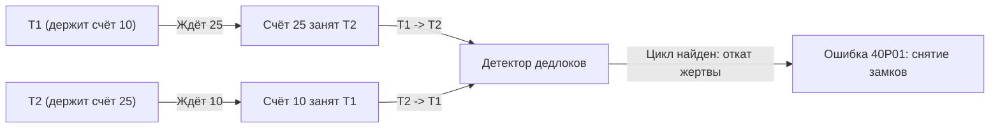

*Условия Коффмана, ориентированный граф ожиданий (Wait-For Graph), выбор жертвы в PostgreSQL и InnoDB, истощение пула Go, канонический порядок блокировок и разбор `HasDeadlockCycle` из `project/step05/mvcc_wal.go`.*

> «Хотя поддержка конкурентности — одна из главных сильных сторон Go, рассуждать о конкурентных программах по природе труднее, чем о последовательных, и интуиция, выработанная на последовательном коде, порой подводит.»  
> — Алан Донован и Брайан Керниган, *The Go Programming Language*

В `LedgerPulse` два клиента одновременно отправляют встречные переводы: `T1` переводит со счёта `10` на `25`, а `T2` — со счёта `25` на `10`. Обе транзакции используют `SELECT ... FOR UPDATE`: `T1` запирает `10` и запрашивает `25`, а `T2` запирает `25` и запрашивает `10`.

В отличие от обычной очереди, эта пара не сдвинется сама: каждая держит ресурс, необходимый соседке. Десять таких пар — и пул `SetMaxOpenConns(20)` исчерпан полностью (`connection pool exhausted`), хотя диски и CPU базы простаивают. Для инженера **взаимоблокировка (Deadlock)** — не сбой СУБД, а симптом несогласованного порядка захвата ресурсов в коде приложения.

---

## Условия Коффмана и граф ожиданий (Wait-For Graph)



Дедлок возникает при одновременном выполнении четырёх условий Коффмана:
1. **Взаимное исключение:** исключительный замок на строку принадлежит только одной транзакции.
2. **Удержание и ожидание:** транзакция держит первый замок и ждёт второй.
3. **Отсутствие вытеснения:** замок нельзя забрать силой до `COMMIT` или `ROLLBACK`.
4. **Циклическое ожидание:** зависимости образуют замкнутое кольцо.

Первые три условия встроены в `Strict 2PL` ([[5. Блокировки (Locking) — 2PL, SELECT FOR UPDATE и SKIP LOCKED|предыдущая глава]]), поэтому главный способ профилактики — разрушить четвёртое условие.

Ядро СУБД моделирует зависимости как **ориентированный граф ожиданий (Wait-For Graph)**: вершины — транзакции, ребро `T1 -> T2` означает «`T1` ждёт замок, удерживаемый `T2`». Любой цикл в этом графе равен дедлоку.



Отличайте **Deadlock** от **Livelock**: при дедлоке транзакции спят и не тратят CPU, а при ливлоке оптимистичные транзакции бесконечно перезапускаются, сбивают друг друга и сжигают 100% ядер без прогресса.

---

## Детектор дедлоков под капотом и цена для железа

Обходить граф при каждой блокировке слишком накладно: большинство ожиданий рассасывается за миллисекунды. Поэтому движки запускают детектор отложенно или по порогу.

> [!info] Под капотом: PostgreSQL против MySQL InnoDB
> **PostgreSQL:** ждущий процесс заводит таймер на `deadlock_timeout` (по умолчанию **1 с**). Если ресурс освободился раньше — проверка не запускается вовсе. Если секунда истекла, функция `CheckDeadLock()` обходит структуры `PGPROC` в разделяемой памяти (`shmem`). Найдя цикл, база откатывает жертву с кодом SQLSTATE **`40P01`** (`deadlock_detected`) — или **`40001`** при конфликте сериализации.
>
> **MySQL / InnoDB:** при `innodb_deadlock_detect` анализирует `innodb_lock_waits` и выбирает жертвой транзакцию с минимальным объёмом `UNDO`-лога.

При выборе жертвы СУБД минимизирует ущерб: объём отката, уже затраченное время и удержание самых «горячих» ресурсов.

### Цена для ОС и рантайма Go

1. **Пул `*sql.DB`:** пока база ждёт `deadlock_timeout` (1 с), соединение остаётся занятым (`active` или `idle in transaction`). Массовые конфликты быстро исчерпывают пул.
2. **Системные вызовы и контекст:** в Linux процесс БД спит на `futex` / `semop` (`TASK_INTERRUPTIBLE`, в Windows — `WaitForSingleObject`). Откат жертвы отправляет ошибку в TCP-сокет, `netpoller` будит горутину из `_Gwaiting` в `_Grunnable`. Переход стоит **5–10 мкс** (против ~100 нс RAM).
3. **Промахи кэша `L3`:** структуры `LOCK` и `PGPROC` разбросаны по `shmem`, поэтому обход графа порождает *pointer chasing* и промахи кэша `L3`.

---

## Разбор `HasDeadlockCycle` в `project/step05/mvcc_wal.go`

Модуль `step05` моделирует поиск циклов в графе ожиданий функцией `HasDeadlockCycle`:

```go
// HasDeadlockCycle проверяет граф ожиданий (wait-for graph) на цикл через DFS.
func HasDeadlockCycle(waits map[uint64][]uint64) bool {
	const (
		unvisited = 0
		visiting  = 1
		visited   = 2
	)
	state := make(map[uint64]int)
	var dfs func(u uint64) bool
	dfs = func(u uint64) bool {
		state[u] = visiting
		for _, v := range waits[u] {
			if state[v] == visiting {
				return true
			}
			if state[v] == unvisited && dfs(v) {
				return true
			}
		}
		state[u] = visited
		return false
	}
	for u := range waits {
		if state[u] == unvisited && dfs(u) {
			return true
		}
	}
	return false
}
```

Ключевой момент: **почему в ориентированном графе нужны три состояния (`unvisited`, `visiting`, `visited`), а не два?** В графе без циклов (DAG) возможен «ромб»: `1 -> 2`, `1 -> 3`, `2 -> 4`, `3 -> 4`. Обойдя `4` через ветку `2`, DFS помечает её `visited` (`2`). Встретив `4` повторно из ветки `3`, алгоритм видит `visited` и не поднимает ложную тревогу. Цикл означает только ребро в вершину со статусом `visiting` (`1`), то есть активную в текущем стеке рекурсии (*back-edge*). Сложность алгоритма: $O(V + E)$ по времени и $O(V)$ по памяти.

Тест `project/step05/mvcc_wal_test.go` проверяет кольцо и линейную цепочку:

```go
if !HasDeadlockCycle(map[uint64][]uint64{1: {2}, 2: {3}, 3: {1}}) {
	t.Fatalf("expected deadlock cycle")
}
if HasDeadlockCycle(map[uint64][]uint64{1: {2}, 2: {3}}) {
	t.Fatalf("unexpected deadlock cycle")
}
```

---

## Четыре защиты от дедлоков в Go и PostgreSQL

### 1. Канонический порядок блокировок

Если все транзакции `LedgerPulse` захватывают счета в порядке возрастания `account_id`, циклическое ожидание невозможно. При встречном переводе между `10` и `25` обе транзакции сначала обратятся к `10` — одна захватит его, вторая подождёт без образования кольца:

```go
func TransferCanonical(ctx context.Context, db *sql.DB, fromID, toID, amount int64) error {
	tx, err := db.BeginTx(ctx, nil)
	if err != nil {
		return fmt.Errorf("begin tx: %w", err)
	}
	defer func() { _ = tx.Rollback() }()

	if _, err := tx.ExecContext(ctx, `SET LOCAL lock_timeout = '300ms'`); err != nil {
		return fmt.Errorf("set lock_timeout: %w", err)
	}

	ids := []int64{fromID, toID}
	slices.Sort(ids) // Канонический порядок в Go + ORDER BY в SQL

	rows, err := tx.QueryContext(ctx, `
		SELECT id, balance FROM accounts
		WHERE id = ANY($1::bigint[])
		ORDER BY id ASC FOR UPDATE`, ids,
	)
	if err != nil {
		return fmt.Errorf("lock accounts: %w", err)
	}
	balances := make(map[int64]int64, 2)
	for rows.Next() {
		var id, bal int64
		if err := rows.Scan(&id, &bal); err != nil {
			_ = rows.Close()
			return err
		}
		balances[id] = bal
	}
	_ = rows.Close()
	if err := rows.Err(); err != nil || balances[fromID] < amount {
		return errors.New("cannot execute transfer")
	}

	if _, err := tx.ExecContext(ctx,
		`UPDATE accounts SET balance = balance - $1 WHERE id = $2`, amount, fromID,
	); err != nil {
		return err
	}
	if _, err := tx.ExecContext(ctx,
		`UPDATE accounts SET balance = balance + $1 WHERE id = $2`, amount, toID,
	); err != nil {
		return err
	}
	return tx.Commit()
}
```

### 2. Короткие транзакции и `lock_timeout`

Не вызывайте внешние HTTP/gRPC API внутри `BEGIN ... COMMIT` и выставляйте `SET LOCAL lock_timeout = '300ms'`, чтобы обрывать затянувшиеся ожидания раньше срабатывания секундного детектора.

### 3. Идемпотентный ретрай с джиттером на `40P01`

Перехватывайте код `40P01` через `errors.As` и добавляйте случайную задержку (*jitter*), чтобы две откатанные транзакции не столкнулись повторно:

```go
func WithDeadlockRetry(ctx context.Context, db *sql.DB, maxRetries int, fn func(context.Context, *sql.Tx) error) error {
	for attempt := range maxRetries + 1 {
		tx, err := db.BeginTx(ctx, nil)
		if err != nil {
			return fmt.Errorf("begin tx: %w", err)
		}
		if err = fn(ctx, tx); err == nil {
			return tx.Commit()
		}
		_ = tx.Rollback()

		var pgErr *pgconn.PgError
		if errors.As(err, &pgErr) && pgErr.Code == "40P01" && attempt < maxRetries {
			delay := time.Duration(1<<attempt)*25*time.Millisecond +
				time.Duration(rand.Int64N(int64(25*time.Millisecond)))
			select {
			case <-time.After(delay):
				continue
			case <-ctx.Done():
				return ctx.Err()
			}
		}
		return err
	}
	return errors.New("max deadlock retries exceeded")
}
```

> [!warning] Ловушка: неидемпотентные ретраи и несортированные батчи
> Повторять транзакцию после `40P01` можно **только если внутри нет внешних побочных эффектов** (отправки писем, списания карты во внешнем шлюзе). Выносите их за пределы транзакции через паттерн Outbox (см. Том 3, раздел про распределённую согласованность). Также помните про скрытые дедлоки при пакетном `UPDATE ... FROM UNNEST(...)` без предварительной сортировки входных массивов по `id`.

> [!tip] Собеседование [Middle]
> **Вопрос:** В чём разница между `deadlock_timeout`, `lock_timeout` и `statement_timeout`?
> **Ответ:** `deadlock_timeout` (1 с) — задержка перед запуском детектора циклов; сам по себе он не убивает запрос без цикла, а слишком малое значение сжигает CPU на проверках графа. `lock_timeout` ограничивает ожидание одной блокировки (`55P03`). `statement_timeout` ограничивает общее время выполнения SQL-оператора (`57014`).

---

## Упражнения

### 1. Базовое: Трассировка `HasDeadlockCycle`

Дан граф `waits = {1: [2], 2: [3, 4], 3: [5], 4: [5], 5: []}`. Есть ли здесь дедлок, и с каким значением `state[5]` алгоритм встретит вершину `5` при повторном заходе?

> [!solution] Показать решение
> **Дедлока нет:** это ациклический граф (DAG), транзакция `5` никого не ждёт и разблокирует цепочку после завершения. При первом обходе (например, `1 -> 2 -> 3 -> 5`) вершина `5` завершит обход и получит статус `visited` (`2`). При повторном подходе через `2 -> 4 -> 5` алгоритм увидит `state[5] == visited`, а не `visiting`, поэтому `HasDeadlockCycle` вернёт `false`.

### 2. Практическое: Сортировка батча `UNNEST`

Два воркера параллельно выполняют `UPDATE accounts AS a SET balance = a.balance + v.delta FROM UNNEST($1::bigint[], $2::bigint[]) AS v(id, delta) WHERE a.id = v.id`. Почему возможен `40P01`, и как подготовить слайсы в Go для защиты?

> [!solution] Показать решение
> Массивы `[25, 10]` и `[10, 25]` могут захватить строковые замки в обратном порядке. Решение — агрегировать дельты по `AccountID` и отсортировать ключи через `slices.Sort`:
> ```go
> func BuildSortedBatch(items []BalanceDelta) ([]int64, []int64) {
> 	agg := make(map[int64]int64, len(items))
> 	for _, it := range items {
> 		agg[it.AccountID] += it.Delta
> 	}
> 	ids := make([]int64, 0, len(agg))
> 	for id := range agg {
> 		ids = append(ids, id)
> 	}
> 	slices.Sort(ids)
> 	deltas := make([]int64, len(ids))
> 	for i, id := range ids {
> 		deltas[i] = agg[id]
> 	}
> 	return ids, deltas
> }
> ```

### 3. Со звёздочкой (*): Поиск жертвы цикла с минимальным `undoCost`

Напишите функцию `FindDeadlockVictim(waits map[uint64][]uint64, undoCost map[uint64]int) (uint64, bool)`, которая при наличии цикла находит **именно участников кольца** (игнорируя внешний «хвост» графа) и возвращает вершину цикла с минимальным `undoCost`.

> [!solution] Показать решение
> ```go
> func FindDeadlockVictim(waits map[uint64][]uint64, undoCost map[uint64]int) (uint64, bool) {
> 	const unvisited, visiting, visited = 0, 1, 2
> 	state := make(map[uint64]int)
> 	var stack []uint64
> 	var dfs func(u uint64) (uint64, bool)
> 	dfs = func(u uint64) (uint64, bool) {
> 		state[u] = visiting
> 		stack = append(stack, u)
> 		for _, v := range waits[u] {
> 			if state[v] == visiting {
> 				cycle := stack[slices.Index(stack, v):]
> 				victim := cycle[0]
> 				for _, node := range cycle[1:] {
> 					if undoCost[node] < undoCost[victim] {
> 						victim = node
> 					}
> 				}
> 				return victim, true
> 			}
> 			if state[v] == unvisited {
> 				if victim, ok := dfs(v); ok {
> 					return victim, true
> 				}
> 			}
> 		}
> 		stack = stack[:len(stack)-1]
> 		state[u] = visited
> 		return 0, false
> 	}
> 	for u := range waits {
> 		if state[u] == unvisited {
> 			if victim, ok := dfs(u); ok {
> 				return victim, true
> 			}
> 		}
> 	}
> 	return 0, false
> }
> ```
> Срез `stack[slices.Index(stack, v):]` отсекает подводящие вершины и выбирает жертву строго внутри замкнутого цикла.

---

## Главный вывод и мостик дальше

Дедлоки устраняются каноническим порядком захвата ключей, короткими транзакциями с `lock_timeout` и идемпотентными повторами с джиттером.

Но почему аналитический отчёт в `LedgerPulse` вообще должен сталкиваться с замками, если он ничего не меняет? Как дать читателям и писателям работать параллельно без взаимных ожиданий — разберём в [[7. MVCC — многоверсионный контроль конкурентности|следующей главе]].
