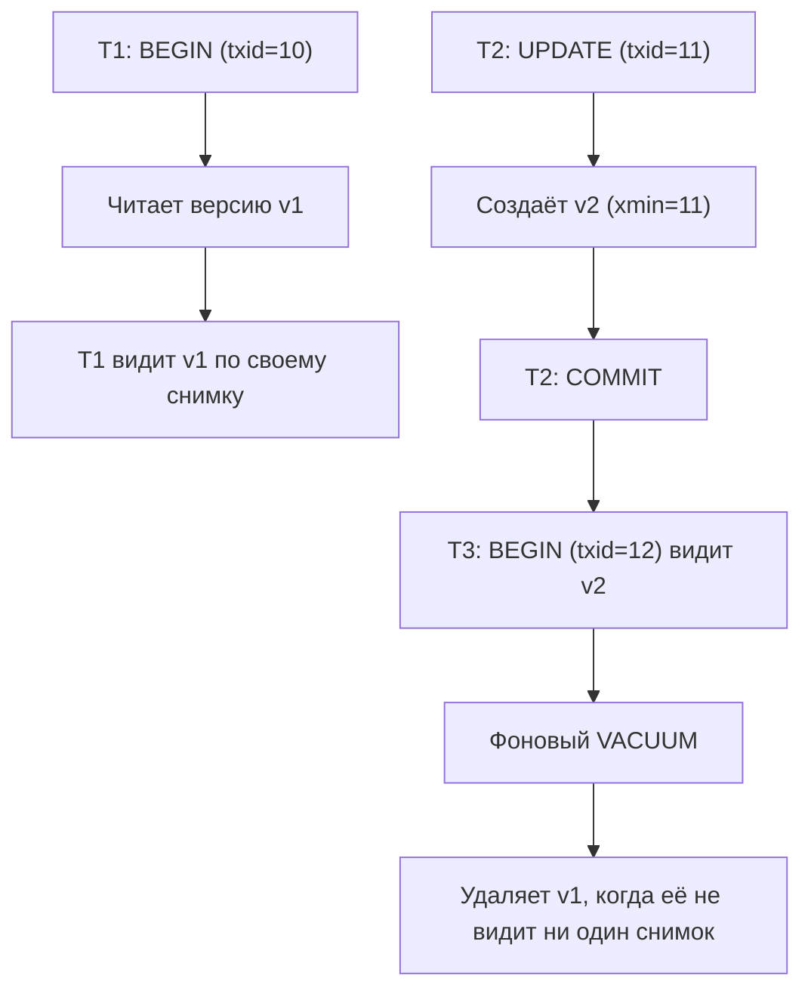
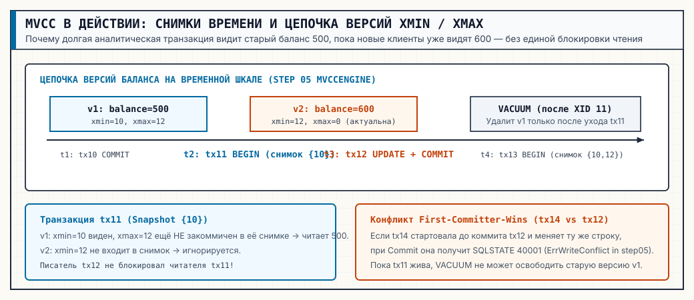

*Как многоверсионность избавляет читателей от ожидания писателей: системные поля `xmin` и `xmax`, снимки транзакций, куча PostgreSQL против Undo-логов InnoDB, кэш-линии CPU и разбор `TupleVersion` и `MVCCEngine` из `project/step05/mvcc_wal.go`.*

> «Блеск Unix заключался в выборе абстракции, достаточно общей, чтобы быть поразительно полезной, и при этом не слишком дорогой по производительности.»  
> — Брайан Керниган, *UNIX: A History and a Memoir*

В чистых блокировочных движках (`2PL`) аналитический запрос `SELECT SUM(balance) FROM accounts` ставит разделяемые `S`-замки и тормозит приём платежей в `LedgerPulse`. Писатели с `X`-замками в ответ останавливают читателей. Под плотной нагрузкой до 80% процессорного времени уходит на ожидания `futex` и переключения контекста.

Архитектура **MVCC (Multi-Version Concurrency Control)** устраняет этот конфликт. Вместо одной перезаписываемой строки движок хранит несколько последовательных версий кортежа, а каждая транзакция читает согласованный **снимок (Snapshot)** на момент своего старта.

Главный закон MVCC: **читатели никогда не блокируют писателей, а писатели никогда не блокируют читателей**. Писатели по-прежнему координируются между собой, но любые `SELECT` проходят без ожидания.



---

## Анатомия версии: `xmin`, `xmax` и видимость без замков



На 8-КБ странице PostgreSQL заголовок каждого кортежа (см. [[5. Таблицы, строки, столбцы и ключи]]) хранит два ключевых поля:
* **`xmin`** — `txid` транзакции, создавшей эту версию строки.
* **`xmax`** — `txid` транзакции, удалившей или обновившей версию (`0`, если версия актуальна).

На старте транзакции (или перед каждым запросом в `READ COMMITTED`, см. [[3. Read Committed, Repeatable Read и Serializable]]) движок снимает **снимок**: минимальный активный `xmin`, верхнюю границу `xmax` и список текущих незавершённых транзакций `xip_list`.

Версия строки видима для снимка, если:
1. Автор создания `xmin` **зафиксирован** до снимка (`xmin < snapshot.xmax` и не в `xip_list`), либо это текущая транзакция.
2. Версия **не удалена** на момент снимка (`xmax == 0`, транзакция `xmax` откатилась, либо `xmax` завершилась уже после снятия снимка).

Проверка сводится к целочисленным сравнениям и битовым флагам за единицы тактов CPU без обращения к `LockManager`.

> [!info] Под капотом: `pg_xact` (`clog`) и `Hint Bits`
> Статусы транзакций (`IN_PROGRESS`, `COMMITTED`, `ABORTED`) хранятся по 2 бита на транзакцию в журнале **`pg_xact`** (ранее `clog`), кэшируемом в разделяемой памяти. Чтобы не проверять `pg_xact` при каждом чтении, первый читатель записывает результат прямо в заголовок кортежа как **биты-подсказки (Hint Bits)** (`HEAP_XMIN_COMMITTED` и др.). Следующие `SELECT` проверяют видимость только по заголовку (побочный эффект: даже `SELECT` может пометить страницу в `Shared Buffers` как грязную).

---

## Куча PostgreSQL против Undo-логов MySQL InnoDB

Два главных движка индустрии реализуют MVCC по-разному:

1. **PostgreSQL (Heap Storage):** все версии лежат **прямо в основной таблице**. При `UPDATE` старая версия получает `xmax`, а в свободное место страницы пишется новая с новым физическим адресом `ctid`.
   * *Плюсы:* быстрое чтение без переходов по ссылкам; если новая версия влезла на ту же страницу и индексы не задеты, работает оптимизация **HOT (Heap-Only Tuple)** — индексы не обновляются, экономя 40–60% I/O и WAL.
   * *Минусы:* таблица раздувается (**Bloat**) и требует регулярного `VACUUM`.
2. **MySQL / InnoDB (Undo Logs):** кластерный индекс хранит **только последнюю версию**, а старые значения выносятся в `UNDO tablespace`. В заголовке строки лежит указатель `DB_ROLL_PTR` на предыдущую версию.
   * *Плюсы:* основная таблица компактна.
   * *Минусы:* чтение старых снимков требует раскрутки длинной цепочки `DB_ROLL_PTR` по страницам отката.

> [!tip] Собеседование [Middle]
> **Вопрос:** Почему `UPDATE` в PostgreSQL вставляет новую версию кортежа вместо перезаписи на месте?
> **Ответ:** Перезапись на месте уничтожила бы старую версию, которую прямо сейчас может читать параллельная транзакция по своему снимку. Неизменность созданного кортежа также позволяет мгновенно откатить транзакцию простой сменой статуса в `pg_xact` без переписывания страниц.

---

## Разбор `TupleVersion` и `MVCCEngine` в `project/step05/mvcc_wal.go`

В `project/step05/mvcc_wal.go` многоверсионный движок смоделирован структурами `TupleVersion`, `MVCCEngine` и `SnapshotTx`:

```go
type TupleVersion struct {
	Xmin  uint64
	Xmax  uint64 // 0 означает актуальную версию
	Value int64
}

type MVCCEngine struct {
	mu        sync.Mutex
	nextXID   uint64
	committed map[uint64]bool
	versions  map[string][]TupleVersion
}
```

Проследим три операции транзакции:
1. **`Begin()`** выдаёт уникальный `XID` и копирует `e.committed` в `tx.Snapshot`. Всё, что закоммитится позже, в снимок не попадёт.
2. **`Get(key)`** сначала проверяет локальный `tx.writeset` (гарантия *Read-Your-Own-Writes*), а затем сканирует `versions[key]` от новых версий к старым:

```go
	vers := tx.engine.versions[key]
	for i := len(vers) - 1; i >= 0; i-- {
		v := vers[i]
		if !tx.Snapshot[v.Xmin] {
			continue
		}
		if v.Xmax != 0 && tx.Snapshot[v.Xmax] {
			continue
		}
		return v.Value, true
	}
```

Если создатель версии не в снимке (`!tx.Snapshot[v.Xmin]`), версия игнорируется. Если версия удалена транзакцией из нашего снимка (`v.Xmax != 0 && tx.Snapshot[v.Xmax]`), она тоже невидима. Если же удаление произошло *после* нашего снимка (`tx.Snapshot[v.Xmax] == false`), читатель видит старую версию.

3. **`Commit()`** проверяет правило **First-Committer-Wins**: если для любого ключа из `tx.writeset` появилась новая версия от конкурента, которая уже зафиксирована (`committed[v.Xmin]`), но отсутствует в нашем снимке (`!tx.Snapshot[v.Xmin]`), коммит возвращает `ErrWriteConflict`. Иначе старой версии проставляется `Xmax = tx.XID`, в срез добавляется новый `TupleVersion`, а `tx.XID` попадает в `committed`.

В тесте `TestWALRecoveryAndMVCC` (`project/step05/mvcc_wal_test.go`) `tx1` и `tx2` стартуют на одном снимке, `tx1` коммитит `"balance"=600` и `"audit_tag"=2`, но `tx2.Get("audit_tag")` по-прежнему без блокировок читает `1`, после чего `tx2.Commit()` падает с `ErrWriteConflict` из-за пересечения по `"balance"`. Отметим, что простое `Snapshot Isolation` защищает от пересечений по одному ключу, а защиту от `Write Skew` на разных ключах (`SSI`) мы разберём в конце этого модуля.

---

## Физика железа и ловушка длинных транзакций

В MySQL InnoDB раскрутка цепочки `DB_ROLL_PTR` по разным страницам вызывает **pointer chasing**: аппаратный `prefetcher` CPU промахивается, ядро получает промахи кэша `L3` и простаивает в `memory stall` сотни наносекунд. В PostgreSQL версии лежат на одной 8-КБ странице, но при сильном **bloat** полезная плотность данных падает: для выборки тех же 100 МБ строк приходится поднимать с диска в 5–10 раз больше страниц, замедляя `Seq Scan` и `COUNT(*)`.

Очистку мёртвых кортежей выполняет инкрементальный **`VACUUM`** (в отличие от Stop-the-World пауз, он работает в фоне, хотя `VACUUM FULL` берёт `ACCESS EXCLUSIVE` на перестройку таблицы). Главная проблема — **`VACUUM` не имеет права удалить ни одну версию новее самого старого активного снимка**.

> [!warning] Ловушка: забытый `tx.Rollback()` и `idle in transaction`
> Одна забытая транзакция в `psql` или утечка `*sql.Tx` в Go без `defer func() { _ = tx.Rollback() }()` замораживает глобальный `xmin`. За три часа простоя база накопит миллионы мёртвых версий, `autovacuum` встанет, а таблицы раздуются в 5–10 раз вплоть до `disk full`. Минимизируйте время жизни транзакций и используйте пакетные `UNNEST`/`COPY` ([[16. Пакетные (Batch) запросы, UNNEST и COPY]]) при массовых вставках.

```go
func FindLongTransactions(ctx context.Context, db *sql.DB, minAgeSec int) error {
	rows, err := db.QueryContext(ctx, `
		SELECT pid, state, (now() - xact_start)::text, left(query, 100)
		FROM pg_stat_activity
		WHERE xact_start IS NOT NULL AND state != 'idle'
		  AND now() - xact_start > make_interval(secs => $1)`, minAgeSec)
	if err != nil {
		return fmt.Errorf("query pg_stat_activity: %w", err)
	}
	defer rows.Close()
	for rows.Next() {
		var pid int
		var state, dur, q string
		if err := rows.Scan(&pid, &state, &dur, &q); err != nil {
			return err
		}
		fmt.Printf("long tx: pid=%d state=%s dur=%s query=%s\n", pid, state, dur, q)
	}
	return rows.Err()
}
```

---

## Упражнения

### 1. Базовое: Трассировка видимости кортежей

Для ключа `"acc:10"` есть версии: `v1 (Xmin=10, Xmax=15, Val=500)`, `v2 (Xmin=15, Xmax=22, Val=800)`, `v3 (Xmin=22, Xmax=0, Val=1200)`. Транзакции `10` и `15` вошли в снимок `T`, а `22` завершилась уже после старта `T`. Что вернёт `T.Get("acc:10")`?

> [!solution] Показать решение
> Вернёт **`800` (`v2`)**. При обходе с конца `v3` отсекается (`T.Snapshot[22] == false`), а у `v2` создатель `15` есть в снимке (`true`), тогда как удалитель `22` — отсутствует (`false`).

### 2. Практическое: Диагностика держателей `backend_xmin`

Напишите SQL-запрос к `pg_stat_activity`, выводящий сессии (включая `idle in transaction`), которые удерживают горизонт снимка (`backend_xmin IS NOT NULL`), в порядке убывания возраста `age(backend_xmin)`.

> [!solution] Показать решение
> ```sql
> SELECT pid, usename, state, backend_xmin, age(backend_xmin) AS xmin_age,
>        now() - xact_start AS tx_duration, left(query, 100) AS last_query
> FROM pg_stat_activity
> WHERE backend_xmin IS NOT NULL AND pid <> pg_backend_pid()
> ORDER BY age(backend_xmin) DESC, xact_start ASC;
> ```
> Сортировка по `age(backend_xmin) DESC` сразу выявляет главную причину остановки `autovacuum`.

### 3. Со звёздочкой (*): Поддержка `Delete(key)` в `SnapshotTx`

Как добавить метод `Delete(key string)` в `SnapshotTx` (`project/step05/mvcc_wal.go`), чтобы транзакция видела своё удаление до коммита, проверяла `First-Committer-Wins` при `Commit()` и физически закрывала последнюю версию через `Xmax = tx.XID`?

> [!solution] Показать решение
> Заводим в `SnapshotTx` карту `deleteset map[string]bool` (при `Delete` удаляем ключ из `writeset`, при `Set` — из `deleteset`):
> ```go
> func (tx *SnapshotTx) Delete(key string) {
> 	delete(tx.writeset, key)
> 	tx.deleteset[key] = true
> }
> // В начале Get(key): if tx.deleteset[key] { return 0, false }
> ```
> В `Commit()` проверяем ключи `deleteset` тем же циклом `First-Committer-Wins`, а при применении выставляем активной версии `Xmax = tx.XID` без добавления нового `TupleVersion`:
> ```go
> for k := range tx.deleteset {
> 	vers := tx.engine.versions[k]
> 	for i := len(vers) - 1; i >= 0; i-- {
> 		if tx.Snapshot[vers[i].Xmin] && vers[i].Xmax == 0 {
> 			vers[i].Xmax = tx.XID
> 			break
> 		}
> 	}
> 	tx.engine.versions[k] = vers
> }
> ```

---

## Главный вывод и мостик дальше

`MVCC` позволяет читателям и писателям не блокировать друг друга за счёт хранения цепочек версий (`xmin`/`xmax`) и снимков, требуя дисциплины коротких транзакций, чтобы `VACUUM` успевал собирать мёртвые кортежи.

Но все эти версии меняются в оперативной памяти (`Shared Buffers`). При внезапном отключении питания RAM обнуляется, а сбрасывать десятки разбросанных 8-КБ страниц на каждый `COMMIT` слишком медленно и опасно. Как сделать фиксацию быстрой и неуязвимой к сбоям питания — разберём в [[8. WAL — журнал упреждающей записи и долговечность на диске|следующей главе]].
