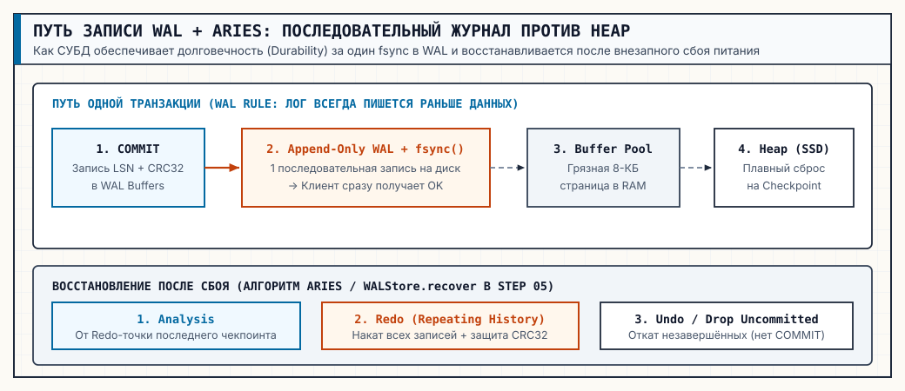
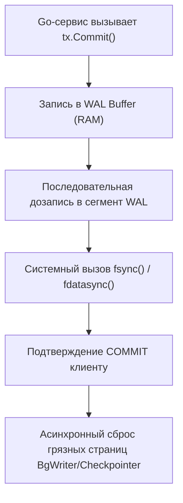

*Почему случайные правки таблиц слишком медленны, как последовательный журнал превращает Random I/O в Sequential I/O, цена `fsync()`, групповой коммит, аппаратный кэш дисков и разбор `WALStore` с `CRC32` и `f.Sync()` из `project/step05/mvcc_wal.go`.*

> «Любая функция ввода-вывода обязана считаться с вероятностью сбоя, и лишь наивный программист верит, что простое чтение или запись не могут завершиться ошибкой. Именно тогда, когда внезапно отказывают самые надёжные операции, нам нужнее всего знать почему.»  
> — Алан Донован и Брайан Керниган, *The Go Programming Language*

В [[7. MVCC — многоверсионный контроль конкурентности|предыдущей главе]] новые версии кортежей рождались на 8-КБ страницах в оперативной памяти (`Shared Buffers`). Но RAM энергозависима: при скачке напряжения её содержимое пропадает мгновенно.

Если при каждом `COMMIT` сбрасывать на диск все изменённые страницы кучи и B-Tree индексов, одна транзакция `LedgerPulse` породит десятки случайных дисковых записей (**Random I/O**): на HDD головка тратит ~10 мс на каждый поиск, а на NVMe SSD частые перезаписи блоков вызывают *Write Amplification* и сжигают ресурс ячеек. К тому же обрыв питания посреди записи 8-КБ страницы порвёт её пополам.

Поэтому базы данных строятся на **журнале упреждающей записи (Write-Ahead Log, WAL)** — механизме, обеспечивающем в [[1. ACID — четыре гарантии транзакции без иллюзий|ACID]] сразу две гарантии: **Atomicity** и **Durability**.

---

## Правило WAL: лог раньше данных



Закон WAL звучит категорично: **любое изменение страницы данных должно попасть в журнал на устойчивом носителе до того, как сама изменённая («грязная») страница будет записана в основной файл таблицы или индекса**.

Путь `UPDATE accounts SET balance = balance - 500 WHERE id = 42` выглядит так:
1. Движок меняет страницу в `Shared Buffers` (RAM) и пишет компактную бинарную запись в кольцевой **`WAL Buffer`** в памяти.
2. На `COMMIT` запись последовательно дописывается в файл WAL на диске и принудительно сбрасывается через **`fsync()`** / **`fdatasync()`**.
3. Лишь после ответа диска клиент получает успешный `COMMIT`.
4. Сама грязная 8-КБ страница остаётся в RAM и сбрасывается на диск позже фоновыми процессами (`BgWriter` и `Checkpointer`).



Этот приём превращает случайную запись по всему диску в **строго последовательную дозапись (Sequential I/O)**, которая на один-два порядка быстрее случайной и на HDD, и на NVMe SSD.

---

## Устройство под капотом: `LSN`, сегменты и `pd_lsn`

1. **LSN (Log Sequence Number):** 64-битный монотонный счётчик байтового смещения в потоке WAL (`pg_current_wal_lsn()`). Каждый `COMMIT` привязан к своему `commit_lsn`.
2. **Сегменты WAL:** журнал нарезан на файлы фиксированного размера (в PostgreSQL по умолчанию **16 МБ**, например `000000010000000A0000002D`; в InnoDB — файлы redo-логов на десятки мегабайт). Старые сегменты переиспользуются после контрольной точки и доставки репликам.

> [!info] Под капотом: `pd_lsn` и идемпотентность REDO
> В заголовке каждой 8-КБ страницы PostgreSQL (16-КБ в InnoDB) хранится **`pd_lsn`** — `LSN` последней записи WAL, изменившей эту страницу. При восстановлении после сбоя (REDO-фаза) движок сравнивает `record.lsn` и `page.pd_lsn`: если `page.pd_lsn >= record.lsn`, страница уже актуальна на диске и повторно применять запись не нужно. Это гарантирует идемпотентность восстановления.

> [!warning] Ловушка: `WAL Bloat` из-за забытого слота репликации
> Если аналитическая реплика или архиватор отвалились, а их **Replication Slot** остался активным, PostgreSQL не удаляет старые сегменты. Каталог `pg_wal` раздувается до переполнения диска, после чего сервер останавливается (`PANIC`) ради сохранения `Durability`. Настраивайте `max_slot_wal_keep_size` и мониторьте размер `pg_wal`.

---

## Физика диска и ОС: `fsync()`, Group Commit и аппаратная ложь


Обычный `write()` копирует байты только в `Page Cache` ядра Linux в RAM (~сотни наносекунд). Чтобы данные легли на физический носитель, нужен `fsync()` или `fdatasync()`:
* **Цена:** на серверном NVMe SSD вызов стоит **100–500 мкс** (против ~100 нс RAM), на SATA SSD и HDD — **2–10 мс**. Поток ядра уходит в состояние `TASK_UNINTERRUPTIBLE` до прерывания контроллера диска, а горутина Go в это время держит слот пула `*sql.DB`.
* **Group Commit:** при одиночных коммитах один поток на NVMe (500 мкс) упирается в 2 000 TPS. Под конкурентной нагрузкой лидер (или `WAL Writer`) объединяет записи десятков параллельных транзакций в одну пачку и сбрасывает её **одним общим `fsync()`**, линейно масштабируя пропускную способность.
* **Аппаратная ложь (`Hardware Write Cache`):** потребительские SSD и дешёвые RAID-контроллеры кэшируют запись в собственной энергозависимой DRAM и отвечают ОС «готово» до попадания битов во флеш-память. Для реальной `Durability` нужны серверные диски с **PLP (Power-Loss Protection)** и поддержкой **FUA**, а в PostgreSQL — `wal_sync_method = fdatasync` или `open_datasync`.

---

## Разбор `WALStore` с `CRC32` и `f.Sync()` в `project/step05/mvcc_wal.go`

В `project/step05/mvcc_wal.go` правило «сначала журнал с `fsync`, затем состояние в памяти» реализовано через `WALStore` и `walRecord`:

```go
type walRecord struct {
	LSN   uint64 `json:"lsn"`
	TxID  uint64 `json:"tx"`
	Op    string `json:"op"` // "PUT", "COMMIT", "ABORT"
	Key   string `json:"key,omitempty"`
	Value int64  `json:"val,omitempty"`
	CRC   uint32 `json:"crc"`
}

func (r walRecord) checksum() uint32 {
	payload := fmt.Sprintf("%d|%d|%s|%s|%d", r.LSN, r.TxID, r.Op, r.Key, r.Value)
	return crc32.ChecksumIEEE([]byte(payload))
}
```

Контрольная сумма **`crc32.ChecksumIEEE`** защищает от тихой порчи байтов на диске (*bit rot*): при расхождении при чтении движок возвращает `ErrCorruptedWAL`. Проследим ключевые методы `appendAndSync` и `ApplyCommitted`:

```go
func (s *WALStore) appendAndSync(recs ...walRecord) error {
	f, err := os.OpenFile(s.walPath, os.O_CREATE|os.O_WRONLY|os.O_APPEND, 0o600)
	if err != nil {
		return err
	}
	defer f.Close()
	for i := range recs {
		s.nextLSN++
		recs[i].LSN = s.nextLSN
		recs[i].CRC = recs[i].checksum()
		line, err := json.Marshal(recs[i])
		if err != nil {
			return err
		}
		if _, err := f.Write(append(line, '\n')); err != nil {
			return err
		}
	}
	return f.Sync()
}

func (s *WALStore) ApplyCommitted(txID uint64, writes map[string]int64) error {
	s.mu.Lock()
	defer s.mu.Unlock()
	var recs []walRecord
	for k, v := range writes {
		recs = append(recs, walRecord{TxID: txID, Op: "PUT", Key: k, Value: v})
	}
	recs = append(recs, walRecord{TxID: txID, Op: "COMMIT"})
	if err := s.appendAndSync(recs...); err != nil {
		return err
	}
	for k, v := range writes {
		s.state[k] = v
	}
	return nil
}
```

Обратите внимание на строгий порядок в `ApplyCommitted`: сначала в файл пишутся `"PUT"` и `"COMMIT"`, затем `f.Sync()` сбрасывает буфер на диск, и **лишь при успехе `f.Sync()`** обновляется `s.state` в памяти.

При перезапуске метод `recover()` буферизует `"PUT"` в карте `pending[txID]` и применяет их к `s.state` только встретив `"COMMIT"`. Записи `"ABORT"` или незакоммиченный хвост от сбоя (включая оборванную строку JSON на хвосте файла) отбрасываются. В `TestWALRecoveryAndMVCC` (`project/step05/mvcc_wal_test.go`) закоммиченное `"acc:1": 1000` переживает `OpenWALStore`, а незавершённое `WriteUncommitted(2, "acc:1", 9999)` исчезает. Полный цикл восстановления **ARIES** (`Analysis`, `Redo`, `Undo`) и контрольные точки мы разберём в следующих двух главах этого модуля.

---

## Практика в Go: группировка, `synchronous_commit` и репликация

1. **Группируйте записи в одну транзакцию:** 1 000 отдельных вставок в режиме автокоммита вызывают до 1 000 `fsync()` и сетевых RTT. Одна транзакция с `UNNEST` или `COPY` ([[16. Пакетные (Batch) запросы, UNNEST и COPY]]) сбрасывает лог один раз.
2. **Ослабляйте `synchronous_commit` только для некритичных данных:** для денежных проводок `LedgerPulse` всегда нужен `synchronous_commit = on` (или `remote_apply` при синхронной репликации, добавляющий сетевой RTT ради сохранности на двух узлах). Но для телеметрии и счётчиков можно локально ускорить запись в 2–5 раз (рискуя потерять лишь последние ~200 мс кэша при отключении питания, без повреждения целостности БД):

```go
func InsertTelemetryBatch(ctx context.Context, db *sql.DB, names []string, vals []int64) error {
	tx, err := db.BeginTx(ctx, nil)
	if err != nil {
		return fmt.Errorf("begin tx: %w", err)
	}
	defer func() { _ = tx.Rollback() }()

	// Действует строго до конца этой транзакции, не загрязняя пул соединений
	if _, err := tx.ExecContext(ctx, `SET LOCAL synchronous_commit = off`); err != nil {
		return fmt.Errorf("set sync mode: %w", err)
	}
	if _, err := tx.ExecContext(ctx, `
		INSERT INTO telemetry_events (name, value)
		SELECT n, v FROM UNNEST($1::text[], $2::bigint[]) AS t(n, v)`,
		names, vals,
	); err != nil {
		return fmt.Errorf("insert telemetry: %w", err)
	}
	return tx.Commit()
}
```

3. **WAL — источник истины для репликации:** в PostgreSQL (`WAL Streaming`) и MySQL (`Binlog`) реплики читают поток записей журнала и воспроизводят изменения локально бит-в-бит.

> [!tip] Собеседование [Senior/Staff]
> **Вопрос:** Почему `WAL` пишется последовательно, а данные — случайно, и зачем в PostgreSQL предпочитают `fdatasync()` обычному `fsync()`?
> **Ответ:** Новые записи WAL дописываются в конец активного сегмента (`Sequential I/O`), тогда как грязные 8-КБ страницы сбрасываются фоном по адресам изменённых блоков (`Random I/O`). Вызов `fsync()` сбрасывает и данные, и метаданные ФС (`mtime`, `inode`), удваивая число дисковых операций. `fdatasync()` сбрасывает только изменённые блоки данных, если размер файла не менялся — а сегменты WAL в PostgreSQL заранее выделяются фиксированного размера 16 МБ.

---

## Упражнения

### 1. Базовое: Потолок `TPS` и эффект `Group Commit`

Один поток Go последовательно коммитит одиночные транзакции (`fdatasync()` = 400 мкс, сеть + CPU = 100 мкс). Каков потолок `TPS` для одного потока и почему при 64 параллельных горутинах суммарный `TPS` вырастает в десятки раз?

> [!solution] Показать решение
> 1. На одну транзакцию в одном потоке уходит `500 мкс = 0.5 мс`, потолок = **`2 000 TPS`**.
> 2. При 64 параллельных горутинах работает **Group Commit**: пока диск выполняет один `fdatasync()` за `400 мкс`, десятки транзакций накапливаются в `WAL Buffer` и сбрасываются одним общим вызовом. Если в окно попадает 20 коммитов, пропускная способность достигает `~50 000 TPS`.

### 2. Практическое: Безопасная обёртка `WithTxSyncMode` в Go

Напишите функцию `WithTxSyncMode(ctx context.Context, db *sql.DB, mode string, fn func(context.Context, *sql.Tx) error) error`, которая принимает `"on"`, `"off"` или `"remote_apply"`, защищается белым списком (так как `SET LOCAL` не поддерживает параметры `$1`), применяет настройку на транзакцию и гарантирует откат при ошибке.

> [!solution] Показать решение
> ```go
> func WithTxSyncMode(ctx context.Context, db *sql.DB, mode string, fn func(context.Context, *sql.Tx) error) error {
> 	var stmt string
> 	switch mode {
> 	case "on":
> 		stmt = "SET LOCAL synchronous_commit = on"
> 	case "off":
> 		stmt = "SET LOCAL synchronous_commit = off"
> 	case "remote_apply":
> 		stmt = "SET LOCAL synchronous_commit = remote_apply"
> 	default:
> 		return fmt.Errorf("unsupported synchronous_commit mode: %q", mode)
> 	}
> 	tx, err := db.BeginTx(ctx, nil)
> 	if err != nil {
> 		return fmt.Errorf("begin tx: %w", err)
> 	}
> 	defer func() { _ = tx.Rollback() }()
> 	if _, err := tx.ExecContext(ctx, stmt); err != nil {
> 		return err
> 	}
> 	if err := fn(ctx, tx); err != nil {
> 		return err
> 	}
> 	return tx.Commit()
> }
> ```

### 3. Со звёздочкой (*): Метод `Abort` и проверка `ErrCorruptedWAL` в `WALStore`

Добавьте в `WALStore` (`project/step05/mvcc_wal.go`) метод `Abort(txID uint64) error` и тест, проверяющий: (1) незавершённая запись с последующим `Abort` не восстанавливается; (2) изменение одного байта в JSON-строке без пересчёта `CRC` вызывает `ErrCorruptedWAL` при `OpenWALStore`.

> [!solution] Показать решение
> ```go
> func (s *WALStore) Abort(txID uint64) error {
> 	s.mu.Lock()
> 	defer s.mu.Unlock()
> 	return s.appendAndSync(walRecord{TxID: txID, Op: "ABORT"})
> }
> ```
> Тест:
> ```go
> func TestWALAbortAndCorruption(t *testing.T) {
> 	p := filepath.Join(t.TempDir(), "abort.wal")
> 	st, _ := OpenWALStore(p)
> 	_ = st.ApplyCommitted(1, map[string]int64{"acc:1": 500})
> 	_ = st.WriteUncommitted(10, "acc:1", 777)
> 	_ = st.Abort(10)
>
> 	reopened, err := OpenWALStore(p)
> 	if err != nil {
> 		t.Fatalf("reopen: %v", err)
> 	}
> 	if v, ok := reopened.Get("acc:1"); !ok || v != 500 {
> 		t.Fatalf("expected 500, got %d", v)
> 	}
> 	raw, _ := os.ReadFile(p)
> 	_ = os.WriteFile(p, bytes.Replace(raw, []byte(`"val":500`), []byte(`"val":600`), 1), 0o600)
> 	if _, err := OpenWALStore(p); !errors.Is(err, ErrCorruptedWAL) {
> 		t.Fatalf("expected ErrCorruptedWAL, got %v", err)
> 	}
> }
> ```

---

## Главный вывод и мостик дальше

`WAL` гарантирует `Atomicity` и `Durability`, превращая случайные записи в последовательный лог с `fsync()`, групповым коммитом и контролем целостности по `CRC32` и `LSN`.

Но если база работает без остановки месяцами, журнал вырастет до сотен гигабайт, а повторное воспроизведение всех записей с нуля при рестарте займёт часы. Как СУБД периодически фиксирует согласованную точку на диске, сбрасывая грязные страницы и безопасно удаляя старые сегменты WAL — разберём в следующей главе о контрольных точках (`Checkpointing`).
