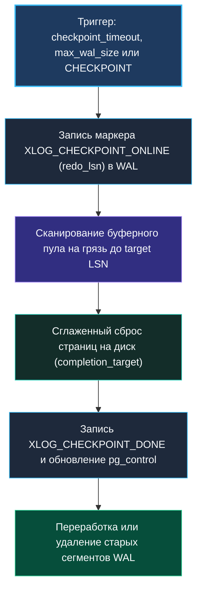

*Как контрольные точки ограничивают рост WAL и время восстановления после сбоя, почему сброс грязных страниц бьёт по хвостовым задержкам и как сгладить дисковый шторм.*

> «В идеальном мире прикладному программисту достаточно знать только API — без того, как этот API реализован и к какому железу он обращается. В реальности же чуть более глубокие знания порой оказываются весьма кстати.»  
> — Чарльз Петцольд, *Code: The Hidden Language of Computer Hardware and Software*

В [[8. WAL — журнал упреждающей записи и долговечность на диске|предыдущей главе]] вы убедились, что при фиксации транзакции база не спешит обновлять 8-килобайтные страницы таблиц и индексов на диске. Достаточно последовательно дописать изменения в журнал упреждающей записи (WAL) и вызвать `fsync()`. Изменённые блоки данных остаются в оперативной памяти — в «грязном» состоянии (`dirty pages`) внутри буферного пула (`shared_buffers`).

Теперь представьте, что СУБД только дописывает байты в конец WAL и никогда не выгружает грязные страницы в основные файлы таблиц. За считанные часы журнал съест весь свободный объём NVMe-накопителя. А если сервер перезагрузится по питанию, движку придётся проигрывать накопленный за сутки или неделю лог с самого начала — целевое время восстановления сервиса (**RTO**, Recovery Time Objective) растянется на часы.

**Контрольная точка (Checkpoint)** — это периодический механизм синхронизации между оперативной памятью и накопителем, который решает три задачи:

1. Фиксирует в WAL маркер согласованного состояния и точку отсчёта `redo_lsn`.
2. Принудительно сбрасывает накопившиеся грязные страницы из буферного пула в файлы таблиц и индексов.
3. Разрешает ядру СУБД удалить или переиспользовать старые сегменты WAL, чьи изменения уже физически лежат на диске.

Для инженера знание механики чекпоинтов критично: этот фоновый процесс напрямую управляет предсказуемостью хвостовых задержек (`tail latency` p99/p99.9), износом серверных SSD и реальным временем простоя после аварии.

---

## Механика: пять фаз контрольной точки

Процесс создания контрольной точки строго детерминирован и проходит пять последовательных шагов.



1. **Триггер события.** Контрольная точка запускается по таймеру (`checkpoint_timeout`), по превышению квоты накопленного WAL (`max_wal_size`) либо по явной команде администратора `CHECKPOINT`.
2. **Фиксация `redo_lsn`.** В журнал упреждающей записи помещается маркер начала контрольной точки (`XLOG_CHECKPOINT_ONLINE` в PostgreSQL). Он фиксирует минимальный адрес `redo_lsn` — с этого места стартует проигрывание лога при аварийном восстановлении.
3. **Сканирование буферного пула.** Фоновый процесс обходит дескрипторы страниц в разделяемой памяти, находит все изменённые блоки (`LSN > checkpoint_lsn`) и формирует упорядоченную очередь на сброс.
4. **Пакетный сброс на диск.** Грязные страницы выгружаются в файлы таблиц и индексов. Чтобы не обрушить на контроллер накопителя лавину случайной записи, движок растягивает сброс во времени согласно параметру `checkpoint_completion_target`, а затем вызывает `fsync()` для затронутых файлов данных.
5. **Завершение и ротация WAL.** Когда все страницы физически записаны на накопитель, в лог добавляется маркер `XLOG_CHECKPOINT_DONE`, а управляющий файл `global/pg_control` обновляется новым указателем контрольной точки. Сегменты WAL, целиком лежащие до `redo_lsn`, помечаются как безопасные для удаления или переименования в будущие сегменты.

> [!info] Под капотом: PostgreSQL против MySQL/InnoDB
> В PostgreSQL за сброс отвечает выделенный процесс `checkpointer`, который общается с ядром и остальными бэкендами через сигналы и разделяемую память (`shared_buffers`). Расписание его работы строго предсказуемо. В MySQL/InnoDB контрольными точками управляет главный фоновый поток `srv_master_thread` (совместно с `page_cleaner_thread`), циклически вызывающий `flush_buffer_pool()`. Алгоритм InnoDB опирается на нечёткие (fuzzy) эвристики процента грязных страниц в пуле и темпа генерации `redo log`.

---

## Учёт устройства железа: диск, кэш-линии CPU и хвостовые задержки

Контрольная точка — один из самых тяжёлых фоновых процессов СУБД. Ошибки в её настройке превращают ровный профиль задержек `LedgerPulse` в периодическую «пилу» на графиках мониторинга.

### Случайная запись и износ SSD

Пока клиентские транзакции пишут в WAL, диск получает последовательный поток байтов — самый быстрый режим как для магнитных пластин, так и для флеш-памяти. Но во время чекпоинта десятки тысяч грязных 8-КБ страниц разбросаны по разным таблицам и B-Tree индексам. Выгрузка превращается в интенсивный поток **случайной записи (`random write`)**:

* на магнитных HDD это вызывает постоянные перепозиционирования головок с задержками порядка ~10 мс на операцию;
* на серверных NVMe/SSD (~100 мкс на базовый I/O) массированная случайная запись активирует внутренний сборщик мусора контроллера — алгоритмы трансляции адресов (**FTL**, Flash Translation Layer) и выравнивания износа (**Wear Leveling**).

Если чекпоинты срабатывают слишком часто, контроллер SSD начинает одновременно стирать и перезаписывать целые блоки флеш-памяти. Пользовательские запросы проваливаются в хвост распределения задержек (`p99` и `p99.9`).

### Кэш-линии CPU и пропускная способность памяти

Доступ к оперативной памяти занимает ~100 нс, к кэшу `L3` — на порядок меньше (~10–20 нс). Процедура поиска грязных блоков в буферном пуле заставляет процесс `checkpointer` обходить миллионы дескрипторов страниц (`BufferDesc` в PostgreSQL или `buf_block_t` в InnoDB), размазанных по гигабайтам разделяемой памяти:

* сканирование вытесняет горячие пользовательские структуры из кэша `L3` процессора;
* аппаратный предвыборщик (`hardware prefetcher`) теряет эффективность из-за хаотичного распределения модифицированных страниц в адресном пространстве;
* конкурирующий трафик по шине памяти способен замедлить параллельные `SELECT` и `UPDATE` на 10–20% на время активной фазы сброса.

### Очереди `blkio` и латентность Go-сервиса

Когда СУБД выгружает тысячи страниц и вызывает `fsync()`, запросы попадают в общую дисковую очередь ядра Linux (`I/O scheduler` / `blkio`). На томах с ограниченными `IOPS` пользовательские транзакции начинают ждать свободных слотов ввода-вывода. В Go-сервисе `LedgerPulse` это проявляется внезапным ростом времени выполнения `QueryRowContext` и `ExecContext`, хотя загрузка ядер CPU базы данных остаётся далекой от 100%.

---

## Стратегии сглаживания: от шторма к ламинарному потоку

Чтобы сброс страниц не душил пользовательский трафик, современные движки сочетают два скоординированных механизма:

1. **Фоновый писатель (`bgwriter`).** Отдельный процесс непрерывно и малыми порциями выталкивает давно не использовавшиеся грязные буферы в Page Cache ОС. Это заранее освобождает чистые слоты под новые чтения и уменьшает объём работы для будущего `checkpointer`.
2. **Целевое время завершения (`checkpoint_completion_target`).** Движок не сбрасывает грязные страницы на предельной скорости контроллера в первые секунды чекпоинта. Параметр (по умолчанию `0.9` в PostgreSQL) задаёт долю интервала между точками, на которую равномерно растягивается запись. При `checkpoint_timeout = 15min` и `0.9` сброс размазывается примерно на 13,5 минут, превращая пиковый удар по диску в ровный фоновый поток.

> [!warning] Ловушка: слишком редкие контрольные точки ради тишины на графиках
> Попытка снизить дисковый I/O за счёт огромного `checkpoint_timeout` (например, 2–24 часа) и гигантского `max_wal_size` опасна. В штатной работе диск отдыхает, но при внезапном падении питания базе придётся заново проигрывать многочасовой объём WAL. Время восстановления (RTO) легко выйдет за пределы 5–10 минут, превратив минутный рестарт в затяжной простой. Рабочий ориентир для большинства OLTP-систем — интервал 10–15 минут или 1–2 ГБ WAL.

---

## Практика в Go: влияние приложения и мониторинг `LedgerPulse`

Разработчик бэкенда не редактирует `postgresql.conf` напрямую из сервиса, но именно код на Go определяет, как быстро пачкаются буферы и как часто срабатывают внеплановые контрольные точки.

### 1. Ограничение размера пакетов вместо шторма записи

Массовая загрузка выписок в `ledger_entries` одной гигантской транзакцией или плотным циклом `INSERT`/`COPY` без пауз мгновенно заполняет `max_wal_size`. СУБД вынуждена запускать принудительные чекпоинты один за другим. Нарезайте импорт на ограниченные батчи:

```go
package ledger

import (
	"context"
	"database/sql"
	"fmt"
)

type Entry struct {
	TxID      int64
	AccountID int64
	Amount    int64
}

func InsertEntriesBatched(ctx context.Context, db *sql.DB, entries []Entry) error {
	const batchSize = 1000
	for i := 0; i < len(entries); i += batchSize {
		end := min(i+batchSize, len(entries))
		batch := entries[i:end]

		tx, err := db.BeginTx(ctx, nil)
		if err != nil {
			return fmt.Errorf("begin batch tx: %w", err)
		}

		stmt, err := tx.PrepareContext(ctx, `
			INSERT INTO ledger_entries (transaction_id, account_id, amount)
			VALUES ($1, $2, $3)
		`)
		if err != nil {
			_ = tx.Rollback()
			return fmt.Errorf("prepare insert: %w", err)
		}

		for _, e := range batch {
			if _, err := stmt.ExecContext(ctx, e.TxID, e.AccountID, e.Amount); err != nil {
				_ = stmt.Close()
				_ = tx.Rollback()
				return fmt.Errorf("exec entry: %w", err)
			}
		}
		_ = stmt.Close()

		if err := tx.Commit(); err != nil {
			return fmt.Errorf("commit batch: %w", err)
		}
	}
	return nil
}
```

### 2. Мониторинг доли принудительных чекпоинтов

В PostgreSQL системное представление `pg_stat_bgwriter` (а начиная с PostgreSQL 17 — выделенное представление `pg_stat_checkpointer` со столбцами `num_timed`, `num_requested`, `buffers_written`) показывает баланс между плановыми чекпоинтами по таймеру и принудительными сбросами из-за переполнения WAL:

```go
type CheckpointStats struct {
	Timed   int64
	Req     int64
	Buffers int64
}

func GetCheckpointMetrics(ctx context.Context, db *sql.DB) (CheckpointStats, error) {
	var stats CheckpointStats
	// Для PostgreSQL 16 и ниже используется pg_stat_bgwriter;
	// в PostgreSQL 17+ метрики перенесены в pg_stat_checkpointer.
	err := db.QueryRowContext(ctx, `
		SELECT checkpoints_timed, checkpoints_req, buffers_checkpoint
		FROM pg_stat_bgwriter
	`).Scan(&stats.Timed, &stats.Req, &stats.Buffers)
	if err != nil {
		return CheckpointStats{}, fmt.Errorf("query checkpoint stats: %w", err)
	}
	return stats, nil
}
```

Если доля принудительных точек `Req / (Timed + Req)` стабильно превышает `30%`, дисковая подсистема работает в режиме хронического стресса: нужно либо увеличивать `max_wal_size`, либо сдерживать темп пакетной записи на стороне Go-воркеров.

> [!tip] Собеседование [Middle]: чем `checkpoint` отличается от `fsync()` при `COMMIT`
> **Вопрос:** Зачем СУБД периодический `checkpoint`, если каждая транзакция и так вызывает `fsync()` при коммите?
>
> **Ответ:** `fsync()` при коммите сбрасывает на диск только последовательные записи конкретной транзакции в журнале WAL — этого достаточно для долговечности, но страницы самих таблиц остаются грязными в памяти. `checkpoint` сбрасывает накопившиеся грязные страницы данных из буферного пула в файлы таблиц и индексов, позволяя удалить старые сегменты WAL. Коммиты происходят тысячи раз в секунду, а контрольная точка — раз в несколько минут; без неё журнал бесконечно рос бы и восстановление после сбоя длилось бы часами.

### Облачные среды и обратное давление (Backpressure)

В управляемых облачных базах (AWS RDS, GCP Cloud SQL) доступ к параметрам вроде `checkpoint_timeout` часто ограничен, а виртуальные диски зажаты квотами `max IOPS` и `burst balance`. Когда квота исчерпывается, контрольная точка тормозит, мешая ротации старых сегментов WAL. Диск под журналом переполняется, что способно остановить кластер с фатальной ошибкой `PANIC: could not write to WAL because of disk space`.

Надёжная защита на стороне фоновых Go-воркеров `LedgerPulse` — механизм обратного давления (**backpressure**): при росте задержек записи в базу или увеличении очереди отложенных задач воркер динамически снижает конкурентность вставки либо притормаживает темп батчей, давая `checkpointer` завершить сброс.

---

## Упражнения

### Упражнение 1 (Базовое). Диагностика соотношения чекпоинтов

Запрос к `pg_stat_bgwriter` вернул `checkpoints_timed = 42`, `checkpoints_req = 78`, `buffers_checkpoint = 1840000`. Оцените состояние подсистемы записи и предложите два независимых инженерных действия для исправления ситуации.

> [!solution] Показать решение
> Доля принудительных контрольных точек составляет `78 / (42 + 78) = 65%`, что существенно выше порога в 30%. Большинство чекпоинтов срабатывает не по расписанию, а из-за исчерпания квоты WAL.
> 1. На стороне СУБД: увеличить `max_wal_size` (при наличии свободного места на диске), чтобы сегменты реже упирались в лимит до истечения `checkpoint_timeout`, и проверить `checkpoint_completion_target` (должен быть `0.9`).
> 2. На стороне Go-приложения: разбить крупные пакетные операции (массовые `INSERT`/`UPDATE`/`COPY`) на батчи с паузами или лимитом темпа (rate limiting), чтобы не провоцировать всплески генерации WAL.

### Упражнение 2 (Практическое). Функция расчёта перекоса в Go

Напишите на Go функцию `NeedsCheckpointTuning(prev, curr CheckpointStats) (forcedRatio float64, alert bool)`, которая по разнице двух снимков метрик за окно наблюдения вычисляет долю принудительных чекпоинтов и возвращает `alert = true`, если новых чекпоинтов было не меньше 5 и доля принудительных превысила `0.30`.

> [!solution] Показать решение
> ```go
> func NeedsCheckpointTuning(prev, curr CheckpointStats) (float64, bool) {
> 	deltaTimed := max(0, curr.Timed-prev.Timed)
> 	deltaReq := max(0, curr.Req-prev.Req)
> 	total := deltaTimed + deltaReq
> 	if total == 0 {
> 		return 0, false
> 	}
> 	ratio := float64(deltaReq) / float64(total)
> 	return ratio, total >= 5 && ratio > 0.30
> }
> ```
> Использование дельты двух последовательных снимков вместо кумулятивных счётчиков с момента старта сервера позволяет ловить свежие деградации нагрузки, не искажённые историей прошлых недель.

### Упражнение 3 (\*). Скорость сброса под `checkpoint_completion_target`

За интервал `checkpoint_timeout = 10` минут в буферном пуле накопилось 90 000 грязных страниц по 8 КБ. Оцените среднюю требуемую пропускную способность случайной записи на диск (в МБ/с) при `checkpoint_completion_target = 0.9` и при аварийном значении `0.1`. Какие последствия вызовет значение `0.1` на облачном диске с лимитом 3000 IOPS (случайные 8-КБ блоки)?

> [!solution] Показать решение
> Объём грязных данных: `90 000 * 8 КБ = 720 000 КБ ≈ 703 МБ`.
> * При `0.9`: окно сброса равно `10 * 60 * 0.9 = 540` секунд. Средний поток: `703 / 540 ≈ 1.30 МБ/с`, или около `90 000 / 540 ≈ 167 IOPS` — спокойная фоновая нагрузка.
> * При `0.1`: окно сжимается до `60` секунд. Поток возрастает до `703 / 60 ≈ 11.7 МБ/с`, или `1500 IOPS` только на один `checkpointer` (не считая параллельного `fsync`, WAL и пользовательских чтений/записей). На томе с лимитом 3000 IOPS половина дискового бюджета мгновенно сгорит на фоновый сброс, вызвав рост очередей и скачок `p99`-латентности в Go-сервисе.

---

## Мостик к следующему уроку

Контрольная точка фиксирует согласованную границу `redo_lsn` и сглаживает выгрузку памяти на накопитель. Но что происходит, когда сервер обесточивается между чекпоинтами: содержимое `shared_buffers` исчезает, а часть 8-КБ страниц остаётся записанной наполовину? В следующей главе разберём механику аварийного восстановления: [[10. Восстановление после сбоя (Crash Recovery) и алгоритм ARIES]].
