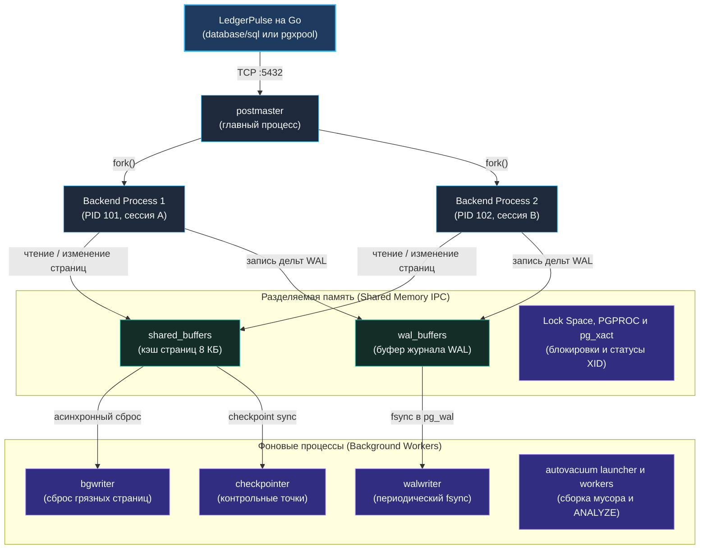
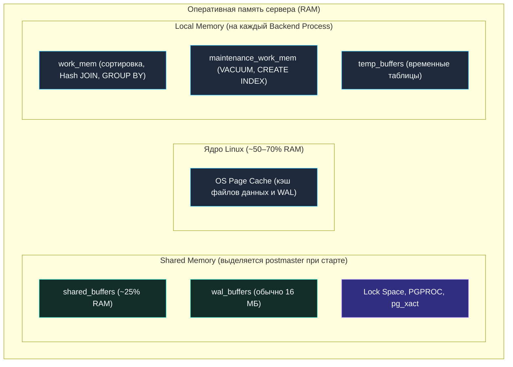
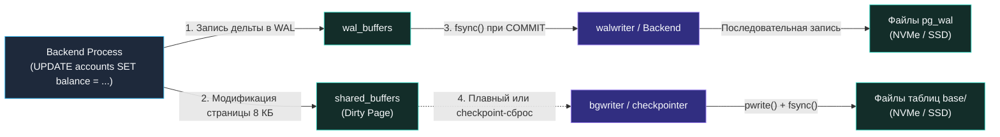

*Почему PostgreSQL выбирает модель «процесс на соединение» вместо потоков и горутин, как `postmaster` форкает бэкенды, чем опасно двойное буферизирование `shared_buffers` и куда уходит `work_mem` при сортировках.*

> «В идеальном мире прикладному программисту достаточно знать только API — без того, как этот API реализован и к какому железу он обращается. В реальности же чуть более глубокие знания порой оказываются весьма кстати.»  
> — Чарльз Петцольд, *Code* (2-е изд.)

В сервисе `LedgerPulse` планировщик Go легко держит десятки тысяч конкурентных горутин поверх горстки потоков ОС по модели G-M-P. Каждая горутина стартует со стеком в 2 КБ и переключается в пространстве пользователя за десятки наносекунд.

Если по аналогии с этим открыть из микросервисов 5 000 прямых соединений к PostgreSQL, сервер базы данных захлебнётся быстрее, чем при тяжёлой аналитике. Причина кроется в базовом архитектурном выборе ядра СУБД: в отличие от многопоточного MySQL (`thread-per-connection`), PostgreSQL использует модель **Process-Per-Connection** — выделенный процесс операционной системы на каждое клиентское подключение.

---

## Process-Per-Connection: от `postmaster` к бэкенду

Внутри своих рабочих обработчиков PostgreSQL принципиально не использует потоки выполнения (threads). Вся архитектура опирается на классические процессы Unix и механизмы разделяемой памяти (Shared Memory IPC).

При запуске кластера операционная система стартует главный управляющий процесс — **`postmaster`** (исполняемый файл называется просто `postgres`). Он открывает TCP-сокет (по умолчанию порт `5432`), инициализирует разделяемую память, запускает фоновых помощников и переходит в цикл ожидания входящих подключений.

Когда приложение на Go вызывает `sql.Open()` и выполняет первый запрос через пул (или `pgxpool`), разворачивается строгая последовательность системных вызовов:

1. **`postmaster`** принимает TCP-соединение через `accept()`.
2. Главный процесс выполняет системный вызов `fork()`, создавая дочернюю копию своего адресного пространства.
3. Дочерний процесс превращается в **Backend Process** (рабочий серверный процесс с собственным PID), забирает файловый дескриптор клиентского сокета и обслуживает все SQL-команды данной сессии.
4. Когда приложение закрывает соединение, бэкенд завершается через `exit()`, возвращая память ядру ОС.



> [!info] Исторический выбор: почему процессы, а не потоки
> Архитекторы проекта POSTGRES в Беркли во главе с Майклом Стоунбрейкером в конце 1980-х сознательно выбрали процессы ради **изоляции памяти и отказоустойчивости**. В едином многопоточном процессе на Си ошибка с висячим указателем или `SIGSEGV` в одном потоке обрушивает весь сервер целиком, обрывая работу всех клиентов и требуя долгого восстановления после сбоя.
>
> В PostgreSQL падение одного бэкенда из-за бага в стороннем C-расширении или сбоя памяти убивает **только этот изолированный процесс**. Ядро Linux само освобождает его страницы и закрывает сокеты, а `postmaster` может перезапустить служебное состояние (при повреждении разделяемой памяти он всё же выполнит контролируемый рестарт кластера для защиты целостности).

У процессорной изоляции есть системная цена:

* **Стоимость `fork()`:** ядро копирует таблицы страниц памяти (Page Tables). Даже с Copy-On-Write (CoW) сотни новых подключений в секунду нагружают менеджер памяти Linux.
* **Переключение контекста:** смена активного процесса требует переключения адресного пространства (регистр `CR3` на x86-64) и сброса TLB без общих тегов PCID — на порядки дороже переключения горутин в Go.
* **Накладной расход RAM:** каждый бэкенд держит свой стек вызовов, локальный кэш системных каталогов (`relcache`, `syscache`) и буферы сокета — минимум **5–10 МБ** памяти ещё до старта первого запроса.

> [!tip] Собеседование [Middle]
> **Вопрос:** Почему при нагрузке 10 000 RPS нельзя открывать из Go 10 000 прямых соединений к PostgreSQL?  
> **Ответ:** 10 000 подключений превращаются в 10 000 процессов Linux. Планировщик ОС (CFS/EEVDF) тратит основную долю ядер на переключение контекста, кэши L1/L2/L3 и TLB постоянно вымываются (*CPU Thrashing*), а память процессов уводит сервер в OOM. Перед PostgreSQL ограничивают пул в Go (`SetMaxOpenConns`) и ставят внешний транзакционный пулер (`PgBouncer` или `Odyssey`), удерживая число активных бэкендов ближе к `2 * CPU_Cores + Disk_Spindle_Depth` (см. главу 9 и Модуль 10).

---

## Карта памяти: общая, локальная и файловый кэш ОС

Вся оперативная память на сервере с PostgreSQL делится между тремя зонами: **разделяемой памятью кластера**, **локальной памятью каждого бэкенда** и **файловым кэшем ядра Linux (Page Cache)**.



### 1. Разделяемая память (Shared Memory)

Единый сегмент памяти, который `postmaster` выделяет при старте (через анонимный `mmap` и при необходимости System V `shmget`) и передаёт по наследству всем дочерним процессам:

* **`shared_buffers`** — главный буферный пул 8-килобайтных страниц данных и индексов. PostgreSQL никогда не читает кортежи напрямую в локальные буферы: сначала страница попадает в `shared_buffers`, и только потом исполнитель читает из неё строки. Обращение к странице в `shared_buffers` занимает **~100 нс** (скорость RAM) против **~100 мкс** при промахе на NVMe SSD (в 1 000 раз медленнее) и **~10 мс** на HDD (в 100 000 раз медленнее). Стандартная стартовая точка — **25% от RAM**.
* **`wal_buffers`** — кольцевой буфер для записей журнала предзаписи (см. [[8. WAL — журнал упреждающей записи и долговечность на диске]]). Обычно хватает 16 МБ (автоматически выбирается около 3% от `shared_buffers` с потолком в 16 МБ, при высокой интенсивности записи поднимают до 32–64 МБ).
* **`pg_xact` (`CLOG`) и структуры синхронизации** — статусы фиксации транзакций, таблицы легковесных (`LWLock`) и обычных блокировок, массив активных процессов `PGPROC`.

> [!warning] Ловушка: двойное буферизирование (Double Buffering)
> Новички после MySQL InnoDB нередко отдают под `shared_buffers` 80% всей оперативной памяти. В PostgreSQL это оборачивается деградацией и риском OOM.
>
> Исторически PostgreSQL открывает файлы таблиц стандартными системными вызовами `read`/`write` (без флага `O_DIRECT`). Когда бэкенд считывает 8-КБ блок с диска, ядро Linux сначала помещает его в свой **OS Page Cache**, а затем копирует в `shared_buffers` PostgreSQL. Одни и те же горячие страницы хранятся в RAM дважды. Оставшиеся 70–75% памяти нужны операционной системе под Page Cache, локальную память бэкендов и буферы ядра. (Начиная с PostgreSQL 16–17 в ядре появились экспериментальные флаги `io_direct` для WAL и данных, но базовый профиль продакшена по-прежнему строится вокруг связки `shared_buffers` + Page Cache).

### 2. Локальная память процесса (Local Memory)

Эта память выделяется динамически внутри конкретного `Backend Process` на время работы узла запроса и освобождается сразу после завершения операции:

* **`work_mem`** — лимит памяти на операции сортировки (`ORDER BY`), построения хэш-таблиц (`Hash JOIN`, `HashAggregate`), материализации и битовые карты (`Bitmap Heap Scan`). Здесь кроется частая ошибка расчёта: **`work_mem` выделяется не на соединение и даже не на весь запрос, а на каждый отдельный узел плана** (и на каждого параллельного воркера при `Parallel Query`). Запрос с тремя `Hash JOIN` и двумя `ORDER BY` способен занять `5 * work_mem`. Умножьте это на 100 одновременных бэкендов — и 64 МБ `work_mem` легко превращаются в 32 ГБ внезапного потребления RAM.
* **Сброс на диск (`spill to disk`):** если промежуточный результат не влезает в `work_mem`, PostgreSQL не падает с ошибкой, а молча выгружает временные прогоны во временные файлы каталога `pgsql_tmp`. Скорость падает в десятки и сотни раз; в плане `EXPLAIN (ANALYZE, BUFFERS)` появляется метка `Sort Method: external merge  Disk: ...kB` (или `Batches: 16` у `Hash`).
* **`maintenance_work_mem`** — лимит для служебных операций: `VACUUM`, `CREATE INDEX`, `ALTER TABLE ADD FOREIGN KEY`. Эти команды запускаются редко, поэтому им смело выдают сотни мегабайт или гигабайты (например, 512 МБ – 2 ГБ).
* **`temp_buffers`** — локальный кэш страниц для пользовательских временных таблиц (`CREATE TEMP TABLE`), который не виден другим сессиям и не занимает `shared_buffers`.

---

## Фоновые процессы (Background Workers)

Чтобы клиентские бэкенды не тратили время ответа на синхронный сброс грязных страниц таблицы на накопитель, эту работу берёт на себя команда фоновых процессов, управляемых `postmaster`:

1. **`Background Writer` (`bgwriter`):** циклично сканирует `shared_buffers` и заранее записывает изменённые (*грязные*) страницы в Page Cache ОС. Его задача — гарантировать, что клиентскому бэкенду при промахе в кэш достанется свободный или чистый слот в `shared_buffers`, и ему не придётся самому вытеснять чужую грязную страницу на диск посреди транзакции.
2. **`WAL Writer` (`walwriter`):** регулярно сбрасывает буферы `wal_buffers` на диск через `fsync()`, обслуживая асинхронные коммиты (`synchronous_commit = off`) и групповую фиксацию (Group Commit), чтобы несколько параллельных транзакций разделяли один дорогой системный вызов `fsync()`.
3. **`Checkpointer`:** периодически выполняет контрольную точку (подробнее в [[9. Контрольные точки (Checkpointing) и сброс грязных страниц]]): сбрасывает *все* грязные страницы из `shared_buffers` на диск и фиксирует метку согласованности в WAL. Это ограничивает глубину проигрывания журнала при аварийном восстановлении (RTO, см. [[10. Восстановление после сбоя (Crash Recovery) и алгоритм ARIES]]).
4. **`Autovacuum Launcher & Workers`:** координатор и пул рабочих процессов, которые очищают страницы от мёртвых версий кортежей после `UPDATE`/`DELETE` и обновляют гистограммы статистики `ANALYZE` (см. [[11. VACUUM и сборка мёртвых версий кортежей]]).



*(Примечание о современной архитектуре: вплоть до PostgreSQL 14 существовал отдельный процесс `Stats Collector`, принимавший статистику по UDP и писавший её на диск. Начиная с PostgreSQL 15 вся кумулятивная статистика перенесена прямо в разделяемую память, что убрало лишние процессы и дисковый трафик).*

---

## Жизненный цикл SQL-запроса внутри бэкенда

Когда `LedgerPulse` отправляет параметризованный запрос `SELECT id, amount FROM ledger_entries WHERE account_id = $1 ORDER BY created_at DESC` (подробнее о синтаксисе протокола см. [[1. Введение в SQL — декларативный язык, DDL, DML и схема LedgerPulse]]), внутри выделенного `Backend Process` запускается четырёхэтапный конвейер:

1. **Parser:** лексический и синтаксический разбор текста SQL, формирование сырого дерева разбора (*Parse Tree*).
2. **Analyzer & Rewriter:** проверка имён таблиц, колонок и типов по системному каталогу (`pg_class`, `pg_attribute`), контроль прав доступа и раскрытие представлений (`VIEW`) и правил перезаписи в *Query Tree*.
3. **Planner / Optimizer:** стоимостной оптимизатор (см. [[11. Стоимостной оптимизатор (Cost-Based Optimizer)]]) перебирает пути доступа (`Seq Scan`, `Index Scan`, `Bitmap Scan`) и алгоритмы соединений, опираясь на статистику `pg_statistic`, и строит *Execution Plan*.
4. **Executor:** рекурсивно обходит узлы плана по модели итераторов Volcano, запрашивает 8-КБ страницы через менеджер буферов (`shared_buffers`), проверяет видимость версий кортежей и отдаёт строки клиенту через TCP-сокет.

---

## Практика: диагностика бэкендов и `work_mem` из Go 1.24

Проверим, как настройки пула в Go соприкасаются с процессами PostgreSQL, и научимся видеть активные бэкенды и сброс сортировки на диск.

```go
package main

import (
	"context"
	"database/sql"
	"fmt"
	"log"
	"time"
)

type BackendInfo struct {
	PID     int
	State   string
	WaitEvt sql.NullString
	Query   string
}

func InspectBackends(ctx context.Context, db *sql.DB) ([]BackendInfo, error) {
	// Ограничиваем пул процессами, соизмеримыми с ядрами БД.
	db.SetMaxOpenConns(16)
	db.SetMaxIdleConns(8)
	db.SetConnMaxLifetime(15 * time.Minute)

	rows, err := db.QueryContext(ctx, `
		SELECT pid, COALESCE(state, 'unknown'), wait_event_type || ':' || wait_event, left(query, 80)
		FROM pg_stat_activity
		WHERE backend_type = 'client backend'
		ORDER BY pid`)
	if err != nil {
		return nil, fmt.Errorf("query pg_stat_activity: %w", err)
	}
	defer rows.Close()

	var out []BackendInfo
	for rows.Next() {
		var b BackendInfo
		if err := rows.Scan(&b.PID, &b.State, &b.WaitEvt, &b.Query); err != nil {
			return nil, fmt.Errorf("scan backend info: %w", err)
		}
		out = append(out, b)
	}
	return out, rows.Err()
}
```

А теперь посмотрим, как на таблице `ledger_entries` объёмом 1 млн строк выглядит нехватка `work_mem` при сортировке неиндексированного среза в `EXPLAIN (ANALYZE, BUFFERS)`:

```sql
SET LOCAL work_mem = '64kB';
EXPLAIN (ANALYZE, BUFFERS)
SELECT id, account_id, amount
FROM ledger_entries
ORDER BY amount DESC, id DESC
LIMIT 50000;
```

Живой вывод плана выполнения:

```text
Limit  (cost=118432.10..124265.44 rows=50000 width=24) (actual time=812.411..849.020 rows=50000 loops=1)
  Buffers: shared hit=8340, temp read=4812 written=4825
  ->  Sort  (cost=118432.10..120932.10 rows=1000000 width=24) (actual time=812.408..843.112 rows=50000 loops=1)
        Sort Key: amount DESC, id DESC
        Sort Method: external merge  Disk: 38496kB
        Buffers: shared hit=8340, temp read=4812 written=4825
        ->  Seq Scan on ledger_entries  (cost=0.00..18340.00 rows=1000000 width=24) (actual time=0.022..184.901 rows=1000000 loops=1)
              Buffers: shared hit=8340
Planning Time: 0.145 ms
Execution Time: 861.734 ms
```

Обратите внимание на `Sort Method: external merge  Disk: 38496kB` и счётчики `temp read=4812 written=4825`: бэкенд не уложился в 64 КБ и перегнал почти 38 МБ через временные файлы на диске. Увеличение `work_mem` в пределах одной транзакции (`SET LOCAL work_mem = '64MB'`) переводит тот же узел в `Sort Method: top-N heapsort  Memory: 3120kB` или `quicksort  Memory` и сокращает время выполнения с **861 мс** до **~210 мс** при `temp read=0 written=0`.

---

## Упражнения

### Упражнение 1 (Базовое)
На сервере `LedgerPulse` установлено 64 ГБ RAM и 16 ядер CPU. Администратор задал `shared_buffers = 16GB`, `work_mem = 128MB` и `max_connections = 500`. Микросервисы открыли 400 активных соединений, и каждое выполняет сложную аналитическую выборку с 3 узлами `Hash JOIN` и 2 узлами `Sort` (без параллельных воркеров). Оцените пиковое потребление памяти только со стороны `shared_buffers`, базового оверхеда процессов (~8 МБ на процесс) и `work_mem`. Объясните, что произойдёт с сервером.

> [!solution] Показать решение
> 1. `shared_buffers`: **16 ГБ**.
> 2. Базовая память 400 бэкендов: `400 * 8 МБ = 3.2 ГБ`.
> 3. Локальная память узлов плана: каждый запрос имеет `3 + 2 = 5` узлов, потребляющих до `work_mem` (`5 * 128 МБ = 640 МБ` на соединение).
> 4. Пик по `work_mem` на 400 запросов: `400 * 640 МБ = 256 ГБ`.
> 5. Суммарная потребность превышает **275 ГБ** при 64 ГБ RAM. Сервер уйдёт в swap, после чего Linux OOM Killer убьёт один из крупных бэкендов, вызвав аварийный перезапуск кластера через `postmaster`. Лечение: ограничить `max_connections` (поставить `PgBouncer`), снизить глобальный `work_mem` до `8–16 МБ`, а тяжёлым отчётам поднимать его локально через `SET LOCAL work_mem`.

### Упражнение 2 (Практическое)
Напишите на Go 1.24 функцию `RunReportWithWorkMem(ctx context.Context, db *sql.DB, accountID int64, workMem string) (int64, error)`, которая открывает транзакцию с `defer func() { _ = tx.Rollback() }()`, локально задаёт безопасное значение `work_mem` только для текущей транзакции (используя `set_config('work_mem', $1, true)` вместо небезопасной строковой склейки `SET LOCAL`), считает сумму проводок счёта и фиксирует транзакцию. Объясните, почему `set_config(..., ..., true)` безопаснее подстановки в `SET LOCAL`.

> [!solution] Показать решение
> Команда `SET LOCAL work_mem = ...` в PostgreSQL не принимает позиционные параметры `` `$1` `` в протоколе extended query. Функция `set_config(setting_name, new_value, is_local)` — полноценный SQL-вызов, поэтому она принимает биндинг `` `$1` `` и полностью защищает от SQL-инъекций. Третий аргумент `true` ограничивает действие настройки только текущей транзакцией.
>
> ```go
> func RunReportWithWorkMem(ctx context.Context, db *sql.DB, accountID int64, workMem string) (int64, error) {
> 	tx, err := db.BeginTx(ctx, &sql.TxOptions{ReadOnly: true})
> 	if err != nil {
> 		return 0, fmt.Errorf("begin tx: %w", err)
> 	}
> 	defer func() { _ = tx.Rollback() }()
>
> 	if _, err := tx.ExecContext(ctx, `SELECT set_config('work_mem', $1, true)`, workMem); err != nil {
> 		return 0, fmt.Errorf("set local work_mem: %w", err)
> 	}
>
> 	var total int64
> 	err = tx.QueryRowContext(ctx,
> 		`SELECT COALESCE(SUM(amount), 0) FROM ledger_entries WHERE account_id = $1`,
> 		accountID,
> 	).Scan(&total)
> 	if err != nil {
> 		return 0, fmt.Errorf("sum ledger_entries: %w", err)
> 	}
>
> 	if err := tx.Commit(); err != nil {
> 		return 0, fmt.Errorf("commit: %w", err)
> 	}
> 	return total, nil
> }
> ```

### Упражнение 3 (\*)
Проанализируйте два вывода `EXPLAIN (ANALYZE, BUFFERS)` для аналитического отчёта по `ledger_entries`: в первом `Buffers: shared hit=12000 read=45000`, во втором `Buffers: shared hit=57000, temp read=19200 written=19220`. Поясните физику обоих сценариев с точки зрения `shared_buffers`, OS Page Cache и `work_mem`. Какой из узких ресурсов нужно лечить в каждом случае и почему бездумное увеличение `shared_buffers` до 85% RAM только ухудшит второй сценарий?

> [!solution] Показать решение
> 1. **`shared read=45000`:** 45 000 страниц (~360 МБ) отсутствовали в `shared_buffers` и поднимались через ОС (из OS Page Cache или с SSD за ~100 мкс на блок). Лечение: оптимизация запроса, индексы или проверка объёма `shared_buffers`.
> 2. **`shared hit=57000, temp read=19200 written=19220`:** таблица целиком в `shared_buffers` (`read=0`), но сортировка/хеш не влезли в `work_mem` и сбросили ~150 МБ во временные файлы `pgsql_tmp`.
> 3. **Почему 85% RAM в `shared_buffers` ухудшит второй случай:** временные файлы сортировки не проходят через `shared_buffers` — они идут в `pgsql_tmp` через Page Cache ОС. Отняв память у ОС, мы лишим её кэша под временные файлы и памяти под `work_mem`, ускорив уход в swap или OOM.

---

Мы разобрались, какие процессы и области памяти живут внутри работающего экземпляра PostgreSQL. Но куда именно `bgwriter` и `checkpointer` сбрасывают 8-килобайтные страницы из `shared_buffers` и как внутри этих 8192 байт размещаются строки таблиц `accounts` и `ledger_entries`? Разберём физическую анатомию хранения в следующей главе: [[2. Движок хранения PostgreSQL — 8 КБ страницы, Heap, TOAST и Visibility Map]].
