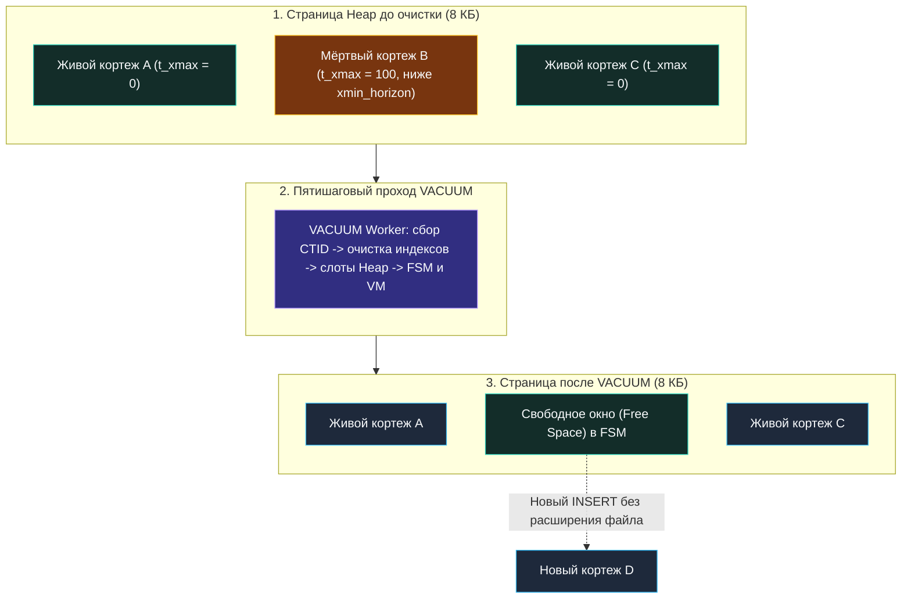
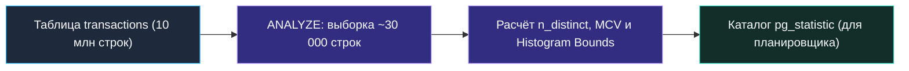

*Как устроен пятишаговый конвейер `VACUUM` и двухфазная очистка индексов, по какой формуле просыпается `Autovacuum`, зачем `ANALYZE` строит гистограммы и как сжать раздутую таблицу `LedgerPulse` без `AccessExclusiveLock`.*

> «Сборка мусора — огромное подспорье при написании корректных программ, но она не избавляет вас от необходимости думать о памяти. Вам не нужно выделять и освобождать память вручную, однако для написания эффективного кода всё равно приходится понимать время жизни переменных.»  
> — Алан Донован и Брайан Керниган, *The Go Programming Language*

В [[3. MVCC в PostgreSQL — xmin, xmax, ctid, HOT и переполнение XID]] мы разобрали базовое свойство Heap: `UPDATE` не меняет строку на месте, а `DELETE` не стирает её с диска. Каждая операция оставляет в 8-КБ странице мёртвый кортеж с идентификатором удалившей транзакции `t_xmax`.

Допустим, в `LedgerPulse` 50 тысяч счетов обновляются по тысяче раз за сутки, а кто-то забыл на ночь открытую транзакцию. К утру таблица с 50 МБ полезных данных раздувается до 40 ГБ. Кэш `shared_buffers` забивается мёртвыми версиями, процент попаданий в RAM (~100 нс) падает, и запросы уходят в чтения с NVMe (~100 мкс).

В [[11. VACUUM и сборка мёртвых версий кортежей|Модуле 5]] мы сравнили очистку в PostgreSQL с Undo-логами InnoDB через горизонт видимости `xmin_horizon`. Здесь мы разберём внутренний конвейер `VACUUM`, математику `Autovacuum`, статистику `ANALYZE` и приёмы сжатия раздутых таблиц.

---

## Конвейер `VACUUM`: пять шагов внутри 8-КБ страницы

Обычный `VACUUM` **не возвращает свободное место операционной системе** (за редким исключением отсечения полностью пустых страниц в самом хвосте файла). Он помечает байты внутри 8-КБ страниц как свободные для будущих `INSERT` и `UPDATE`.



Конвейер `VACUUM` проходит пять строгих этапов:

1. **Сканирование Heap.** Воркер читает страницы таблицы из `shared_buffers` или диска, пропуская страницы с установленным битом `all_visible` в `Visibility Map`.
2. **Проверка горизонта видимости.** По глобальному снимку активных транзакций отбираются мёртвые кортежи, чей `t_xmax` завершён и находится строго ниже `xmin_horizon`.
3. **Двухфазная очистка индексов.** Воркер собирает адреса `CTID` мёртвых строк в оперативный буфер `maintenance_work_mem`, затем обходит **все индексы таблицы** (B-Tree, GIN, GiST) и удаляет ссылки на эти `CTID` из листовых страниц.
4. **Очистка Heap и уплотнение.** Только после очистки всех индексов вакуум возвращается к Heap, освобождает слоты указателей (`ItemIdData`) и дефрагментирует страницу.
5. **Обновление карт `_fsm` и `_vm`.** В Free Space Map (`_fsm`) записывается объём свободного места каждой страницы, чтобы `INSERT` находил блоки без линейного сканирования. В Visibility Map (`_vm`) выставляется бит `all_visible` (и `all_frozen`, когда все кортежи заморожены).

Если `maintenance_work_mem` слишком мал, буфер `CTID` переполняется, и вакуум вынужден прерывать сканирование таблицы и обходить все многогигабайтные индексы по нескольку раз за один цикл.

---

## `VACUUM FULL` против `pg_repack`

Когда таблица уже раздулась до 90 ГБ при 10 ГБ живых данных, обычный `VACUUM` откроет слоты внутри файла, но не уменьшит его размер на диске.

`VACUUM FULL` физически возвращает место ОС:
1. Создаёт **новый файл таблицы** на диске.
2. Переносит туда только живые кортежи без зазоров.
3. Перестраивает с нуля все индексы.
4. Подменяет файл в каталоге и удаляет старый.

> [!warning] Ловушка: `AccessExclusiveLock` в `VACUUM FULL`
> На всё время работы `VACUUM FULL` захватывает исключительную блокировку **`AccessExclusiveLock`**. Запрещены даже обычные `SELECT`. На терабайтной таблице `LedgerPulse` это означает часы простоя: запросы Go зависнут, а `pgxpool` исчерпается за секунды.
>
> **Промышленная альтернатива:** утилита **`pg_repack`**. Она создаёт теневую копию таблицы, ловит текущие изменения лёгким триггером, переносит данные и перестраивает индексы без блокировки чтения и записи, а в финале подменяет таблицу под мгновенной блокировкой. На диске при этом нужно иметь свободный объём не меньше размера сжимаемой таблицы с индексами.

---

## `Autovacuum`: формула запуска и физика I/O

За фоновую уборку отвечает процесс **Autovacuum Launcher**, просыпающийся каждые `autovacuum_naptime` (по умолчанию 1 минуту) и запускающий пул воркеров на таблицы, превысившие порог.

> [!tip] Собеседование [Middle]
> **Вопрос:** По какой формуле PostgreSQL запускает `Autovacuum` на таблице?
> **Ответ:** Очистка стартует, когда число мёртвых кортежей (`n_dead_tup`) превышает порог:
> $$\text{Порог} = \text{autovacuum\_vacuum\_threshold} + (\text{autovacuum\_vacuum\_scale\_factor} \times \text{reltuples})$$
> По умолчанию `threshold = 50`, а `scale_factor = 0.2` (20% от живых строк `reltuples`). Начиная с PostgreSQL 13 добавлен отдельный порог для вставок (`autovacuum_vacuum_insert_threshold = 1000`, `autovacuum_vacuum_insert_scale_factor = 0.2`), чтобы append-only таблицы тоже получали биты `Visibility Map` и заморозку XID.

Для таблицы `transactions` со **100 миллионами строк** дефолтная формула даёт:

$$\text{Порог} = 50 + (0{,}2 \times 100\,000\,000) \approx 20\,000\,050\text{ мёртвых строк}$$

Ждать 20 миллионов мёртвых кортежей недопустимо: плотность данных на 8-КБ страницах падает, кэш-линии CPU и `shared_buffers` заполняются мусором, а проснувшийся воркер создаёт многочасовой шторм случайного I/O. Снижение `scale_factor` до `0.01` или `0.005` делает очистку частой, мягкой и предсказуемой.

---

## `ANALYZE`: глаза и компас планировщика

Задача **`ANALYZE`** — поддерживать точность стоимостного оптимизатора. Команда читает случайную выборку (~`300 * default_statistics_target`, по умолчанию ~30 000 строк) и обновляет каталог `pg_statistic`:
* число страниц (`relpages`) и строк (`reltuples`);
* кардинальность уникальных значений (`n_distinct`);
* список самых частых значений (**Most Common Values, MCV**) и их доли;
* гистограммы квантилей (**Histogram Bounds**) для остальных значений.



Представьте перекос в `transactions`: 99% строк имеют `status = 'completed'` и 1% — `'pending'`. При свежей статистике запрос `WHERE status = 'pending'` идёт по точечному `Index Scan` за миллисекунду. Если же статистика устарела и планировщик считает доли равными, он выберет полный `Sequential Scan` по всей таблице.

---

## Защита целостности: `Visibility Map` и заморозка XID

Регулярный `VACUUM` обеспечивает два системных инварианта:

1. **Карта видимости (`Visibility Map`).** Бит `all_visible` на чистой странице разрешает планировщику сверхбыстрый **`Index-Only Scan`** ([[4. Семейство индексов PostgreSQL — B-Tree, GIN, GiST, SP-GiST, BRIN и Hash]]) без обращений к файлу Heap.
2. **Заморозка транзакций (`Freezing`) против `Wraparound`.** Счётчики `xmin` и `xmax` занимают 32 бита (~4,29 млрд значений по модулю $2^{32}$). Половина диапазона (~2,1 млрд) отводится прошлому, половина — будущему. Если счётчик сделает оборот, старые строки окажутся «в будущем» и пропадут из видимости. Поэтому `VACUUM` замораживает старые живые строки (исторически ставя `FrozenTransactionId = 2`, а с PostgreSQL 9.4 — флаг в `t_infomask`). При приближении к `autovacuum_freeze_max_age` (200 млн) запускается принудительный *anti-wraparound vacuum*, а при риске переполнения СУБД останавливает запись:

```text
ERROR:  database is not accepting commands to avoid wraparound data loss in database "ledgerpulse"
```

---

## Тюнинг `Autovacuum` и диагностика в Go 1.24

Ключевые настройки под высокую нагрузку:
1. **`maintenance_work_mem`**: `512MB`–`2GB`, чтобы буфер `CTID` избегал многократных проходов по индексам.
2. **`autovacuum_max_workers`**: увеличьте с `3` до `5`–`8` при наличии свободных ядер CPU и запаса IOPS.
3. **`autovacuum_vacuum_cost_limit`**: поднимите с `200` до `1000`–`2000` (при `autovacuum_vacuum_cost_delay = 2ms`), чтобы очистка успевала за потоком `UPDATE`.

> [!warning] Ловушка: долгие транзакции в Go блокируют очистку
> Если Go-сервис открыл транзакцию и пошёл ждать внешний HTTP-шлюз, старый снимок замораживает `xmin_horizon` для всего кластера:
> ```go
> tx, _ := pool.Begin(ctx)
> defer tx.Rollback(ctx)
> callSlowExternalPaymentGateway() // транзакция открыта часами — Autovacuum бессилен
> ```
> Ограничивайте время транзакций через `context.WithTimeout` в Go и задавайте `idle_in_transaction_session_timeout = '30s'` на сервере.

Собирать метрики мёртвых кортежей и возраста `relfrozenxid` удобно напрямую из `pg_stat_user_tables` и `pg_class` (Go 1.24 + `pgxpool`):

```go
package monitoring

import (
	"context"
	"fmt"
	"time"

	"github.com/jackc/pgx/v5/pgxpool"
)

type TableVacuumHealth struct {
	TableName      string
	LiveTuples     int64
	DeadTuples     int64
	XIDAge         int32
	LastAutovacuum *time.Time
}

func CollectVacuumHealth(ctx context.Context, pool *pgxpool.Pool, limit int) ([]TableVacuumHealth, error) {
	const query = `
		SELECT s.relname, s.n_live_tup, s.n_dead_tup, age(c.relfrozenxid), s.last_autovacuum
		FROM pg_stat_user_tables s
		JOIN pg_class c ON c.oid = s.relid
		ORDER BY s.n_dead_tup DESC
		LIMIT $1`

	rows, err := pool.Query(ctx, query, limit)
	if err != nil {
		return nil, fmt.Errorf("query vacuum health: %w", err)
	}
	defer rows.Close()

	var stats []TableVacuumHealth
	for rows.Next() {
		var item TableVacuumHealth
		if err := rows.Scan(&item.TableName, &item.LiveTuples, &item.DeadTuples, &item.XIDAge, &item.LastAutovacuum); err != nil {
			return nil, fmt.Errorf("scan vacuum health row: %w", err)
		}
		stats = append(stats, item)
	}
	return stats, rows.Err()
}
```

---

## Практикум: задачи для закрепления

### Упражнение 1 (Базовое)
В таблице `accounts` хранится **50 000 000** строк. Посчитайте порог запуска `Autovacuum` при значениях по умолчанию (`threshold = 50`, `scale_factor = 0.2`) и при `scale_factor = 0.005`. Напишите `ALTER TABLE` для снижения порога и ускорения воркера.

> [!solution] Показать решение
> * По умолчанию: $50 + 0{,}2 \times 50\,000\,000 = 10\,000\,050$ мёртвых строк.
> * При `0.005`: $50 + 0{,}005 \times 50\,000\,000 = 250\,050$ мёртвых строк.
> ```sql
> ALTER TABLE accounts SET (
>     autovacuum_vacuum_scale_factor = 0.005,
>     autovacuum_vacuum_insert_scale_factor = 0.01,
>     autovacuum_analyze_scale_factor = 0.005,
>     autovacuum_vacuum_cost_limit = 1000
> );
> ```

### Упражнение 2 (Практическое)
Запросы к append-only таблице `ledger_entries` перестали использовать `Index-Only Scan` (растёт `Heap Fetches`). Напишите SQL-запрос к `pg_class` и `pg_stat_user_tables`, чтобы проверить долю страниц с битом `all_visible` (`relallvisible / relpages`) и число вставок с последнего вакуума.

> [!solution] Показать решение
> Новые страницы после `INSERT` не имеют бита `all_visible` до прихода `VACUUM`. Проверить отставание можно так:
> ```sql
> SELECT
>     c.relname,
>     c.relpages,
>     c.relallvisible,
>     round(100.0 * c.relallvisible / NULLIF(c.relpages, 0), 2) AS all_visible_pct,
>     s.n_ins_since_vacuum,
>     s.last_autovacuum
> FROM pg_class c
> JOIN pg_stat_user_tables s ON s.relid = c.oid
> WHERE c.relname = 'ledger_entries';
> ```
> Снижение `autovacuum_vacuum_insert_scale_factor` до `0.01` ускорит простановку битов `Visibility Map`.

### Упражнение 3 (Со звёздочкой \*)
Таблица `transactions` (15 ГБ данных + 10 ГБ индексов) раздулась до **95 ГБ**. Опишите план сжатия на живом продакшене через `pg_repack`: требования к ключам, месту на диске, фазы блокировок и влияние на WAL/репликацию.

> [!solution] Показать решение
> 1. **Требования к схеме:** таблица обязана иметь `PRIMARY KEY` или непустой индекс `UNIQUE NOT NULL`.
> 2. **Свободное место:** нужна копия живых данных и индексов плюс журнал дельт — минимум **35–45 ГБ** свободного места с запасом под WAL.
> 3. **Блокировки:** короткий `AccessExclusiveLock` в начале (создание лога и триггера) и в конце (подмена имён в каталоге). Используйте таймауты `-T 5` и `-k`, чтобы не повесить очередь запросов. Вся основная переупаковка идёт без блокировок.
> 4. **Влияние на кластер:** `pg_repack` пишет десятки гигабайт WAL, поэтому нужно заранее проверить запас места в `pg_wal` и пропускную способность сети до реплик.

---

## Что дальше

Мы разобрали устройство одиночного узла PostgreSQL до 8-КБ страниц, MVCC, планировщика и фонового `Autovacuum`. Но одиночный сервер остаётся единой точкой отказа: сбой накопителя или питания стойки останавливает весь сервис.

Как построить отказоустойчивый кластер на потоковой физической и логической репликации WAL, настроить кворум без потери транзакций и уберечь диск от зависших слотов — в заключительной главе модуля: [[11. Репликация в PostgreSQL — потоковая, логическая и слоты]].
