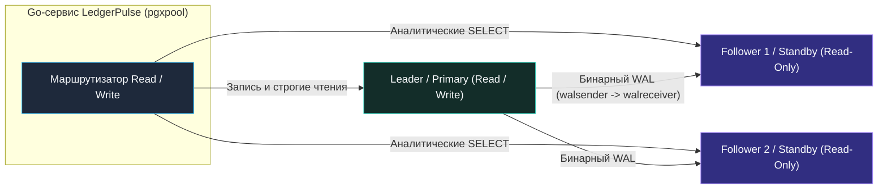
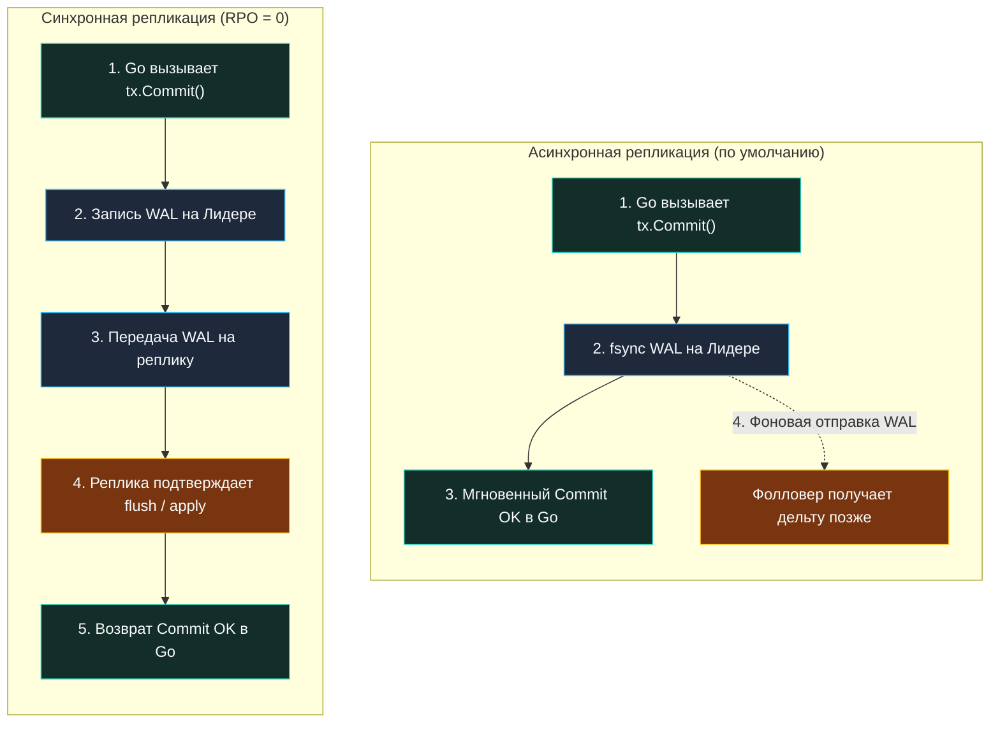

*Как устроена потоковая физическая и логическая репликация поверх WAL, где проходит компромисс между асинхронностью и кворумным `synchronous_standby_names`, почему зависший слот переполняет диск и как маршрутизировать чтения из Go.*

> «Любая функция ввода-вывода обязана считаться с вероятностью сбоя, и лишь наивный программист верит, что простое чтение или запись не могут завершиться ошибкой. Именно тогда, когда внезапно отказывают самые надёжные операции, нам нужнее всего знать почему.»  
> — Алан Донован и Брайан Керниган, *The Go Programming Language*

Одиночный сервер базы данных — классическая **единая точка отказа (Single Point of Failure, SPOF)**. Выходит из строя контроллер NVMe, ломается модуль памяти ECC или пропадает питание в стойке — и `LedgerPulse` встаёт.

Репликация решает две фундаментальные задачи кластера:
1. **Высокая доступность (High Availability, HA):** непрерывное поддержание актуальной копии данных на резервных узлах для переключения трафика (**Failover**) при падении Лидера.
2. **Масштабирование чтения (Read Scaling):** перенос тяжёлых аналитических выборок и отчётов на реплики, разгружая основной сервер.

---

## WAL как фундамент потоковой репликации

Как показано в [[8. WAL — журнал упреждающей записи и долговечность на диске]], PostgreSQL пишет любое изменение сначала в журнал предзаписи (**Write-Ahead Log, WAL**), а затем обновляет страницы в `shared_buffers`. Непрерывный поток бинарных записей со смещениями **LSN** (*Log Sequence Number*) служит единым источником правды для синхронизации узлов.

Топология PostgreSQL строится по модели **Leader–Follower** (Primary–Standby):
* **Лидер (Leader / Primary):** единственный узел, принимающий запись (`INSERT`, `UPDATE`, `DELETE`, DDL) и транзакционные чтения.
* **Фолловеры (Followers / Standby / Реплики):** узлы в режиме «только чтение» (`Hot Standby`), непрерывно применяющие поток WAL от Лидера.

### Физическая (потоковая) репликация — Streaming Replication

Процесс `walsender` на Лидере по TCP транслирует сырые записи WAL, а `walreceiver` на Фолловере сбрасывает их на диск и накатывает на свои файлы данных в режиме постоянного восстановления.



* **Плюсы:** реплика даёт точную побайтовую копию Лидера (все базы, каталоги, индексы B-Tree/GIN/GiST и последовательности) при минимальной нагрузке на CPU Лидера — пересылаются готовые байты журнала.
* **Ограничения:** реплицируется только весь кластер целиком; мажорные версии обязаны строго совпадать (физическая потоковая репликация с PG 14 на PG 17 невозможна из-за различий в формате страниц).

Состояние подключённых реплик контролируется на Лидере через `pg_stat_replication`:

```sql
SELECT
    pid,
    application_name,
    client_addr,
    state,
    sent_lsn,
    write_lsn,
    flush_lsn,
    replay_lsn,
    pg_wal_lsn_diff(pg_current_wal_lsn(), replay_lsn) AS lag_bytes
FROM pg_stat_replication;
```

Четыре указателя отражают стадии пути: `sent_lsn` ушёл в сеть, `write_lsn` лёг в Page Cache реплики, `flush_lsn` сброшен через `fsync()` на её NVMe (~100 мкс), а `replay_lsn` применён к таблицам и виден читателям.

---

## Синхронность против асинхронности и кворум

Режим подтверждения записи задаёт баланс между сохранностью данных (**RPO** — *Recovery Point Objective*) и задержкой `tx.Commit()`.



### Асинхронная репликация (по умолчанию)
Лидер отвечает `COMMIT OK` сразу после сброса WAL на свой диск. Это даёт минимальную задержку записи, но при аппаратной гибели Лидера транзакции, не успевшие уйти по сети на реплику, теряются (`RPO > 0`).

### Синхронная репликация и уровни `synchronous_commit`
При задании `synchronous_standby_names` Лидер задерживает ответ клиенту до подтверждения от реплики. Уровень ожидания регулирует `synchronous_commit`:
* `remote_write` — реплика приняла WAL в Page Cache ОС (риск при общем отключении питания);
* `on` — реплика сбросила WAL на свой накопитель (`flush_lsn`), гарантируя `RPO = 0`;
* `remote_apply` — реплика применила WAL к страницам (`replay_lsn`), делая изменения сразу видимыми читателям на этой реплике.

Риск наивной синхронной пары из двух серверов — блокировка всех записей на Лидере при падении единственной реплики.

> [!tip] Собеседование [Senior/Staff]
> **Вопрос:** Как настроить кластер `LedgerPulse`, чтобы гарантировать `RPO = 0` при аварии Лидера, но не остановить запись при отказе одной реплики?
> **Ответ:** Использовать кворумную синхронную репликацию в `synchronous_standby_names`: `ANY 1 (standby_a, standby_b)` или `FIRST 1 (standby_a, standby_b)` на кластере минимум из трёх узлов. Лидер ждёт подтверждения записи WAL от **любой одной** живой реплики: при отказе `standby_a` кластер продолжит писать с подтверждением от `standby_b`. Для автоматического Failover без *split-brain* поверх потоковой репликации разворачивают Patroni с распределённым консенсусом etcd/Consul (подробнее о кворумах и CAP/PACELC см. Том 4).

---

## Логическая репликация и CDC (Publish / Subscribe)

С версии PostgreSQL 10 в ядро встроена **логическая репликация** по модели издателя и подписчика (*Publish / Subscribe*). С помощью **логического декодирования** (*Logical Decoding*, плагин `pgoutput`) Лидер превращает поток WAL в строковые события: *«в таблицу `accounts` добавлен кортеж `(id=42, currency='RUB', balance_cents=15000)`»*.

Для работы требуется `wal_level = logical` на издателе, а реплицируемые таблицы должны иметь `PRIMARY KEY` (или `REPLICA IDENTITY`) для идентификации изменяемых и удаляемых строк.

```sql
-- На издателе (Publisher):
CREATE PUBLICATION pub_ledger FOR TABLE accounts, ledger_entries;

-- На подписчике (Subscriber):
CREATE SUBSCRIPTION sub_ledger
    CONNECTION 'host=leader.internal port=5432 dbname=ledgerpulse user=replicator password=secret'
    PUBLICATION pub_ledger;
```

Четыре главные задачи логической репликации:
1. **Бесшовный апгрейд (Zero-Downtime Upgrade):** перенос базы с PostgreSQL 14 на PostgreSQL 17 почти без простоя.
2. **Выборочная репликация:** передача только выбранных таблиц, столбцов или отфильтрованных строк (`WHERE`).
3. **CDC (*Change Data Capture*):** выгрузка потока изменений в DWH или шину событий (подробнее о паттернах CDC и Transactional Outbox см. Том 3).
4. **Независимая запись на подписчике:** возможность заводить собственные таблицы и дополнительные индексы.

Учитывайте ограничения: DDL-команды (`ALTER TABLE`) и текущие значения `SEQUENCE` по умолчанию не реплицируются и требуют координации при переключении.

---

## Эксплуатационные ловушки и слоты репликации

### 1. Задержка репликации и Read-Your-Own-Writes
В асинхронном кластере реплика отстаёт от Лидера на десятки миллисекунд. Если клиент обновил счёт (`UPDATE accounts`) на Лидере и сразу перезагрузил страницу (`SELECT` ушёл на Фолловер), он увидит старый баланс.

**Решение:** критические чтения (баланс перед списанием, личный кабинет сразу после записи, авторизация) направляйте на Лидер. Тяжёлые отчёты и витрины отправляйте на реплики — либо проверяйте, что `replay_lsn` реплики догнал LSN записи.

### 2. Конфликты восстановления (`Query Conflicts`)
Если на реплике 5 минут выполняется аналитический `SELECT`, а на Лидере прошёл `VACUUM` и удалил старые версии тех же страниц, прибывший WAL попытается освободить эти страницы на реплике. По истечении `max_standby_streaming_delay` (по умолчанию 30 секунд) реплика прервёт запрос ради применения журнала с ошибкой:

```text
ERROR:  canceling statement due to conflict with recovery
```

Включение `hot_standby_feedback = on` заставляет реплику сообщать Лидеру свой `xmin`, удерживая очистку — но ценой раздувания таблиц на самом Лидере. Под многочасовую аналитику безопаснее выделять отдельную реплику.

### 3. Переполнение диска из-за слотов репликации

> [!warning] Ловушка: забытый `Replication Slot` убивает Лидер
> **Слот репликации (Replication Slot)** хранит указатель `restart_lsn`, не позволяя Лидеру удалять сегменты из `pg_wal`, которые реплика ещё не скачала. Если реплика или CDC-коннектор упали, но слот остался активным в каталоге, Лидер начнёт бесконечно копить WAL на диске, пока свободное место не кончится и процесс PostgreSQL не упадёт в панику.
>
> **Защита:** всегда настраивайте предохранитель **`max_slot_wal_keep_size`** (например, `50GB`) и отслеживайте отстающие неактивные слоты:
> ```sql
> SELECT
>     slot_name,
>     slot_type,
>     active,
>     pg_size_pretty(pg_wal_lsn_diff(pg_current_wal_lsn(), restart_lsn)) AS retained_wal
> FROM pg_replication_slots
> ORDER BY pg_wal_lsn_diff(pg_current_wal_lsn(), restart_lsn) DESC;
> ```

---

## Маршрутизация Read / Write в Go 1.24

Идиоматичная обёртка над `pgxpool.Pool` и `math/rand/v2` для разделения записи и чтения в `LedgerPulse`:

```go
package db

import (
	"context"
	"fmt"
	"math/rand/v2"

	"github.com/jackc/pgx/v5/pgxpool"
)

type DBCluster struct {
	Master   *pgxpool.Pool
	ReadOnly []*pgxpool.Pool
}

func NewCluster(ctx context.Context, masterDSN string, replicaDSNs []string) (*DBCluster, error) {
	masterPool, err := pgxpool.New(ctx, masterDSN)
	if err != nil {
		return nil, fmt.Errorf("connect to master: %w", err)
	}

	replicas := make([]*pgxpool.Pool, 0, len(replicaDSNs))
	for i, dsn := range replicaDSNs {
		pool, err := pgxpool.New(ctx, dsn)
		if err != nil {
			masterPool.Close()
			for _, r := range replicas {
				r.Close()
			}
			return nil, fmt.Errorf("connect to replica %d: %w", i, err)
		}
		replicas = append(replicas, pool)
	}

	return &DBCluster{Master: masterPool, ReadOnly: replicas}, nil
}

func (c *DBCluster) Reader() *pgxpool.Pool {
	if len(c.ReadOnly) == 0 {
		return c.Master
	}
	return c.ReadOnly[rand.IntN(len(c.ReadOnly))]
}

func (c *DBCluster) Close() {
	c.Master.Close()
	for _, r := range c.ReadOnly {
		r.Close()
	}
}
```

При ошибке подключения к любой из реплик `NewCluster` закрывает уже созданные пулы, предотвращая утечку соединений при старте сервиса.

---

## Практикум: задачи для закрепления

### Упражнение 1 (Базовое)
Одна из реплик отключилась, и папка `pg_wal` на Лидере стремительно растёт. Напишите SQL-запросы для поиска брошенного слота, удаления его с Лидера и назовите директиву `postgresql.conf`, ограничивающую удержание WAL слотами.

> [!solution] Показать решение
> ```sql
> SELECT slot_name, slot_type, active,
>        pg_size_pretty(pg_wal_lsn_diff(pg_current_wal_lsn(), restart_lsn)) AS retained_wal
> FROM pg_replication_slots
> WHERE NOT active;
>
> -- После подтверждения, что реплика выведена из строя:
> SELECT pg_drop_replication_slot('replica_2_slot');
> ```
> В `postgresql.conf` задайте `max_slot_wal_keep_size = 50GB`.

### Упражнение 2 (Практическое)
Пользователи `LedgerPulse` после перевода видят старый баланс из-за лага реплики в 50 мс. Добавьте к `DBCluster` метод `PoolForRead(lastWriteAt time.Time) *pgxpool.Pool`, направляющий чтения на `Master` в течение 2 секунд после записи пользователя.

> [!solution] Показать решение
> ```go
> package db
>
> import (
> 	"time"
>
> 	"github.com/jackc/pgx/v5/pgxpool"
> )
>
> const stickyMasterWindow = 2 * time.Second
>
> func (c *DBCluster) PoolForRead(lastWriteAt time.Time) *pgxpool.Pool {
> 	if !lastWriteAt.IsZero() && time.Since(lastWriteAt) < stickyMasterWindow {
> 		return c.Master
> 	}
> 	return c.Reader()
> }
> ```
> Проверку баланса перед списанием всегда отправляйте напрямую в `c.Master`.

### Упражнение 3 (Со звёздочкой \*)
Спланируйте обновление `LedgerPulse` с PostgreSQL 14 на PostgreSQL 17 без длительного простоя. Почему не подойдёт физическая репликация и какие шаги нужны для логической репликации с учётом `REPLICA IDENTITY`, `DDL` и `SEQUENCE`?

> [!solution] Показать решение
> Физическая репликация несовместима между мажорными версиями из-за различий формата 8-КБ страниц и системных каталогов.
>
> **План перехода через логическую репликацию:**
> 1. На PG 14 включить `wal_level = logical` и убедиться, что у всех таблиц есть `PRIMARY KEY` или `REPLICA IDENTITY FULL` (иначе не реплицируются `UPDATE`/`DELETE`).
> 2. Перенести схему через `pg_dump --schema-only` на PG 17 и заморозить DDL-миграции (DDL не реплицируются автоматически).
> 3. Создать `PUBLICATION` на PG 14 и `SUBSCRIPTION` на PG 17; дождаться синхронизации в `pg_subscription_rel`.
> 4. В короткое окно переключения (5–30 сек) остановить запись, убедиться в нулевом лаге по `pg_stat_replication`, **перенести текущие значения `SEQUENCE`** на PG 17 (иначе `INSERT` поймают конфликт `PRIMARY KEY`), переключить DSN на PG 17 и удалить подписку.

---

## Итог модуля и взгляд вперёд

В этом модуле мы разобрали весь внутренний стек PostgreSQL — от системного вызова `fork()` и 8-КБ страницы до распределённой репликации:

1. **Процессы и память:** модель Process-per-Connection требует пулера `PgBouncer` и сбалансированного бюджета `shared_buffers` + `work_mem` с опорой на Page Cache ОС.
2. **Хранение и MVCC:** страницы Heap, TOAST, внутристраничные обновления HOT и карты `FSM`/`VM` опираются на настроенный `Autovacuum` и защиту от переполнения 32-битных `XID`.
3. **Индексы и расширения:** шесть типов индексов, бинарный `JSONB`, полнотекстовый поиск, `PostGIS` и `pg_stat_statements` закрывают широкий круг задач внутри одной СУБД.
4. **Кластер и HA:** потоковая физическая и логическая репликация поверх WAL устраняют единую точку отказа при контроле за слотами и лагом.

PostgreSQL строится вокруг отдельных процессов ОС и неупорядоченной кучи Heap. В следующем разделе — **Модуле 7 «MySQL, InnoDB и форки»** — мы изучим альтернативную инженерную школу: единый многопоточный процесс `mysqld`, хранение строк прямо в кластерном B+Tree индексе, вынесенные Undo-логи и собственный `Buffer Pool` поверх прямого ввода-вывода `O_DIRECT`.
