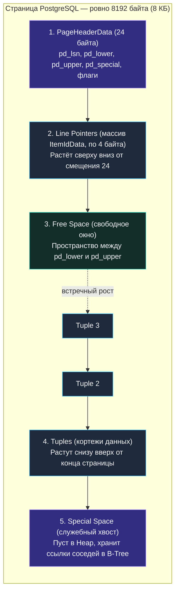
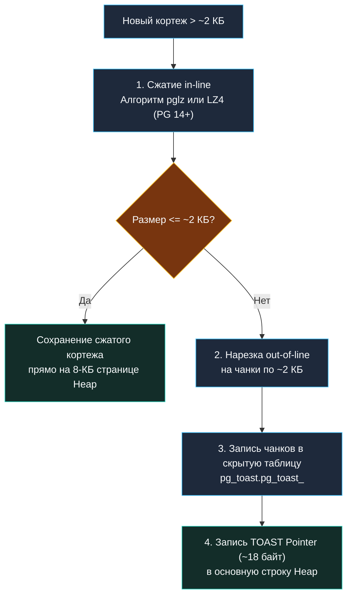

*Как PostgreSQL раскладывает таблицы в гигабайтные сегменты каталога `base/`, зачем 8-КБ странице встречный рост указателей и кортежей, сколько памяти крадёт неверный порядок колонок и как устроены TOAST, FSM и Visibility Map.*

> «Файл в Unix — это просто последовательность байтов. Любую структуру и организацию его содержимого определяют лишь программы, которые с ним работают; самой файловой системе безразлично, что лежит внутри.»  
> — Брайан Керниган, *UNIX: A History and a Memoir*

В памяти Go-программы поля структуры лежат компактно и выровнены компилятором, а освобождением мёртвых объектов занимается сборщик мусора. На диске же операционная система отдаёт PostgreSQL голый поток байтов. Чтобы данные не пропали при сбое и читались за микросекунды, СУБД сама организует внутри файлов страничный менеджер памяти.

В отличие от MySQL с подключаемыми движками (MyISAM, Memory, `InnoDB`), PostgreSQL изначально строился вокруг единого проверенного хранилища — **Heap (Куча)**. Начиная с PostgreSQL 12 в ядре появился интерфейс `tableam` (Table Access Method) для экспериментальных движков вроде `zheap`, но для подавляющего большинства продакшен-кластеров стандартом остаётся классический **Append-Only Heap**.

Понимание физического формата страниц объясняет вещи, которые в SQL кажутся магией: почему порядок колонок в `CREATE TABLE` экономит гигабайты кэша, зачем нужен `SELECT id, balance` вместо `SELECT *` и как индекс находит строку после локального сжатия страницы.

---

## От отношения к файлам и гигабайтным сегментам

В терминологии и исходном коде PostgreSQL таблица, B-Tree индекс, последовательность (`SEQUENCE`) и материализованное представление (`MATERIALIZED VIEW`) объединены понятием **Relation (Отношение)**. При создании каждому отношению назначается системный идентификатор **`OID`**, а его физическому файлу на диске — дескриптор **`RelFileNode`** (или `relfilenode`, который меняется при `TRUNCATE`, `VACUUM FULL` и `REINDEX`).

Заглянув в каталог данных кластера (`PGDATA/base/<OID_базы>/`), вы увидите не `accounts.db`, а набор числовых файлов:

```bash
$ ls -l /var/lib/postgresql/data/base/16384/
-rw------- 1 postgres postgres 1073741824 Sep 14 10:00 16390
-rw------- 1 postgres postgres 1073741824 Sep 14 10:15 16390.1
-rw------- 1 postgres postgres  524288000 Sep 14 10:30 16390.2
-rw------- 1 postgres postgres      24576 Sep 14 10:30 16390_fsm
-rw------- 1 postgres postgres       8192 Sep 14 10:30 16390_vm
```

Вся таблица нарезается на сегменты фиксированного размера — ровно по **1 ГБ** (`1 073 741 824` байта). Когда основной файл `16390` достигает гигабайта, движок создаёт `16390.1`, затем `16390.2` и так далее. Рядом лежат два вспомогательных слоя (forks):

* **`_fsm` (Free Space Map)** — дерево поиска свободного места на страницах, чтобы `INSERT` и `UPDATE` быстро находили подходящий блок без перебора всей таблицы.
* **`_vm` (Visibility Map)** — карта видимости блоков для ускорения `Index-Only Scan` и пропуска чистых страниц при `VACUUM`.

> [!info] Зачем резать файлы ровно по 1 ГБ
> Предел в 1 ГБ — компромисс с файловой системой Linux и утилитами бэкапа. Монолитный файл на 2 ТБ тяжело копировать, а вызов `fsync()` при контрольной точке (см. [[9. Контрольные точки (Checkpointing) и сброс грязных страниц]]) способен вызвать долгие I/O-паузы при сбросе метаданных огромного файла. Сегменты по 1 ГБ держат `ulimit -n` в норме и дают предсказуемый ввод-вывод.

---

## Страница 8 КБ (`Slotted Page`): неделимый квант ввода-вывода

Гигабайтный сегмент — только внешняя обёртка. Внутри каждый файл таблицы или индекса строго поделён на блоки размером **8 КБ (`8192` байта)** (изменить это можно лишь при сборке из исходников через `--with-blocksize`).

Фундаментальное правило хранения в PostgreSQL: **СУБД никогда не читает и не пишет с диска отдельную строку**. Минимальной единицей обмена между диском и `shared_buffers` всегда выступает целая 8-КБ страница. Чтобы получить одно 8-байтовое поле `balance` из `accounts`, движок при промахе в кэш поднимает с NVMe SSD все 8192 байта страницы (~100 мкс на NVMe и ~10 мс на HDD против ~100 нс при попадании в RAM).

Внутри страницы используется архитектура **Slotted Page** с двунаправленным ростом, позволяющая компактно хранить строки переменной длины без внешней фрагментации:



Разберём пять зон страницы по порядку адресов от `0` до `8191`:

1. **`PageHeaderData` (24 байта):** заголовок блока. Хранит `pd_lsn` (позицию последней записи в [[8. WAL — журнал упреждающей записи и долговечность на диске]], изменившей эту страницу — без него невозможен Crash Recovery), смещение начала свободного окна `pd_lower`, конца свободного окна `pd_upper` и начала специальной зоны `pd_special`.
2. **`Line Pointers` (`ItemIdData`):** массив 4-байтовых указателей на строки. Каждый элемент содержит смещение начала кортежа (`lp_off`), биты состояния (`lp_flags`: `NORMAL`, `REDIRECT`, `DEAD`, `UNUSED`) и длину (`lp_len`). Массив растёт **сверху вниз** (от байта 24 к центру).
3. **`Free Space`:** непрерывная область между `pd_lower` и `pd_upper`. Когда они сходятся так близко, что новый кортеж и 4-байтовый указатель не помещаются, страница заполнена.
4. **`Tuples`:** физические версии строк (кортежи). Они записываются **снизу вверх** (от конца страницы к центру).
5. **`Special Space`:** необязательный хвост страницы. В таблицах Heap его длина равна 0, а в индексных страницах (см. [[2. B-Tree индекс под капотом — страницы, ветвление и page split]]) здесь лежат номера левой и правой соседних страниц для быстрого сканирования диапазонов.

> [!tip] Собеседование [Middle]
> **Вопрос:** Зачем на странице нужен массив `Line Pointers`, если индексы могли бы хранить точное смещение байтов строки?  
> **Ответ:** Строки имеют переменную длину (`TEXT`, `JSONB`), и при дефрагментации страницы (`VACUUM`, HOT-сжатие) живые кортежи сдвигаются к концу блока для склейки `Free Space`. Абсолютные байтовые смещения заставили бы переписывать все индексы при каждом сдвиге. Поэтому индексы хранят логический адрес **`CTID` (`ItemPointer`)** — пару `(Номер_блока, Номер_слота_Line_Pointer)`, например `(42, 3)`. При сдвиге кортежа меняется только `lp_off` внутри слота №3, а внешние индексы остаются валидными.

---

## Заголовок кортежа (`HeapTupleHeaderData`) и выравнивание данных

Каждая строка в Heap состоит из системного заголовка `HeapTupleHeaderData` и пользовательских столбцов:

```text
+-----------------------------------------------------------------------+--------------------------+
|                         HeapTupleHeaderData                           |       User Payload       |
| t_xmin (4B) | t_xmax (4B) | t_cid (4B) | t_ctid (6B)                  | col1 | col2 | col3 | ... |
| t_infomask2 (2B) | t_infomask (2B) | t_hoff (1B) | null_bitmap (вар.) | (с учётом padding)       |
+-----------------------------------------------------------------------+--------------------------+
```

Минимальный размер заголовка — 23 байта, а с учётом обязательного 8-байтового выравнивания пользовательских данных — **24 байта** (или 32 байта, если в таблице много колонок и `null_bitmap` превышает 1 байт):

* **`t_xmin`** (4 байта) — ID транзакции, создавшей версию строки.
* **`t_xmax`** (4 байта) — ID транзакции, удалившей или обновившей версию (`0` для живой нетронутой строки).
* **`t_cid`** (4 байта) — счётчик команды внутри одной транзакции (`cmin`/`cmax`), чтобы транзакция видела собственные изменения.
* **`t_ctid`** (6 байт: 4 байта номера блока + 2 байта номера слота) — физический адрес текущей версии строки либо ссылка на новую версию при `UPDATE`.
* **`t_infomask2` и `t_infomask`** (2 + 2 байта) — битовые флаги кортежа (есть ли `NULL`, зафиксирована ли `t_xmin`, является ли строка частью HOT-цепочки, число атрибутов).
* **`t_hoff`** (1 байт) — смещение от начала кортежа до первого пользовательского столбца (после заголовка и битовой маски `NULL`-значений).

### Выравнивание столбцов (`Data Alignment` и `Padding`)

Как компилятор Go выравнивает поля `struct` в оперативной памяти под машинное слово CPU (64-битные поля — по адресу, кратному 8), так и PostgreSQL выравнивает столбцы кортежа прямо на диске:

* **8 байт (`typalign = 'd'`):** `BIGINT` (`INT8`), `TIMESTAMPTZ`, `DOUBLE PRECISION` (`FLOAT8`).
* **4 байта (`typalign = 'i'`):** `INTEGER` (`INT4`), `DATE`, `REAL` (`FLOAT4`).
* **2 байта (`typalign = 's'`):** `SMALLINT` (`INT2`).
* **1 байт (`typalign = 'c'`):** `BOOLEAN`, `CHAR(1)`, а также `UUID` (в PostgreSQL `UUID` весит 16 байт, но хранится как массив байтов с выравниванием по 1 байту) и сжатые/короткие `TEXT`/`JSONB` с 1-байтовым varlena-заголовком.

> [!warning] Ловушка: порядок колонок в миграциях
> Сравним два варианта таблицы с одинаковым набором столбцов:
>
> ```sql
> CREATE TABLE bad_padding (
>     id         BIGINT,   -- 8 байт (смещение 0..7)
>     is_active  BOOLEAN,  -- 1 байт (смещение 8) + 7 БАЙТ PADDING
>     account_id BIGINT,   -- 8 байт (смещение 16..23)
>     is_frozen  BOOLEAN   -- 1 байт (смещение 24) + 7 БАЙТ PADDING в конце
> );
> ```
>
> Полезная нагрузка равна `8 + 1 + 8 + 1 = 18` байт, но из-за выравнивания кортеж съедает **32 байта** полезных данных (плюс 24 байта заголовка и 4 байта `Line Pointer` — 60 байт на диске). На 100 миллионах строк это **1.4 ГБ пустых нулевых байтов** на SSD, в WAL, в трафике репликации и в `shared_buffers`.
>
> **Правило вёрстки таблиц:** объявляйте фиксированные столбцы **по убыванию выравнивания** — сначала 8-байтовые (`BIGINT`, `TIMESTAMPTZ`, `FLOAT8`), затем 4-байтовые (`INTEGER`, `DATE`), затем 2-байтовые (`SMALLINT`), и в самом конце — 1-байтовые (`BOOLEAN`, `UUID`) и типы переменной длины (`TEXT`, `CHAR(N)`, `JSONB`):
>
> ```sql
> CREATE TABLE optimal_padding (
>     id         BIGINT,   -- 8 байт (0..7)
>     account_id BIGINT,   -- 8 байт (8..15)
>     is_active  BOOLEAN,  -- 1 байт (16)
>     is_frozen  BOOLEAN   -- 1 байт (17) + 6 байт выравнивания кортежа -> 24 байта
> );
> ```
>
> В схеме `LedgerPulse` (`project/sql/migrations/001_init_ledger.sql`) таблица `ledger_entries` компактно ставит в начале три 8-байтовых поля (`id`, `transaction_id`, `account_id`, `amount` — итого четыре `BIGINT`), затем 8-байтовый `TIMESTAMPTZ` и `currency CHAR(3)`, избегая внутренних дыр между `BIGINT`.

---

## TOAST: хранение атрибутов крупнее 2 КБ

Строка в PostgreSQL **не имеет права пересекать границу 8-КБ страницы**. При этом в `accounts.metadata` (`JSONB`) или в `transactions.description` (`TEXT`) приложение может записать документ размером 50 КБ или 5 МБ.

Для таких значений работает механизм **TOAST (*The Oversized-Attribute Storage Technique*)**. Когда суммарный размер кортежа превышает порог `TOAST_TUPLE_THRESHOLD` (по умолчанию около **2 КБ** — четверть 8-КБ страницы), движок запускает протокол сжатия и выноса:



У колонок с поддержкой TOAST настраиваются четыре стратегии хранения (`ALTER TABLE ... ALTER COLUMN ... SET STORAGE`):

* **`EXTENDED`** (по умолчанию для `TEXT`, `JSONB`, `BYTEA`): сначала пытается сжать in-line (`pglz` или более быстрый `LZ4`, доступный с PostgreSQL 14), если всё ещё не влезает — выносит сжатые чанки во внешнюю TOAST-таблицу.
* **`EXTERNAL`**: выносит данные без сжатия (выгодно для уже сжатых бинарных форматов вроде JPEG/Protobuf, чтобы не тратить CPU впустую, а также ускоряет чтение подстрок `substr()` по смещению).
* **`MAIN`**: старается сжать и удержать данные в основной странице, вынося их только в крайнем случае.
* **`PLAIN`**: запрещает и сжатие, и вынос (используется для фиксированных типов вроде `BIGINT`).

### Почему `SELECT *` ломает локальность кэша и нагружает GC в Go

Предположим, у счёта в `accounts` поле `metadata JSONB` выросло до 40 КБ и уехало в `pg_toast`. Если сервис балансов пишет ленивый запрос `SELECT * FROM accounts WHERE id = $1`, когда ему нужны только `balance` и `status`, происходят пять лишних этапов:

1. Бэкенд читает страницу Heap и видит 18-байтовый **TOAST Pointer** в колонке `metadata`.
2. Из-за `*` исполнитель идёт по B-Tree индексу таблицы `pg_toast_<OID>` и делает серию случайных чтений 2-КБ чанков (если их нет в кэше — лишний дисковый I/O).
3. Процессор тратит такты на декомпрессию `pglz`/`LZ4` и склейку буфера.
4. Десятки килобайт ненужного JSON летят по TCP в Go-процесс.
5. Драйвер `database/sql` или `pgx` аллоцирует память под длинный `[]byte`/`string`, нагружая сборщик мусора Go.

Точечная проекция `SELECT id, balance, status FROM accounts WHERE id = $1` даже не обращается к `pg_toast` — PostgreSQL читает одну страницу Heap и сразу возвращает ответ.

---

## Карта видимости (`_vm`) и карта свободного места (`_fsm`)

Два вспомогательных файла рядом с таблицей напрямую определяют скорость чтения и вставки:

* **Visibility Map (`_vm`):** отводит ровно **2 бита** на каждую 8-КБ страницу основной таблицы (то есть 1 страница карты видимости размером 8 КБ покрывает ~256 МБ данных Heap).
  * Бит **`all_visible`**: равен `1`, если все кортежи на странице созданы давно зафиксированными транзакциями и видны всем текущим и будущим снимкам. Когда индексный поиск (подробнее в [[6. Покрывающие (Covering) индексы, INCLUDE и Index-Only Scan]]) видит `all_visible = 1`, он работает в режиме **`Index-Only Scan`** и не читает страницу Heap с диска вообще.
  * Бит **`all_frozen`**: равен `1`, если все кортежи на странице заморожены и защищены от переполнения XID. Процесс `VACUUM` полностью пропускает такие страницы при обходе таблицы.
* **Free Space Map (`_fsm`):** хранит по 1 байту на каждую страницу таблицы (округляя свободное пространство шагами по 32 байта) в виде древовидной карты поиска. При `INSERT` движок за несколько обращений в памяти находит страницу с достаточным окном `Free Space`, не сканируя гигабайты таблицы.

---

## Практика: инспекция файлов, слоёв и выравнивания

В Go-коде или административной сессии вы можете проверить физические файлы таблицы `accounts`, распределение размеров по слоям (`main`, `fsm`, `vm`, `toast`) и стоимость лишнего `SELECT *`:

```go
package main

import (
	"context"
	"database/sql"
	"fmt"
)

type TableFootprint struct {
	FilePath  string
	MainBytes int64
	FSMBytes  int64
	VMBytes   int64
	IdxBytes  int64
	TotalSize int64
}

func InspectTableStorage(ctx context.Context, db *sql.DB, tableName string) (TableFootprint, error) {
	var tf TableFootprint
	err := db.QueryRowContext(ctx, `
		SELECT
			pg_relation_filepath($1::regclass),
			pg_relation_size($1::regclass, 'main'),
			pg_relation_size($1::regclass, 'fsm'),
			pg_relation_size($1::regclass, 'vm'),
			pg_indexes_size($1::regclass),
			pg_total_relation_size($1::regclass)`,
		tableName,
	).Scan(&tf.FilePath, &tf.MainBytes, &tf.FSMBytes, &tf.VMBytes, &tf.IdxBytes, &tf.TotalSize)
	if err != nil {
		return TableFootprint{}, fmt.Errorf("inspect storage for %s: %w", tableName, err)
	}
	return tf, nil
}
```

Примерный вывод при проверке таблицы `ledger_entries` на тестовом стенде (1 млн строк):

```text
FilePath:  base/16384/16412
MainBytes: 68321280   (~65.2 MB — основная куча Heap)
FSMBytes:  40960      (40 KB — карта свободного места)
VMBytes:   8192       (8 KB — карта видимости)
IdxBytes:  49627136   (~47.3 MB — индексы)
TotalSize: 118005760  (~112.5 MB — включая TOAST, если есть)
```

А так в SQL можно наглядно измерить разницу в размере кортежей с плохим и правильным порядком колонок с помощью `pg_column_size`:

```sql
SELECT
    pg_column_size(ROW(1::bigint, true, 42::bigint, false)) AS bad_row_bytes,
    pg_column_size(ROW(1::bigint, 42::bigint, true, false)) AS opt_row_bytes;
```

```text
 bad_row_bytes | opt_row_bytes
---------------+---------------
            56 |            42
```

Один перенос двух флагов `BOOLEAN` в конец экономит 14 байт на каждой записи без изменения логики домена.

---

## Упражнения

### Упражнение 1 (Базовое)
В `LedgerPulse` нужно завести таблицу `payment_webhooks` со столбцами: `id BIGINT`, `processed BOOLEAN`, `attempt_count SMALLINT`, `created_at TIMESTAMPTZ`, `retry_after INTEGER`, `is_verified BOOLEAN`, `account_id BIGINT`, `payload_sha256 CHAR(64)`. Расположите столбцы в оптимальном порядке для минимизации padding и подсчитайте, сколько байт выравнивания удастся сэкономить по сравнению с приведённым порядком (до `payload_sha256`).

> [!solution] Показать решение
> **Исходный порядок (до `payload_sha256`):** `id` (8B: 0..7), `processed` (1B: 8) + 1B padding, `attempt_count` (2B: 10..11) + 4B padding, `created_at` (8B: 16..23), `retry_after` (4B: 24..27), `is_verified` (1B: 28) + 3B padding, `account_id` (8B: 32..39) = **40 байт** (потеря **8 байт** padding из 32 полезных).
>
> **Оптимальный порядок (`8 → 4 → 2 → 1 → varlena`):**
> ```sql
> CREATE TABLE payment_webhooks (
>     id             BIGINT      GENERATED ALWAYS AS IDENTITY PRIMARY KEY,
>     account_id     BIGINT      NOT NULL,
>     created_at     TIMESTAMPTZ NOT NULL,
>     retry_after    INTEGER     NOT NULL,
>     attempt_count  SMALLINT    NOT NULL DEFAULT 0,
>     processed      BOOLEAN     NOT NULL DEFAULT false,
>     is_verified    BOOLEAN     NOT NULL DEFAULT false,
>     payload_sha256 CHAR(64)    NOT NULL
> );
> ```
> Смещения: `0..7` (`id`), `8..15` (`account_id`), `16..23` (`created_at`), `24..27` (`retry_after`), `28..29` (`attempt_count`), `30` (`processed`), `31` (`is_verified`) — ровно **32 байта** без внутреннего padding. Экономия: **8 байт** на строку (400 МБ на 50 млн строк).

### Упражнение 2 (Практическое)
Напишите SQL-запрос для `accounts`, который выведет имя скрытой TOAST-таблицы (`reltoastrelid::regclass`), количество строк с вынесенными значениями (порог проверки по `pg_column_size(metadata) > 2000` или через `octet_length`), а также два плана `EXPLAIN (ANALYZE, BUFFERS)` для `SELECT * FROM accounts WHERE id = 1` и `SELECT id, balance FROM accounts WHERE id = 1` при `metadata` размером 32 КБ. Объясните разницу в счётчике `Buffers: shared hit/read`.

> [!solution] Показать решение
> 1. Находим TOAST-таблицу для `accounts`:
> ```sql
> SELECT relname, reltoastrelid::regclass AS toast_table
> FROM pg_class
> WHERE relname = 'accounts';
> ```
> 2. Вставляем тестовый JSON размером ~32 КБ (несжимаемый или с большим количеством уникальных ключей, чтобы он точно уехал в TOAST) и выполняем два запроса с `EXPLAIN (ANALYZE, BUFFERS)`:
> * `SELECT id, balance FROM accounts WHERE id = 1;` — прочитает только индекс PK и 1 страницу Heap (`shared hit` около 3–4 блоков).
> * `SELECT * FROM accounts WHERE id = 1;` — прочитает те же блоки плюс дополнительно обратится в `pg_toast.pg_toast_<OID>` и её индекс `pg_toast_<OID>_index`, увеличив `shared hit/read` (обычно на 5–20 блоков в зависимости от числа 2-КБ чанков после сжатия `pglz`/`LZ4`) и время выполнения из-за распаковки TOAST-значения.

### Упражнение 3 (\*)
Рассчитайте максимальное количество строк таблицы `ledger_entries` (упрощённая модель без `NULL`: 4 столбца `BIGINT`, 1 `TIMESTAMPTZ`, 1 `CHAR(3)`), которое поместится на одной чистой 8-КБ странице Heap (`8192` байта) при `fillfactor = 100`. Учтите `PageHeaderData` (24 байта), `ItemIdData` (4 байта на строку), `HeapTupleHeaderData` (24 байта на строку) и 8-байтовое выравнивание кортежа.

> [!solution] Показать решение
> 1. Заголовок `HeapTupleHeaderData` (без NULL): **24 байта**.
> 2. Поля: четыре `BIGINT` + `TIMESTAMPTZ` = `40` байт (`24..63`), далее `currency CHAR(3)` с 1-байтовым varlena-заголовком = `4` байта (`64..67`). Итого `68` байт; округление вверх под `MAXALIGN` (8 байт) даёт **72 байта** на кортеж.
> 3. С учётом 4-байтового `ItemIdData` строка занимает `72 + 4 = 76` байт.
> 4. Доступно после `PageHeaderData` (24B): `8192 - 24 = 8168` байт.
> 5. Итог: `floor(8168 / 76) = 107` строк (`8132` байт занято, `36` байт остаток). На 108-й строке `ctid` перейдёт с блока `0` на блок `1`.

---

Теперь мы точно знаем, что в 24-байтовом заголовке каждого кортежа на странице Heap лежат поля `t_xmin`, `t_xmax` и `t_ctid`. Как именно движок PostgreSQL использует эти три числа, чтобы тысячи параллельных транзакций видели согласованные снимки данных без блокировки читателей, и почему забытый в Go вызов `Rollback()` способен парализовать весь кластер? Разберём в следующей главе: [[3. MVCC в PostgreSQL — xmin, xmax, ctid, HOT и переполнение XID]].
