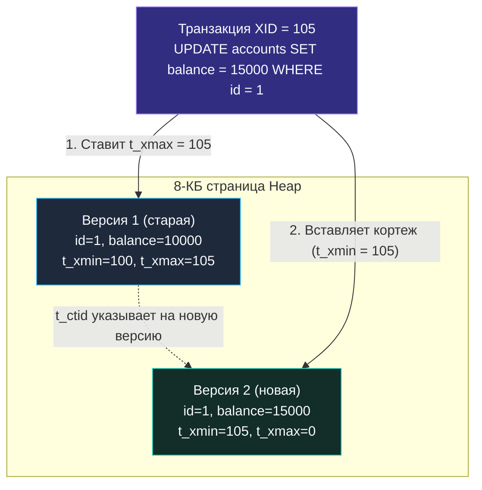
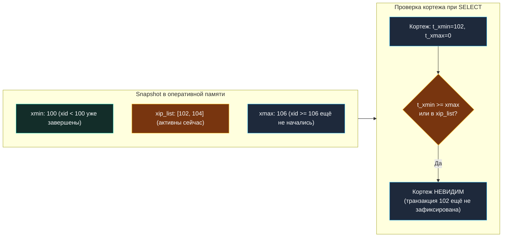
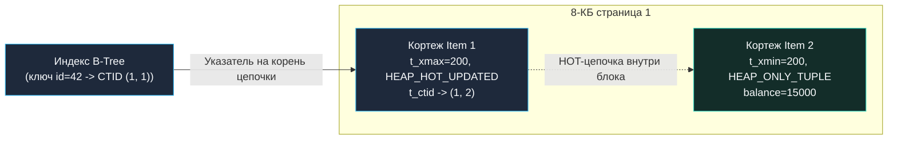

*Почему в PostgreSQL нет Undo-логов, как `UPDATE` создаёт цепочку версий в 8-КБ странице, каким образом оптимизация HOT обходит обновление индексов и чем грозит переполнение 32-битного счётчика транзакций.*

> «Блеск Unix заключался в выборе абстракции, достаточно общей, чтобы быть поразительно полезной, и при этом не слишком дорогой по производительности.»  
> — Брайан Керниган, *UNIX: A History and a Memoir*

В многопоточном коде на Go разделяемую мапу обычно защищают `sync.RWMutex`: десятки горутин читают данные под `RLock()`, но как только одна горутина берёт `Lock()` на запись, все читатели останавливаются в очереди.

В высоконагруженном биллинге `LedgerPulse` подобная блокировка парализовала бы систему: пока транзакция обновляет баланс счёта, все выписки и отчёты по этому счёту замирали бы. Чтобы избежать очередей между чтением и записью, реляционные СУБД используют **MVCC (Multi-Version Concurrency Control)** — управление конкурентным доступом через многоверсионность (теоретический фундамент мы заложили в [[7. MVCC — многоверсионный контроль конкурентности]]).

Главный принцип MVCC: **читатели никогда не блокируют писателей, а писатели никогда не блокируют читателей**. Но физическая реализация этого принципа в PostgreSQL устроена принципиально иначе, чем в MySQL InnoDB или Oracle.

---

## Версии прямо в куче (Heap) без Undo-логов

В MySQL InnoDB и Oracle при обновлении строки новая версия пишется на место старой, а прежний образ уезжает в отдельный журнал отката (**Undo Log**). Параллельный запрос со старым снимком собирает прошлую версию на лету, раскручивая цепочку изменений из Undo Log.

В ядре PostgreSQL **вообще нет Undo Log**. Все поколения одной строки — уже удалённая, текущая зафиксированная и незафиксированная от пишущей транзакции — хранятся бок о бок в страницах основной таблицы (Heap), устройство которых мы разобрали в [[2. Движок хранения PostgreSQL — 8 КБ страницы, Heap, TOAST и Visibility Map]].

При этом в PostgreSQL **нет физической перезаписи кортежа на месте** при `UPDATE`. Любой `UPDATE` — это пара операций: мягкое удаление старой версии и вставка новой. Проследим, что происходит при обновлении баланса счёта:

```sql
UPDATE accounts SET balance = 15000 WHERE id = 1;
```

*(Заметим важный нюанс: пока транзакция только читает через `SELECT`, PostgreSQL выдаёт ей лёгкий виртуальный идентификатор `virtualxid` и не расходует настоящий 32-битный `XID`. Настоящий `XID` выделяется только при первой модификации данных — `INSERT`, `UPDATE` или `DELETE`.)*

На 8-КБ странице Heap выполняются пять шагов:

1. Исполнитель находит текущую живую версию кортежа (`t_xmax = 0`).
2. Вместо перезаписи байтов поля `balance` движок записывает в заголовок старой версии `t_xmax = 105` (идентификатор текущей транзакции).
3. В свободное окно `Free Space` (на той же странице или на другой, найденной через `_fsm`) записывается **новый физический кортеж** с `balance = 15000`.
4. У нового кортежа выставляются `t_xmin = 105` и `t_xmax = 0`.
5. Поле `t_ctid` старого кортежа перенаправляется на `(block, offset)` нового кортежа, образуя направленную цепочку версий.



Обе физические версии лежат на странице одновременно. Транзакция, получившая снимок до фиксации `XID 105`, спокойно прочитает баланс `10000`, а транзакция, начавшаяся после `COMMIT`, увидит `15000`. При откате (`ROLLBACK`) PostgreSQL даже не откатывает байты на странице: он просто помечает `XID 105` как `ABORTED` в журнале статусов `pg_xact`.

---

## Снимки данных (`Snapshot`) и правила видимости

Как исполнитель понимает, какую версию кортежа вернуть клиенту? В зависимости от уровня изоляции (см. [[3. Read Committed, Repeatable Read и Serializable]]) — перед каждым оператором в `READ COMMITTED` либо один раз на старте транзакции в `REPEATABLE READ` и `SERIALIZABLE` — ядро формирует **снимок (`Snapshot`)**.

Снимок не копирует строки таблицы. Это компактная структура в оперативной памяти из трёх компонентов:

* **`xmin` снимка:** минимальный `XID` среди всех транзакций, активных на момент снятия снимка. Любая транзакция с `xid < snapshot.xmin` уже завершилась (зафиксирована или откачена).
* **`xmax` снимка:** первый ещё не выданный глобальный идентификатор (`next_xid`). Все транзакции с `xid >= snapshot.xmax` на момент снимка ещё не существовали и строго невидимы.
* **`xip_list`:** массив идентификаторов всех транзакций, которые выполнялись (*in-flight*) в диапазоне `[xmin, xmax)` ровно в момент снятия снимка.



При сканировании страницы Heap исполнитель проверяет заголовок каждого кортежа по строгим **правилам видимости**:

1. **Создатель не зафиксирован на момент снимка:** если `t_xmin >= snapshot.xmax`, либо `t_xmin` входит в `xip_list`, либо статус `t_xmin` в `pg_xact` равен `ABORTED` или `IN_PROGRESS` (и это не наша собственная транзакция) — **кортеж невидим**.
2. **Создатель зафиксирован, но удаление произошло позже снимка:** если `t_xmin` завершён до снимка, а `t_xmax` не равен `0`, но транзакция `t_xmax` активна в `xip_list`, равна/больше `snapshot.xmax` или была отменена (`ABORTED`) — **кортеж видим**.
3. **Создатель зафиксирован, удаления нет:** если `t_xmin` завершён до снимка и `t_xmax = 0` — **кортеж видим**.

Чтобы не обращаться к журналу статусов `pg_xact` при каждом чтении строки, первый же читатель, проверивший статус транзакции, выставляет в заголовке кортежа **биты-подсказки (`Hint Bits`)** в `t_infomask` (`HEAP_XMIN_COMMITTED`, `HEAP_XMAX_COMMITTED`). Все последующие `SELECT` проверяют видимость за пару тактов CPU прямо в кэше L1/L2 без обращений к разделяемым таблицам статусов.

---

## Раздувание таблиц (Bloat) и зависшие транзакции в Go

Хранение старых версий в куче даёт быстрое неблокирующее чтение, но имеет прямую цену — **раздувание таблиц и индексов (Table & Index Bloat)**.

Если в `LedgerPulse` баланс одного горячего счёта мерчанта обновляется по 500 раз в секунду, каждая операция создаёт новый физический кортеж. Старые версии остаются на страницах Heap как мёртвые кортежи (*dead tuples*). Без регулярной очистки таблица с 10 000 живых счетов способна вырасти до нескольких гигабайт, из-за чего:

* падает полезная плотность данных на 8-КБ странице, и `Seq Scan` тратит дисковый I/O на чтение мусора;
* мёртвые версии вытесняют горячие данные из `shared_buffers` и OS Page Cache;
* индексы раздуваются ссылками на уже неактуальные `ctid`.

Уборкой мёртвых строк занимается фоновый **`Autovacuum`** (см. [[11. VACUUM и сборка мёртвых версий кортежей]] и главу 10 этого модуля). Но у сборщика мусора есть жёсткое ограничение: **он не имеет права удалить мёртвый кортеж, если тот ещё может быть виден хотя бы одному живому снимку в кластере**.

> [!warning] Ловушка: внешние вызовы и утечка `sql.Tx` в Go
> Самый частый сценарий деградации PostgreSQL в продакшене Go-сервисов выглядит так:
>
> ```go
> tx, err := db.BeginTx(ctx, nil)
> if err != nil {
> 	return err
> }
> // Быстрое чтение счёта выдало снимок или XID.
> var balance int64
> if err := tx.QueryRowContext(ctx, `SELECT balance FROM accounts WHERE id = $1`, accountID).Scan(&balance); err != nil {
> 	return err // ОШИБКА: забыли tx.Rollback() при выходе по ошибке
> }
>
> // ОШИБКА: долгий сетевой запрос во внешний платёжный шлюз внутри открытой транзакции БД.
> if err := callPaymentGateway(ctx, accountID); err != nil {
> 	return err
> }
> return tx.Commit()
> ```
>
> Пока горутина ждёт ответа внешнего HTTP-сервиса или висит в состоянии `idle in transaction` из-за забытого `Rollback()`, её `backend_xmin` (или старый открытый снимок) замораживает **горизонт транзакций (`Transaction Horizon`)** для всей базы данных. `Autovacuum` не может зачистить ни одну строку, удалённую позже этого момента — даже в совершенно других таблицах.
>
> **Правило Go-инженера:** всегда ставьте `defer func() { _ = tx.Rollback() }()` сразу после `BeginTx`, передавайте `context.WithTimeout` и никогда не выполняйте сетевые HTTP/gRPC-вызовы внутри открытой транзакции PostgreSQL.

---

## Оптимизация HOT (Heap-Only Tuples) и `fillfactor`

В обычной ситуации при `UPDATE` создаётся новый кортеж с новым физическим адресом `ctid`. Раз `ctid` изменился, PostgreSQL обязан обновить **каждый индекс** на таблице, вставив в него ключ с новым `ctid`. Если на таблице висит 6 индексов, один логический `UPDATE` порождает запись в кучу, 6 обновлений индексных деревьев и лавину записей в WAL (*Write Amplification*).

Чтобы радикально сократить этот штраф, в PostgreSQL (начиная с версии 8.3) работает оптимизация **HOT (*Heap-Only Tuples*)**. Она срабатывает автоматически при одновременном выполнении двух строгих условий:

1. `UPDATE` **не затрагивает ни одной колонки, входящей в какой-либо индекс** (включая неключевые колонки из секции `INCLUDE` и столбцы в предикате `WHERE` частичных индексов).
2. На **той же самой 8-КБ странице Heap** есть достаточно свободного места (`Free Space`) для размещения новой версии кортежа.



Когда оба условия выполнены, PostgreSQL **не трогает ни один индекс**. В индексе остаётся старый `CTID (1, 1)`. На старой версии выставляется флаг `HEAP_HOT_UPDATED`, на новой — `HEAP_ONLY_TUPLE`, а `t_ctid` старой версии указывает на слот `2` в той же странице. При поиске по индексу исполнитель заходит на страницу 1 по слоту `1`, видит флаг HOT и мгновенно переходит по цепочке к актуальной версии в слоте `2` (всё в пределах уже загруженного 8-КБ блока в `shared_buffers`).

Более того, любой последующий запрос к этой странице может выполнить **HOT pruning** — вычистить мёртвые промежуточные версии внутри одной страницы прямо на ходу, даже не дожидаясь прихода `Autovacuum`, и переставить `REDIRECT`-указатель корневого слота `1` сразу на актуальный кортеж.

Но если страница забита под 100% (`fillfactor = 100` по умолчанию для таблиц), новой версии некуда ложиться и HOT не срабатывает. Для таблиц с частыми обновлениями неиндексируемых полей (например, баланса `accounts.balance` в `LedgerPulse`, если на `balance` нет индекса) оставляют резерв свободного места на каждой странице:

```sql
ALTER TABLE accounts SET (fillfactor = 70);
```

Теперь при вставках таблица заполняет страницы лишь на 70%, оставляя 30% (`~2.4 КБ` на блок) под будущие HOT-обновления. Учесть, что на уже существующих плотно набитых страницах эффект проявится после `VACUUM FULL` или `pg_repack`, а новые страницы сразу будут оставлять запас.

---

## Переполнение счётчика транзакций (XID Wraparound) и Заморозка

> [!tip] Собеседование [Senior/Staff]
> **Вопрос:** Что такое переполнение счётчика транзакций (Transaction ID Wraparound) в PostgreSQL и как заморозка (`Freezing`) спасает данные от исчезновения?  
> **Ответ:** Идентификаторы `t_xmin` и `t_xmax` имеют размер **32 бита** ($2^{32} \approx 4.29 \times 10^9$ значений). Значения `0` (Invalid), `1` (Bootstrap) и `2` (`FrozenTransactionId`) зарезервированы. PostgreSQL сравнивает `XID` в кольцевой арифметике по модулю $2^{32}$: примерно **2.14 миллиарда** транзакций считаются лежащими в прошлом, а следующие **2.14 миллиарда** — в будущем. Если строка создана при `xid = 100`, а кластер прошёл 2.15 млрд пишущих транзакций без обслуживания, сравнение по модулю $2^{32}$ покажет, что `100` находится «в будущем» относительно текущего `XID`. С точки зрения правил видимости историческая строка внезапно исчезнет для всех запросов.
>
> Чтобы этого не произошло, `VACUUM` и `Autovacuum` выполняют **заморозку (Freezing)**: для кортежей старше `vacuum_freeze_min_age` (по умолчанию 50 млн транзакций) они помечают заголовок флагом заморозки (`HEAP_XMIN_FROZEN`, комбинируя `HEAP_XMIN_COMMITTED | HEAP_XMIN_INVALID` поверх сохранённого `xmin`, либо подменяя на `FrozenTransactionId = 2` в старых версиях). Замороженный кортеж считается видимым всем транзакциям навечно, независимо от возраста `XID`.
>
> Если какая-то таблица приближается к `autovacuum_freeze_max_age` (по умолчанию 200 млн), запускается принудительный **anti-wraparound autovacuum**, который нельзя отменить обычным образом (он даже не прерывается при конфликтах так легко, как обычный). Если из-за долгой зависшей транзакции или сломанного autovacuum база подходит вплотную к 2-миллиардному порогу (за несколько миллионов транзакций до точки `xidStopLimit`), PostgreSQL **отказывается выдавать новые `XID`** и останавливает все операции записи с ошибкой `database is not accepting commands to avoid wraparound data loss`, требуя ручного `VACUUM` в однопользовательском режиме (`single-user mode`).

---

## Практика: наблюдаем `xmin`, `xmax`, `ctid` и долю HOT в Go и SQL

Проверить физическую смену версий при `UPDATE` можно прямо в `psql` (обратите внимание, что системные колонки `xmin`, `xmax`, `ctid` нужно запрашивать явно):

```sql
BEGIN;
SELECT xmin, xmax, ctid, balance FROM accounts WHERE id = 1;
--  xmin | xmax |  ctid  | balance
-- ------+------+--------+---------
--   812 |    0 | (0,14) |   10000

UPDATE accounts SET balance = 15000 WHERE id = 1;
SELECT xmin, xmax, ctid, balance FROM accounts WHERE id = 1;
--  xmin | xmax |  ctid  | balance
-- ------+------+--------+---------
--   813 |    0 | (0,15) |   15000
COMMIT;
```

Видно, что старый кортеж остался в слоте `(0,14)` (получив `xmax = 813`), а новый лёг в `(0,15)` той же нулевой страницы.

А следующий код на Go 1.24 пригодится сервису мониторинга `LedgerPulse`: он одновременно проверяет долю HOT-обновлений на горячих таблицах и следит за возрастом `relfrozenxid` и висящими транзакциями:

```go
package main

import (
	"context"
	"database/sql"
	"fmt"
)

type MVCCStatus struct {
	TableName   string
	Updates     int64
	HotUpdates  int64
	HotRatioPct float64
	FreezeAge   int64
}

func CheckMVCCHealth(ctx context.Context, db *sql.DB) ([]MVCCStatus, error) {
	rows, err := db.QueryContext(ctx, `
		SELECT
			s.relname,
			s.n_tup_upd,
			s.n_tup_hot_upd,
			CASE WHEN s.n_tup_upd = 0 THEN 100.0
			     ELSE round((s.n_tup_hot_upd::numeric / s.n_tup_upd) * 100, 2)
			END AS hot_pct,
			age(c.relfrozenxid) AS freeze_age
		FROM pg_stat_user_tables s
		JOIN pg_class c ON c.oid = s.relid
		ORDER BY freeze_age DESC`)
	if err != nil {
		return nil, fmt.Errorf("query mvcc health: %w", err)
	}
	defer rows.Close()

	var stats []MVCCStatus
	for rows.Next() {
		var st MVCCStatus
		if err := rows.Scan(&st.TableName, &st.Updates, &st.HotUpdates, &st.HotRatioPct, &st.FreezeAge); err != nil {
			return nil, fmt.Errorf("scan mvcc status: %w", err)
		}
		stats = append(stats, st)
	}
	return stats, rows.Err()
}
```

Если `HotRatioPct` на активно обновляемой таблице `accounts` падает ниже 70–80%, это прямой сигнал проверить индексы (нет ли лишнего индекса на часто меняющемся столбце вроде `updated_at`) и снизить `fillfactor`. А рост `FreezeAge` выше 150–180 миллионов предупредит об угрозе anti-wraparound vacuum задолго до критического инцидента.

---

## Упражнения

### Упражнение 1 (Базовое)
В двух параллельных окнах `psql` (сессия A и сессия B) выполните шаги по порядку:
1. Сессия A: `BEGIN; SELECT xmin, xmax, ctid, balance FROM accounts WHERE id = 1;`
2. Сессия B: `BEGIN; UPDATE accounts SET balance = balance + 500 WHERE id = 1;` (без `COMMIT`).
3. Сессия A: снова `SELECT xmin, xmax, ctid, balance FROM accounts WHERE id = 1;` (при уровне изоляции `READ COMMITTED`).
4. Сессия B: `COMMIT;`
5. Сессия A: снова тот же `SELECT` и `COMMIT;`.
Опишите, какими будут `xmin`, `xmax`, `ctid` и `balance` в сессии A на шагах 1, 3 и 5, и почему на шаге 3 сессия A не заблокировалась.

> [!solution] Показать решение
> Допустим, начальное состояние кортежа: `xmin = 500`, `xmax = 0`, `ctid = (0, 1)`, `balance = 10000`, а сессии B при `UPDATE` выдан `XID = 501`:
> * **Шаг 1:** сессия A видит `xmin = 500, xmax = 0, ctid = (0, 1), balance = 10000`.
> * **Шаг 3:** сессия B изменила у `(0, 1)` поле `t_xmax = 501` и записала новую версию `(0, 2)` с `t_xmin = 501`. Поскольку транзакция `501` ещё активна (`in-flight` в `xip_list` нового снимка сессии A), по правилам видимости удаление в `(0, 1)` для сессии A не произошло, а версия `(0, 2)` невидима. Сессия A **без малейшей блокировки** читает прежнюю строку `(0, 1)` с `balance = 10000`, причём в системном выводе `xmax` уже может отражаться `501` (как незафиксированный удалитель).
> * **Шаг 5:** после `COMMIT` сессии B новый оператор `SELECT` в режиме `READ COMMITTED` получает свежий снимок, где `501` больше нет в `xip_list`. Теперь `(0, 1)` считается удалённым, а `(0, 2)` — видимым: сессия A вернёт `xmin = 501, xmax = 0, ctid = (0, 2), balance = 10500`. (В режиме `REPEATABLE READ` сессия A на шаге 5 сохранила бы старый снимок и продолжала видеть `balance = 10000`.)

### Упражнение 2 (Практическое)
В миграции разработчики повесили индекс `CREATE INDEX idx_accounts_updated_at ON accounts (updated_at);` и при каждом зачислении средств выполняют `UPDATE accounts SET balance = balance + $1, updated_at = now() WHERE id = $2`. Объясните, что произойдёт с оптимизацией HOT на таблице `accounts` даже при `fillfactor = 70`, и предложите два инженерных решения, возвращающих HOT-обновления.

> [!solution] Показать решение
> Индекс `idx_accounts_updated_at` построен по столбцу `updated_at`, который изменяется в каждом `UPDATE`. Первое условие HOT (не модифицировать ни одной индексируемой колонки) нарушено. Наличие свободного места от `fillfactor = 70` больше не спасает: каждое обновление баланса генерирует новый `ctid` и вынуждено обновлять не только `idx_accounts_updated_at`, но и **все остальные индексы** таблицы `accounts` (PK по `id`, уникальный индекс по `external_id`, `idx_accounts_status_currency`, `idx_accounts_metadata_gin`).
>
> **Решения:**
> 1. Удалить индекс по `updated_at`, если он не нужен критичным OLTP-запросам (либо заменить на BRIN, или перенести аналитические выборки по времени изменения в отдельную витрину/CDC-поток).
> 2. Если периодический поиск по `updated_at` всё же нужен для фоновой выгрузки, вынести `updated_at` (или историю балансов) в отдельную таблицу либо проверять реальную частоту запросов к `idx_accounts_updated_at` через `pg_stat_user_indexes.idx_scan` и убедиться, не решает ли задачу журнал проводок `ledger_entries`, который пишется в режиме append-only и не обновляется.

### Упражнение 3 (\*)
Напишите на Go 1.24 функцию `FindTransactionHorizonBlockers(ctx context.Context, db *sql.DB, minAgeSec int, freezeWarnAge int64)`, которая:
1. Возвращает все клиентские сессии из `pg_stat_activity`, удерживающие `backend_xmin IS NOT NULL` дольше `minAgeSec` секунд (включая `idle in transaction` с открытым снимком).
2. Проверяет `age(datfrozenxid)` текущей базы данных и возвращает ошибку или предупреждение, если возраст XID превысил `freezeWarnAge`.

> [!solution] Показать решение
> ```go
> type HorizonBlocker struct {
> 	PID        int
> 	State      string
> 	AgeSeconds float64
> 	BackendXID sql.NullString
> 	Query      string
> }
>
> func FindTransactionHorizonBlockers(ctx context.Context, db *sql.DB, minAgeSec int, freezeWarnAge int64) ([]HorizonBlocker, int64, error) {
> 	var dbFreezeAge int64
> 	if err := db.QueryRowContext(ctx,
> 		`SELECT age(datfrozenxid) FROM pg_database WHERE datname = current_database()`,
> 	).Scan(&dbFreezeAge); err != nil {
> 		return nil, 0, fmt.Errorf("read datfrozenxid age: %w", err)
> 	}
>
> 	rows, err := db.QueryContext(ctx, `
> 		SELECT
> 			pid,
> 			COALESCE(state, 'unknown'),
> 			EXTRACT(EPOCH FROM (now() - COALESCE(xact_start, query_start))),
> 			backend_xmin::text,
> 			left(query, 100)
> 		FROM pg_stat_activity
> 		WHERE backend_xmin IS NOT NULL
> 		  AND pid <> pg_backend_pid()
> 		  AND now() - COALESCE(xact_start, query_start) > make_interval(secs => $1)
> 		ORDER BY age(backend_xmin) DESC`, minAgeSec)
> 	if err != nil {
> 		return nil, dbFreezeAge, fmt.Errorf("query horizon blockers: %w", err)
> 	}
> 	defer rows.Close()
>
> 	var blockers []HorizonBlocker
> 	for rows.Next() {
> 		var b HorizonBlocker
> 		if err := rows.Scan(&b.PID, &b.State, &b.AgeSeconds, &b.BackendXID, &b.Query); err != nil {
> 			return nil, dbFreezeAge, fmt.Errorf("scan blocker: %w", err)
> 		}
> 		blockers = append(blockers, b)
> 	}
> 	if err := rows.Err(); err != nil {
> 		return nil, dbFreezeAge, err
> 	}
> 	if dbFreezeAge >= freezeWarnAge {
> 		return blockers, dbFreezeAge, fmt.Errorf("xid freeze age %d exceeded threshold %d", dbFreezeAge, freezeWarnAge)
> 	}
> 	return blockers, dbFreezeAge, nil
> }
> ```

---

Мы увидели, как MVCC связывает строки с индексами через `CTID` и почему обычные `B-Tree` индексы ничего не знают о видимости версий `xmin` и `xmax`. Но одного `B-Tree` недостаточно, когда в `LedgerPulse` появляются поиск по `JSONB`-метаданным, пересечения интервалов лимитов, префиксы IP-адресов и многомиллиардные журналы проводок. В следующей главе соберём полную карту всех шести семейств индексов PostgreSQL: [[4. Семейство индексов PostgreSQL — B-Tree, GIN, GiST, SP-GiST, BRIN и Hash]].
